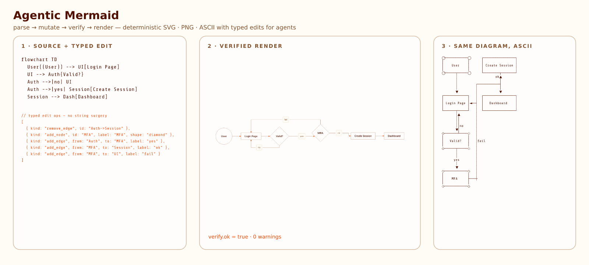

<div align="center">

# Agentic Mermaid

**Beautiful diagrams, made with your agent.**

Agentic Mermaid helps coding agents create styled diagrams from Mermaid source and edit existing diagrams through typed operations. Export SVG or PNG for documents, and ASCII or Unicode for terminal review.

It is forked from [`lukilabs/beautiful-mermaid`](https://github.com/lukilabs/beautiful-mermaid). Published on npm as `agentic-mermaid`; the GitHub repository is `adewale/agentic-mermaid`; the live site is [`agentic-mermaid.dev`](https://agentic-mermaid.dev/).



A login flow with MFA, rendered directly by Agentic Mermaid.
[Mermaid source](examples/styles/readme-hero.mmd) · [Style and reproduction command](examples/styles/readme-hero.md)

[Live Demo & Samples](https://agentic-mermaid.dev/) · [Live Editor](https://agentic-mermaid.dev/editor)

</div>

**Ask your coding agent:**

> Read `Instructions_for_agents.md` in this repository, or https://agentic-mermaid.dev/llms.txt if you don't have a checkout. Draw Browser → API → Database using the hand-drawn style and nord-light palette. Verify it, then return the Mermaid source and an SVG.

[Agent setup and skills](#agent-quick-start) · [Try the same diagram in JavaScript](#svg)

Docs: [docs index](./docs/) · [getting started](./docs/getting-started.md) · [agent guide](./Instructions_for_agents.md) · [agent API cookbook](./docs/agent-api-cookbook.md) · [design system](https://github.com/adewale/agentic-mermaid/blob/main/DESIGN.md) · [skills](./skills/) · [fork differences](./docs/fork-differences.md) · [vs Mermaid & Beautiful Mermaid](./docs/comparison.md) · [changelog](./CHANGELOG.md)

## Why Agentic Mermaid

Choose a built-in style, or keep your diagram's colors and fonts in a JSON style file. Inspect the rendered result before publishing.

| You want | Agentic Mermaid gives you |
|---|---|
| An agent to draft the diagram | Mermaid source plus a verified render path |
| Beautiful defaults | Built-in looks such as `watercolor`, `blueprint`, `hand-drawn`, and `publication-figure` |
| Brand fit | Style + Palette stacks and custom JSON palettes you can keep in your repo |
| Safe edits later | `parseRegisteredMermaid` → family narrower → `mutate` → `verifyMermaid` → `serializeMermaid` |
| Reviewable artifacts | SVG, PNG, ASCII, Unicode, and JSON layout from the same source |

The agent workflow is the guardrail behind the polish: agents should not guess from pixels, concatenate strings, or regenerate whole diagrams when a structured edit is available.

## Highlights

- **Discover supported diagrams and edits** — `am capabilities --json` reports what the installed version supports, including registered extensions.
- **SVG, PNG, ASCII, Unicode, JSON** — export images, review diagrams in the terminal, or inspect positions as JSON layout.
- **Render SVG without a browser** — the synchronous JavaScript API runs without a DOM or Puppeteer.
- **Composable styles** — `{ style: ['hand-drawn', 'dracula'] }` combines a look with a palette. Set colors, fonts, strokes, fills and backdrops in a [JSON style](./docs/style-authoring.md). `seed` re-rolls the ink, never the layout.
- **Match your editor's colors** — choose a built-in palette, theme from two colors, or adapt a VS Code theme with Shiki.
- **Agent-native editing** — use typed operations for modeled syntax. Inputs with unmodeled syntax retain their source; [source-preserving edits](./docs/agent-mutation-policy.md) cover selected Class and Flowchart operations.
- **CLI + MCP + library** — use `am`, connect `agentic-mermaid-mcp`, or import `agentic-mermaid/agent` for rendering and editing. See the [API reference](./docs/api.md) for the other library and browser entry points.

## Installation

Requires **Node.js 22 or later**, or **Bun 1.4.0 or later**. The package is ESM-only; use `import`, or dynamic `import()` from CommonJS.

```bash
npm install agentic-mermaid       # or: bun add agentic-mermaid / pnpm add agentic-mermaid
npx --no-install agentic-mermaid --help
```

The `am …` examples below name the published bin. After a project-local npm
install, invoke it from a shell as `npx --no-install agentic-mermaid …` (or
from an npm script as `am …`). From a source checkout, use
`bun run bin/am.ts …` instead.

## Output quick starts

Use `agentic-mermaid/agent` when you want one import path for styled renders, output formats, and the structured edit API.

### SVG

Save this as `diagram.mjs`:

```js
import { writeFileSync } from 'node:fs'
import { renderMermaidSVG } from 'agentic-mermaid/agent'

const svg = renderMermaidSVG(`flowchart LR
  Browser --> API --> Database`, {
  style: ['hand-drawn', 'nord-light'],
  security: 'strict',
})

writeFileSync('diagram.svg', svg)
```

```bash
node diagram.mjs
```

Open `diagram.svg` to see **Browser → API → Database** in the hand-drawn style with the `nord-light` palette.

### PNG

```ts
import { writeFileSync } from 'node:fs'
import { renderMermaidPNG } from 'agentic-mermaid/agent'

const png = renderMermaidPNG(`flowchart TD
  Start --> Done`, {
  fitTo: { width: 1200 },
  background: '#fff',
})

writeFileSync('diagram.png', png)
```

CLI equivalent:

```bash
am render diagram.mmd --format png --output diagram.png
```

### ASCII / Unicode

```ts
import { renderMermaidASCII } from 'agentic-mermaid/agent'

const unicode = renderMermaidASCII(`flowchart LR
  A --> B`)
const ascii = renderMermaidASCII(`flowchart LR
  A --> B`, { useAscii: true })
```

## Agent quick start

If your coding agent can read repo files, point it at:

- [`skills/agentic-mermaid-diagram-workflow/SKILL.md`](./skills/agentic-mermaid-diagram-workflow/SKILL.md) for diagram authoring/editing.
- [`skills/agentic-mermaid-live-editor/SKILL.md`](./skills/agentic-mermaid-live-editor/SKILL.md) for editor changes.

If it only has shell access:

```bash
am --agent-instructions
am capabilities --json
am preview diagram.mmd --security strict --open
am mutate diagram.mmd --op '{"kind":"set_label","target":"API","label":"API gateway"}' --json
```

For an existing diagram, follow parse → narrow → mutate → verify → serialize. For a new diagram, author Mermaid source, then parse and verify it. To wire Agentic Mermaid into another repo, run `npx agentic-mermaid init-agent` (or `bun run bin/am.ts init-agent` from a source checkout); it writes a non-clobbering `AGENTS.md` section, root `skills/` bundle, and `.mcp.json` sample.

Use strict `preview` for human inspection and `mutate --op/--ops` for verified one-shot or batched edits.

For multi-step MCP edits, use Code Mode `execute(code)` with the same `mermaid.*` SDK names. See the [agent API cookbook](./docs/agent-api-cookbook.md) for library, CLI and MCP recipes.

## MCP server

Agentic Mermaid ships a Model Context Protocol server so MCP-capable agents can render and safely edit diagrams without shelling out.

After installation, start the local stdio server:

```bash
npx --no-install agentic-mermaid mcp
```

Use the library, CLI or local MCP for private diagrams, offline work, larger inputs or local PNG files. The [MCP transport guide](./docs/mcp-http-transport.md) covers HTTP/SSE and file/URL artifacts; [agent setup](#agent-quick-start) shows how to generate a sample client configuration. The [tool reference and Code Mode guide](./docs/mcp-code-mode-rationale.md) explains the available tools and multi-step edits.

An optional public, unauthenticated MCP endpoint runs at `https://agentic-mermaid.dev/mcp`. It accepts MCP JSON-RPC rather than REST render requests, caps inputs at 64 KB and returns PNG as base64. Hosted calls send your source or code to the server; see the [privacy notice](./docs/MCP-PRIVACY.md). Directory maintainers can use the [MCP listing record](./docs/MCP-DIRECTORY-LISTINGS.md).

## Structured edit example

Change the API node's displayed label while keeping its connection to DB:

```ts
import { parseRegisteredMermaid, asFlowchart, mutate, verifyMermaid, serializeMermaid } from 'agentic-mermaid/agent'

const parsed = parseRegisteredMermaid('flowchart TD\n  API --> DB')
if (!parsed.ok) throw new Error('parse failed')

const flow = asFlowchart(parsed.value)
if (!flow) throw new Error(`not a structured flowchart: ${parsed.value.kind}`)

const next = mutate(flow, { kind: 'set_label', target: 'API', label: 'API gateway' })
if (!next.ok) throw new Error(next.error.message)

const verify = verifyMermaid(next.value)
if (!verify.ok) throw new Error(JSON.stringify(verify.warnings, null, 2))

const source = serializeMermaid(next.value)
console.log(source)
```

Output:

```text
flowchart TD
  API[API gateway] --> DB
```

The node ID is still `API`; its displayed label is now `API gateway`, and the `API → DB` connection remains. Verification checks for structural and geometry problems; review the rendered result and confirm it expresses your intent before saving.

Rules:

- Use the matching exported `as<Family>` narrower before mutating an existing structured diagram.
- Mutation ops use `kind`, not `type`.
- Run `verifyMermaid` before every commit point.
- Do not call `mutate` on opaque fallback bodies; the narrower returns `null` for unmodeled syntax.
- For opaque Class/Flowchart inputs, bounded [source-preserving edits](./docs/agent-mutation-policy.md) support Class `add_member`/`remove_member` and Flowchart `set_label`/`rename_node`. Use `mutatePreservingSource`, `applyOps` with `mode: 'source-preserving'`, or CLI `--preserve-source`; MCP and the editor worker expose the same explicit mode. Save exact source and inspect the retained portability diagnostics; ambiguous ownership and unsupported dependencies refuse atomically.

## Supported diagram families

Run `am capabilities --json` for the supported families and edit operations in
your installed version. See [diagram families](./docs/diagram-families.md) for
syntax examples and compatibility notes.

## More documentation

- [System architecture](https://github.com/adewale/agentic-mermaid/blob/main/docs/design/system/README.md) — how Mermaid source becomes a diagram, from parsing to layout and output.
- [API reference](./docs/api.md) — renderers, agent API, options, CLI/MCP pointers.
- [Vocabulary](./docs/api.md#vocabulary) — families, source objects, Scene parts, resolved primitives and typed-family narrowing.
- [Agent API cookbook](./docs/agent-api-cookbook.md) — practical recipes for agents.
- [Theming](./docs/theming.md) — two-color themes, built-ins, Shiki compatibility.
- [Custom style cookbook](./docs/custom-style-cookbook.md) — JSON style files, screenshots, schema usage, and CLI commands.
- [Fonts in custom styles](./docs/custom-fonts.md) — font selection, SVG declarations, PNG directories, fallbacks, and browser usage.
- [React integration](./docs/react.md) — browser-safe, family-loaded rendering.
- [ASCII output](./docs/ascii.md) — terminal output, color modes, XY charts.
- [Mermaid config](./docs/config.md) — frontmatter, init directives, runtime config.
- [Features](./docs/features.md), [quality](./docs/quality.md), [security](./SECURITY.md), [fork differences](./docs/fork-differences.md).
- [Adding diagram types](https://github.com/adewale/agentic-mermaid/blob/main/docs/contributing/adding-diagram-types.md) for contributors.

## Live editor and examples

- [Examples](https://agentic-mermaid.dev/examples/) — supported families, Style + Palette combinations, and the rich shared examples corpus.
- [Live editor](https://agentic-mermaid.dev/editor) — SVG/PNG exports and URL sharing.
- [`examples/agent-loop.ts`](https://github.com/adewale/agentic-mermaid/blob/main/examples/agent-loop.ts)
- [`examples/mcp-vs-cli-complex-diagrams.ts`](https://github.com/adewale/agentic-mermaid/blob/main/examples/mcp-vs-cli-complex-diagrams.ts)
- [`examples/agent-improve-auth-flow.ts`](https://github.com/adewale/agentic-mermaid/blob/main/examples/agent-improve-auth-flow.ts)

## Contributing and reporting bugs

[Report a bug](https://github.com/adewale/agentic-mermaid/issues) with the Mermaid source, render options and the result you expected. For changes to the project, read the [contributor instructions](https://github.com/adewale/agentic-mermaid/blob/main/CLAUDE.md) for implementation and testing rules.

To work from a source checkout, use Bun 1.4.0 or later:

```bash
git clone https://github.com/adewale/agentic-mermaid
cd agentic-mermaid
bun install
bun run build
bun run bin/am.ts --help
bun run bin/agentic-mermaid-mcp.ts   # MCP stdio server
```

## Attribution

Agentic Mermaid is a fork of Beautiful Mermaid by [Luki Labs](https://github.com/lukilabs/beautiful-mermaid). The ASCII rendering engine is based on [`mermaid-ascii`](https://github.com/AlexanderGrooff/mermaid-ascii) by Alexander Grooff and extended for Agentic Mermaid.

## License

MIT

Native Event Modeling and ZenUML authoring and rendering have documented
[capability and runtime contracts](docs/eventmodeling-and-zenuml.md).
