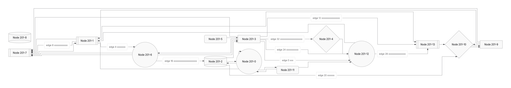
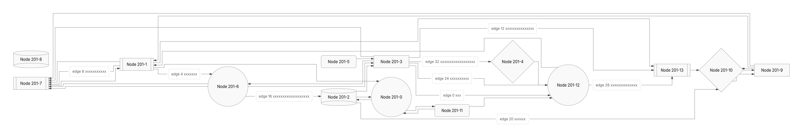

This PR preserves the PR449 ownership/capture foundation and fixes selected layout refusals, marker occlusion, forest/Requirement geometry and worker packaging. Native improves most flowchart geometry in the fixed comparison below, but Class retains adverse area cases and both engines retain shared delivery limits. **The PR remains draft. General ELK replacement, CPU speedup and bundle reduction are not established.**

Current head: `ce15c91b929ccfdfe338e79df8b6a97aaee2e8fa`. Integrated main: `9fb35b8bf8dc654a19612de3cc6a50144d68b0a7`. The requested merge-preserving rebase completed without changing the prior head/tree; main had no new commits. The current head only fixes the worker test harness and records the comparison. Automated campaign and deadline report remain disabled.

## What improves

Frozen main9fb → PR780 calls consumed complete SVGs and receipts. These are selected demonstrated gains, not a final-head workload ranking:

| Input | Main → PR |
| --- | --- |
| ER208 chain, default and Native | 400k geometry refusal → delivered SVG;208 identities/207 relationships |
| Nonlinear forest, default and Native | Area−26.98%, wire−37.60%; eight bends unchanged |
| Native Sparse256 | Area−77.05%; connected wire unchanged |
| Native RequirementTB | Area−22.95%, wire−8.56%; eight bends unchanged |
| Raw hollow-circle marker | Selected paint contribution0→225 pixels; proof remains unverified |
| ER256 chain | Both still refuse at the unchanged cap |

Later selected repairs remove SHA201/241 head overlaps (each4hidden/12attenuated pixels→0/0) and SHA152's shaft/card overlap (122hidden→0). The62d comparison records76 proof upgrades and no downgrades/refusal changes across874Native inputs, with mixed area/wire/bend costs. Those are not76 independently proven visible repairs.

The subsequent cleanup releases completed construction evidence, centralizes route publication and endpoint reversal, and makes write completion/abort and proof identity explicit. A reproduced reentrant-publication regression is fixed. Its eight checked SVGs/receipts stay exact; no new visible-layout gain is claimed. [Cleanup evidence and rejected optimization](https://github.com/adewale/agentic-mermaid/tree/a67cfe19edeef8bd29bf617192e97050d53d53d2/invariant-plan-433b-20261107).

## Current Native versus ELK

The exact433b CI artifact supplies874identical input/options pairs with explicit backend and fallback none. Both deliver874SVGs. Native/ELK final-receipt proof:740/696passed and134/178unverified. These statuses are separate from the projected geometry:

| Lower is better | Native lower | Equal | ELK lower |
| --- | ---: | ---: | ---: |
| Area | 667 | 141 | 66 |
| Route length | 644 | 150 | 80 |
| Bends | 500 | 221 | 153 |
| Crossings | 645 | 228 | 1 |

The population is mostly generated cyclic flowcharts. Class area improves in8/40 cases and worsens in13. Native retains6crossings versus ELK4 on `generated-cyclic:276`. Geometry vectors do not prove authored meaning or final visible ink.

Twelve new public calls retain the sharedER256 refusal and unverified raw circle; all ten returned SVGs bind exactly to retained integration controls. Current forest versus ELK: area−6.43%, wire+10.19%; Sparse256 area+5.04% (the+.97% candidate is unshipped). First-render timings/RSS and actual gzip9/Brotli11 product bytes are reported separately, without speedup ratios.

[Full comparison, counterexamples, costs and pipeline proposals](https://github.com/adewale/agentic-mermaid/blob/817d3a68cdf6db380f8adbaf8c9ad46da277dfdd/compare-rebase-433b-20261107/REPORT.md).
[Original artifact, literal jobs, products, bindings and logs](https://github.com/adewale/agentic-mermaid/tree/817d3a68cdf6db380f8adbaf8c9ad46da277dfdd/compare-rebase-433b-20261107).
[Profile-first performance review and cache inventory](https://github.com/adewale/agentic-mermaid/blob/ce15c91b929ccfdfe338e79df8b6a97aaee2e8fa/docs/design/system/layout-0.6-performance-review.md).

## Verification and remaining costs

The current test-only fix models DOM removal after successful worker decoding. The introduced CI failures reproduce locally (5pass/2fail); the complete repaired owner passes44tests/296assertions. Cancellation and invalid decoding retain the payload. Core types and canonical lint pass. No runtime or pixels change in this checkpoint.

Earlier cleanup owners: retention/write52pass; route/context779pass with18missing-jsdom checks; actual standalone browser2pass/505assertions. Final HTML versus62d costs+222raw/+372gzip9/+202Brotli11 bytes. The flat crossing-storage trial is unshipped because fully consumed timing was adverse despite its sampled helper improvement.

[Compared-head CI42380534166](https://github.com/adewale/agentic-mermaid/actions/runs/42380534166) completed failure: known Sparse32 proof cap, lazy payload/advisory failures, plus the two worker mock failures repaired here. Current-head CI needs completion and qualification. This PR is not ready to merge.

Unverified outputs, oversubscribed endpoint constraints and sharedER256 refusal remain. Original2dad/Trident/pinned Mermaid12.2/Pele1.9 remain unavailable. Replacement24 stays sealed. No backend-default/version change, cap increase or new cache.

## Visual evidence

PR baseline SHA: `9fb35b8bf8dc654a19612de3cc6a50144d68b0a7`.
Current PR head SHA: `ce15c91b929ccfdfe338e79df8b6a97aaee2e8fa`.

The latest checkpoint changes the test harness and log only. Earlier [201 before](https://github.com/adewale/agentic-mermaid/blob/ecfc69324aabf41fa39dca4e831f6cce08c42169/stopped-62d-20261107/before201.png)/[after](https://github.com/adewale/agentic-mermaid/blob/ecfc69324aabf41fa39dca4e831f6cce08c42169/stopped-62d-20261107/after201.png) and [241 before](https://github.com/adewale/agentic-mermaid/blob/ecfc69324aabf41fa39dca4e831f6cce08c42169/stopped-62d-20261107/before241.png)/[after](https://github.com/adewale/agentic-mermaid/blob/ecfc69324aabf41fa39dca4e831f6cce08c42169/stopped-62d-20261107/after241.png) show selected endpoint ink. Owned-pixel measurements have that limited scope; whole-diagram readability remains separate.
Selected repair `generated-cyclic:201`, Native, fixed input/options:
render base `780b5f1b04ac7ac5db35cdd442d98df652daf17d` →
render head `62d521fbce155cdd3de928ec62fc5222fa3a8482`.
Compare the crowded endpoint heads; the selected hidden/attenuated pixels fall
from4/12 to0/0. This is historical repair evidence, not a new comparison result.

