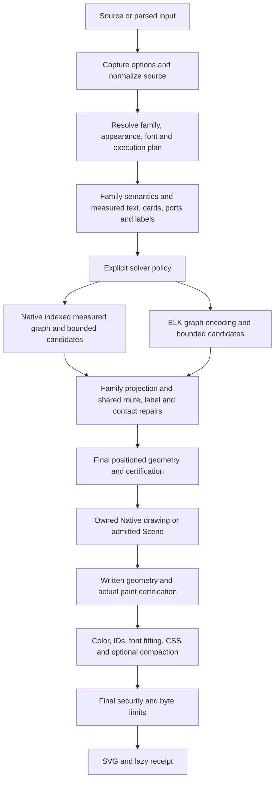

# Native and ELK at the same PR602 revision

Native is stronger on most measured flowchart geometry in this population.
ELK retains real counterexamples, particularly Class area. Both share delivery
limits downstream of placement. This comparison supports continuing targeted
repairs; it does not establish general replacement or a runtime speedup.

Compared source: `433b523b86f9017960d8004f3c776d9d8d82dbce`.
Main fetched afterwards: `9fb35b8bf8dc654a19612de3cc6a50144d68b0a7`.
The merge-preserving rebase completed with the same head and tree.
An initial plain rebase tried flattening historical merge ancestry and stopped
on an old documentation conflict; it was aborted without retaining changes.
The successful operation used `git rebase --rebase-merges origin/main`.
Backup: `backup/pr602-pre-rebase-20261107-433b`. No force push.

## Fixed comparison

The exact-head CI artifact supplies 874 unique literal inputs, each rendered
with identical options except explicit graph backend. Every receipt selected
the requested backend with fallback none. Source/ID/family/options match.
No original2dad, Trident, Mermaid12.2 or Pele1.9 comparison was recovered.

Artifact13577493020 from
[CI42380534166](https://github.com/adewale/agentic-mermaid/actions/runs/42380534166):
`generated-layouts-433b523b86f9017960d8004f3c776d9d8d82dbce`.
ZIP SHA256:`c43ea8e9a9ba7f98082e538d8dfc45a5e1d16aac5f9e42327f323ab64dbac957`.
The generated ZIP snapshots record this source revision and dirty=false.
This reuses completed results; it is new synthesis, not new rendering progress.

| Measure, lower is better | Native lower | Equal | ELK lower |
| --- | ---: | ---: | ---: |
| Area | 667 | 141 | 66 |
| Total route length | 644 | 150 | 80 |
| Bends | 500 | 221 | 153 |
| Crossings | 645 | 228 | 1 |
| Label conflicts | 41 | 833 | 0 |
| Opposing route overlap | 28 | 846 | 0 |
| Parallel route overlap | 247 | 627 | 0 |

Both delivered final SVG in874/874. Final SVG receipt certification, separately:
Native740passed/134unverified; ELK696passed/178unverified. Paired statuses:
663P/P,101U/U,77P/U,33U/P. A passed certificate still has its stated coverage and
font/transparency limitations. The area/wire/crossing vectors come from the
positioned projection; they are not an independent final-ink or authored-meaning
oracle. Counts agree for nodes/edges in every pair, which alone proves neither.

Population:770flowchart,22state,40class,27ER,12architecture,3requirement.
Most inputs are generated cyclic flowcharts; the totals are not a workload
prevalence estimate. Area lower/higher by family:

| Family | Native lower | ELK lower |
| --- | ---: | ---: |
| Flowchart | 628 | 47 |
| State | 8 | 3 |
| Class | 8 | 13 |
| ER | 18 | 3 |
| Architecture | 2 | 0 |
| Requirement | 3 | 0 |

Counterexamples remain enrolled:

- `generated-cyclic:276`: Native6crossings versus ELK4; both certificates passed.
- `corpus/class/2`: area85,680 versus61,400, route length60 in both.
- `generated-cyclic:277`: area1,026,873.87 versus770,020.78;
  wire15,119.58 versus13,523.53; bends82 versus81.

The report HTML's built-in composite verdict is retained for browsing, but
the separate vectors above determine no new acceptance gate. Zero measured
label-conflict regressions does not imply zero visible collisions.

## Fresh public calls and costs

Twelve fresh public calls consume the complete SVG and entire receipt.
Five inputs return under both engines; ER256 refuses under both. All ten returned
SVGs exactly match their existing `main-9fb-integration/frozen-controls-refined`
controls. This binds previous selected output observations; it adds no new raster
or comprehensive authored-meaning qualification.

- Forest: current Native area165,355.6575 versus ELK176,727.21 (−6.43%);
  current wire436.857166666 versus396.469666666 (+10.19%); eight bends each.
  The earlier+16.89% wire result predates the retained shortening repair.
- RequirementTB: final canvas461.893×499.45 versus481.1416×535.3 (−10.43% area).
  The earlier+9.53% area loss is historical.
- Sparse256:1831×1984.5 versus2300×1504 (+5.04% area). The+.97% candidate is unshipped.
- ER208: both deliver with passed proof; ER256: both refuse with
  `ER_ROUTE_WORK_LIMIT`, frame corridor checks exceed400000.
- Raw fan/circle: both deliver the identical SVG, both remain unverified for a
  potential endpoint-marker occlusion. Delivery and certainty are separate.

Node24.19.0/Linux; cache0; first render after public module import. Timer includes
complete product consumption; import and offline compression are excluded.
Each arm has one process/sample. RSS is whole-process high water, not incremental
solver heap. These observations establish no repeat/cache/edit ratio or leak.

| Input | Native / ELK wall ms | Native / ELK peak RSS KiB |
| --- | ---: | ---: |
| Forest | 244.9 / 494.4 | 197,920 / 214,768 |
| RequirementTB | 183.7 / 289.5 | 203,592 / 215,432 |
| Sparse256 | 454.5 / 927.8 | 258,856 / 327,152 |
| ER208 | 804.4 / 2,199.6 | 320,400 / 554,412 |
| Raw circle | 208.5 / 440.2 | 198,572 / 213,644 |
| ER256 refusal | 246.9 / 1,026.7 | 262,304 / 304,692 |

`COSTS.json` contains process CPU and actual gzip9/Brotli11 compressed SVG and
full-product bytes. Refusals have no output payload. Heap is unmeasured here.
Selected full-product compressed bytes retain small adverse changes as well:

| Input | Native / ELK gzip9 bytes | Native / ELK Brotli11 bytes |
| --- | ---: | ---: |
| Forest | 2,685 / 2,681 | 2,271 / 2,269 |
| Sparse256 | 14,902 / 14,477 | 7,712 / 7,744 |
| ER208 | 41,685 / 41,770 | 26,828 / 26,856 |

The existing dated performance review retains cold/cache/edit distinctions,
self/inclusive sampled hotspots and cache inventory. Its timings are not
silently rebound to this source. No optimizer or cache was added.

## Reconsidering the complete shared pipeline

Graph solver selection, drawing representation and proof status are separate
decisions. A Native-labelled Class request still uses its Scene admission path;
an ELK placement can feed the same native drawing writer as Native placement.

There is also private positioned reuse before family production, selected solver
result reuse, and completed drawing reuse. Identity, options, custom metric
authority and mutable/extension producer isolation govern whether reuse is valid.
Terminal-cell layouts stay in their own adapters; pixel companion decisions are
recorded separately. PNG consumes the final secured SVG, not a solver result.

| Boundary | Existing owner and obligation | Consequence for changes |
| --- | --- | --- |
| Request admission | `render-contract.ts:615`, immutable capture and private execution plan; source normalization and exact family identity | Never replace getter capture with an identity-only key. Preserve UTF16 and diagnostics. |
| Text and family geometry | `text-measurement-profile.ts:75`; family layout hooks; prepared text and painted card/marker dimensions | Share facts, not one universal family representation. Host font authority must survive both solver projections. |
| Solver policy | `layout/backend.ts:58`; typed unsupported/candidate-rejected fallback only | A shared consumer error is not permission to silently run ELK or replenish a work cap. |
| Graph production | `layout/agentic-producer-core.ts:123`, `layout-engine.ts:2072` | Native has an indexed measured representation already; ELK requires a different schema. Same source does not imply identical backend-specific reservations. |
| Shared final geometry | `layout-engine.ts:1799`, `er/layout.ts:1324`; Class/Requirement own specialized surfaces | Find the first stage causing a loss before changing the solver. |
| Public positioning | `positioning.ts:76`; final projection, owner-isolated private borrow or public clone | Retained projection and certificate do not authorize exposing mutable cache geometry. |
| Drawing and write | `scene/positioned.ts:91`, `scene/serialization.ts`; owned bytes, exact proof continuation, complete/abort | Preserve first capture and actual-write evidence. A helper certificate cannot replace written-output evidence. |
| Final product | `graphical-render.ts:218`; late rewrites before final security and byte limits | Removing an earlier inspection is safe only if its consumer gets equivalent authoritative facts. No security check is removed. |
| Receipt | `graphical-render.ts:333`; existing lazy build releases its builder after consumption | SVG-only calls already avoid receipt materialization. Another receipt cache or API split would duplicate existing behavior. |

## Proposed work, in priority order

1. **Reduce shared ER corridor work.** Both engines reach the same400k refusal in
   `finishErGeometry`. It already has `erInkIndex` for several interaction sets,
   while final raw-segment/card and shaft/card checks still traverse all entities
   (`er/layout.ts:1637`, `:1667`). Use the existing index only if a charged
   broad-phase intervention actually saves enough total work to admit ER256.
   Keep incident terminal, open-boundary, rounded border, group/header and label
   obligations. Preserve refusal if the causal ceiling remains insufficient;
   prior stopped ER shortcuts are evidence against assuming an easy win.
   Expected time/memory saving: unmeasured. This could improve both engines'
   delivery; a cap increase would conceal the cause.

2. **Reuse family measurement across candidate encodings, without growing a new
   global cache.** Generic graph candidates reconstruct group membership,
   endpoint indices and demand as ordering/placement alternatives are tried.
   Requirement already prepares cards/labels before branching, and Native
   already has numeric endpoints. Follow those existing producers: retain one
   request-owned immutable fact set and generate the solver's disposable input
   from it. Start with the Class area counterexample to identify whether its
   excess is required port capacity or avoidable placement. Do not force equal
   box dimensions when one engine needs larger safe painted capacity.
   Verify the first differing measured input and final output. Speedup and
   memory reduction require a measured duplicate; none is claimed here.

3. **Subtract duplicate consumers of owned facts.** The existing profile puts
   Scene snapshot/admission and paint certification ahead of speculative hash
   packing. Keep the first mutable capture, then trace which completed consumer
   still rereads the same admitted data. The existing write ledger, route commit
   helper, private index views and completed-product release are the starting
   points. Preserve actual geometry checks after mutations: the pass runner
   snapshots even allegedly edge-only changes because declarations can be wrong.
   A SoA rewrite or trust in a `mutates` declaration alone is insufficient.
   The previous flat crossing trial lost end-to-end time despite improving its
   sampled helper; do not resume it unchanged.

4. **Make ELK runtime setup failure-safe.** `elk-instance.ts:41` temporarily
   replaces global timer/document state during initialization; `:147` replaces
   a worker response handler around synchronous dispatch. Their restoration is
   currently sequential after calls that can throw. Establish throw-path
   reproductions before adding narrowly owned try/finally and an explicit
   initialization reset. This is an identified unenforced restoration invariant,
   not a profiled performance hotspot. Keep this separate from solver tuning.

5. **Remove unwanted imports at package boundaries, measured on built output.**
   Shared interfaces must remain engine-free; Native-only helpers belong to the
   optional solver chunk. Existing lazy payload ceilings fail even for families
   that use neither graph engine, so replacing ELK cannot explain the whole
   download cost. Use the existing lazy bundle report's dependency closure to
   locate the newly shared import before moving helpers. Report native-only,
   ELK-only and engine-free payloads separately; default/fallback support remains
   unchanged. This review has not established a byte-saving intervention.

No new qualification framework, packed index scheme, broad SoA conversion,
cache, backend-default change or layout cap change follows from this review.
The next useful implementation would be one demonstrated causal subtraction
with affected ownership/output contracts requalified, not a campaign restart.

## Verification and limitations

The compared CI completed failure. Unit3 contained two introduced worker VM
mock failures; local named reproduction had5P/2F. The fixed DOM harness passes
the complete owner44P/0F/296assertions and enforces payload removal on success,
retention through cancellation and retention on invalid decode. Runtime source
is unchanged. Core typecheck and canonical lint pass. Full CI remains required
for the new test/log-only head; Sparse32, advisory and lazy payload failures remain.

The original comparison ZIP, all rows and failures, twelve literal jobs, full
products, first-call cost records, compression results, red/green logs and the
existing HTML report regeneration path are retained. No tests were replayed as
visible-correctness progress. The automated campaign remains stopped.
