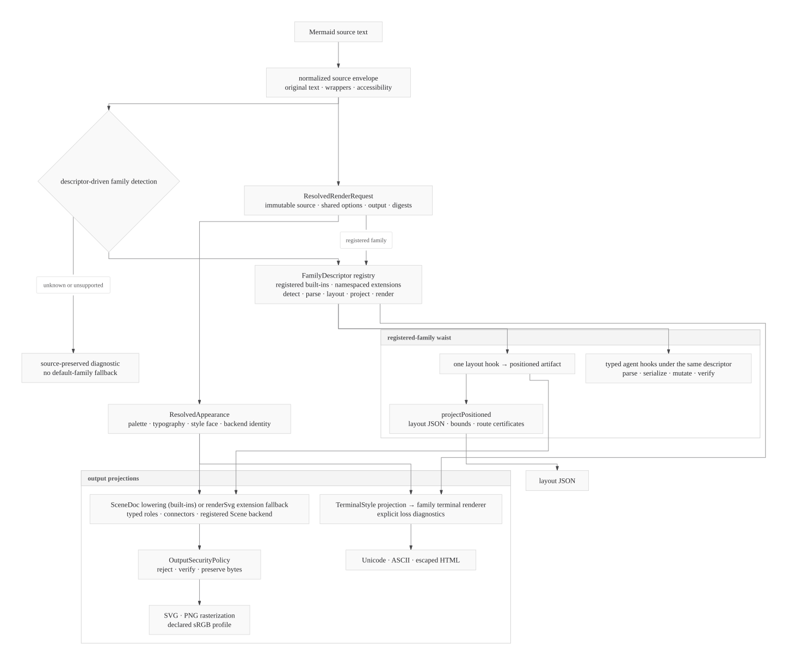

# System architecture — start here

Mermaid source passes through a shared request and family registry, then a
family-specific layout and output adapter. This page explains that path. For
library usage, start with [Getting started](../../getting-started.md).



The parser normalizes source once, and the `FamilyDescriptor` registry selects
the diagram family. The descriptor owns that family's parsing, editing, layout
and output hooks. Unknown or unsupported headers retain their source and receive
a diagnostic. Discovery commands and generated capability tables use this same
registry.

A `ResolvedRenderRequest` combines the source with output options, style and
security policy. The family layout hook produces a positioned artifact: nodes,
connections, labels and bounds. Layout JSON projects that artifact without
parsing or laying it out again. Output receipts record which request and
appearance produced the result.

Graphical output uses a family renderer or lowers drawing parts through a Scene
backend. Both paths pass through `OutputSecurityPolicy` before returning SVG.
PNG rasterizes secured output. Terminal rendering has its own cell grid and
encoding rules; it preserves authored meaning without promising the same pixel
positions as the graphical layout.

Geometry checks and final-paint checks have different scopes. A layout may be
refused, and a rendered image may have an `unverified` paint receipt. See
[quality](../../quality.md) for those boundaries and the
[API vocabulary](../../api.md#vocabulary) for the types used along this path.

## Reproduce the architecture figure

The diagram is authored as Mermaid ([`architecture.mmd`](./architecture.mmd)) and
rendered to [`architecture.svg`](./architecture.svg) **by our own renderer**.
Re-render it after changing the source:

```
bun run bin/am.ts render docs/design/system/architecture.mmd --format svg --output docs/design/system/architecture.svg
```

## Follow the code

| Stage | Owner | Responsibility |
| --- | --- | --- |
| Resolve a request | `src/render-contract.ts` | Normalize options, appearance and output identity. |
| Select a family | `src/agent/family-registry.ts` | Own detection and declared parser, editing, layout and output hooks. |
| Produce geometry | `src/positioning.ts` and family layout hooks | Position one artifact for projection and verification. |
| Lay out Flowchart/State graphs | `src/layout-engine.ts` and `src/layout/` | Run placement, route repairs and final geometry checks. |
| Draw and secure output | `src/graphical-render.ts`, `src/scene/`, `src/output-security.ts` | Produce SVG or raster output within the selected backend and security contract. |
| Project terminal output | `src/ascii/` | Preserve meaning using terminal cell geometry and encoding. |

## Read by topic

- [`layout-backends.md`](./layout-backends.md) — explicit ELK and Agentic graph producers, fallback evidence, and comparable measurements.
- [`route-contracts.md`](./route-contracts.md) — the flowchart routing engine (edge classification, direct-lane proofs, certifying straightener).
- [Layout-pass audit](./layout-pass-audit-2026-10-29.md) — all 25 repair passes, order counterexamples, constraints, and staged refactoring recommendations.
- [`layout-rubric.md`](./layout-rubric.md) — the deterministic layout-quality rubric.
- [`chart-honesty.md`](./chart-honesty.md) — what every family owes its reader (legible, contained, drawn-or-reported, style-invariant text; distinguishable peers; proportional quantities), measured on the rasterized output and bound to the registry.
- [`layout-guarantees-and-robustness.md`](./layout-guarantees-and-robustness.md) — literature + industry synthesis: which invariants we can guarantee by construction vs. only optimize-and-certify, and the path to fuzz-robustness.
- [`source-preservation-ladder.md`](./source-preservation-ladder.md) — the structured\|opaque family-adoption contract (L0–L4).
- [`Agent editing`](../../../AGENT_NATIVE.md) — determinism, source preservation and verification scope.
- [`Testing strategy`](../../testing-strategy.md) — behavior checks, visual review and remaining gaps.

Per-family implementation notes live in [`../families/`](../families/README.md).
The [project index](../../project/README.md) separates active plans from historical
records. Dated backend experiments, including the PR #449 studies, retain their
original revisions and limitations; start with [layout follow-up results](layout-followup-results.md)
when investigating that research. For performance comparisons, use the
[measured results](https://github.com/adewale/trident/blob/main/RESULTS.md).
