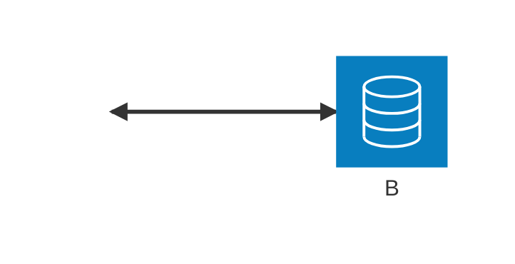

# Endpoint markers and geometry authority

Issue [#258](https://github.com/adewale/agentic-mermaid/issues/258) asks whether
the visible endpoint symbol, routed shaft and connection surface agree. They
are three separate observations. A route certificate computed from the same
wrong bounds as the router cannot establish agreement with the drawing.

## The reproduced defect



At main revision `009159f93e6cea53f97ca53e416cf66b130c8e49`, the graph adapter
allocates a 28px State pseudostate for this junction. Architecture draws a
16px ring at that allocation's centre. Routing and public layout both use the
28px allocation, so the shaft and visible arrow tip stop **6px outside the
ring**, while the route certificate says the endpoint is anchored. A configured
larger ring reverses the error: the endpoint can fall inside the ring.

This matters for ordinary branching diagrams, independently of any comparison
with Mermaid. It is an instance of two related failure modes:

- A marker's reference point differs from its intended contact point. Stroke
  units, viewport scaling and rotation turn that difference into a visible
  offset even when the shaft endpoint is correct.
- The layout allocation is mistaken for the drawn connection surface. Marker
  anchoring can be correct while both shaft and symbol miss the visible node.

The original Architecture reference-point suspicion is already fixed at that
revision: `tipAnchoredArrow` constructs the triangle and reference from the
same tip. Journey's `refX=9` and tip at `10` are still different, but its
score guide ends freely; the overhang is not a disconnected node attachment.

## Geometry ownership

Architecture resolves the junction radius once and passes it through its
existing layout metrics. An internal graph-placement `nodeSizes` map reserves
the diameter plus 6px clearance on each side. This keeps the default allocation
unchanged and gives larger configured rings sufficient placement room.

The Architecture adapter extracts the tight ring bounds at that allocation's
centre. Those retained bounds then belong to alignment, side constraints,
group fitting, ports, obstacles, public layout and route certificates. The
renderer draws the outer radius from the retained width. It does not recreate
connection geometry from a separate visual default. Clearance remains a
placement concern rather than an invisible connection surface.

The change adds one map entry and constant work per junction. It does not add
an intersection search, a second layout pass, or a runtime audit of every
marker. The existing typed Scene resources, retained positioned artifacts and
shared marker constructor are adequate primitives. The missing abstraction
was a small internal input for family-owned placement dimensions; a universal
cross-family clipping framework is unnecessary here.

## Marker meanings and owners

The registry-enrolled Scene corpus supplies the resource and use sets in
`scene-fidelity.test.ts`. Its contact characterization rejects unknown marker
meanings and checks strict reference-point contracts. This table explains the
current families; it is not a second registration list. Sizes below are local
marker coordinates, before units and transforms. Unless specified otherwise,
there is no viewBox and SVG's default `strokeWidth` units apply.

| Family / source owner | Resources and local contact | Orientation / units | Intent and ordinary exercise |
| --- | --- | --- | --- |
| Flowchart, [graph-connectors.ts](../../../src/graph-connectors.ts) | Arrow start `(0,2.5)`, end `(8,2.5)`; circle/cross have separate envelope contracts. Fixed-width arrow variants are 8×8. | `auto`; explicitly styled-width variants use `userSpaceOnUse`. | Surface-bound. `flowchart LR; A <--> B`; circle/cross owning raster tests preserve their distinct ink semantics. |
| State, [graph-connectors.ts](../../../src/graph-connectors.ts) | Same arrow constructor and tip contracts. | Same as Flowchart. | Surface-bound. `stateDiagram-v2`, `A --> B`. |
| Sequence, [renderer.ts](../../../src/sequence/renderer.ts) | Filled/open/half/stick arrow tips `(8,2.5)`; destruction cross is centred at `(4,2.5)`. | Arrows `auto-start-reverse`; cross `auto`. | Message-path endpoints with lifeline/activation policy. `A->>B: message`, `A-xB: destroy`; half/stick cases are in browser parity tests. |
| Class, [renderer.ts](../../../src/class/renderer.ts) | Inheritance tip `(12,5)`; diamond corner `(13,6)` in 14×12 viewBox; open arrow `(8,3)`; lollipop tangent `(12,7)` for centre `(7,7)`, radius 5. | `auto-start-reverse`. | Surface-bound with relationship-specific projection. `A --|> B`, `A *-- B`, `A --() B`; Class geometry tests exercise both authored ends and all directions. |
| Journey, [renderer.ts](../../../src/journey/renderer.ts) | 10×8 path, tip `(10,4)`, reference `(9,4)`. | `auto`. | Free score-axis termination, not node contact. A two-task Journey verifies the overhang equals one local unit times the axis stroke width. |
| Architecture, [renderer.ts](../../../src/architecture/renderer.ts) | Start `(0,2.5)`, end `(8,2.5)`, same shared tip constructor. | `auto`. | Service cards, junction rings or explicitly selected group frames. Public SVG tests measure each surface independently. |
| Gantt, [renderer.ts](../../../src/gantt/renderer.ts) | Dependency tip `(8,3.5)`; ordinary/critical paint variants have the same geometry. | `auto`. | Bar or milestone attachment; opt-in `dependencyArrows`. Existing dependency tests cover up/down/gutter and milestone cases. |
| C4, [routing.ts](../../../src/c4/routing.ts) and [renderer.ts](../../../src/c4/renderer.ts) | Shared graph arrows with start/end tip contracts. | `auto`. | Surface-bound relationship endpoints; C4 final-SVG quality checks cover cards and route repair. |
| Requirement, [renderer.ts](../../../src/requirement/renderer.ts) | Arrow `(9,3.5)`; contains notation is a circle/cross at `(6,6)`, radius 5, referenced at `(0,6)`. | `auto`, `userSpaceOnUse`. | Arrow meets its surface. Contains is a relationship symbol with its own spacing, not a triangle-tip contract. |
| Ishikawa, [renderer.ts](../../../src/ishikawa/renderer.ts) | Shared arrow tip `(8,4)`. | `auto`, `userSpaceOnUse`. | Effect spine terminates at the effect surface. |
| Block, [renderer.ts](../../../src/block/renderer.ts) | Arrow start/end `(0,3.5)` / `(8,3.5)`; circle/cross reference their centre `(4.5,4.5)`. | `auto`, `userSpaceOnUse`. | Arrow contact and centred endpoint decorations are different contracts. |

ER cardinalities are inline drawing primitives, not SVG marker resources.
They remain part of the endpoint-writer review below. The remaining registered
families in this corpus do not produce SVG marker resources.

## Final endpoint writers

These are the writers that must be considered after initial placement; marker
definitions alone do not settle their geometry.

| Owner | Geometry chain and special policy |
| --- | --- |
| Flowchart / State | Graph extraction, route-contract/layout passes, clipping and final route closing, then graph connector projection. State pseudostate geometry stays State-owned. |
| Class | Class extraction and namespace/header avoidance; interface/lollipop relationship projection; title translation; rounded connector and marker-overlay lowering. |
| ER | ER extraction, group separation and frame-route repair, title translation, then inline cardinality artwork. |
| Architecture | Graph placement, tight ring extraction, alignment, side constraints, group fitting, endpoint resolution/routing, label separation, title translation, rounded-path lowering, then public certificate projection. |
| C4 | Route contracts, obstacle repair, label repair/separation and final route closing before renderer projection. |
| Sequence | Chronology, lifelines, activation boundaries and self-message routing; these are not generic node boxes. |
| Gantt | Renderer-owned opt-in dependency overlay routes against positioned bars/milestones. |
| Journey | Score-guide placement and free-axis marker lowering. No node surface is promised. |
| Requirement | Family layout/extraction, title translation and rounded connector lowering; contains notation retains its own spacing. |
| Block | Authored grid placement, routes through-node repair, actual-shape endpoint pullback and label allocation. |
| Ishikawa | Family spine/branch placement followed by effect-spine marker lowering. |

The neutral SVG marker serializer and Scene bounds machinery subsequently
apply viewBox scaling, reference subtraction, marker units and carrier
orientation. Styled backends consume the same retained resources. The
browser/native parity suite independently exercises start reversal, nonzero
viewBoxes, clipping, stroke units and rotated carriers; it is not replaced by
the family contract table.

## Evidence and limits

`endpoint-marker-contact.test.ts` reads the final public SVG and independently
measures both shaft-to-surface and transformed-marker-contact-to-surface error.
It does not reuse the production clipper, Scene marker bounds or certificate
math. Its junction cases combine all four faces, source/target positions,
default/custom radius, default/hand-drawn style, nesting, alignment and titles.
Public circle dimensions are bound to the emitted ring, so a certificate
computed from the wrong allocation cannot bless the drawing.

The registry contact test and the existing Class/Flowchart/raster tests cover
different boundaries. Passing them does not prove that every possible route,
custom external marker, extreme style combination or future resource is
correct. In particular, a resource-reference check alone does not prove that
its carrier reached the intended surface. No claim of universal endpoint
correctness follows from this audit.

Reviewed golden changes are limited to
`testdata/layout-geometry-baseline.json`'s `corpus/architecture/4` junction
diagram and `testdata/svg/architecture-representative.svg`. They now record
tight 16px junction bounds, correct contacts and consequent side-constraint /
group-fitting adjustments. Unrelated corpus geometry must remain unchanged.

For immutable same-source SVG, native-size PNG and public-layout evidence:

```sh
bun run scripts/pr-assets/meaning-preservation-evidence.ts BASE_SHA HEAD_SHA OUT_DIR \
  architecture-junction-contact architecture-junction-custom-contact
```

The two revisions must be full commit SHAs. The script renders production APIs
in isolated checkouts; the source and evidence sidecars accompany the images.
Generated evidence is not a test oracle and is not committed to the source tree.

### Measured validation against the rebased main

- The new public endpoint tests fail in 17 cases against the base production
  code. The candidate passes those tests and the affected Architecture,
  Flowchart, Class, Gantt, Block, Requirement, Scene and layout-equivalence
  suites: 296 tests. The separate Chromium/native suite passes both tests.
- In isolated fault probes, adding one local unit to the shared arrow reference
  breaks 34 selected public/contact tests. Enlarging only the drawn ring by one
  pixel also breaks the junction tests. These are manual audit probes, not
  tests that inspect or mutate other tests.
- Both revisions render 302 of the 303 corpus inputs; the same Gantt
  security/theme-CSS fixture is refused. Only `corpus/architecture/4` changes
  SVG. Its crossing count stays at 2, measured node-label legibility at 1,
  and minimum node spacing at approximately 50.91px.
- A bounded source-API benchmark alternates base/head order for nine paired
  rounds, with three fully consumed renders per sample, after warm-up. Median
  milliseconds per render are 4.56→3.84 for the ordinary junction, 8.90→9.00
  for 16 junctions, 14.64→13.20 for 32, and 6.81→7.34 for the junction corpus
  example. Unchanged-family controls vary by up to 20%; this initial run is too
  variable to establish a performance change. The canonical comparisons below
  provide the closure evidence. Added preparation uses O(junctions) time and
  storage.

### Complete metric comparison

The follow-up audit compares separately built, clean production checkouts at
`009159f93e6cea53f97ca53e416cf66b130c8e49` and
`850860e8257e083325e1f2515bc78248c9dd00ed`. Run it with:

```sh
bun eval/trident/run.ts source bench:endpoint-marker BASE_CHECKOUT HEAD_CHECKOUT OUT_DIR
```

Both checkouts need their Node packages built with `bunx tsup`. The command
records every enrolled input, failure, measurement and certificate finding in
`metrics.json`. It exits unsuccessfully on missing measurement coverage, a
per-input regression, changed meaning, lost renders or failed candidate contact
contracts. Totals cannot hide one diagram regressing while another improves.

All 35 Architecture inputs were measured, including the enrolled documentation
and layout corpora, registry example, service/junction scaling workloads and
the direction/size/late-writer cases. Their 185 routes retain all 370 endpoint
checks and 253 marker checks. Authored identities, labels, endpoint identities,
group membership and parentage are preserved.

| Metric | Base | Candidate |
| --- | ---: | ---: |
| Route crossings | 4 | 4 |
| Direction-change bends | 84 | 84 |
| Maximum bends per edge | 2 | 2 |
| Short-jog hitches, both axes | 0 | 0 |
| Detours with a clear, face-compatible direct lane | 0 | 0 |
| Off-outline shaft endpoints | 185 | 0 |
| Off-outline marker contacts | 171 | 0 |
| Marker bodies without a separating viewport/tangent proof | 70 | 0 |
| Text/text or text/foreign-box overlap findings | 0 | 0 |
| Edge-label pill conflicts with other pills, cards or non-own routes | 0 | 0 |
| Route certificate findings, including false contact claims | 185 | 0 |
| Native paint certificate findings | 78 | 16 |
| Maximum shaft / marker contact error | 6px / 6px | 0px / 0px |

The existing rendered short-jog detector is checked in both orientations.
The additional clear-lane check respects Architecture's authored endpoint
faces, node/ring obstacles, unrelated group frames and labels. Raw bends count
actual direction changes after repeated points are removed. Text overlap uses
the existing SVG overlap auditor's font estimates and tolerances; label-pill
conflicts use the actual emitted rectangles. These are bounded, declared
measurements rather than a claim about arbitrary font rasterization.

The remaining 16 native findings are unchanged `POTENTIAL_OCCLUSION` warnings
in the eight custom 3px-stroke cases: two attached markers per diagram. Their
conservative marker hulls remain unverified by the native certificate. The
independent SVG audit proves that each marker's clipped viewport lies outside
the tangent of its attached filled rectangle or circle. This includes marker
stroke paint. Chromium confirms the default `overflow:hidden`; expanded
native/browser raster tests cover the same custom radius, stroke width,
directions, nesting, alignment and title combinations. All three browser tests
pass. The raw findings remain in the report with their owner IDs and messages.

The wider comparison contains 840 enrolled corpus entries. Both revisions
successfully render 704; every refusal is recorded. Unrelated families retain
identical final SVG, public geometry and paint/route certificates. There are
zero lost renders, changed meanings, missing measurements or per-input metric
regressions.

### Canonical performance comparison

The release runner compares built packages in fresh Node processes, alternating
base/head order. Correctness, determinism and full-output consumption precede
warm timings. Memory runs are separate from latency measurements.

- The full run enrolls 537 official examples and 25 scaling workloads plus the
  agent workflow, with three paired rounds and five timing repetitions. All
  **17 gates pass**. There are 402 shared successful official inputs; all 26
  scaling/workflow inputs succeed. Unsupported/refused examples remain
  explicit in the report.
- Matched corpus time is **1.109×** baseline, allocation approximately **1.00×**,
  and peak RSS approximately **1.03×**. Retained heap growth is **4.3MiB**,
  within the existing 16MiB budget. No SVG or ASCII renders are lost.
- A second run covers all six official Architecture examples and the new
  16-junction, 32-junction and enlarged 32-junction workloads. It uses seven
  paired rounds and nine repetitions. All **17 gates pass**; the official
  Architecture paired time ratio is **0.979×**, allocation approximately
  **1.00×**, and peak RSS approximately **1.02×**.
- An identical-build control runs the base package under both aliases across
  the complete official corpus. Paired timing ratios range from **0.763× to
  1.153×**, with median **1.010×**. This demonstrates substantial measurement
  variation even with identical production bytes. The recorded 11% full-run
  increase remains visible; the supported claim is performance within the
  established budgets on these workloads.

For reproduction, run the full benchmark with:

```sh
bun run bench:release \
  --baseline BASE_CHECKOUT --candidate HEAD_CHECKOUT \
  --rounds 3 --reps 5 --out OUT_DIR
```

The initial full report predates enrollment of the three junction workloads;
their seven-round comparison is recorded separately. Future full runs enroll
them automatically. The committed follow-up changes measurement tools, browser
checks and this explanation; production code remains the measured `850860e`.

### Adversarial PR review

Three independent reviewers checked production geometry, measurement proofs,
and evidence/benchmark provenance. The geometry review compared 192 layouts
(all 16 authored side pairs, three junction radii, flat/nested groups and
row/column alignment), 64 ASCII/Unicode renderings and 12 public SVG/layout
cases with frontmatter-derived, fractional or small radii. No additional
overlap, clipping, blocked route, terminal diagnostic or render failure was
found. Architecture terminal output does change: tighter junction bounds affect
pixel-to-cell projection. It is not covered by the unrelated-family identity
claim. Fractional public bounds retain the existing 0.5px rounding allowance.

The proof reviewer found that measuring an unclipped polygon tip could falsely
verify contact when a smaller marker viewport actually clipped that tip. A
native-size mutation, with only marker ink colored red, demonstrated a 3px
gap while the shaft still reached the card. Both independent contact checks
now require the tip to remain inside its viewport. The audit regression rejects
this mutation; the raster regression prevents shaft ink from hiding it. The
audit also retains each edge's start/end/mid marker signature when comparing
meaning and rejects malformed numeric lists instead of silently dropping
invalid coordinates. The 42 focused public-contact and audit tests pass.

The evidence reviewer verified the hosted image bytes, native dimensions,
11 unchanged control pairs and historical measurement counts. Final PR
benchmark results are published separately, after these review fixes, with
immutable revision and measured-package identities. These reviews support
the bounded contracts above; they do not establish universal correctness or
exact performance equality.
