# Diagram families

Agentic Mermaid supports Mermaid's common diagram families through a split pipeline: parse source, layout typed structures, render SVG/PNG/ASCII, and verify structural warnings.

A **family** is a Mermaid diagram type, such as Flowchart or Sequence. Its
source nodes, edges and other objects are distinct from Scene parts and painted
resolved primitives. See the [shared vocabulary](./api.md#vocabulary).

## Capability authority

The roster and per-family capability states come from the `FamilyDescriptor` registry. Agents can discover the live roster and operation shapes through `am capabilities --json`. Library and Code Mode callers can use `describeOps(family)` for the exact mutation schema. This guide keeps examples and family-specific caveats, not a second inventory.

Opaque fallback preserves source without claiming native semantics. Some bodies can still render; for XY Chart, unknown nonblank statements now fail verification/rendering rather than producing a plausible partial diagram. Other families have their own documented dispositions. Agents should edit preserved source deliberately instead of calling `mutate`.

To pick a family from the reader's task rather than from this inventory, start at [`choosing-a-diagram.md`](./choosing-a-diagram.md).

## Flowchart

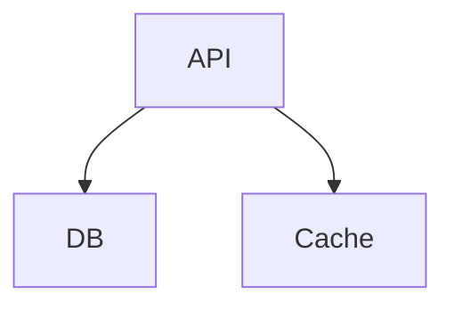

Structured ops include node and edge add/remove/rename/set-label operations. Use `asFlowchart(parsed.value)` before mutation.

## State

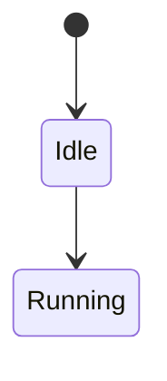

State diagrams own a dedicated `StateBody`: narrow with `asState`. States, transitions, start/end, composites, concurrency regions, fork/join/choice and history pseudostates, notes, declarations, direction, and paint are modeled. Use `describeOps('state')` for the current mutation schema; malformed or otherwise unmodeled syntax falls back losslessly and stays source-level. Verify runs the full Tier 1 + Tier 2 geometric path by projecting the body to a graph.

Simple states accept both `Idle` and `state Idle`. Unknown statements stop
rendering, and verification reports `RENDER_FAILED` with the offending text.
Preserving an opaque source does not imply that it can be drawn completely.
Full-line `//` comments remain preserved. `scale N width` and
`hide empty description` remain opaque and source-preserved while rendering
known topology; verification names the layout directives that have no effect
on local rendering. Unknown statements still prevent a partial drawing.

## Sequence

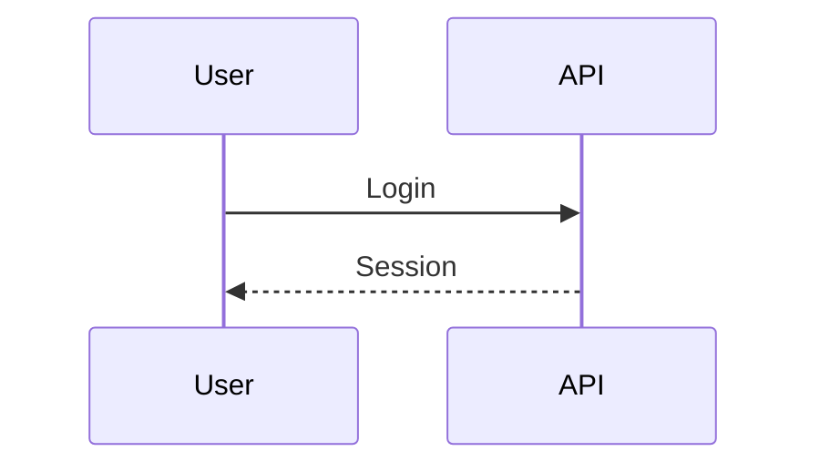

Participants and messages are structured. `alt`, `opt`, `loop`, and `par` blocks whose bodies hold only messages are typed fragments with their own fragment, branch, and fragment-message ops (see `describeOps('sequence')`). Other rich statements — notes, activation syntax, `critical`/`break`/`rect`/`box` blocks, and fragments containing notes, comments, or nested blocks — remain ordered verbatim segments while participant/message operations stay live; only un-segmentable input falls back to a whole opaque body.

## Timeline

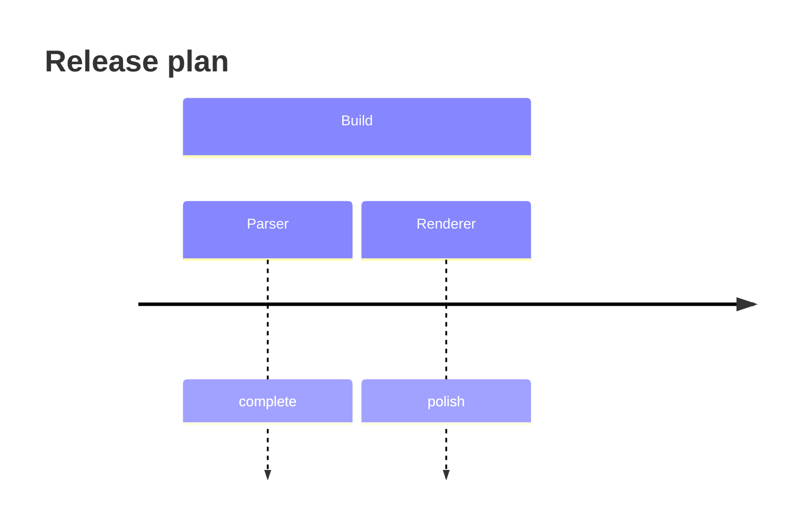

Structured ops cover title, section, period, and event changes.

## Class

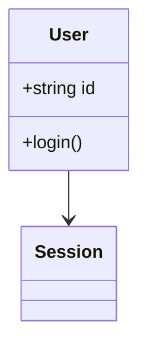

Structured ops cover classes, members, relations, notes, and renames.
One-ended lollipops are independent interface occurrences, even when labels
repeat or match an ordinary class name. Use `add_interface` with `class` and
`label` (and optional `side`, `relationLabel`, `lineStyle`) to create one;
`add_relation` cannot silently turn an ordinary class into an interface.
The interface label and its relationship label remain distinct.

Removing or moving the last class out of an unlabeled namespace removes that
empty group, including empty ancestors. An explicit namespace label is authored
content: an edit that would empty its entire subtree returns `INVALID_OP` and
leaves the diagram unchanged. A labeled parent with surviving descendants keeps
its label in a valid nested export. Directly authored empty namespace blocks
remain opaque and source-preserved, because Mermaid cannot read an empty block;
they cannot accept typed edits.

## ER

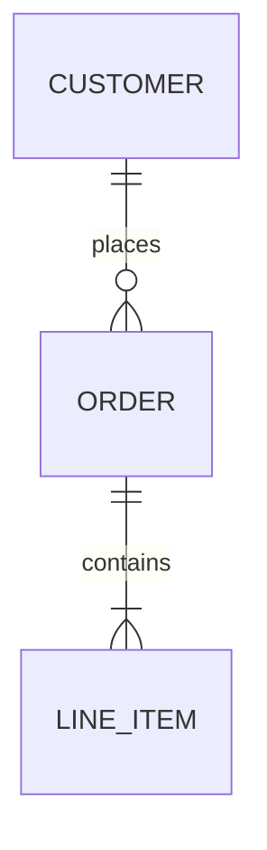

Structured ops cover entities, attributes, relation add/remove, and renames.
ER `class` directives accept comma-separated entity and class-name lists, such
as `class CUSTOMER, ORDER vip, hot`; `CUSTOMER:::vip,hot` also works in
declarations and relationship endpoints. Class names paint in applied
order (later properties win); the agent preserves the class list through
serialization and unrelated typed mutations.

## Journey

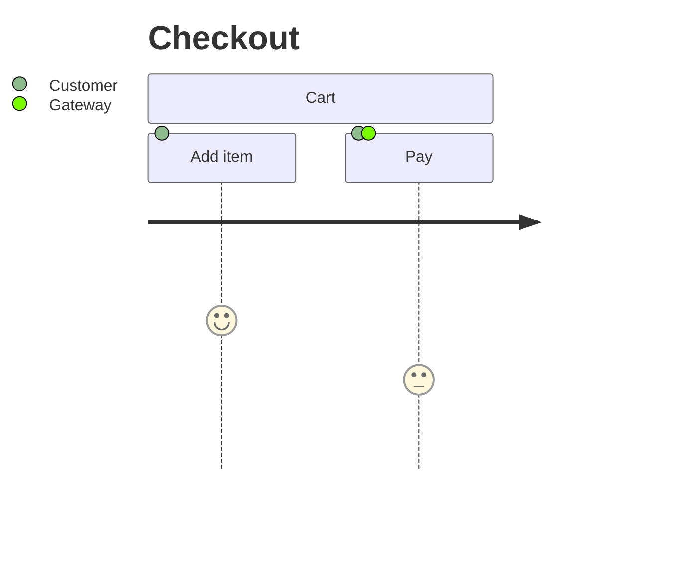

Journey diagrams narrow via `asJourney`; discover the exact section, task, score, actor, ordering, and accessibility operation schema with `describeOps('journey')`. Documented Mermaid accessibility directives (`accTitle`, inline `accDescr`, and block `accDescr { ... }`) stay structured and round-trip through canonical serialization. Malformed or unknown Journey syntax falls back to a lossless opaque body.

SVG rendering uses Mermaid's left-to-right Journey metaphor rather than the older Agentic card layout: sections span task columns, actors appear in a left legend, per-task actor dots show participation, and scores map to sentiment markers on a progression baseline. Mermaid `journey` config fields for actor colors, section fills/text colors, task/title fonts, task spacing, and actor label width are honored. Agentic Mermaid `style` and palette colors also reach Journey-specific surfaces such as section spans, actor dots, score markers, and the baseline.

## XY chart

```mermaid
xychart-beta
  title "Latency"
  x-axis [p50, p95, p99]
  y-axis "ms" 0 --> 500
  line [50, 180, 420]
```

The modeled title, axes, orientation, and bar/line series are structurally mutable through `asXyChart`; use `describeOps('xychart')` for the exact schema. Unknown statements fall back losslessly at the agent layer, but verification and rendering reject them instead of silently dropping them. Direct library errors name the statement; CLI and hosted routes project a generic render diagnostic. See [`design/families/xychart.md`](https://github.com/adewale/agentic-mermaid/blob/0f05d39858d0061b79a0c99ef03a5c10d537ddaa/docs/design/families/xychart.md) for compatibility details and layout notes.

## Pie

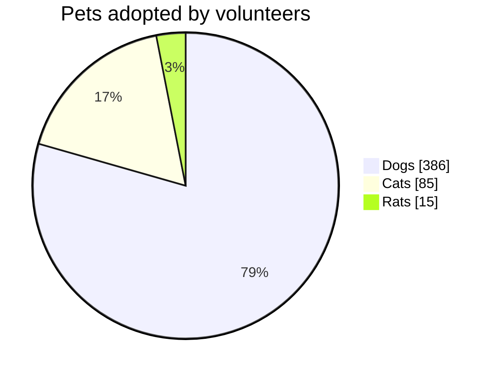

Pie charts accept the `pie` header with optional `showData`, an optional `title`, and `"label" : value` entries with positive numeric values. Slices render clockwise in source order. `showData` adds the raw value beside each legend label; the legend always shows the computed percentage. Malformed entries (negative/zero values, missing colon, unquoted labels) fall back to a lossless opaque body — never silently dropped — and the renderer still surfaces the loud error at render time. The ASCII renderer draws a proportional bar list. Pie is structured when narrowed through `asPie`; slices are addressed by their unique label. The operation schema is generated from the registry rather than duplicated here.

## Quadrant

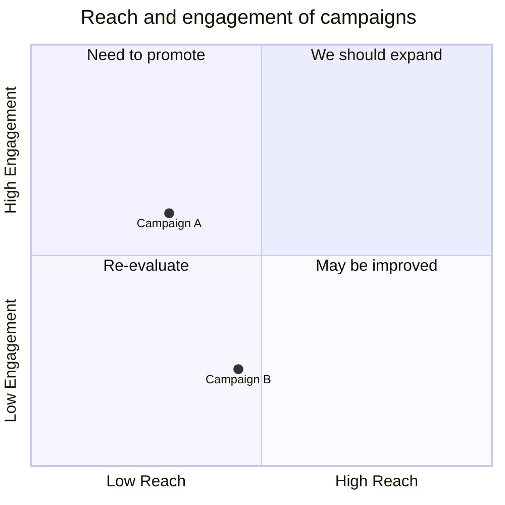

Quadrant charts accept the `quadrantChart` header, an optional `title`, `x-axis <left> --> <right>` and `y-axis <bottom> --> <top>` axis labels (the far side is optional), four `quadrant-1..quadrant-4 <label>` region labels, and `<Label>: [x, y]` points with coordinates in `[0, 1]`. Quadrant numbering follows Mermaid core: **1 = top-right, 2 = top-left, 3 = bottom-left, 4 = bottom-right**. The SVG renderer draws a square plot split into four theme-tinted quadrants with the points as circles; the ASCII renderer draws a bordered grid with a coordinate legend. Official point style metadata (`radius`, `color`, `stroke-color`, `stroke-width`), `classDef` lines, and class assignments are modeled for rendering and typed mutation. Authored point and class colors must be drawable CSS paints; invalid values receive a named error on every output instead of producing misleading paint. Malformed lines — out-of-range/non-numeric coordinates, missing brackets, duplicate point labels, and unknown point style metadata — fall back to a lossless opaque body, never silently dropped, and the renderer still surfaces the loud error at render time. Quadrant is structured when narrowed through `asQuadrant`; points are addressed by their unique label and coordinates stay in `[0, 1]`. The operation schema is generated from the registry rather than duplicated here.

## Radar

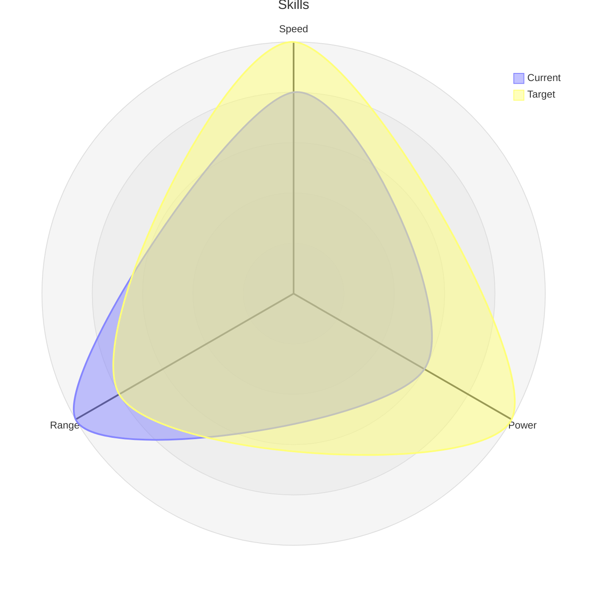

Radar (spider) chart — multivariate profiles compared across equi-angular axes from a shared center; one closed translucent area per entity. The `radar-beta` header takes an optional `title`, `axis <id>["Label"], …` declarations, one `curve <id>["Label"]{v1, v2, …}` per entity (one value per axis, in axis order), and optional `max`/`min`/config lines. The SVG renderer draws the axis spokes, concentric grid, and per-curve polygons; the ASCII renderer draws a grouped proportional-bar table like pie. Malformed lines fall back to a lossless opaque body, never silently dropped. Radar is structured when narrowed through `asRadar`; axes and curves are addressed by their unique id. The operation schema is generated from the registry rather than duplicated here.

## Gantt

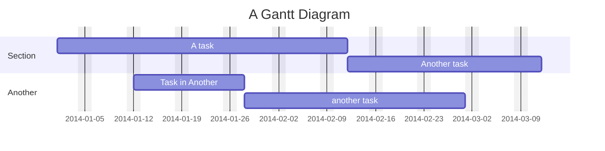

An empty Gantt plan renders its authored title/sections and **No tasks scheduled**, without inventing task bars or date ticks. Verification retains the existing `EMPTY_DIAGRAM` diagnostic.

Gantt charts accept the `gantt` header, `title`, calendar directives (`dateFormat`, `axisFormat`, `tickInterval`, `inclusiveEndDates`, `topAxis`, multiple `excludes`/`includes` lines, `weekend friday|saturday`, `weekday <day>`, `todayMarker`), `section` lines, and task lines `Label :[tags,] [id,] [start,] end` where tags are `active`/`done`/`crit`/`milestone`/`vert`, start is a date or `after id…`, and end is a date, a duration token (`ms s m h d w M y`, decimals allowed), or `until id…`. Dependencies resolve in a pure scheduler ([design/families/gantt.md](https://github.com/adewale/agentic-mermaid/blob/8af19b86f53e0ad2683388b01e3c5cef083a4653/docs/design/families/gantt.md)): `after` starts at the latest referenced end, `until` ends at the earliest referenced start, working durations extend over excluded days, `includes` overrides `excludes`, and dependency cycles / unknown references / invalid dates are named structured errors (`GANTT_*`), never wall-clock fallbacks. Rendering is deterministic: the `todayMarker` draws only when the caller passes `ganttToday` (a date in the diagram's `dateFormat`), and `todayMarker off` always wins. `displayMode: compact` (frontmatter or `config.gantt`) packs non-overlapping tasks of a section into shared rows; `vert` markers draw a full-height line without consuming a task row. `click … href` is sanitized under strict security and `click … call` is parsed but never executed. Gantt is structured when narrowed and segment-preserving: `asGantt` edits title/sections/tasks while calendar directives, click lines, and comments ride along verbatim as opaque segments; duplicate task ids or an unclosed `accDescr` block fall back to a lossless whole-opaque body.

## Mindmap

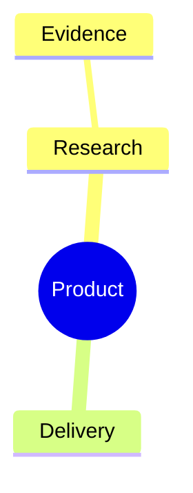

Mindmap uses indentation for parentage and supports Mermaid node shapes, `::icon(...)`, `:::class`, accessibility directives, deterministic tree layout, and structured mutation through `asMindmap`. Repeated node text or explicit ids are separate nodes: later occurrences get occurrence ids (`X#2`, …) and keep the authored text as `sourceId`; a default-shaped node's text is its id. Use `describeOps('mindmap')` for the exact operation schema; see [`design/families/mindmap.md`](https://github.com/adewale/agentic-mermaid/blob/0f05d39858d0061b79a0c99ef03a5c10d537ddaa/docs/design/families/mindmap.md).

## GitGraph

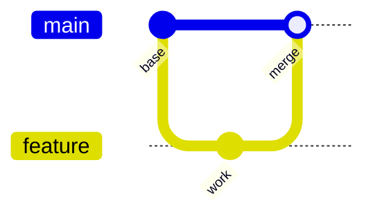

GitGraph replays commits and branch movement in source order and exposes structured mutation through `asGitGraph`. Generated ids are deterministic `c<N>` values. Repeated authored commit IDs retain separate, collision-free occurrence IDs while rendering and canonical export retain their authored labels; later occurrences expose `sourceId`. Typed edits use public occurrence IDs. Explicit duplicate merge IDs remain invalid. Use `describeOps('gitgraph')` for the exact operation schema; see [`design/families/gitgraph.md`](https://github.com/adewale/agentic-mermaid/blob/8af19b86f53e0ad2683388b01e3c5cef083a4653/docs/design/families/gitgraph.md).

## Architecture

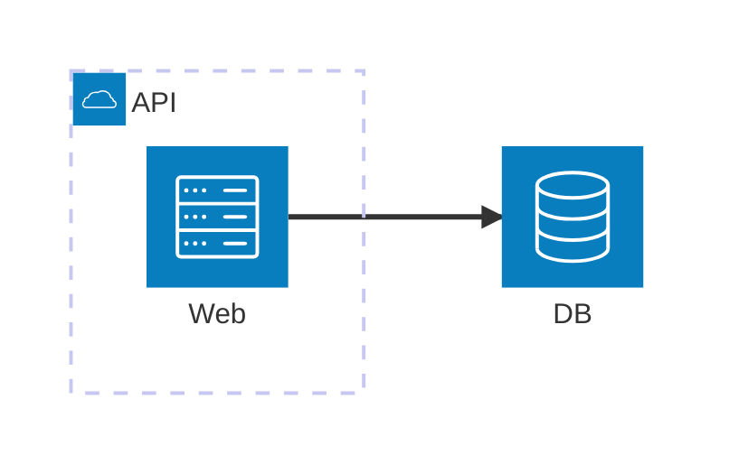

See [`design/families/architecture-beta.md`](https://github.com/adewale/agentic-mermaid/blob/0f05d39858d0061b79a0c99ef03a5c10d537ddaa/docs/design/families/architecture-beta.md) for parser/layout/render notes.

## Sankey

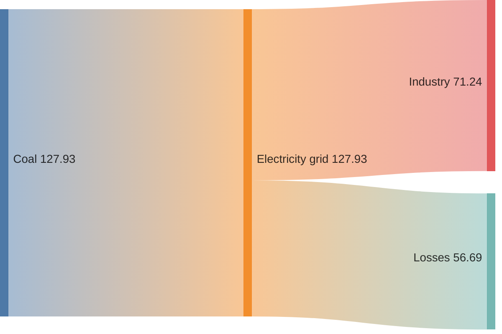

Sankey diagrams accept the `sankey` or `sankey-beta` header followed by one `source,target,value` CSV row per link (an RFC 4180 subset: quoted fields may contain commas, `""` is a literal quote, and blank lines and `%%` comments are allowed). Nodes are implied by the labels, values are non-negative numbers, and self-loops or cycles are rejected. Malformed rows fall back to a lossless opaque body that verification reports (`UNSUPPORTED_SYNTAX`, `RENDER_FAILED`) rather than rendering a partial diagram. Verify also emits the `FLOW_IMBALANCE` lint when an intermediate node receives a different total than it emits. Sankey is structured when narrowed through `asSankey`; use `describeOps('sankey')` for the exact link and rename operation schema. See [`design/families/sankey.md`](https://github.com/adewale/agentic-mermaid/blob/0f05d39858d0061b79a0c99ef03a5c10d537ddaa/docs/design/families/sankey.md) for layout, config, and terminal notes.

## C4

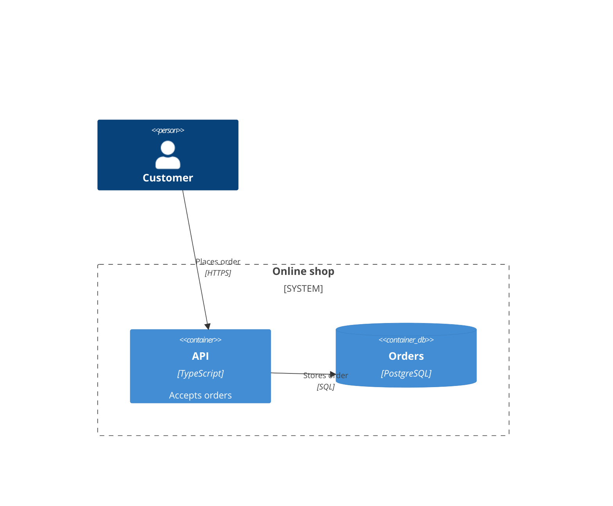

All five legacy headers (`C4Context`, `C4Container`, `C4Component`,
`C4Dynamic`, `C4Deployment`) use the typed `C4Body`. Narrow with `asC4` and
discover edits with `describeOps('c4')`. Elements, recursive boundaries,
deployment nodes and individual repeated interactions retain source identity
across graphical and terminal projections. Unknown statements are preserved,
diagnosed and block partial rendering. See [C4 semantics and output
dispositions](https://github.com/adewale/agentic-mermaid/blob/0f05d39858d0061b79a0c99ef03a5c10d537ddaa/docs/design/families/c4.md) for editing, config and portability.

## Requirement

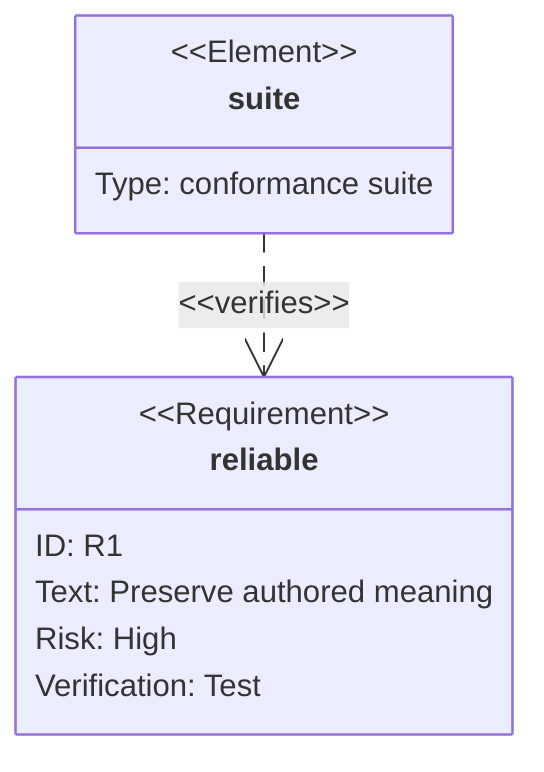

Requirements remain compartmented boxes with ID, text, risk and verification fields, joined by typed traceability relations. Narrow with `asRequirement` and discover typed edits with `describeOps('requirement')`. See [Requirement semantics and output](https://github.com/adewale/agentic-mermaid/blob/0f05d39858d0061b79a0c99ef03a5c10d537ddaa/docs/design/families/requirement.md) for placement, portability and pin evidence.

## Block

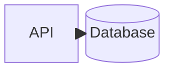

Blocks occupy authored grid cells, with explicit column spans, empty cells and nested composites; connectors do not reorder the grid. Narrow with `asBlock` and discover typed edits with `describeOps('block')`. See [Block semantics and output](https://github.com/adewale/agentic-mermaid/blob/0f05d39858d0061b79a0c99ef03a5c10d537ddaa/docs/design/families/block.md) for placement, portability and pin evidence.

## Packet

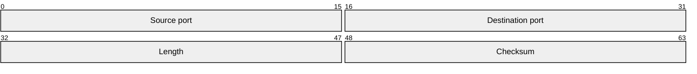

A packet displays bit-addressed fields with proportional widths and explicit word rows. The Editor supports keyboard field selection, highlighting all fragments and displaying bit ranges and zero-based byte offsets; this preview inspection leaves canonical exports intact. Narrow with `asPacket` and discover typed edits with `describeOps('packet')`. See [Packet semantics and output](https://github.com/adewale/agentic-mermaid/blob/8af19b86f53e0ad2683388b01e3c5cef083a4653/docs/design/families/packet.md) for placement, portability and pin evidence.

## Kanban

```mermaid
kanban
  column1[Column Title]
    task1[Task Description]
```

A Kanban board preserves ordered workflow columns containing ordered task cards. Opt into whole-column graphical wrapping with render options `kanban: { maxWidth: 720 }`, or use the Editor’s **Wrap board to preview width** control. Columns retain readable fonts and a 160px minimum; the requested width is best-effort. Terminal output uses its separate `targetWidth`. Metadata key/value source spans are available through optional `SourceMap.spans.metadata`. Narrow with `asKanban` and discover typed edits with `describeOps('kanban')`. See [Kanban semantics and output](https://github.com/adewale/agentic-mermaid/blob/8af19b86f53e0ad2683388b01e3c5cef083a4653/docs/design/families/kanban.md) for placement, portability and pin evidence.

## Treemap

```mermaid
treemap-beta
"Category A"
    "Item A1": 10
    "Item A2": 20
"Category B"
    "Item B1": 15
    "Item B2": 25
```

Nested rectangles encode hierarchical containment and value-proportional leaf area. Narrow with `asTreemap` and discover typed edits with `describeOps('treemap')`. See [Treemap semantics and output](https://github.com/adewale/agentic-mermaid/blob/0f05d39858d0061b79a0c99ef03a5c10d537ddaa/docs/design/families/treemap.md) for placement, portability and pin evidence.

## Ishikawa

```mermaid
ishikawa
  Delayed release
  Process
    Manual approval
  Tooling
    Slow builds
```

A fishbone diagram has a causal spine ending in one effect, with alternating category bones and nested contributing causes. Narrow with `asIshikawa` and discover typed edits with `describeOps('ishikawa')`. See [Ishikawa semantics and output](https://github.com/adewale/agentic-mermaid/blob/0f05d39858d0061b79a0c99ef03a5c10d537ddaa/docs/design/families/ishikawa.md) for placement, portability and pin evidence.

## Output formats

All built-in renderable families use the same public output paths:

Terminal output uses the [shared terminal compositor](https://github.com/adewale/agentic-mermaid/blob/main/docs/project/terminal-composition.md)
for owned cell geometry and encoding. SVG/PNG use their graphical pipeline.
Shared entry points do not imply identical geometry, feature projections or
layout feasibility. C4 has native connected terminal geometry. String-only
extension output does not supply native terminal ownership.

```ts
import { renderMermaidSVG, renderMermaidPNG, renderMermaidASCII } from 'agentic-mermaid/agent'

const svg = renderMermaidSVG(source, { security: 'strict' })
const png = renderMermaidPNG(source, { fitTo: { width: 1200 }, background: '#fff' })
const text = renderMermaidASCII(source)
```

CLI equivalents:

```bash
am render diagram.mmd --format svg > diagram.svg
am render diagram.mmd --format png --output diagram.png
am render diagram.mmd --format ascii > diagram.txt
```
