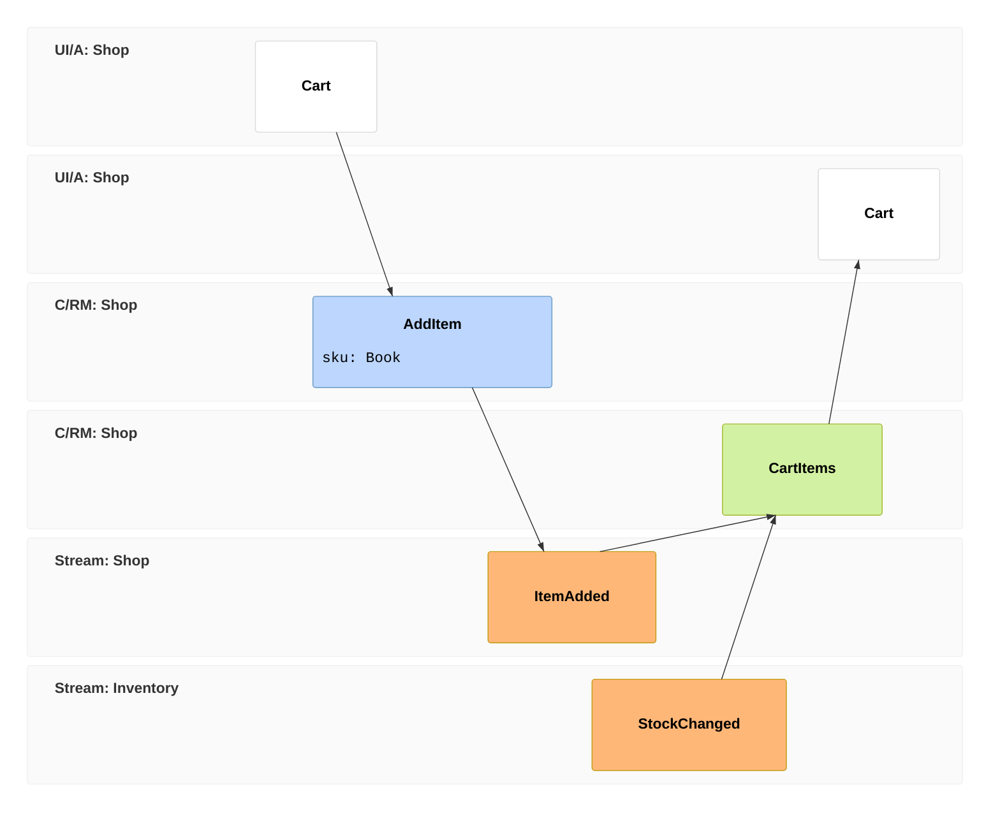
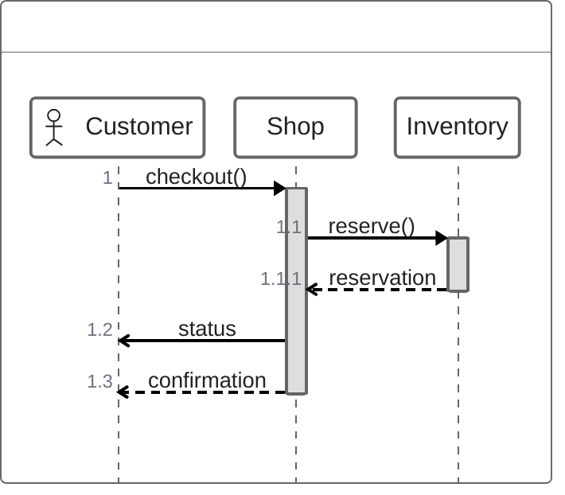

# Native Event Modeling and ZenUML

Both languages run through the ordinary synchronous SVG, PNG, terminal and
layout APIs, CLI and MCP. No Mermaid DOM host or ZenUML addon is required.
`am capabilities --json` and `describeOps(family)` expose the current operation
schemas. The upstream maturity policy still records classification uncertainty;
that label does not disable these native implementations or remove the families
from required-support comparisons.

## Event Modeling



Compact and relaxed frame/type keywords share a native body. Frame IDs remain
strings, independent of source order. Each namespace and entity band owns one
lane even when the source returns to it. Qualified identifiers retain every
component; the full prefix before the last component is the namespace.

A normal frame infers an incoming relation from the nearest preceding frame in
a different lane. Explicit `->>` sources replace inference. A reset frame has
no inferred predecessor and still retains its explicit sources. Explicit self
references are supported. Removing a referenced frame requires `cascade`; when
its last explicit reference disappears, the receiver becomes a reset frame so
the edit cannot invent a new inferred predecessor.

Inline and named data retain their full text and declared type. Notes and
Given/When/Then specifications retain their frame and declared-entity ownership.
Typed operations can insert, move, rename and remove frames; change entities,
sources and data; and manage notes, entity declarations and specifications.

```ts
import { asEventModeling, mutate, parseRegisteredMermaid } from 'agentic-mermaid/agent';
const result = parseRegisteredMermaid(source);
if (!result.ok) throw new Error('Parse failed');
const diagram = asEventModeling(result.value);
if (!diagram) throw new Error('Source is not a native Event Modeling body');
const changed = mutate(diagram, {
  kind: 'set_frame_entity', id: '02', entity: 'Shop.AddBook',
});
```

Data and notes are inert display text. The pinned multiline grammar cannot
represent a payload line beginning with a closing brace; typed writes refuse
that delimiter rather than introducing another statement. One-line frame data
can contain complete nested JSON text. Unknown future statements retain an
opaque source body and refuse structured edits.

The terminal output is an ordered frame list with incoming frame IDs, type,
namespace, full data, notes and specifications. Its receipt diagnoses this
projection: terminal cells do not encode the graphical timeline's geometry.

## ZenUML



The native AST retains participant aliases and annotation glyphs, ordered
synchronous/asynchronous/creation/reply messages, nested calls, comments,
returns, assignment replies, loops, conditional/optional/parallel regions and
try/catch/finally branches. Calls and returns use their actual enclosing caller,
including self calls. An implicit outer caller is projected as a separate
`Caller` actor with a generated identity that authored identifiers cannot use.
Accessibility trees, facts and layout include that projected caller consistently.

Pixel and terminal geometry reuse Agentic's sequence adapters after ZenUML owns
the call-stack projection. Async arrows have open heads, synchronous calls have
filled heads, and replies are dashed. Consecutive comments form one note above
the following message or region; comments attached to declarations are ignored.
Exception branches use the existing sequence region geometry.

Use `asZenUml` to narrow the public parse result. Typed operations can add
participants, messages, calls, creations, regions, branches, returns and comments;
rename participants; change aliases/message text/branch labels; and remove
statements. Statement IDs identify occurrences in the current parsed artifact,
so read back the new body after an insertion or removal. A branch label retains
its DSL spelling (`else`, `else if(condition)`, `catch`, `catch(error)`, `finally`).

The parser handles the documented language. An unknown annotation or statement
remains opaque source, rather than earning native editing credit. Invalid
balanced-delimiter, dangling-reply and caller-scope inputs fail with structured
parse errors. Typed writes reparse their output and refuse any change to
unrelated authored values; rejected edits leave the original diagram untouched.

## Evidence and limits

Owning tests exercise independent frame IDs/endpoints, reset/explicit-source
interactions, full data retention, namespace re-entry, native writes, nested
calls, control regions, actual SVG/PNG/terminal/lazy-browser entry points and
negative statement-injection cases. Shared family tests exercise round trips,
style/Scene contracts, accessibility trees and terminal width bounds.

Event frame and relation source anchors are available. ZenUML retains document
spans and AST occurrence IDs; statement source spans for editor selection are
not exposed.

Agentic chooses its own geometry and styles. These checks do not establish
pixel equality with Mermaid, every third-party ZenUML extension or every
configuration/feature combination. The required-family benchmark and community
fidelity ledgers report the actual measured scope separately.
