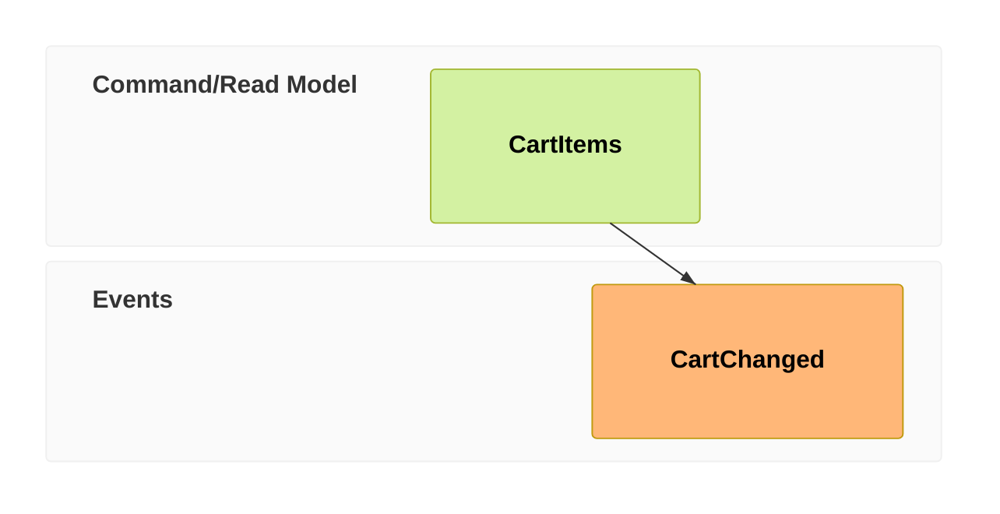

# ZenUML and Event Modeling across Mermaid implementation lineages

Reviewed 2026-10-27 for issues #501/#502 and PR #545.

Merman supplies a concrete independent precedent for production Event Modeling
source-type diagnostics and an owned ZenUML semantic model. Pele's copied Event
validator tests, mmdr's arrow-line Zen renderer, and Visimer's lossless Zen view
exercise different contracts. Their presence in a family list does not establish
production validation, full styling, or checked domain editing.

## Scope and provenance

This review started with the 27 renderer/parser candidates marked `root` or
`independent` in Trident's community catalog. That selection is a discovery list,
not proof of 27 independent engines. The catalog snapshot was checked on
2026-10-18, with individual observations dated through 2026-10-23; this review
reads the pinned sources linked below. The harness pin is
[`0a0453c8`](https://github.com/adewale/trident/tree/0a0453c8cc64567d4ad1ccdc256035fb311cf31d).
The retained local research bundle contains the selected catalog records and
edges, all 27 pinned READMEs, the source excerpts, and the two-version Pele probe.

Forks, ports, bindings, and wrappers do not supply another independent engine
vote. Classify the operation as well as the repository: an independent editor
may use somebody else's renderer, and an independent SVG renderer may port its
terminal engine. Separate Git roots support ancestry review; they do not prove
that every source file was independently written. OpenCode and Grok have only
depth-one history observations here, so their founding status remains unresolved.

The project reference is Mermaid **12.2.0**, source
[`1fb78698`](https://github.com/mermaid-js/mermaid/tree/1fb7869866dd619168d840291c9c54b4f129758b),
not the catalog's newer Mermaid default-branch head. The configured Zen control
uses `@mermaid-js/mermaid-zenuml@1.0.1` and `@zenuml/core@3.47.9`. It is another
consumer of the same Zen engine, not an independent correctness vote. Merman's
inspected Zen module names **Core 3.50.1** as its grammar target; its source
coverage cannot be substituted for a run against our older pin.

This is a source and contract comparison, with the limited public-API probes
identified below. It is not a new benchmark, an exhaustive grammar audit, or a
cross-library visual score. A feature marked unqualified was not established by
the inspected evidence; that does not assert that the feature is absent.

## The three contracts

**Production Event validation.** A read-model input to an event has clear syntax
but violates the Event domain rule. An implementation can retain and draw it
while reporting the problem. A copied private validator passing its own unit
tests does not show that public parsing, rendering, or verification calls it.

The positive control changes frame 01 to `cmd UpdateCart`. The complete rule is
command ← UI/processor; event ← command; read model ← event; processor/UI ← read
model. Test explicit source references, aliases, empty inputs, and one diagnostic
per bad input. Keep parser acceptance, domain diagnostics, and Langium service
registration as separate observations.

**Zen styling that owns geometry.** The relevant question is whether the family
consumes typography and style values when measuring text, reserving participant
and fragment space, and routing calls, as well as when painting. Changing actor
or message colors is useful palette support; it does not establish measured
typography or a full Look. Conversely, a family-specific font/configuration path
can own measured typography even when a generic theme-rule API does not support
that family. Neither API shape alone establishes visual quality.

**Checked Zen editing and serialization.** Use the existing
[Checkout witness](../../src/__tests__/testdata/zenuml-checkout.mmd): alias,
nested call, conditional returns, and the final async-message direction. Renaming an
implicit participant must update nested references without merging another
participant. Inserting a branch interaction must retain its caller and return
context. Invalid edits must leave the prior model unchanged, and canonical Zen
export must reload with the same meaning. Lossless source storage, JSON model
serialization, text-area editing, and typed domain mutation are distinct useful
capabilities.

## Implementations with relevant family evidence

| Lineage and exact source | Event source-type validation | Zen model, appearance, and editing evidence |
| --- | --- | --- |
| [Mermaid 12.2.0](https://github.com/mermaid-js/mermaid/tree/1fb7869866dd619168d840291c9c54b4f129758b) | The real [Langium validator and registration](https://github.com/mermaid-js/mermaid/blob/1fb7869866dd619168d840291c9c54b4f129758b/packages/parser/src/language/eventmodeling/event-modeling-validator.ts) contain the domain rules. Registration is a separate private service contract. This review does not infer that ordinary diagram parsing executes document validation. | Zen is an [external addon](https://github.com/mermaid-js/mermaid/blob/1fb7869866dd619168d840291c9c54b4f129758b/packages/mermaid-zenuml/src/zenumlRenderer.ts) using ZenUML core. It supplies the configured language/rendering control, not native Agentic-style integration or a checked Zen editing API. |
| [Latias94/merman `252752f7`](https://github.com/Latias94/merman/tree/252752f7029b67f6a6f22a35230ef2bdf9c605d0) | Production parsing [calls semantic validation](https://github.com/Latias94/merman/blob/252752f7029b67f6a6f22a35230ef2bdf9c605d0/crates/merman-core/src/diagrams/eventmodeling.rs#L508); the [validator](https://github.com/Latias94/merman/blob/252752f7029b67f6a6f22a35230ef2bdf9c605d0/crates/merman-core/src/diagrams/eventmodeling.rs#L1449) resolves real frame references and records wrong-source-type diagnostics. This is production code, not a compatibility-test copy. | Own grammar-derived lexer/parser, AST, [semantic builder](https://github.com/Latias94/merman/blob/252752f7029b67f6a6f22a35230ef2bdf9c605d0/crates/merman-core/src/diagrams/zenuml/semantic.rs), and [typed model](https://github.com/Latias94/merman/blob/252752f7029b67f6a6f22a35230ef2bdf9c605d0/crates/merman-core/src/diagrams/zenuml/model.rs). Calls, resolved endpoints, assignments, creation, returns, fragments, references, and source spans remain Zen-specific. Appearance and editing distinctions are detailed below. |
| [obsidianmd/pele source `44da152b`](https://github.com/obsidianmd/pele/tree/44da152bbb79b91f03e68016f42499bb25bf6e82); public packages **1.9.0 / 1.12.0** probed separately | The rule copy is explicitly in [tests/compat/eventmodeling/validator.ts](https://github.com/obsidianmd/pele/blob/44da152bbb79b91f03e68016f42499bb25bf6e82/tests/compat/eventmodeling/validator.ts). Its comment says those rules are retained because the upstream specs test them. The production [entry](https://github.com/obsidianmd/pele/blob/44da152bbb79b91f03e68016f42499bb25bf6e82/src/diagrams/eventmodeling/index.ts) composes parse → model → render. Both probed public versions accepted and rendered the positive and negative witness. | Both public probes reported Zen unsupported. No Zen styling or editing capability was qualified. The source head and npm versions are separate observations; no artifact/source parity is assumed. |
| [1jehuang/mermaid-rs-renderer `3726ccbf`](https://github.com/1jehuang/mermaid-rs-renderer/tree/3726ccbffe0e8032361eb9668694b24f77858060) | Event Modeling is absent from its [advertised 23-family list](https://github.com/1jehuang/mermaid-rs-renderer/blob/3726ccbffe0e8032361eb9668694b24f77858060/README.md#diagram-types). No scoped Event validation result is claimed. | [parse_zenuml_diagram](https://github.com/1jehuang/mermaid-rs-renderer/blob/3726ccbffe0e8032361eb9668694b24f77858060/src/parser.rs#L3712) creates a generic graph from arrow-bearing lines. It skips title lines and ignores lines that the arrow helper cannot read. Nested calls, return expressions, and fragment scopes are not represented by this function. A returned SVG therefore cannot qualify the full Checkout meaning, full Zen layout, or checked Zen serialization. |
| [evangwt/xmermaid `d7dcff19`](https://github.com/evangwt/xmermaid/tree/d7dcff197bf2595d06a797bbc2bf25f19ee39cfe) | Its [machine-readable support declaration](https://github.com/evangwt/xmermaid/blob/d7dcff197bf2595d06a797bbc2bf25f19ee39cfe/src/support.ts) marks Event frames/types partial and data-block rendering, configuration, classes, and styles unsupported. A production source-type validator was not qualified here. | The same declaration qualifies direct calls, returns, and participant/actor declarations, while explicitly excluding control blocks and async forms. Its [public description](https://github.com/evangwt/xmermaid/blob/d7dcff197bf2595d06a797bbc2bf25f19ee39cfe/README.md#what-renders-today) calls the broad family catalog partial and diagnoses unsupported syntax. Generic editor/rename claims do not establish the unsupported nested Zen case. |
| [Dicklesworthstone/frankenmermaid `29536a13`](https://github.com/Dicklesworthstone/frankenmermaid/tree/29536a1308acd1bae4da8b72b4cebffb39709ae0) | The [32-family list and visual thesis](https://github.com/Dicklesworthstone/frankenmermaid/blob/29536a1308acd1bae4da8b72b4cebffb39709ae0/README.md#supported-diagram-types) include native Event Modeling. The inspected detector also names it. Those facts do **not** establish whether its production domain validator reports the negative witness; that question remains unqualified. | Zen is not in that closed family list. Source-lens editing is advertised for the implementation generally, but no Zen checked mutation/writer result was established. The catalog also distinguishes current Rust source, older distributed WASM, native release, and deployed site; these are not interchangeable artifacts. |
| [inkeep/visimer `594440da`](https://github.com/inkeep/visimer/tree/594440dad857d4b040f205047289ef60d5e0618b), independent CST/editor operation | Event Modeling is not advertised in its 23-type table. No Event domain result is qualified. | The [support table](https://github.com/inkeep/visimer/blob/594440dad857d4b040f205047289ef60d5e0618b/README.md#diagram-support) explicitly marks Zen **view-only**, with neither item nor structural editing. It claims lossless round trips and selection sync even for that view. Its DOM renderer uses the caller's Mermaid instance, so this is editor/CST evidence, not another independent renderer or a native Zen typed-edit contract. |

### What Merman establishes, and what remains separate

Merman is a useful positive architectural comparison. Its
[module authority](https://github.com/Latias94/merman/blob/252752f7029b67f6a6f22a35230ef2bdf9c605d0/crates/merman-core/src/diagrams/zenuml/mod.rs#L1)
explicitly owns the Zen lexer, recovering parser, semantic builder, editor facts,
and render model. It says Zen is not translated through Mermaid Sequence JSON
or actions. Reusing sequence geometry later does not negate that owned model.

Its [theme guide](https://github.com/Latias94/merman/blob/252752f7029b67f6a6f22a35230ef2bdf9c605d0/docs/rendering/custom-diagram-themes.md#family-configuration-and-compiled-rules)
distinguishes two authorities: `themeVariables.zenuml` owns family colors and
typography, with measurement and paint consuming prepared font values; the
compiled generic Zen theme adapter supports `Title.fill`, while generic text and
typography rules are unsupported and reported. Calling this merely recoloring
would miss the family configuration path. Calling it unrestricted generic theme
support would miss the adapter boundary.

Merman also produces source-backed editor facts, and its
[rename policies](https://github.com/Latias94/merman/blob/252752f7029b67f6a6f22a35230ef2bdf9c605d0/crates/merman-core/src/editor.rs#L167)
include Event identifier/frame-ID constraints. Its Zen model's `Serialize`
implementation projects render-model **JSON**. These establish useful typed
model/editor boundaries; neither observation alone proves a public checked
Zen mutation → canonical Zen source → semantic reload contract. That exact
workflow was not executed in this review.

## Lineage exclusions and related consumers

| Candidate | Treatment |
| --- | --- |
| [kingsword09/mermansi `40e5923c`](https://github.com/kingsword09/mermansi/blob/40e5923cfca654503212612fd0f1af8a8720dfbe/README.md#support-matrix) | Reuses `merman-core` and `merman-ascii`; it is not another Zen parser/validator lineage. It adds real terminal work: its own matrix calls Zen partial sequence geometry plus canonical model, and Event connected frame/data-box geometry. Retain this as output-adapter evidence, not a second independent semantic vote. |
| [neongreen/mermaid-ast `6b5e43ba`](https://github.com/neongreen/mermaid-ast/blob/6b5e43baae0340cfa354b64c0ddea16f5bc31551/README.md) | Depends on `@mermaid-js/parser` in the catalog record and advertises wrapper classes. Excluded as a new parser engine; its parse/serialize wrapper API is a separate operation. |
| [Yassimba/loom `32c82fb9`](https://github.com/Yassimba/loom/blob/32c82fb904789dd74715bf1232b7e13ce5f395cc/README.md#credits) | The README credits `pi-lovely-mermaid`, which belongs to the Grok-port lineage in the catalog. Do not count Loom as a demonstrated new founding engine. The inspected [renderer entry](https://github.com/Yassimba/loom/blob/32c82fb904789dd74715bf1232b7e13ce5f395cc/plugins/pi-loom-mermaid/src/loom-mermaid/index.ts) lists ten other families and describes best-effort output with warnings. The package advertises an `UPSTREAM.md` file, but it was absent at the inspected path; exact ancestry remains less certain than the credit itself. |
| [lukilabs/beautiful-mermaid `2ac8bbbb`](https://github.com/lukilabs/beautiful-mermaid/blob/2ac8bbbb060ca0a65a6a21f3200bd99b1587b488/README.md) | Its own SVG engine is eligible as a separate renderer lineage. Its README explicitly says the ASCII engine was ported from AlexanderGrooff/mermaid-ascii, so ASCII is not a new founding vote. Neither target family is in its six-family list. Agentic Mermaid is itself a descendant of this repository, not another founder for this comparison. |
| [taoche/mermaid-reactflow-render `69ad28fc`](https://github.com/taoche/mermaid-reactflow-render/blob/69ad28fc5ec26e8e146945f287a67716f9a627ca/README.md#mermaid-reactflow-render) | Credits the approach and styling of `albingcj/mermaid-reactflow-editor`, then says it reimplements the rendering half. That is weaker evidence than a confirmed code port, so do not assert either a new root or a proven fork. Its public contract is render-only flowcharts; no scoped family result is qualified. |

Inspiration alone does not establish a port: Termaid and Figurehead explicitly
credit other projects, but the inspected records do not identify them as copied
engines. Conversely, a catalog `independent` label does not erase explicit
dependency or port evidence. Wrappers around Pele, mmdr bindings, Mermaid forks,
and the catalog's Beautiful/ASCII/Grok ports are not additional entries in the
founder comparison.

## Remaining candidates: no target-family contract qualified

The following sources document other families or a different operation. They do
not contribute a successful or failed Zen/Event contract result. In particular,
renderer appearance is outside the operation of a validator or source formatter.
An absent README entry is weaker than a source dispatcher or an explicit
unsupported declaration; the evidence column preserves that distinction.

| Candidate and pin | Inspected operation and scope |
| --- | --- |
| [aj-archipelago/merval `d8bb4bf3`](https://github.com/aj-archipelago/merval/blob/d8bb4bf39cf9ec6541e9a4247e29621f37ef4c1f/README.md#supported-diagram-types) | Syntax validator; the checked list names 13 other families. No Zen/Event rule result qualified; no renderer-style failure is inferred. |
| [AlexanderGrooff/mermaid-ascii `5f00e3d9`](https://github.com/AlexanderGrooff/mermaid-ascii/blob/5f00e3d9ac9fc96a19859d502333e35b87d2ffea/README.md) | Independent terminal ancestor; reviewed documentation covers graph/flowchart and sequence. It provides no qualified target-family contract here; the README review is not an exhaustive negative source audit. |
| [anomalyco/opencode `46172108`](https://github.com/anomalyco/opencode/blob/4617210822bdbb31e5749751afbfb4584ccedac8/packages/merman/src/detect.ts) | `packages/merman` has a closed six-family dispatcher: flowchart, Gantt, gitGraph, sequence, state, timeline. Neither target is selected. Founding history is unresolved in the depth-one catalog observation. |
| [chenyanchen/mermaid-formatter `7072b46e`](https://github.com/chenyanchen/mermaid-formatter/blob/7072b46e46636441e2ec262eed5c9ce63b09459a/README.md#supported-diagram-types) | Source formatter; its enumerated 17-family list omits both targets. Formatting/round-trip behavior would be the relevant operation, not styling. |
| [crafter-station/mermaid `1bac2411`](https://github.com/crafter-station/mermaid/blob/1bac24116826233c3b0ad8da589d7223d77a451a/README.md#supported-diagrams) | Independent parser/layout/SVG pipeline advertises eight other families. No target-family support is qualified by that list or this review. |
| [emtyty/merslim `746ddb4e`](https://github.com/emtyty/merslim/blob/746ddb4e71d7ebecbcfc98540dbf4dd9b5b54a61/README.md#supported-diagram-types) | Native parser/SVG/terminal implementation lists 14 other families. No Zen/Event contract qualified. |
| [fasouto/termaid `a10dfd50`](https://github.com/fasouto/termaid/blob/a10dfd506ec67dc11fce3f399c20a353202586ae/README.md#supported-diagram-types) | Terminal renderer lists 18 other families. Inspiration credits do not establish a copied engine. No target-family contract qualified. |
| [justsml/rusty-mermaid `ce95d8dd`](https://github.com/justsml/rusty-mermaid/blob/ce95d8ddb8323006b6dd8ddbc616c2478c3827aa/README.md#features) | Syntax validator documents flowchart, sequence, class, and state, with “more to come.” This is an advertised subset, not an exhaustive source-level exclusion. Rendering style is outside its validation operation. |
| [kitlangton/merman `0158eeac`](https://github.com/kitlangton/merman/blob/0158eeac3542e23acef7c665638b7ef99902dd3a/README.md) | Terminal flowchart, sequence, and state renderer. It is unrelated by Git root to Latias94/merman; do not transfer the latter's Zen/Event support to this name. |
| [KlangHaus/vitepress-plugin-diagram `6f4b8a23`](https://github.com/KlangHaus/vitepress-plugin-diagram/blob/6f4b8a2310d8f416d255832c97c40ff81380c8fb/README.md#supported-diagrams) | Own parser/layout/SVG implementation lists flowchart, sequence, and class. Being packaged as a VitePress plugin does not make that engine a pure Mermaid wrapper. Neither target is qualified. |
| [Mootikins/figurehead-rs `ba20125c`](https://github.com/Mootikins/figurehead-rs/blob/ba20125c6dde3b263f4d2d40377a6173563098ff/README.md#diagram-types) | Claims 24 core families, explicitly excludes external-plugin Zen, and does not list Event Modeling. No Event domain-rule result qualified; its other advertised coverage was not executed here. |
| [probelabs/maid `c30a4ec4`](https://github.com/probelabs/maid/blob/c30a4ec4fa77655ef6c89618480c864655bd0e54/README.md#rendering-diagrams-experimental) | Primarily validation/autofix; experimental rendering names flowchart/pie in the browser and flowchart/pie/sequence for the CLI. Neither target contract was established. This is not a claim that its complete validator rejects either family. |
| [sandyyst/dsh-plugin-mermaid-gb-svg `27210554`](https://github.com/sandyyst/dsh-plugin-mermaid-gb-svg/blob/27210554c992884167ed681944bf078e402febf4/README.md) | Flowchart-specific GB/T 1526-1989 SVG renderer. No target-family contract qualified. |
| [tariqshams/mermaidtui `ca59dd91`](https://github.com/tariqshams/mermaidtui/blob/ca59dd9115c290be846c2bd62925b8bd44331d51/README.md#supported-syntax-v006) | Documents a flowchart subset. No target-family contract qualified. |
| [xai-org/grok-build `2bdd1d6a`](https://github.com/xai-org/grok-build/blob/2bdd1d6a6369de0e8c68132ea4539e9abd9e14a8/crates/codegen/xai-grok-markdown/src/mermaid.rs#L58) | Source dispatcher handles graph/flowchart, state, class, ER, and sequence, then falls back to framed raw source. Such fallback is preservation, not Zen/Event rendering. Founding history remains unresolved in the depth-one catalog observation. |

## Consequences for the two implementations

Agentic's Event repair puts source-type rules in the production verification
authority and retains invalid-but-clear authored connections as advisory
`EVENT_SOURCE_TYPE` diagnostics. The unchanged original inventory now qualifies
**15 parser cases and 25 production rule cases** against **41 passing actual
upstream controls**. One private Langium registry-wiring case remains unavailable
on the native side. Rule receipts contain actual type inputs and no fabricated
parse source. Running the same adapter against the clean pre-repair revision
retains those 25 rule gaps rather than borrowing the new implementation.

Native Zen follows an owned authored model with a direct projection to existing
Sequence geometry and Scene/terminal owners. The optional pinned browser engine
remains an explicit upstream control. This distinction permits native typography,
styles, and checked edits to be tested at their actual producer/consumer
boundaries. It does not prove every Zen extension, every Look/density/font
combination, or comparative aesthetic superiority.

The useful comparison is therefore case-level: real diagnostics, retained
call/branch meaning, measured styled geometry, atomic edits, and portable source.
Family counts and successful SVG returns remain discovery and acceptance facts.
