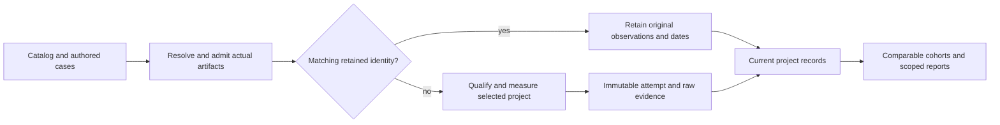

# Mermaid benchmark suite

The suite answers four different questions: whether a diagram's meaning survives
an operation, how a caller can invoke the implementation, what that work costs,
and how the result compares with another implementation. Those questions share
inputs and artifact identities, but they do not share one overall score.

Benchmarks run locally and stay outside CI and npm publication. Product
correctness, security, package and browser contracts still run in CI. The private
benchmark package owns its runners, community adapters, qualification, records,
reports and controller tests. It is excluded from the published library.

For individual entry points and prerequisites, use the [inventory](INVENTORY.md).
The [assessment](ASSESSMENT.md) explains the limits of existing measurements.
The [package guide](README.md) covers installation, updates and extraction seams.

## Primary questions

| Question | Owning benchmark | What the result can establish |
| --- | --- | --- |
| How well do we render Mermaid's docs? | Original Dave browser comparison | Every official fence occurrence remains in its denominator. SVG acceptance and shared-success time are measured; acceptance alone does not certify drawing fidelity. |
| How well do we match Mermaid's own tests? | `upstream-test-assertions`, alongside the existing selected-input `pinned-reference-score` | Execute original pinned assertions where a reviewed public-model adapter exists; retain every other inventoried declaration as unprojected. Selected historical input replay is a separate score. |
| Do we cover every required diagram family? | `stable-support`, with `family` functionality | Executed public SVG/label admission for every policy-stable family, plus unresolved exclusions conservatively retained. Native operations and painted fidelity need their own evidence. |
| How quickly can each entry return its first usable result? | `entry-startup`, alongside the wider `invocation` matrix | Fresh process through fully consumed first payload; import/readiness/API clocks remain separate. Browser launch, CLI inputs, factory setup, optional backends and MCP initialization belong inside their declared startup boundaries. |
| How much memory and CPU does it use? | Separate paired resource passes in `entry-startup` and the portable campaign | Whole-child high-water RSS/CPU and named JS/RSS snapshots. Browser document heap is not whole-browser, worker, native or GPU memory. |

[Measurement rules](MEASUREMENT.md) explain how these lanes address interface
changes, selection bias, warmup, missing cases and overfitting. Public docs and
public tests are external validation, not a secret holdout.

## The layers

| Layer | Question | Main suites | Evidence and limits |
| --- | --- | --- | --- |
| Public invocation | Can a real caller use the shipped entry or transport? | `invocation`, browser/editor and distribution contracts | Installed entries, Node/Bun, global/lazy/worker browser paths, Node/native CLI and MCP transports. An entry-point pass is not a witness for every function or feature. |
| Family functionality | Does an operation preserve authored meaning? | `family`, family contracts/functionality, operation witnesses | Independently expected parse, write, rejected-write, source, layout and output behavior. Advertised operations without a witness remain visible. |
| Mermaid reference | How much reviewed Mermaid input and meaning do we preserve? | Dave, pinned-reference score, semantic/grammar/operation corpora, historical imported cases | Same inputs and independent criteria retain their exact reference pins. SVG acceptance, semantic criteria and parser time are distinct measures. Mermaid geometry is not Agentic Mermaid's pixel specification. |
| Community comparison | How do tools behave at the same public boundary? | Community API/browser/CLI, portable project campaign, peer/release comparisons | Matched workloads, real artifact acquisition, scoped fidelity checks, timings and delivery. Unsupported or failed cases do not become cheap successful renders. |
| Cost and attribution | Where is execution or download cost paid? | Micro, pipeline, render stages, renderer profiles, editor sessions/delivery | First use, warm work, consumed receipts, imports, observed requests, bundles, CPU and scoped memory. Instrumented stage clocks remain separate from public API latency. |
| Own output quality | Is our drawing usable and internally consistent? | Layout, routes, visual rubric, styles, sketch, heuristic tracker and ugly audit | Connectivity, ownership, geometry and contrast at the owning surface. A heuristic score is not independent human or perceptual judgment. |
| Agent workflows | Does a real task succeed, and what did the provider consume? | Replay, MCP, live model and subagent evaluations | Replay and wire conformance can run without a model. Provider quality and dollar costs require actual task transcripts, model identity, usage and dated prices. |
| Campaigns and reports | Which evidence is comparable and current? | Unified controller, PR campaign, retained project records, charts and scorecard | Exact source/artifact identity, measurement dates, controls and admission. A report reducer does not execute a benchmark or create a new measurement. |

The unified controller lists enrolled suites with:

```sh
bun run bench --list --profile full
```

Selection is an execution request. It is not proof that every prerequisite is
installed or every case passed. Missing browsers, toolchains, artifacts, models
or transcripts must remain blocked evidence. Standalone evaluations and callable
judges are listed separately in the inventory so that “all” has an inspectable
scope.

## How a result reaches a comparison



Preparation resolves the selected package or source pin, public entry and runtime
before clocks start. Acquisition errors stay in the record. The worker consumes
the public result; validation and report construction stay outside API timing.
The report distinguishes a returned SVG from the stronger assertions that were
actually checked against it.

Performance and fidelity failures are both retained. A parser-only tool cannot
enter an SVG speed rank. A project that loses one required case cannot enter a
complete fixed-core rank using just its successful subset. Forks with verified artifact and protocol equivalence may share explicitly
attributed evidence; they are not independent votes.

If collection completed but publication rejected repeated observation IDs, the
controller can recover that exact attempt with
`--benchmark-resume-attempt /absolute/project-output/attempts/ID`, one selected
project and one retained suite. Recovery checks the original identity against
current artifacts and settings, validates distinct measured sample coordinates,
and preserves the original sampler response as `raw-result.json`. It adds record
ownership and observation IDs without launching measurement workers. Cancelled,
partial or changed-identity attempts cannot use this recovery path. Normal
updates use the retained record automatically; they do not need this flag.

## Keep the comparison lanes distinct

| Lane | What stays stable | What it can support |
| --- | --- | --- |
| Dave | The original same-input browser comparison and its pinned source cases | External acceptance pressure and shared-success timing against Mermaid and peers. Acceptance alone does not prove the drawing is faithful. |
| Pinned Mermaid | Current reviewed syntax/meaning criteria and the recorded public reference pin | Same-case semantic score and separately measured parser time. Historical imported tests retain their original pins. |
| Fixed community core | Six inputs across five families; terminal comparison uses its declared subset | Historical public-boundary comparisons. It is too narrow for an all-family performance claim. |
| Balanced family and scaling cohorts | Independently authored family representatives, graph sizes and interacting feature cases | Family-specific coverage, per-case distributions and growth behavior. These are additive lanes; they do not rewrite Dave or the fixed core. |
| Paired release/PR experiments | The exact candidate, baseline, controls, dependency policy and noise rules | A measured change against its controls. Insufficient rounds, fresh samples or semantic admission remain uncalibrated. |
| Rolling project records | Each retained attempt's actual artifact, protocol, environment and date | Updating one project economically. Small cross-project differences need a matched comparison window before they can support a performance-win claim. |

Changing an implementation, workload, qualifier, runtime or sampling protocol can
invalidate reuse. Changing a prose report cannot turn old observations into a
new simultaneous campaign. Report dates and identities are part of the result.

## Updating a project

The maintained catalog is `docs/mermaid-community.json`. The project ID, rather
than a role or implementation language, selects a comparison participant.

```sh
bun run bench:community:update -- \
  --projects obsidianmd/pele --profile full --rounds 3 \
  --records bench-report/project-records \
  --out bench-report/community-updates \
  --markdown docs/community-benchmark-ranking.md
```

Matching records skip timing for that project. `--force` creates another attempt;
`--plan` performs preparation and shows the decisions without starting clocks.
The Markdown update replaces only its marked rolling-record section. Keep both
the record store and referenced evidence directories. Missing evidence prevents
reuse and removes the affected row from qualified ranks.

The legacy paired Dave, release and PR experiments deliberately execute their
own controls when explicitly selected. Reusing an old peer observation in a
new paired experiment would change the experiment's meaning.

## Pele as the extraction and measurement case

Pele is a useful case because it exposes a fast public SVG API and also exposes
how narrow speed claims can be. The historical fixed-core browser rank placed
Bezel and Ondine ahead of Pele; another boundary or workload can change that
order. “Fastest” therefore always needs a named cohort, boundary and version.

The portable project campaign accepts a frozen installed artifact directly:

```sh
bun run eval/benchmark/portable/run.ts \
  --project obsidianmd/pele --artifact-root /path/to/installed/pele \
  --records bench-report/project-records --out bench-report/pele \
  --rounds 5 --samples 31 --cold-samples 20 --allow-partial
```

`--allow-partial` allows the diagnostic run to finish with a report when paint
coverage or timing calibration is incomplete. It does not turn that evidence
into a complete pass; declared check failures still fail execution.

Its extraction contract is to run the neutral package in an empty workspace with
the supplied project artifact, without importing Agentic Mermaid production
source. The same cases, qualifiers and evidence rules must remain available
after extraction. Agentic-specific source-stage diagnostics remain optional
repository adapters.

The authored portable corpus contains 49 cases: 23 family representatives, 15
scaling cases, eight interacting feature cases and three invalid inputs. Scaling
uses flowchart, sequence, class, state and ER inputs at sizes 8, 32 and 128.
Nesting, parallel/reciprocal edges, quoted and Unicode labels, invalid-source
recovery, configuration reset and an independently checked font-size edit give
the timing lanes functional conditions to preserve.

The campaign writes its report and raw evidence separately from product files.
Its case matrix distinguishes rejected input, accepted output, checked semantic
facts, unavailable evidence and measured timings. Fresh-use, warm, scaling and
resource observations retain their own scopes. A failed or unmeasured topology
check must not be described as semantic equivalence just because labels survive.

The Pele calibration uses three replicas of the same admitted artifact: two
controls and a third measurement. That checks the measurement method; it does
not establish an Agentic Mermaid improvement. Warm workers and first-use workers
remain separate. First-use samples use fresh processes/modules; imports may be
prepared in a bounded batch, then a barrier permits one timed API call at a time.
Those import times are diagnostic and unranked. A case with a recovery or reset
prelude is explicitly post-prelude, rather than a first-ever call. Whole-child
resource passes run separately after the latency jobs.

Reviewed paint projections cover flowchart, class, state, ER and simple sequence
cases in Pele’s SVG format. Other adapters need equivalent qualifiers before
their painted fidelity can be compared; unavailable projection evidence is not a
renderer failure. They check visible owned identities, actual connecting geometry and
directed endpoint multiplicity. Flowcharts bind public edge IDs to owned ink;
class/state/ER paths bind geometrically to unique node bounds without guessing
generated relation IDs. Sequence messages bind to owned actor lifelines and
authored row order, with message text tied to its corresponding painted owner.
Legitimate actor footer duplicates stay distinct from unique headers.

The projections check ordinary directed arrowheads or ER endpoint marker ink,
declared label ownership and optional containment. Their 12-pixel endpoint
tolerance is an explicit approximation. They do not certify curve interiors,
crossings, exact shape boundaries, unasserted class/ER relationship details or
perceptual quality. Complex sequence lifecycle, self, bidirectional, activation
and control-block paint remains outside the reviewed projection. Other families
can pass public-model assertions while painted correspondence stays unmeasured.
The report's semantic-completion flag means all declared scoped criteria passed;
it is not a certificate of complete Mermaid meaning or visual fidelity.

The dated [Pele case study](PELE-CASE-STUDY.md) records the run, reuse proof and
lessons. Its retained report gives the exact artifact and protocol. The overview describes the suite's contracts rather than
copying volatile performance numbers from a single machine into an architecture
document.

## Reading costs and confidence

API `maxRSS` inherited from a parent process is excluded from comparative ranks.
An end-of-loop RSS snapshot includes its runtime, harness and adaptive workload;
it is not attributable peak memory per render. Browser V8 heap excludes native,
WASM and GPU memory. Fresh child resource measurements and baseline differences
must name what they include, their sampling policy and measurement resolution.

Per-case samples, repetition counts, uncertainty and noise controls belong beside
aggregates. A p95 requires enough independent fresh observations for that scope.
Calibration is a result of completed evidence, never a label inferred from a
successful process exit.

CPU, elapsed time, bytes and dollar cost remain separate units. Missing model
usage or prices means unavailable dollar cost. A counter below its resolution
is censored evidence, not free execution. No current score proves complete
perceptual quality, every API combination or production behavior on every
device.

## Required-family gaps and upstream assertions

The pinned policy currently labels 20 families stable. The benchmark does not
quietly remove a family because its header has a legacy `-beta` spelling. It
also retains Event Modeling and ZenUML until their exclusions have been reviewed.
Those two pending requirements do not mean 22 independently certified stable
families. [Event Modeling #501](https://github.com/adewale/agentic-mermaid/issues/501)
and [ZenUML #502](https://github.com/adewale/agentic-mermaid/issues/502) contain
public reproductions, actual peer observations and related open/closed community
work. They track product work separately from the benchmark.

A successful preservation parse is not native support: both missing types can
retain exact source while rendering remains unsupported. Beta/experimental
probes stay visible as supplements. Unresolved maturity or a missing required
positive blocks a complete-comparison admission claim. The declared gate checks
representative SVG format and authored labels; it is not a certificate of all
features or painted topology.

The new original-assertion lane uses the current pinned Mindmap/GitGraph spec
callbacks without replacing their expectations. A public-model facade cannot
project every private Mermaid DB/config/logger assertion; those callbacks remain
unavailable. The wider monorepo census and literal-source replay retain their
own units and cannot add assertion-pass credit. Exact error wording, rejected
input, typed semantics and visible drawing quality are reported separately.
