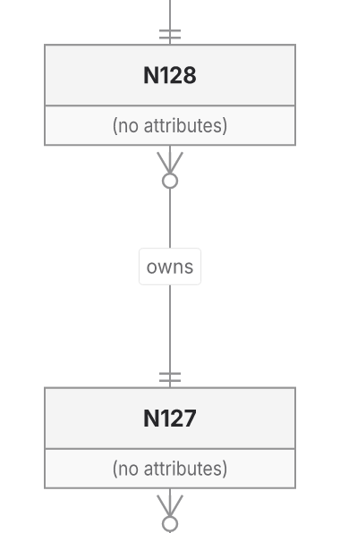
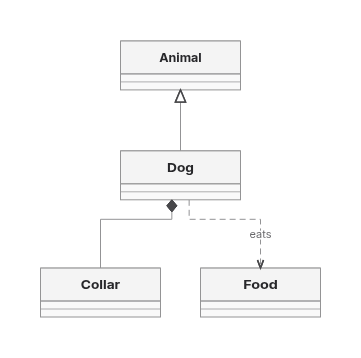

This PR preserves PR449’s SVG ownership/capture foundation, removes the shared ER256 refusal, improves selected Native layouts, and adds a common measured-layout boundary with an opt-in Trinity backend.

**Draft: keep ELK. Trinity delivers 24 of the 30 frozen cases; Native and ELK deliver 28.** Defaults, package versions and original work limits are unchanged.

Source: `21194248b21873a87fa72fa545f67cfd8b49dad4`. Integrated main: `e7cb05baa7f68154942a9ce9c6e9aaaee163dc94` (#608), including its queue, clone-admission and hosted-worker changes. Normal pushes preserve history.

## Verified improvements

Shared ER finalization reuses its call-local glyph/shaft snapshot while routes remain unchanged and combines lookup for the same cardinality-piece checks. ER256 now delivers in all four directions through both backends at the original 400k geometry limit:

| ER256 geometry operations | Before | After |
| --- | ---: | ---: |
| Native BT/RL | Refused | 385,344 |
| ELK BT/RL | Refused | 371,874 |
| Native TB/LR | 397,206 | 343,421 |
| ELK TB/LR | 384,466 | 330,681 |

Previously returned control SVGs remain exact. Refused work is excluded from completed timing comparisons.

Selected same-input results against pinned main `c366de0d137e33e123acd84fc99164417c0f3917`:

| Metric | Main Native | PR Native | ELK |
| --- | ---: | ---: | ---: |
| Forest wire | 700.04 | 397.71 | 396.47 |
| Forest area | 226,466 | 165,356 | 176,727 |
| Class2 area | 85,680 | 65,400 | 61,400 |

Class2 becomes narrower and taller: 200×327 rather than 360×238. The historical Requirement +9.53% area loss no longer reproduces; it is not a new gain. [Comparison scope and inputs](https://github.com/adewale/agentic-mermaid/blob/fb8258f17fadf2996e15aa4c82a0973b1cefae4f/rebase-c366-reconsider-20261107/README.md).

## Common interface and Trinity

Neutral measured constraints distinguish body placement from routed results and enforce finite geometry, subject correspondence and fixed/minimum sizes. Existing completion retains manifest, context, state notes, ordering, freeze and metrics. Native retains its private cache/search/work custody. The primary glyph/CSS producer, Class/ER/Requirement measurements, and bottom-up scope sizing/projection are reused. Native keeps its visit/read order, private search/statistics and route projection.

`graphLayout: { backend: 'trinity' }` selects a real bounded adapter: up to 64 nodes / 128 edges for rectangular Flowchart/State, fixed State start/end circles, flat Class/ER cards and Requirement. It plans endpoint capacity before coordinates. Actual shape circles, marker pieces and caption halos supply measured demand. Unsupported constraints decline; ELK fallback requires an explicit request. Hard kernel exhaustion and defects cannot authorize fallback. No geometry cache is added.

Placement forests reuse body placement without discarded generic routes, under the existing 4,096-node / 16,384-edge limits. A real public single-container Architecture adapter consumes that placement and retains actual text/icon minima, headers, ports and family routes. Broader compounds, Class namespaces/notes/interfaces/cardinalities, controlled images and larger routed workloads remain unsupported; admission caps are not qualification at capacity.

| Frozen 30-case public outcome | ELK | Native | Trinity |
| --- | ---: | ---: | ---: |
| SVG returned, receipt certification passed | 28 | 28 | 24 |
| Explicit unsupported | 0 | 0 | 4 |
| Input errors | 2 | 2 | 2 |

Independent authored meaning, actual ink, delivery and receipt proof remain separate. The existing 613-criterion Trident ledger retains Trinity’s 518 passed / 65 unsupported / 28 blocked / 2 failed observations. Native retains 576/6/28/3 and ELK 575/6/29/3 in that order. Common parser/prelude passes are not solver delivery. Unknown ink remains unknown.

Quality is mixed. On the retained Class inheritance/composition/dependency TB drawing, area is ELK 136,680 / Native 131,040 / Trinity 129,238; wire 348.90/214.60/340.30; bends 2/0/4. All observed crossing/parallel/opposing-overlap counts are zero. On Requirement TB, Trinity has lower area than ELK but more wire and bends; Native is better on both area and wire. ER attribute/cardinality TB area is 147,532/119,152/102,566.1, wire 400.6/271.6/192.1 and bends 0/0/0. Branching Architecture area is 151,171.228/151,171.228/151,593.494, wire 352/358.133/354 and bends 4/4/4: Trinity retains adverse area/wire versus ELK. All four directions and adverse cells remain in evidence.

## Complete-product costs

The existing collector consumes SVG and the entire receipt. Imports, artifacts, explicit GC and profiling stay outside timed render windows. These are exploratory two-replica observations, not general ratios or memory superiority:

| Input / runtime / cache disabled | ELK cold / repeat2 ms | Native | Trinity |
| --- | ---: | ---: | ---: |
| Flowchart / `bbab8283d` | 318.57 / 33.74 | 153.21 / 19.59 | 139.91 / 17.53 |
| Requirement / `bbab8283d` | 308.13 / 45.26 | 164.63 / 31.18 | 154.87 / 28.69 |
| Class / `a67632464` | 300.10 / 35.90 | 160.80 / 26.57 | 159.70 / 21.25 |
| ER / `bcf5e6bad` | 343.84 / 32.51 | 201.88 / 23.09 | 300.15 / 22.64 |
| Architecture / `fe9113601` | 450.56 / 62.45 | 186.22 / 29.26 | 247.81 / 62.75 |

All 300 calls returned with passed certification; repeats were exact and edits changed SVG. Cached results are closer: Class repeat2 medians 22.29/21.61/21.90ms, edit2 21.82/18.14/22.48ms. Trinity has no uniform cached advantage. Architecture cached repeat2 is 22.65/30.10/30.03ms and edit2 27.45/22.07/22.52ms. Cache-off Architecture process peak RSS ranges are 180,984–195,956 / 170,208–174,796 / 170,308–172,484 KiB; heap-used snapshots 51.95–56.47 / 36.64–55.12 / 35.94–39.82 MB. Harness/import/artifact work and GC affect these observations; heap snapshots are not heap peaks and no general memory win is established. Each row binds its runtime revision; the five-input mix is not an all-family throughput benchmark.

Current actual lazy-browser six-family product union, plus four enrolled feature sources:

| Fetched product modules | ELK | Native | Trinity |
| --- | ---: | ---: | ---: |
| gzip9 bytes | 856,349 | 483,797 | 450,550 |
| Brotli11 bytes | 686,964 | 414,176 | 385,763 |
| Requests including binding | 41 | 47 | 47 |

Bindings consume full public SVG+receipt. Binding bytes are separate; the server sent raw bytes and compression follows observation. No compressed-wire or startup claim. Whole Class JSON product gzip is 3,108/3,073/3,109 bytes: Trinity’s code closure saving does not imply smaller output.

Option-validation extraction previously saved 54,116 gzip / 46,024 Brotli bytes. Subsequent integration and Trinity add costs: actual editor **1,341,338 Bun gzip9 / 1,281,204 Brotli11 bytes**, exceeding its unchanged gzip limit by **6,838 bytes**. Architecture changes −94 gzip / +277 Brotli versus the ER checkpoint; its Brotli cost remains adverse. Node/Bun compression results are not mixed.

The fresh 45-call current-runtime profile reports self/inclusive elapsed sample weights per complete product: copyInner 2.162/2.842ms; external snapshot visit 1.581/1.749; certifyNativePaint 0.740/3.531; copy 0.623/2.948; omitUndefinedObjectFields 0.552/0.604. Inclusive weights overlap. Existing cache inventory is retained; no cache added or invented speedup. An unsafe diagnostic-path-only ceiling preserves 40 successful full products but breaks nested error paths and shows inconsistent timing (repeat2 26.76→28.04ms, worse). Stop that hypothesis; no performance rewrite shipped.

[Class evidence and reproduction](https://github.com/adewale/agentic-mermaid/blob/8afca58de944dd502904d17fe4ead80550d9aea2/trinity-class-checkpoint-20261108/README.md), [primary comparison](https://github.com/adewale/agentic-mermaid/blob/a7aa224e9cd6c580bfc0d43d16b6069c3c2b1fdd/trinity-primary-checkpoint-20261108/README.md), [specification](https://github.com/adewale/agentic-mermaid/blob/21194248b21873a87fa72fa545f67cfd8b49dad4/docs/design/system/trinity-layout.md), [roadmap](https://github.com/adewale/agentic-mermaid/blob/21194248b21873a87fa72fa545f67cfd8b49dad4/docs/design/system/layout-0.6-qualification.md), [profile](https://github.com/adewale/agentic-mermaid/blob/21194248b21873a87fa72fa545f67cfd8b49dad4/docs/design/system/layout-0.6-performance-review.md).

[Final Architecture, complete-product costs and current profile evidence](https://github.com/adewale/agentic-mermaid/blob/8e4ebd21df5041ea654343d2037622c9f9ddc3c7/trinity-architecture-checkpoint-20261108/README.md).

## Visual evidence

Baseline SHA: `a195262036dbb07c7ce4919505d4ff47dea09e63`.
Current SHA: `21194248b21873a87fa72fa545f67cfd8b49dad4`.

The ER baseline refuses BT/RL; no before drawing exists. This actual repair crop retains N127→N128, label and cardinalities. Later refactoring preserves the products.

The new Trinity Class output below is from actual final SVG with verified Inter fonts. Earlier Trinity refused this input; this is added delivery, not a before/after quality claim. [Native](https://raw.githubusercontent.com/adewale/agentic-mermaid/493a6e695706046711b0b387f5054ec3e2757069/trinity-class-checkpoint-20261108/agentic-inheritance-TB.png) and [ELK](https://raw.githubusercontent.com/adewale/agentic-mermaid/493a6e695706046711b0b387f5054ec3e2757069/trinity-class-checkpoint-20261108/elk-inheritance-TB.png) alternatives are retained.

## Verification and remaining losses

Core/repository types, lint, affected owners and actual lazy/editor builds pass. New public source/parsed/layout/PNG/fallback/hard-error contracts pass. Earlier shared extraction preserved all 1,748 Native/ELK vectors; primary extraction preserved 874 Native vectors. Subsequent affected State/Class/ER products remain exact. Shared Architecture extraction preserves 874 Native vectors; its final leaf-count adjustment preserves all 34 affected compound vectors and eight Native/ELK Architecture products. Those replays validate preservation.

Current test-only-head CI `42536426208` is in progress. Runtime `fe9113601` CI `42534101146` completed failure: Sparse32, lazy/website budgets, advisory, plus two stale Class/ER refusal tests. Both stale failures were reproduced and repaired; the complete Requirement file now passes 51 tests. Core/repository types and lint pass after the test-only repair. No runtime or visible gain is claimed for test maintenance. The introduced MCP description overruns were reproduced and repaired without raising limits; both context owners pass. **The PR is not ready.**

Known Native contacts 152/372/201/241, crossing276, Class2, Sparse256’s historical +5.04% area gap, Sparse32’s 400k proof exhaustion and distribution failures remain. Original baseline2dad and comparable Mermaid/Pele performance remain unavailable. Replacement24 stays sealed. Stage 5 broader compound/family migration and stage 8 broad qualification remain incomplete. Stage 9 decision: retain ELK. Stage 10 retirement is deferred. Deadline: 2026-11-08 23:59:59 UTC; automations remain off.
