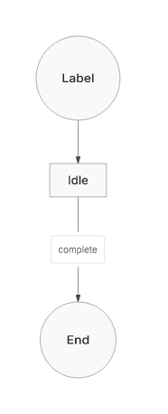
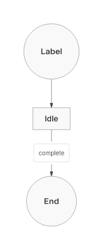
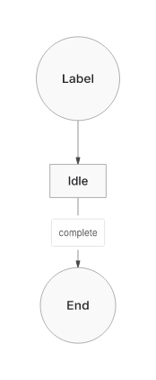
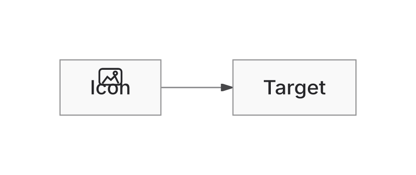
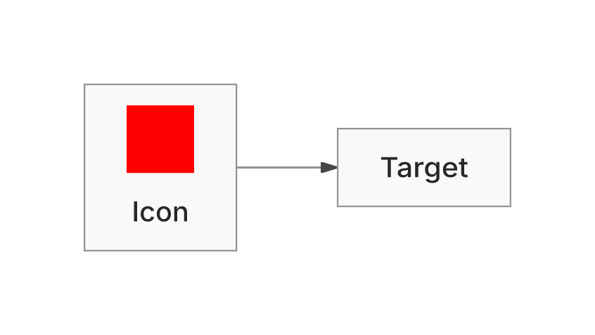

## What changes

**Draft; retain ELK.** This PR preserves SVG ownership, fixes measured rendering/layout failures, and adds an opt-in Trinity solver. Trinity does not cover ELK's workload. Source `dee908197a8fe678d05cb6e1c6827d05ae9d4fb7`; main `e7cb05baa7f68154942a9ce9c6e9aaaee163dc94`. Backend defaults, versions and original limits stay unchanged. “Native” below is the `agentic` backend.

- Bind proof to actual SVG writes and occurrence ownership, preserving mutable/getter, UTF16, CSS, definitions and cache isolation. Native and ELK now deliver ER256 in four directions within the original 400k geometry allowance. Sparse32 emitted-proof exhaustion remains separate and unresolved.
- Repair Native capacity, invisible constraints, shortening, nonlinear forests and component packing. The dated forest wire changes 700.04→397.71 versus ELK396.47; area 226466→165356 versus ELK176727. Sparse256's implemented historical area gap is +5.04%; the +0.97% candidate remains unshipped.
- Improve shared consumers too: canonical Requirement contact demand, frame-containment rollback, and actual sized inline PNG drawing. Native/ELK replace a vector placeholder; Trinity gains delivery. Raster paint remains unmeasured/unverified. Remote media stays inert; security, custom-backend compatibility, catalog/SDK generation and truthful build provenance remain enforced.
- Add explicit measured placement/routed results and a bounded Trinity kernel. Supported adapters include rectangular/rounded Flowchart/State scopes, fixed State circles, flat fixed ordinary circles, canonical Class scopes, flat ER/Requirement, single-container Architecture and closed-scope canonical diamonds. Routed admission remains 64 subjects/128 edges. Unsupported inputs decline unless fallback is requested; exhaustion stays hard.

Latest verified repairs:

| Failure | Result | Retained cost / limit |
| --- | --- | --- |
| Native201 + three invisible constraints, TB/BT: caption hides a marker | Each selected head: 66 hidden/72 attenuated pixels→0/0 at3× | Caption moves16.8px along/0.5px across its route; nodes/routes/viewport stay exact. Each selected browser closure adds933gzip/727Brotli bytes. [Evidence](https://github.com/adewale/agentic-mermaid/blob/55f7df9306a8f2a75b69a51e6b5dbdfb000c389a/native-body-gap-checkpoint-20261109/README.md). |
| Thin-head capacity hint disables weighted endpoint packing | Keep body growth; restore per-occurrence packing. Selected cyclic353head8hidden/18attenuated→0/0; three other sampled heads4attenuated→0 | Six NativeU→P, noP→U;39layouts change. One crossing2→3, two+2bend cases, three slightly longer wires. [All adverse vectors](https://github.com/adewale/agentic-mermaid/blob/f04428d0d5861f008707f784ab35c9f72949e204/native-weighted-packing-checkpoint-20261109/QUALITY-DELTA.json). |
| Trinity rejects ordinary labelled circles | Reuse canonical shapeOutline radii; distinguish logical centreline from stroke paint. Flat fixed singleton source/target circles work in four directions | Multiport/loop/compound requests still decline. Valid State geometry unchanged. [Evidence](https://github.com/adewale/agentic-mermaid/blob/ac347e7489e94b42a90ae45ffbd39ed2564c0d90/trinity-ordinary-circle-checkpoint-20261109/README.md). |

## Correctness and remaining domain

Original874sources, identical authored input/options with explicit backend/fallback:none:

| Outcome /874 | ELK | Native | Trinity |
| --- | ---: | ---: | ---: |
| SVG returned |874|874|123|
| Proof passed |696|741|123|
| Proof unverified |178|133|0|
| Unsupported |0|0|751|

These are delivery/proof counts, not visible-correctness scores. Native's current874requalification retains835whole products and changes39; sixU→P include five introduced regressions. Trinity's fresh874run recovers one labelled circle; its prior122returned whole products remain exact. Native/ELK874records are from the preceding unaffected paths; all3current frozen controls remain exact.

The distinct frozen30cohort retains28returned/27proof-passed/1raster-unverified and2shared invalid-option errors per backend. The separate36fan cohort retains32P/4U per backend. No failed, unsupported or unknown row is dropped. Actual selected rasters and authored identities/labels/endpoints are checked separately; no whole-workload ink parity follows.

A remaining shared defect is now measured: a target body partly hides hollow end-circle markers in the mixed fan. SelectedLRring hidden pixels: ELK10, Native21, Trinity12. Changing only marker references is insufficient and remains unshipped. A derived0.625px painted-tangency **SVG-only counterfactual** removes fully hidden selected ink in all3, with residual antialias attenuation0/1/5; it is not a public implementation or requalified proof. The pipeline lacks one shared owned transaction for painted terminal seating and public route correspondence. No extra gap, proof exception or partial fix is shipped.

## Performance, memory and bytes

Same current3node/2edge TBcircle chain; full publicSVG+entireReceipt consumed. Twelve serial fresh Node24processes/60calls allreturn/P; two process replicas/cell. Imports, GC, writes and compression are separate. Existing layoutcache0/1 is separate from other derived caches. No speed ratio against former Trinity refusal, general winner, p95, allocation/retention or leak claim.

| Circle-chain metric | ELK | Native | Trinity |
| --- | ---: | ---: | ---: |
| First render ms; import excluded | 411.04 | 186.88 | 222.96 |
| Uncached repeat wall / CPU ms | 47.83 / 88.52 | 36.73 / 57.28 | 33.99 / 59.49 |
| Uncached repeated edit ms | 56.08 | 25.78 | 27.12 |
| Cached repeat / repeated edit ms | 6.56 / 18.38 | 5.20 / 15.22 | 5.20 / 15.31 |
| Heap snapshot MiB | 50.13–50.14 | 38.43–38.43 | 37.46–37.49 |
| Process peak RSS MiB | 180.33–184.94 | 182.98–183.69 | 168.01–177.44 |
| Area px² | 85277.89 | 78367.30 | 73462.80 |
| Wire px / bends | 164.30 / 0 | 126.30 / 0 | 126.55 / 0 |
| Response gzip / Brotli bytes | 2431 / 2096 | 2431 / 2100 | 2435 / 2103 |

Trinity loses to Native on first render, repeated edit and response size in this case. Raw ranges and every phase remain in the [current comparison](https://github.com/adewale/agentic-mermaid/blob/ac347e7489e94b42a90ae45ffbd39ed2564c0d90/trinity-ordinary-circle-checkpoint-20261109/COMPARISON-TABLE.md). The [dated labelled-star comparison](https://github.com/adewale/agentic-mermaid/blob/f04428d0d5861f008707f784ab35c9f72949e204/native-weighted-packing-checkpoint-20261109/COMPARISON-TABLE.md) separately retains adverse Native cached repeat7.94→22.01ms and cyclic353cached repeated-edit56.23→110.52ms. Different workloads are not pooled. All actual gzip/Brotli response streams decode exactly.

Actual13input browser product union, all3lanes passing:

| Metric | ELK | Native | Trinity |
| --- | ---: | ---: | ---: |
| gzip9 bytes |861487|489891|483140|
| Brotli11 bytes |691425|419955|413902|
| Requests, including separately listed binding |43|49|50|

Current circle change: gzip0/+51/+44bytes, Brotli−81/−39/−30, no new requests. Four new circle directions pass all3in the actual browser too. These are fetched bytes compressed offline, not compressed-wire/startup measurements. The full package can grow despite a smaller selected solver closure. Actual module graphs already load only the selected solver; the unnecessary-solver-import hypothesis was falsified and stopped.

## Verification and readiness

Reproduce circle owners: `bun test src/__tests__/trinity-layout.test.ts src/__tests__/graph-layout-selection.test.ts -t 'fixed centered ellipse|seats circle contacts' --timeout 30000`. Eight assertions fail before the extension. Current414owning checks across7files, core/repository types and lint pass. Previous Native repair:644owners and original874inputs qualified. Frozen90retains84whole products/sixsameerrors. Public owners check actual written circle radii/cardinal endpoints and authored labels; native-sizeSVG/PNGs bind canonical Inter bytes with system fonts off.

[Exact-head CI42678116358](https://github.com/adewale/agentic-mermaid/actions/runs/42678116358) completed **failure**. Unit2/3, package consumers, browser, semantic conformance and renderer isolation pass. Unit1has7142passes/1failure: Sparse32 emitted-proof exhaustion. Original budgets fail:

- LazyFlowchart783210>761500gzip bytes.
- Website demo315344>302500gzip bytes.
- Standalone editor1338979>1334500gzip bytes.
- Relative payload growth and the advisory generated-layout diagnostic also remain adverse.

The PR is not ready. Limits are not raised and failures are not waived. The [five-hotspot self/inclusive profile and cache inventory](https://github.com/adewale/agentic-mermaid/blob/60d02d4b6e0dce15bc03d6f38e5c157743b2b787/docs/design/system/layout-0.6-performance-review.md) retains its own revision; no new cache or invented speedup is added. Original2dad baseline and equivalent pinnedMermaid/Pele runtime comparisons remain unavailable. Replacement24stays sealed. Stages5/7gain limited capability; stage8remains incomplete; stage9retainsELK and stage10retirement is deferred.

## Visual evidence

Baseline SHA: `e7d8070ebef60c3a546d0f23153c3ae9d69d8233`.
Current SHA: `dee908197a8fe678d05cb6e1c6827d05ae9d4fb7`.

Actual canonical SVG/native-size renders with manifest-verified Inter and system fonts off. ELK/Native already delivered these circle chains; Trinity previously refused. No pre-change Trinity image is implied.

| ELK | Native | Trinity |
| --- | --- | --- |
|  |  |  |

The shared image repair has different dated provenance: beforec0099d8c, aftere387; its current frozen whole products remain exact. Before, Native/ELK render a placeholder; after, the red square is the authored PNG. Raster proof remains unverified.

| Placeholder before | Actual authored image after |
| --- | --- |
|  |  |

Source and all evidence are preserved on the existing PR/recovery branches. No new PR/issues, forced history rewrite, manual CI dispatch, release, default/version or cap change.
