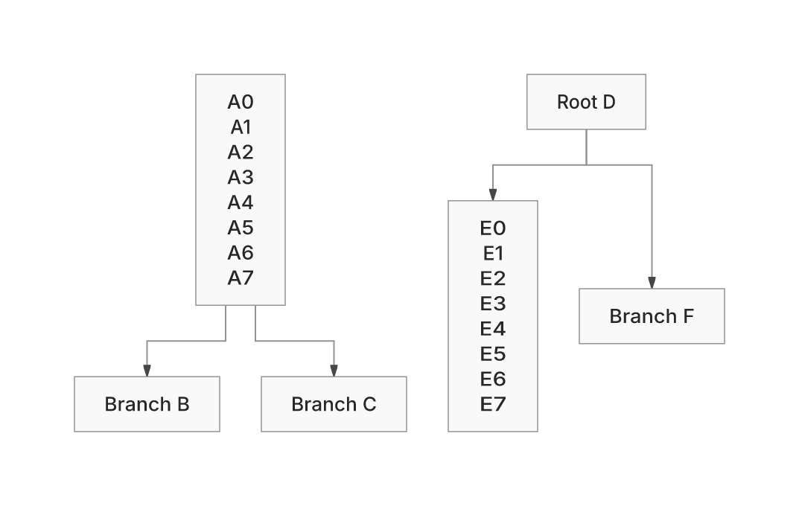

Recover the PR449 layout and SVG-emission work, retain its ownership/capture foundation, and integrate it with current main. The retained fixes restore previously refused Class/ER cases, preserve authored text and endpoint paint, and reduce wasted space in selected Native layouts. The latest change separates terminal forest exits without moving cards.

This is a **draft**. Main `f9ec8c115de14020d3c182d5d7f2e7e70bfcdefb` and recovery head `e057d987ab8f73e84cf7d8a59b4c853dcf545249` were joined by normal merge `fa85d8123eebdbc1194298f3ae3fe17ce9711453`. The combined diff includes the inherited ownership APIs and validation machinery; its scope exceeds the earlier recovery-only comparison. Main's 0.5.7 identity, ELK default and caps remain intact.

## Changes and contract

Authored identities, parents, relationship occurrences, labels and marker ends must reach the final SVG with their intended ownership and paint. Delivery, visible correctness, proof availability, layout quality and execution cost are assessed separately.

- Class caption seating restores the enrolled nested-caption result from 6/8 to 8/8. Scene reuse and final-coordinate publication support Class128 certification in four directions.
- ER allocation and prefix reuse restore the reproduced 192/207/208 delivery cases. Scene reuse lets ER208 finish proof without changing its SVG. Independent Native cards use the existing 20px ER component clearance by default; connected spacing and explicit overrides are retained.
- Shared emission preserves formatting across hard breaks and retains captured geometry for terminal paint. The enrolled raw orthogonal/STEP hollow circles gain 225 confined pixels in both backends; proof remains unverified for that paint witness. Cubic, closed, diagonal and reversal cases remain outside the demonstrated repair.
- Inspection/capture repairs preserve actual served-contour authority, private copied coordinates and owned text arrays. The integration fixes include the reproduced private-point constructor escape and the discretionary-hint caption refusal; admission and caps are unchanged.

The [work log](https://github.com/adewale/agentic-mermaid/blob/741b80dba91c0e1f4feba9a62695f7820bc79a23/docs/design/system/layout-0.6-work-log.md) records each runtime revision, reproduction, retained cost and stopped experiment.

## Forest fix and remaining delta from ELK

`69af97a12aefe1140095064312a7f32b3f5e5714` fixes the first responsible stage in the enrolled nonlinear forest. Native places unequal terminal bodies at a common measured center, but the late fanout gate compared their leading faces and rejected them. An earlier port edit would be overwritten by bundling. The fix reuses the existing route-only fork producer after bundling, preserving every body seat and target terminal.

The added branch handles plain unlabelled solid-arrow forks to 2–3 distinct rectangular terminal peers. Captioned, styled, parallel and noncentered cases retain their existing routes. Existing same-start, grouped and diamond behavior is preserved. The observable benefit is shorter, separated source exits; both old source runs already contributed ink.

| Workload | Native relative to ELK | Remaining limitation |
| --- | --- | --- |
| Nonlinear forest, freshly measured on the integrated candidate | Wire **+10.19%**, down from +16.89%; area **−6.43%**. Native wire 463.4375→436.8572, area 165,355.6575 and eight bends unchanged. ELK wire 396.4697, area 176,727.21; its SVG stays byte-exact. | Residual placement/terminal cost remains. Fixed-dock routes were already shortest. The stopped body-equalization trial grew area 6.88%. |
| Sparse256, retained historical measurement | Area **+5.04%**: 3,633,619.5 vs 3,459,200; wire 132.598 vs 214.598. | The isolate-spacing fix removed 51.22% of the prior Native area. The +0.97% backfill candidate is unshipped; +115.35% is the obsolete pre-fix gap. |
| Requirement cycle, retained measurement | TB/BT area **+9.53%**; LR/RL **−1.44%**. | Directional placement loss remains. The later PNG review does not close it. |
| ER256 relationship chain | Both backends refuse. | Guarded shortcuts did not remove enough work; those hypotheses were stopped. |
| Sparse32 | Delivered 1,500 text records and 32 contributing markers; proof unverified at 400,000 operations. | Separate from ER256 refusal. Middle-glyph attribution, readability and arbitrary fonts remain unknowns. |

These rows retain their recorded provenance and do not establish a complete current peer ranking. The original baseline2dadf0dbc2685c8435df541de99f3edce841450d/Trident comparison and pinned Mermaid12.2/Pele1.9 products remain unavailable after recovery. Pele1.8 was not substituted. Replacement24 stays sealed.

## Visual evidence

PR baseline SHA: `f9ec8c115de14020d3c182d5d7f2e7e70bfcdefb`.
Current PR head SHA: `741b80dba91c0e1f4feba9a62695f7820bc79a23`.

Claim: the same forest input has two distinct normal exits below Root D, with every card, label and target terminal preserved. The pictured before runtime is `3b35c1b3d3387df2d61323071b3c9678b06f1445`; the pictured after runtime is `69af97a12aefe1140095064312a7f32b3f5e5714`. This pair isolates the latest fix within the branch. The current head adds only a Class expected PNG and documentation beyond that runtime revision.

| Before | After | Reviewer cue |
| --- | --- | --- |
|  |  | Inspect the stems immediately below Root D. Both images use the same viewport and manifest Inter fonts. The left A fork is unchanged. |

[Inputs/options, actual SVGs and entire receipts, source/marker subtraction, costs and frozen patch](https://github.com/adewale/agentic-mermaid/tree/6b5ed81355e05954b11b8a47b10c13627493bd20/forest-exits-20261105) are retained outside the source diff. Independent readback preserves six identities, four ordered relationships, 20 logical text lines and eight normal contacts. All four head contributions remain positive and unchanged. Source-run contributions remain positive in both versions; the new runs occupy disjoint regions. These checks do not qualify arbitrary fonts or every possible fork.

Owning reproduction on Bun1.4.4:

```sh
bun test src/__tests__/fanout-symmetry.test.ts src/__tests__/forest-lazy-boundary.test.ts src/__tests__/indexed-forest.test.ts src/__tests__/layout-equivalence.test.ts --timeout 60000
```

Four directional owner cases fail against the old fork gate. The final run passes 44 tests, including the public final-SVG guard and the unchanged 322-record geometry corpus. Another 28 ownership/CSS tests, core types and two-file lint pass. A fresh Native repeat matches the first candidate byte for byte; the ELK control is unchanged.

## Integration qualification

Nine Class geometry records were reviewed against actual main/current SVGs before updating expectations; 313 records stayed unchanged. The measured halo is 3px where layout previously reserved 6px. Eight canvases lose excess height; Class25's captions move while bodies and routes remain exact. The [Class review](https://github.com/adewale/agentic-mermaid/tree/5de73796a993e4abee23ad6ee90f85baf4693e34/class-review-20261105) retains the main/head products and selected-caption ink controls.

The Requirement complex PNG was reproduced failing. A temporary reversal of two ELK spacing options restores main's complete layout and all eight carriers, identifying the valid contains-start clearance change as the cause of four one-pixel interior-track shifts. All 2,080 changed pixels lie in the routing corridor; authored fields, contacts and marker poses remain. Only its reviewed PNG changed; 97 citizenship/Requirement owners pass. [Exact products and restored causal control](https://github.com/adewale/agentic-mermaid/tree/1a8297b9d98b2d7f22e97b59746f56a01ac56668/requirement-review-20261105) retain the limits and adverse proof/file costs.

The browser Class expectation had the same halo-spacing cause: ApiService and its contents move up 3px, the caption 1.5px, with retained rounded fills and contacts. Independent inversion of those changes restores main's entire DOM. Only the Class expected PNG changed; the unchanged five-case browser test passes 29 assertions in 13.99s. This difference is too small for useful thumbnail comparison; the [exact DOMs, PNGs and failure/pass logs](https://github.com/adewale/agentic-mermaid/tree/9a60e1cfdd76f635515d17e9a56ba3fd9ccb125d/browser-spacing-20261105) provide the review. Other screenshot expectations and tolerances are unchanged.

[CI3b run42057059999](https://github.com/adewale/agentic-mermaid/actions/runs/42057059999) completed failed on the merge into mainf9. Shards1/2, semantic conformance, browser contracts and package consumers pass. Sparse32, browser/payload checks fail; the CLI lane failed downloading Bun with HTTP504 before tests. The browser PNG has since been qualified locally. **Latest-head [CI741 run42064078938](https://github.com/adewale/agentic-mermaid/actions/runs/42064078938) completed failed; this PR is not ready to merge.** Shards1/2, semantic conformance, CLI/MCP, browser scene checks and package consumers pass. Shard3 fails only the enrolled Sparse32 proof-cap case. Rounded-header screenshots pass; browser-site still fails the standalone payload budget. Quality/full-payload checks and the advisory layout diagnostic fail. The intervening forest-head run was superseded/cancelled.

## Performance and adverse costs

The [five-hotspot profile and cache inventory](https://github.com/adewale/agentic-mermaid/blob/741b80dba91c0e1f4feba9a62695f7820bc79a23/docs/design/system/layout-0.6-performance-review.md) profiles revision99ed with six fresh Node24 workers, six warmups and 18 fully consumed calls. It distinguishes self/inclusive sample weights, whole SVG/entire receipt, cache/repeat/edit and CPU/RSS/heap. Snapshot traversal is the largest Native Class self weight at 147.9ms/call. Expected optimization speedups remain unmeasured; descriptor-Map causation was withdrawn. The adverse cache-on edit sample is 2,393ms wall/3,871ms CPU.

The forest quality fix increases proof work **97,331→98,311 (+980)**, SVG **8,027→8,047 raw / 1,462→1,483 gzip9 / 1,233→1,238 Brotli11 bytes**. Candidate wall samples include both faster and slower observations; no speedup follows. Equivalent complete standalone builds, using the same dependencies/recipe and only reverting the fork source for the control, measure **1,418,892→1,419,207 gzip9 bytes (+315)**, raw +332. The original producer and candidate HTML were restored byte-exactly. This download cost remains above the existing ceiling; no allowance was raised.

Other retained costs remain adverse: Native Sparse256 gzip SVG is 13,323 vs ELK12,762 bytes; latest CI complete selected-ELK Flowchart download is main 732,640→candidate 771,830 gzip bytes (+39,190), including another 120 bytes after the fork change. Earlier same-recipe request counts fell 34→25; initial transfer was separately 5,924→5,858 gzip bytes. These are distinct from execution time. The [work log cost table](https://github.com/adewale/agentic-mermaid/blob/741b80dba91c0e1f4feba9a62695f7820bc79a23/docs/design/system/layout-0.6-work-log.md#qualification-and-costs) retains cold/repeat/edit, RSS and payload observations at their original revisions. No unequal-work runtime ratio is claimed.

## Recovery and risk

Source/tests are on this PR branch; evidence is on `review/pr449-evidence-20261105`. The [latest restore checkpoint](https://github.com/adewale/agentic-mermaid/blob/9a60e1cfdd76f635515d17e9a56ba3fd9ccb125d/browser-spacing-20261105/README.md) descends from the original 5,122-file reconstruction and preserves the new comparative products, controllers, failed probes and build artifacts. Each new archive member was byte-verified. Archived leases cannot authorize a writer.

The broad ownership/emission diff, remaining proof/resource failures and future main changes require further qualification. Failed drafts remain visible, including the stopped ER shortcuts and a disposable raster diagnostic killed after repeated pixel-getter allocations; its corrected single-buffer run completed. The owner authorized bounded continuations and regular pushes through **2026-11-08T23:59:59Z**. Continuous execution is not claimed.
