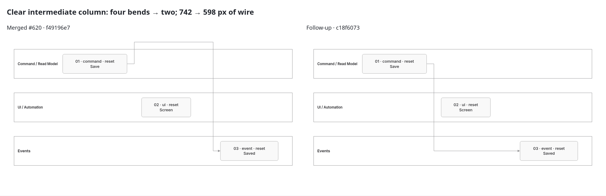
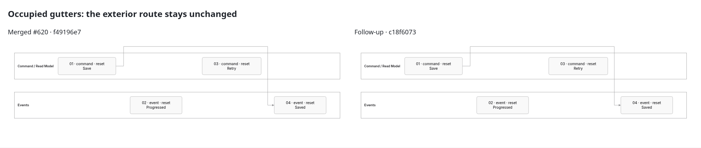

# Clear Event links, paint reuse and remaining crossings

Source control: merged PR #620 at `f49196e7f5d6d2f0970a4a76fe62644ee5e9d004` (tree identical to tested `c790c8adb918dd0f437488327c250d7841b060b0`). Follow-up source: `c18f607364ca1d85dd91a669c8ac33a2c7173a23`. This packet is outside the source diff. Prior captioned PR #620 evidence remains in its original directory on this branch.

## Visible result and meaning

The clear three-frame Event Modeling connector changes from six points/four bends/742 px of wire to four points/two bends/598 px. The same-lane variant changes six points to two, and 461 to 317 px. Node and group geometry, identities, endpoint contacts and authored relations stay the same. Card-blocked and peer-blocked controls keep their original six-point SVGs byte for byte. Each before/after product verifies and has a passing scoped actual SVG paint receipt.

Follow the vertical shaft between the command and event cards. The shorter path uses the clear intermediate column instead of the exterior top gutter. It preserves the two original contacts. The blocked control below retains its exterior path.

[Exact sources, SVGs, complete receipts and layouts](event/) · [Four-case measurements](event/results.json) · [Capture recipe](event/event-images.mjs). Render with the production CLI at either source revision: `bun run bin/am.ts render /tmp/event-skip.mmd --format svg --output /tmp/event-skip.svg`, after copying `event/clear.mmd` to that input path. Node 24.19.0, Bun 1.4.4 and Chromium 156 were used. The renderer’s prepared occupied text bounds are not exact glyph outlines; external CSS and declared transparency remain outside the scoped receipt.

## Paint preparation

One-use inert paint supports move from owned graph label settlement to the immediately adjacent final admission. The consumer pays its original work debit into a fresh ledger, validates current coordinates and paint inputs, and refreshes every later changed proposal or rollback. Standalone, grouped, custom-measurement and oversized inputs retain their original path. Event shortening also requires canonical written paint. Missing/custom paint identities preserve the old route; SVG and terminal-companion cache entries retain their distinct identities.

Three observed graph inputs reused 271 of the 284 initial route supports offered to consuming contexts and 104 node boxes. Seven producer initializations prepared 359 route rows and 128 boxes overall; a dense projection prepared 75 rows and 24 boxes which no consumer used. Thus 271/284 is conditional reuse, while 271/359 covers all prepared route rows. Full hitch scans remain. [Structural observations](analysis/paint-counts-v2.json) · [Read-only review](analysis/REVIEW.md).

The 31 retained public graph products have identical layout, full SVG and full receipts, the same seven archived quality fields and verification results, and passing scoped actual paint. [Qualification](qualification/aesthetics.json). No ELK kernel, routing policy, option/default/version/cap, existing test expectation or golden changed.

## Fully consumed execution cost

The final comparison used 72 balanced fresh serial Node processes: two source operands × six cases × two cache settings × three processes. Each process timed cold rendering, seven original-source repeats, one actual edit and three edited-source repeats. SVG plus the entire receipt was serialized and counted as UTF-8 inside each clock. Import is separate; explicit GC, compression and evidence writes are outside the clocks. RSS and heap include the harness and retained products. Other local tests, builds, browsers and profilers were stopped. This is exploratory sampling, not formal calibration or a full Trident score run.

Cache-disabled medians of per-process warm means:

| Case | Merged main ms | Follow-up ms | Change | Main/follow-up heap MiB | Main/follow-up RSS MiB |
| --- | ---: | ---: | ---: | ---: | ---: |
| Chain100 | 95.09 | 80.13 | −15.7% | 34.63 / 33.78 | 134.68 / 132.96 |
| Nine-chain | 101.52 | 122.18 | +20.3% | 31.63 / 33.30 | 136.27 / 133.01 |
| Cyclic19 | 172.46 | 182.34 | +5.7% | 39.78 / 42.09 | 164.25 / 179.01 |
| Dense24 | 514.55 | 483.96 | −5.9% | 79.22 / 81.90 | 276.54 / 295.65 |
| Clear Event | 6.85 | 4.80 | −29.9% | 15.76 / 15.80 | 88.01 / 85.78 |
| Blocked Event | 4.81 | 4.88 | +1.3% | 15.74 / 15.84 | 86.90 / 85.43 |

Chain100 is outside the reuse eligibility limit; its timing change is not attributed to that feature. Dense cold time worsened 763.46→989.65 ms with caching disabled, while the cache-enabled cold result reversed, 998.82→772.10 ms. Dense cache-enabled first edit improved 570.91→513.85 ms; uncached first edit worsened 481.62→490.44 ms. The entire result supports neither a renderer-wide speedup nor a memory reduction. [All import/cold/cache/edit/peak-RSS cells](benchmark/summary.json) · [Phase deltas](benchmark/delta.json) · [Raw workers](benchmark/raw-results.jsonl.gz) · [Protocol and exact case sources](benchmark/).

All 864 products returned with passing scoped certification. All 288 graph plus 72 blocked-Event paired products have identical SVG and complete receipt bytes. All 72 clear-Event paired products changed as intended. All 504 warm repeats match their own cold product. [Per-product hashes](benchmark/byte-controls.json) · [Every consumed SVG/receipt](benchmark/consumed-products.tar.gz). The archive maps all 1,728 product files to 28 distinct uncompressed byte objects by SHA-256; no returned product is omitted.

A separate six-process same-c18 nine-chain diagnostic disabled only the producer preparation argument in memory. Handoff off/on warm medians were 116.75/102.40 ms (−12.3%), with all three paired workers faster when enabled. Cold 311.36/339.13 ms and first edit 93.46/137.63 ms worsened; edited repeats 95.17/96.03 ms were nearly flat. All 72 outputs passed and matched the untouched c18 products. This isolates a sample-local warm contribution, including JIT effects of the changed callsite. It does not replace or explain away the +20.3% release-level nine-chain result. [Diagnostic source, bindings and raw workers](nine-chain-ablation/). An inherited baseline label in its first summary was corrected in the generator; raw measurements were not changed and the stale summary is preserved locally.

The earlier prototype’s adverse dense first-edit result and larger heap were retained. It is a different build, not the final source. [Prototype raw results and summary](rejected-prototype/) · [Its paired profile](analysis/dense-edit-profile.json) · [Interpretation](analysis/COST.md).

## Actual compressed payload

| Surface | Merged main | Follow-up | Delta |
| --- | ---: | ---: | ---: |
| Initial lazy gzip, five files | 6,248 B | 6,249 B | +1 B |
| ELK-selected Flowchart closure gzip | 351,135 B / 25 files | 352,365 B / 26 files | +1,230 B / +1 file |
| Same closure Brotli | 298,509 B | 299,728 B | +1,219 B |
| Solver gzip | 62,699 B | 62,699 B | 0 |
| npm archive | 7,096,884 B | 7,103,321 B | +6,437 B |
| npm unpacked | 21,003,201 B / 269 files | 21,016,825 B / 270 files | +13,624 B / +1 file |

All unchanged lazy and actual Chromium website payload budgets pass. Closure gzip sums per-file gzip9; it is not a monolithic bundle or extra-RTT estimate. [Lazy report](lazy-c18f6073.json) · [Deltas](payload-delta-c18f6073.json) · [Actual website requests](website-payload-c18f6073.json).

## Same-input crossings

The exact 1,052-byte titled input has SHA-256 `f1d482325fb4f8c463b88269655bce30a02556b0b2a1990deae3cef6f0714e12`. Each product retains all 44 authored edge occurrences and 11 caption associations. The table counts proper emitted-shaft centerline incidences, excluding endpoint contacts, tangencies and shared spans; multiple distinct crossing points for one edge pair count separately.

| Product | Crossings | Distinct crossing edge pairs | Positive collinear segment spans |
| --- | ---: | ---: | ---: |
| Current ELK.ts | 37 | 37 | 7 |
| Original ELK.js 0.11.1 in the same SDK wrapper | 37 | 37 | 7 |
| Zombie Mermaid 5.17.0 | 31 | 31 | 0 |
| Hosted pele.run, displayed 1.13.0 | 40 | 38 | 0 |
| Pele npm 1.13.0 | 38 | 37 | 0 |
| Historical Native | 23 | 23 | 3 |

The same-wrapper JS/TS SVG and receipt are byte-identical. Current c18 preserves those graph products. Hosted Pele is an actual playground capture with an exact editor-source hash and saved asset URLs, not the npm output; its deployment Git identity is unknown. Complete line/quadratic/cubic calculations cover all 946 edge pairs with zero unresolved pairs and independent numerical agreement. No listed crossing center is inside a later-painted node/caption bound. Stroke extents, glyph ink, raster occlusion and other inputs are outside this diagnostic. Shared spans are not the SDK’s route-overlap rubric. Trident 0.4.0’s capped observer leaves this fixture unassessed; its unavailable crossing total is not zero. [Detailed interpretation](analysis/COMPARISON.md) · [Actual source and all six SVGs](crossings/) · [Hosted incidence checks](analysis/hosted-pele/).

No new kernel-ordering policy qualified. Native-inspired feedback/node order produced 40 crossings; priority trials produced 47–51, and eight of nine adjacent swaps stayed at 37 while one rose to 51. An apparent route win hid a crossing in 97.845 px of shared opposing ink. A two-return corridor/target-slot experiment reached 36 without a new shared span but displaced a caption. Next causal work is a joint two-route, two-port and label reseating transaction at the existing feedback owner, with full written-paint clearance. Issue #619 remains open.

## Local verification and remaining blocker

Source c18 has 17,053 distinct passing unit cases and 78 skips, including serial recovery after an initial parallel OOM and one property timeout. Shard 2 passed 4,360/28; shard 1 passed 6,497/15 plus one timeout; the timed-out file then passed all ten cases at the unchanged 30-second limit, and the entire killed shard 3 passed 6,195/35 with Bun’s memory-saving GC mode. The other nine waist tests are counted only once. No test, golden, timeout or proof cap was changed for these failures. [Counts](checks/unit-summary.json) · [Raw passing, failing and recovery logs](checks/).

Build, core/repository types, lint (2,175 files), website artifacts, family catalog, lazy execution/budgets, actual Chromium request budgets, 529-diagram/2,116-format ugly audit, and dependency advisory scan pass. The scan checked 687 packages, no high/critical findings, 14 below the high threshold. A symlink caused an initial lazy observer failure; a hash-verified physical dist restored its exact-path observation and the unchanged gate passed.

The aggregate pre-push command did **not** pass. Pinned Docker font-subset regeneration is still blocked by full container storage: first `/tmp`, then `/output/toolchain` after supplying temporary memory and the host trusted CA bundle without disabling TLS verification. Font/source policy is unchanged. This is not a waived or passing check. No remote CI was run. The follow-up remains draft until this check and the remaining review decision are resolved. Both adversarial Astra 6.2 Max reviewers approved the scoped source contracts and recommended retaining the bounded reuse with these cost limits.
