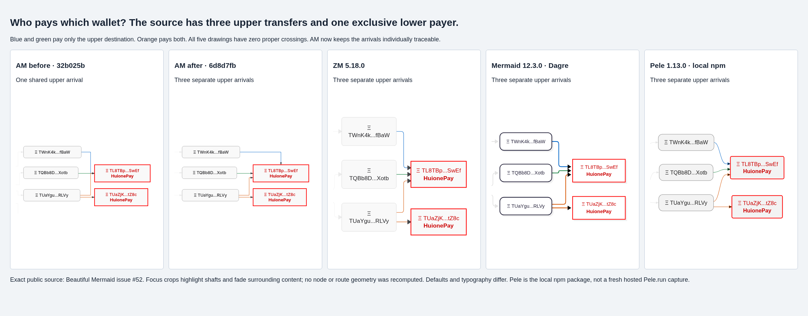
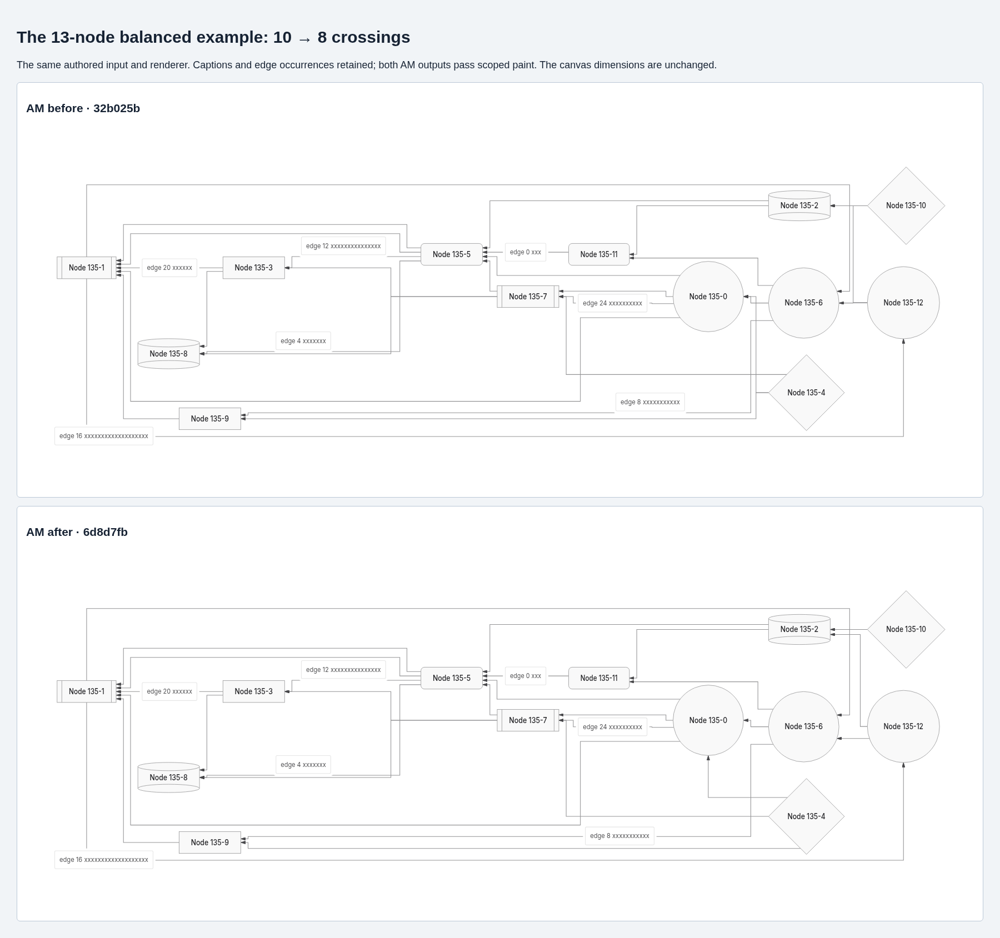

# Traceable arrivals, source-linked intent tests and long-edge diagnosis

Source `6d8d7fbc835b2767b83a3bbdfca5e7b7d9f8e19b`, before `32b025bff14e3020fd709a08d84f8543f57cb0cd`. Existing draft PR621; issue619 remains open.

[What changed, public issue inputs and five-product comparisons](QUALITY-RESULT.md) · [Execution, memory, payload and all local verification](PERFORMANCE-RESULT.md) · [Separate unchanged-kernel long-edge profile](long-edge-profile/REPORT.md).

Blue/green pay only the upper wallet; orange pays both. Colors/fading are inspection annotations; coordinates/markers remain original. Defaults/fonts differ. Inspect3upperarrowheads; oldAM already preserves correct exclusive lower connectivity. Wire+16.52%. OriginalSVGs, receipts and annotated focus bindings accompany the gallery.

[Full5productSVGgallery](gallery.html). HostedPeleupload was rejected by automatic approval review; localnpm1.13.0 was used. Mermaid elliptical-arc crossing totals remain unknown on3generated examples. No fullTridentscore claim or issue619closure.
