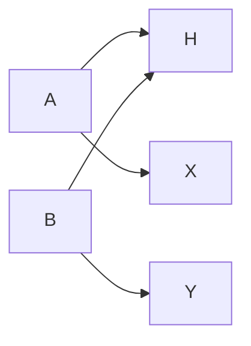

# Crossing weights and asymmetric arrivals

## Final implementation review

The final implementation resolves the demonstrated wallet, competing source bundles and mixed-label diamond. Its ordinary comparison applies the weighted crossing and padded-conflict cost after feasibility and title readability. Equal costs retain the earlier crossing-first tie rule. The receipt reports `readabilityCost` when both inputs to a decisive weighted comparison change. Balanced mode still evaluates each tracked dimension against the current ordinary layout. The mixed-label owner retains its existing behavior for a valid spread and for uniform convergence. When spreading would place a dock off its target outline and the bounded peer arrivals qualify for separation, it declines the optional rewrite. The normal lane owner can then preserve or find distinct safe arrivals. The wallet, workflow, labelled fan and request/response fixture files match the saved reporter inputs byte for byte. [Weighted selector](/workspace/elk-layered-port/src/layout/certification.ts:408) · [Mixed-label owner](/workspace/elk-layered-port/src/layout/passes/peers.ts:630) · [Source-linked fixtures](/workspace/elk-layered-port/src/__tests__/aesthetic-issue-regressions.test.ts:128)

I independently read all 14 final emitted SVGs and their public quality records and matched them to the corresponding pre-change outputs. All 14 retain exactly the same written viewBox, and 11 SVGs are byte-identical. Only the wallet in default and balanced modes and seed 135 in balanced mode change. The wallet’s incoming arrow tips have a minimum spacing of 13.45 px. TWnK4k enters the upper face, TQBb8D and TUaYgu enter the left face, and only TUaYgu pays the lower wallet. Both wallet outputs retain 0 crossings, 0 padded conflicts and passing scoped paint. Geometric bends decrease from 12 to 11, and centerline length increases from 857.90 to 999.61 px, or 16.52%. [Hash-bound product audit](final-svg-audit.json) · [Wallet source and screenshots](https://github.com/lukilabs/beautiful-mermaid/issues/52)

Seed 135 balanced goes from 10 crossings to 8 and from 63 geometric bends to 60 on its identical 1601.718 × 563.370833333 canvas. Its centerline length increases 18.21 px, or 0.13%, over the previous balanced revision. The current ordinary layout still uses 15,438.82 px versus 13,729.04 px for balanced. Seed 139 remains byte-identical at 24 crossings in balanced mode. Its prior two potential marker occlusions against node n16 remain unverified. The 19-node witness remains byte-identical at 37 crossings with passing scoped paint. The 34-node approval workflow remains byte-identical at zero and preserves its 18 captions. [All before/after records](final-svg-audit.json)

The 900 focused tests include all four directions of the exact wallet, the two competing fan-outs and the mixed-label diamond. The 9-failure red run covers wallet, opposing fan-outs and the ordinary selector. The mixed-label owner was isolated separately on its intermediate failure. Common saved geometry also shows three upper-wallet arrivals and zero crossings in Zombie Mermaid, Mermaid and Pele. Peer renderers have no shared AM paint certificate. The comparison harness leaves Mermaid's dense crossing totals unknown where SVG arc commands remain unresolved. It establishes the wallet result independently from those unknown totals. [Focused result](/workspace/elk-layered-tools/issue619-intent-repair-20261121/focused-final.log) · [Red result](/workspace/elk-layered-tools/issue619-intent-repair-20261121/red-confirmed.log) · [Peer comparison](/workspace/elk-layered-tools/issue619-intent-repair-20261121/comparison-metrics.json)

**Limits.** The new arrival policy is a bounded geometric heuristic. Its forward fan-ins require distinct visible forward destination sets and sender box starts within 28 px on the diagram's flow axis. A distant additional sender, wider label-driven boxes, a different local direction or the existing 64-node/128-edge thresholds can change eligibility. State terminators, invisible shafts and self-loops have explicit exclusions. Shared trunks remain useful in uniform nets. The 4:5 weighting is a declared product decision. These sources establish reader concerns and the selected examples' behavior. They do not establish optimal weights, universal per-occurrence tracing, common certification of cross-product paint, or a package-wide performance result. [Eligibility owner](/workspace/elk-layered-port/src/layout/route-geometry.ts:450) · [Public quality policy](/workspace/elk-layered-port/docs/quality.md:67)

The sections below retain the earlier design analysis and resolved intermediate counterexamples for provenance.

The wallet report supports retaining separate incoming routes when a source also branches to a destination that its peers do not reach. The implementation can reuse three valid ELK docks that AM already obtains. Changing the ordinary candidate comparator addresses a separate reported problem, the loss of edge-caption readability. The ratio between crossings and padded conflicts is a product choice. The source reports establish both preferences without identifying a ratio. [Wallet report](https://github.com/lukilabs/beautiful-mermaid/issues/52) · [Lost edge captions](https://github.com/dfadler/zombie-mermaid/issues/1392)

## Where the wallet docks disappear

One default layout of the exact 10-node, 11-transfer input traced each pass at pre-change runtime revision `32b025bff14e3020fd709a08d84f8543f57cb0cd`. ELK gives all three upper-wallet transfers distinct incoming contacts. After layer alignment their y coordinates are 111.692, 125.142 and 138.592 px. The generic bundled candidate places them all at 125.142. In the selected candidate, which turns off generic bundling, the three remain distinct until `applyRouteContracts` independently moves them onto the same dock. The final route certificates read explained detour, straight and explained detour. The route-slot ordinals remain distinct because AM assigns them by sorted attachment coordinates with occurrence order breaking ties. [Per-pass trace](wallet-pass-trace.json) · [Emitted default layout](/workspace/elk-layered-tools/issue619-bm-zm-examples-20261121/renders/bm52-wallet-ours-default.json) · [Slot ordinals](/workspace/elk-layered-port/src/layout/route-geometry.ts:635)

Both owners have an explicit preference for convergence. The generic builder first constructs fan-outs, then considers only the remaining edges for fan-in. The lane proof lets a terminal run overlap another published run into the same target. The route-contract owner also prefers a shared port over an available hook for suitable fan-ins. The marker guard permits compatible sources to repaint an identical arrowhead. A change to generic bundling alone cannot preserve this wallet's separate arrivals. [Generic construction](/workspace/elk-layered-port/src/layout/passes/edge-bundling.ts:293) · [Terminal-channel exception](/workspace/elk-layered-port/src/layout/route-lanes.ts:285) · [Contract routing](/workspace/elk-layered-port/src/route-contracts.ts:290) · [Marker admission](/workspace/elk-layered-port/src/layout/route-marker-clearance.ts:266)

## Smallest rule supported by the evidence

1. **Preserve established, distinguishable arrival docks where visible branches differ.** Inspect the full incident graph before a fan-out consumes any occurrences. Invisible constraints and self-loops do not create competing outward branches. Use distinct destinations so a repeated transfer remains under the dedicated duplicate-lane rule. A distant retry leaving through another side is weak evidence that a forward fan-in needs to split. Restrict the physical decision to incident forward arrivals whose routes are actually at risk of merging. For the wallet, preserve the three native docks through generic reconstruction and route certification. Transactions that cannot keep endpoints attached, marker and shaft paint clear, and labels on their own routes should retain the certified incumbent. Coincident native contacts and insufficient room on a curved or narrow target require separate evidence before promising distinct docks there.
2. **Protect legitimate junctions and the other end of the line.** Uniform fans, including complete rectangular incidence `A & B --> C & D`, remain allowed to share. The same physical occurrence can participate in a valid shared outgoing trunk and an asymmetric incoming target. Preserve the former where feasible. An all-target-set rule applied globally would classify 11 targets on the real approval workflow as asymmetric, although no pair there shares a physical arrival dock. On the 19-node witness it flags 12 targets, with actual coincident end docks at only three. On balanced seeds 135 and 139 the analogous counts are 10 versus five and 12 versus three. These counts describe selection scope. They provide no independent evidence that the additional coincident routes on generated inputs are unreadable. [Geometry audit](topology-baselines.json) · [Uniform rectangular incidence](/workspace/elk-layered-port/src/__tests__/graph-layout-selection.test.ts:132) · [User's labelled-trunk preference](https://github.com/lukilabs/beautiful-mermaid/issues/111)
3. **Check final projected geometry.** On the exact wallet, verify the three upper-wallet arrivals have physically distinguishable shafts and marker footprints, with TUaYgu retaining its separate lower-wallet transfer. Verify the same semantic property on a short, reversed-direction variant and use the uniform labelled fan-out and neutral invisible rank hint as controls. A distinct edge ID, slot ordinal or route certificate does not show what a reader sees. If a visible shaft can still travel from an unrelated payer onto the exclusive lower branch, three separated arrowheads alone would also miss that failure. [Original and preferred images](/workspace/elk-layered-tools/issue619-bm-zm-examples-20261121/astra/raw/image-bindings.json) · [Issue inputs](/workspace/elk-layered-tools/issue619-bm-zm-examples-20261121/astra/sources/SOURCES.tsv)

## Ordinary preference and balanced mode

Keep existing hard feasibility and title order. For ordinary candidate selection, `4 × crossing locations + 5 × padded label-conflict pairs` is deterministic and monotone. One eliminated conflict can pay for one additional crossing. From 0 crossings and 5 conflict pairs to 6 crossings and 0 conflict pairs, the total improves from 25 to 24. A crowded caption may account for multiple pairs, and node obstacles use conservative bounding rectangles with 8 px pill padding and 0.5 px interior tolerance. This score measures a trade between two observable soft metrics. It does not measure unreadable words, affected readers or false connectivity. Retain the raw counts. For exact weighted ties such as 5 crossings/0 conflicts against 0 crossings/4 conflicts, retaining the former preference for fewer crossings minimizes churn. Name the trade in receipts whenever a formerly preferred raw metric goes up. The same ordinary comparison should cover placement and the last routing choice. Balanced's extra proposal should continue to require separate non-regression of each raw dimension. [Label conflict model](/workspace/elk-layered-port/src/layout/label-conflicts.ts:32) · [Padding and tolerance](/workspace/elk-layered-port/src/shared/edge-label-geometry.ts:61) · [Balanced admission](/workspace/elk-layered-port/src/layout/non-regressing-alternative.ts:16)

The existing synthetic selector witness covers one clear crossing versus a conflicting caption. Pair it with the reciprocal decision that two crossings cost more than one eliminated conflict, then retain the strict balanced veto on any paid crossing or dimensional regression. The exact wallet was already a zero-crossing, zero-conflict picture under published metrics, so the score change alone cannot account for a wallet improvement. Compare real SVGs using the author's tracing question, and report source/path identity, labels and marker positions alongside counts. The actual upstream workflow and accepted extra-row ER trade support the direction of the policy without turning this numeric ratio into a user-study result. [Selector witness](/workspace/elk-layered-port/src/__tests__/layout-certification.test.ts:286) · [Approval workflow](https://github.com/lukilabs/beautiful-mermaid/issues/83) · [Accepted crossing and one-row repair](https://github.com/dfadler/zombie-mermaid/pull/2859)

## Counterexample found in the first working implementation

The first implementation skipped protected targets in the generic fan-in loop and made the ordinary lane proof aware of those targets. The five-node example below still produced two coincident arrivals. Both edges into H were already owned by the two source fan-outs before the fan-in loop ran. Their shared arrival in LR was (148, 123.35), and in TB it was (158, 124.9). Reordering the declarations reproduced the result. Construction can preserve each existing target dock when drawing the respective shared source prefix. When that cannot pass the usual paint proof, the affected member can retain its original route. A separate case with one common starting node already produced separated docks. [Eight working-tree observations, including full routes](competing-fanouts.json)

The first weighted comparator also attributed any nonzero trade to label conflicts whenever the two conflict counts differed. Moving from 2 crossings and 0 conflicts to 0 crossings and 1 conflict improves cost from 8 to 5. Label conflicts got worse. A receipt should show the weighted decision or cite the winning dimension. These findings describe an intermediate working copy and were provided to the implementation owner for verification against the final tree.
