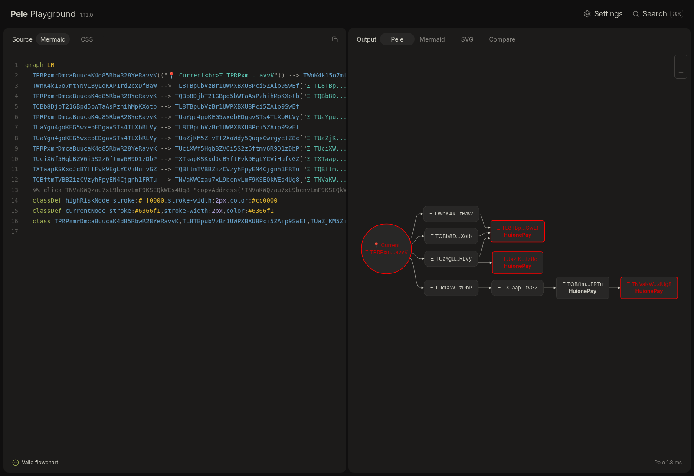

# Hosted Pele comparison: nine exact public/generated inputs

The owner explicitly requested these hosted tests after the earlier external-disclosure rejection. All nine inputs were entered unchanged into https://pele.run/playground in fresh browser contexts. All nine returned a stable flowchart SVG; every captured editor SHA-256 matches its requested source. The visible version is1.13.0 throughout. No page errors were observed. Asset URLs, response status and content hashes bind the deployed build; a source Git revision is unavailable.

AM controls are current balanced ELK.ts at `6d8d7fbc835b2767b83a3bbdfca5e7b7d9f8e19b`. Seven controls reuse the previously bound SVGs; the two additional public regression controls were rendered through the same built public API. ZM5.18 controls and local Pele npm1.13 controls retain their original recorded defaults. The local API was not substituted for the hosted tests.

| Exact input | Nodes / edges / captions | Current AM | ZM5.18 | Hosted Pele1.13 | Npm Pele1.13 |
|---|---:|---:|---:|---:|---:|
| duplicate | 4/4/0 | 0 | 0 | 0 | 0 |
| seed135 | 13/28/7 | 8 | 4 | 10 | 10 |
| seed139 | 17/40/10 | 24 | 17 | 21 | 21 |
| nineteen | 19/44/11 | 37 | 31 | 40 | 38 |
| bm52-wallet | 10/11/0 | 0 | 0 | 0 | 0 |
| bm83-workflow | 34/44/18 | 0 | 0 | 0 | 0 |
| nineteen-body | 19/44/11 | 37 | 31 | 40 | 38 |
| bm111-labelled-fan | 4/3/3 | 0 | not captured | 0 | 0 |
| zm629-round-trip | 2/2/2 | 0 | not captured | 0 | 0 |

Counts are complete proper emitted-shaft crossing incidences from the existing exact decimal/interval observer, not a sampled polyline approximation or a Trident composite score. All34 available output assessments completed with zero unresolved intersections. Collinear/shared spans are recorded separately; the observer does not treat them as proper crossings. No fully coincident directed shaft pair was found in these hosted outputs.

## What the drawings show

- **Wallet (BM#52):** hosted Pele has three distinct upper-wallet arrivals, one exclusive lower payer and zero crossings. Current AM and ZM retain the same distinctions. This confirms the actual hosted product, rather than assuming npm parity.
- **Generated13-node seed135:** hosted Pele10, current AM8, ZM4. AM has fewer crossings than hosted Pele on this source.
- **Generated17-node seed139:** hosted Pele21, current AM24, ZM17. This remains an AM crossing loss; AM also retains its two known n16 marker/node paint-unknown findings.
- **Original titled19-node witness:** hosted Pele40, current AM37, ZM31, npm Pele38. Removing only the title produces the same crossing totals. Hosted and npm Pele are not interchangeable here. The hosted title remains visible.
- **Approval workflow (BM#83):** all four products have zero crossings, with34nodes/44relationships/18captions retained. Hosted Pele wraps many Chinese labels over two positioned text lines. The displayed Unicode within each line matches the authored text; boundary whitespace and wrapping are recorded.
- **BM#111 labelled fan and ZM#629 round trip:** hosted Pele returns all three labelled branches and both separately labelled request/response arrows respectively, with zero crossings. The original reports concerned terminal output; these SVG results do not close those historical terminal findings.

## Authored meaning and final SVG checks

For every hosted fixture, node IDs, displayed characters at explicit rendered line boundaries, directed endpoint occurrence counts, source/target/caption associations and one forward-facing end arrow per relationship match the parsed authored controls. Endpoint metadata alone was not used to count crossings: the saved written shafts were parsed and their intersections assessed. All nine editor inputs and output SVG hashes are retained. Wrapped captions are read as separate positioned tspans rather than incorrectly concatenated without a word boundary.

Raw display differences remain visible. AM retains literal inline bold tags in several wallet node captions; Pele interprets those tags as bold text. The common comparison checks the same displayed words while recording this formatting difference. It does not label the two typographies identical. The first diagnostic reader failed on wrapped text and formatting; that initial JSON/log is retained alongside the corrected, source-aware line reader.

These checks do not establish common peer paint certification, exact glyph clearance, every marker/outline contact, or equivalent accessibility behavior. Current AM seed139 remains paint-unverified. Different fonts, measurements, palettes and routing models prevent assigning canvas differences to a single algorithm. No performance, memory or bundle-size superiority is inferred from the playground UI's render timer or whole-site downloads.

## Reviewable outputs

[All original SVGs and side-by-side gallery](gallery.html). The gallery displays original SVG coordinates under standalone defaults; actual hosted theme and font context are retained in [playground screenshots](screenshots/). Inputs and their provenance are in [cases.json](cases.json); hosted captures include exact source, hashes, version, script identities and request URLs. The nine source fixtures include the prior public/generated comparison set and the two exact additional public regressions.

The preceding permission rejection is superseded by the owner's direct request for these hosted tests. Production source remains unchanged; this evidence belongs on the existing separate review branch. No CI, merge or source-code modification is part of this comparison.
