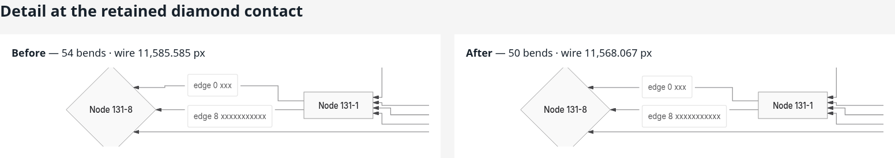

# Nine-chain route repair

The named edge into Node 131-8 loses its 2.363 px return while keeping the same diamond contact and distinct parallel occurrence.

Before source: cdaf3cc8054a6395864664f65cbf935b8a525971.
After source: c790c8adb918dd0f437488327c250d7841b060b0.
PR merge base: 17c400a942d05090679ef7cb07588fd5ee763382.

This screenshot magnifies the same viewport of the actual before/after SVGs; no paths, labels or markers were redrawn. The labelled edge saves 4.726 px and two bends. A second unlabelled edge also shortens, so the complete diagram changes from 54 to 50 bends and saves 17.518 px. Crossings remain three and area is unchanged.

The original SVGs, complete public paint receipts, input/options, version details, hashes and comparison scope are in this directory and receipt.json. Both public paint checks pass. Reproduce from the checked-in cyclic-labelled-9-chains.mmd fixture with the Cyclic routes title wrapper and graphLayout backend elk/fallback none at each stated source revision.

This is evidence for the last scoped repair. It does not demonstrate every cumulative PR change, full Native parity, or a runtime improvement.
