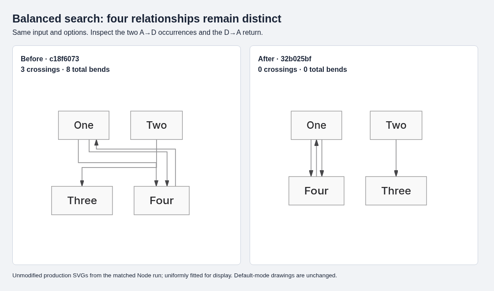

# Balanced ordering experiments and kept combination

Source control: c18f607364ca1d85dd91a669c8ac33a2c7173a23. Kept source: 32b025bff14e3020fd709a08d84f8543f57cb0cd, existing PR #621. Main is f49196e7f5d6d2f0970a4a76fe62644ee5e9d004. This comparison measures the new change against c18, not a new whole-PR comparison against main.

Three Sol 6.1 High agents investigated ordering, atomic routes/candidate admission, and the combined producer-to-consumer contract. They used the preceding Astra 6.2 Max review. The best tested quality combination keeps forced model order and MODEL_ORDER cycle breaking as defaults, admits the existing unforced candidate on duplicate graphs only in opt-in balanced mode, and checks each completed occurrence for new ambiguous shafts, marker conflicts and displaced captions. The documented componentwise Pareto rule and two-extra-producer allowance remain unchanged. No kernel, option, default, version, cap or golden changes.

## Actual aesthetic impact

The existing layout-compare harness captured 51 sources in default and balanced modes at both arms: 204 public SVGs, with corresponding layout/quality/receipt captures. All 51 default SVG comparisons are exact. Balanced changes only these three originals:

| Source | Crossings | Total geometric bends | Routed wire, px | Canvas area, px² | Paint |
| --- | ---: | ---: | ---: | ---: | --- |
| Four-node duplicate and return | 3→0 | 8→0 | 644.324→192 | 55,480.48→52,183.46 | passed→passed |
| Generated LCG seed 135, RL | 13→10 | 66→63 | 15,438.82→13,710.83 | 1,022,909.06→902,361.20 | passed→passed |
| Generated LCG seed 139, RL | 43→24 | 106→104 | 24,154.95→20,183.03 | 1,597,522.17→1,385,390.13 | unverified→unverified |

Both seeds have zero reported parallel/opposing overlaps before and after. Seed139 retains the same two POTENTIAL_OCCLUSION findings involving n1→n16 and n11→n16 against node-shape:n16. Its complete measured coverage does not turn an unverified paint result into a pass. Across each arm's 102 SVG captures, 86 pass and 16 remain unverified. No new issue type/owner was identified in the changed unverified case. Prepared text regions do not prove exact glyph ink or clearance under external CSS.

The small example's certification penalty is 4→0 bends because justified bundle turns are exempt. The public total geometric count is 8→0. These metrics are kept separate.

Inspect the two One→Four shafts and the Four→One return. The image fits unmodified production SVGs from the matched Node run. It does not reconstruct or redraw geometry. Full source, options, source/output hashes and receipts are in renders/bindings.json and the adjacent files. The SVGs are cache0 replica0 cold products from the benchmark, at the exact control/kept revisions.

## Rejected combinations

| Trial on the 19-node witness | Result | Decision |
| --- | --- | --- |
| Supported unforced order, current feedback set |37→48 crossings; small caption edit repeats the loss | Reject global switch |
| Declared node array, forced/unforced |84/62 crossings; changed feedback roles disagree with downstream roles; nine-chain paint becomes unverified | Reject |
| High-degree treatment off |37/48, no benefit | Reject |
| Postcompaction NONE |Same crossing counts, more bends/wire/area | Reject |
| Original ELK.js0.11.1 DFS, same SDK model |Raw 50/58 crossings | No TypeScript DFS port justified by this experiment; not a completed public comparison |
| Atomic two-return channel/arrival-slot swap |One geometric crossing removed, but no honest caption seat on channel or other existing segment | Reject entire transaction; retain 37 |
| Duplicate candidate requiring wider canvas |Fewer crossings, width/Pareto regression | Keep incumbent |

The original-JS reciprocal model screen reproduces Zombie's 31 only for the interacting peer model. It does not attribute that result to one setting or establish common full-paint superiority. DFS remains explicitly unsupported in the TypeScript dispatch. No runtime oracle/fallback was introduced. The initial same-process duplicate experiment hit an upper cache and is retained as tooling-invalid, not a no-effect result. See order/ORDER-RESULT.md and routes/ADMISSION-RESULT.md.

## Runtime and memory cost

This is a quality improvement with an opt-in execution cost. The isolated, fully consumed built-public run used84 fresh serial Node 24.19 processes, seven cases, cache0/1, three paired replicas and seven warm repeats plus a real edit and three edited repeats. Each clock consumes actual SVG and the entire receipt JSON/UTF8 bytes. Import, first render, warm, first edit and cached work remain separate. Compression, artifact writes and explicit GC are outside clocks. No profiler or other local build/test/browser stream ran during timing.

All 1,008 products returned: 864 paint passed and 144 unverified, with 72 unverified per arm, all seed 139. There were zero render/lifecycle failures. All 144 paired default SVGs AND entire receipts match. All 840 within-arm repeated SVG comparisons match. The 300 whole-receipt repeat differences are exclusively documented cache1 per-execution optimization counters/selections; no other repeat difference occurred. Exact raw byte flags and full difference paths are preserved, with no receipt normalization.

Uncached balanced warm median paired increases: small winner+15.8%/+2.18 ms, seed 135+30.3%/+35.84 ms, seed 139+40.3%/+52.16 ms, rejected cyclic19+37.6%/+64.36 ms, rejected dense24+45.1%/+222.29 ms. Seed139 edited-repeat paired cost grows 89.6%; dense24 cache1 first edit grows 64.9%. Default uncached warm paired ratios are 1.007× cyclic19 and1.019× dense24; the small sample and mixed cold/edit/import outcomes do not prove universal flat default cost.

Largest paired peak-RSS increases: dense24 balanced cache1+78.87 MiB; seed 139 cache0+62.14 MiB. Cyclic19 balanced cache0 warm heap increases 12.79 MiB and RSS 40.92 MiB. RSS includes the harness, imported modules, retained warmup products and compression history; it is not package-only memory. Full 14-row timing/memory tables, all phase data and scope limits: benchmark/PERFORMANCE-RESULT.md. These exploratory samples are not a full Trident score run or formal calibration.

## Transfer and package size

Actual per-file-compressed Flowchart closure gzip grows 352,365→352,667 bytes (+302), remaining 26 requests. Initial gzip remains 6,249 bytes and 5 requests. Solver transfer remains 62,699 gzip bytes; solver and pure optional optimization CJS files are byte-identical to c18. The npm archive grows 7,103,321→7,104,337 bytes (+1,016); unpacked size 21,016,825→21,019,620 (+2,795), still 270 files. See payload-delta.json, pack-final.json and kernel-bindings.json. All unchanged lazy and actual Chromium request budgets pass.

Review caught a draft import that would have duplicated core/stateful modules inside the optional CJS kernel. Admission now stays with the core pipeline; the optional kernel is unchanged. The opposing-span exception was extracted from the existing bundle owner, so two implementations do not define competing policies.

## Verification and remaining limits

- Four new focused behaviors: a public duplicate/return winner, the width-rejected incumbent, direct occurrence/shaft admission, and per-occurrence caption attribution. Restoring the old blanket veto produces two expected failures. Direct staged negatives exercise the admission owner; they are not naturally generated public failures.
- 768 focused tests pass. Full local suite at kept head: 17,057 passed, 78 skipped, 0 failed across three sequential shards; canonical 30s timeout unchanged. Build, core/repository types, lint 2,176 files, and 529-diagram/2,116-format corpus audit pass with zero reported hard/soft/render errors.
- Dependency scan: 687 packages, 0 high/critical, 14 below high. Canonical font manifest/four WOFF2 regeneration, website artifacts, lazy graph/size checks and actual installed Chromium request budgets pass.
- Initial sandbox npm/child-output failures, the initial benchmark preflight failure, and read-only npm-cache packing failure are preserved. Affected checks were recovered without source/test/budget changes. The final npm pack uses a writable task cache and ignore-scripts. Remote CI was not run, as requested.

The19-node default and balanced result stays 37 crossings. Historical Native 23, same-wrapper ELK.js 37, Zombie 31 and hosted Pele 40 remain prior artifact observations; these peers were not rerendered in this run. The scoped Trident observer limitation for that fixture remains, not zero crossings. Issue #619 stays open. Further investigation must isolate coherent generated-port/measurement model blocks or find actual room for a joint return-label transaction; repeating rejected permutations, DFS alone or caption-only swaps has no surviving evidence here.

Reproduce the owning tests with bun test src/__tests__/layout-optimization.test.ts. The exact benchmark command and source/config/runtime binding are in benchmark/PERFORMANCE-PLAN.md and benchmark/results-32b025bf/identity.json. No source-tree evidence, work log, documentation-only commit, remote CI run, merge or release was added by this experiment.
