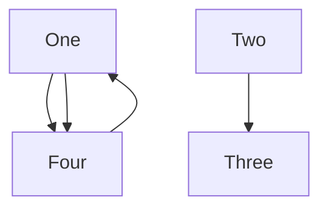

# Qualified balanced duplicate candidate

Removing only the blanket duplicate-pair veto admits a real Pareto winner on this source, with the incumbent derived node order and cycle breaker retained:

The guarded proposal reduces completed crossings 3→0, maximum bends 2→0, total bends 4→0 in the certification comparison vector, wire 644.324→192 and canvas 258.59×214.55→258.59×201.8. Width is unchanged; every tracked balanced dimension is nonworsening. Public quality's aggregate geometric bend metric includes all emitted elbows and is retained separately in each JSON artifact. Exactly one optional producer is consumed from the existing allowance of two. Default behavior and balanced Pareto/caps are unchanged by the scratch hook.

All four authored occurrences remain distinct, including both A→D occurrences and the D→A return. The admitted routes are four separate vertical shafts: A→D at x68.795 and x82.795, D→A at x75.795, and B→C at x179.09. Every path retains its own SVG relationship identity and end-marker reference. All four markers are measured, and complete public SVG paint certification passes with no issues and no unmeasured primitive. An independent pair read finds zero positive shared shaft spans, and the public rubric finds zero opposing/parallel overlaps and zero caption conflicts. This witness has no edge captions. Node captions, source/target identity and the duplicate warning remain intact. See `admission-guarded/winner-ownership-audit.json`.

| Control | Incumbent→proposal return | Outcome |
|---|---:|---|
| Duplicate + reciprocal return | 3→0 | Admitted, honest separate shafts |
| Unlabelled duplicate alone | 2→2 | Candidate has 0 crossings but loses width/area; incumbent retained |
| Mixed-caption duplicate | 0→0 | Already clean; no optional producer |
| Two-caption duplicate | 0→0 | Already clean; no optional producer |
| Explicit adjacency | 2→2 | Caller order remains authoritative; no optional producer |
| Clear duplicate | 0→0 | No optional producer |
| Unicode node-name edit | 3→3 | Candidate loses width; incumbent retained |
| Caption + dashed-return edit | 0→0 | Already clean; no optional producer; caption retained |

Every returned control has passing public paint certification. No honest overlap-hiding produced alternative arose in this bounded matrix; the existing archived single-route counterexample remains a useful adverse artifact, but no new fabricated candidate is claimed as a public-path result.

The scratch helper `admission-guard.ts` compares each authored occurrence against the same completed candidate roster. It uses existing `countParallelRouteOverlaps` per same-endpoint pair, `opposingRoutePartners` per occurrence, `routeCandidateMarkerBlocker` with existing terminal exemptions, and `measureLabelConflicts` per occurrence. `shared-policy.ts` is an extraction prototype of the current bundling owner's exact `realEdge`/`misleads` rule; production should extract that policy once and reuse it, instead of retaining a second copy. Existing different-endpoint constructed convergence is unaffected by same-pair duplicate checks. No blanket `bundle` certificate exemption is introduced for hidden duplicate shafts.

The original `admission/summary.json` is tooling-invalid evidence: incumbent and admitted arms shared one process, so positioned cache hits prevented candidate production. It is retained only to document that mistake. Valid unguarded arms use fresh processes (`incumbent-summary.json`, `admitted-summary.json`); all guarded arms likewise use fresh processes under `admission-guarded/`. Hooked timings support no performance claim.

All code here is scratch source-loader work. No production source was edited. The current cyclic19 route swap remains rejected for lack of an honest caption seat; this smaller balanced improvement does not claim to close that 37-crossing witness gap.
