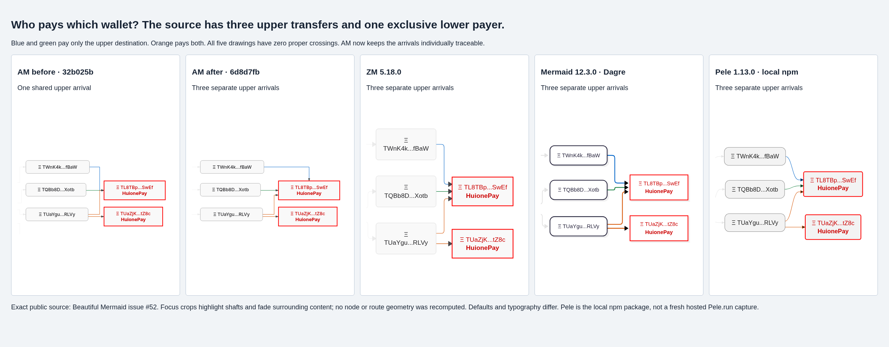
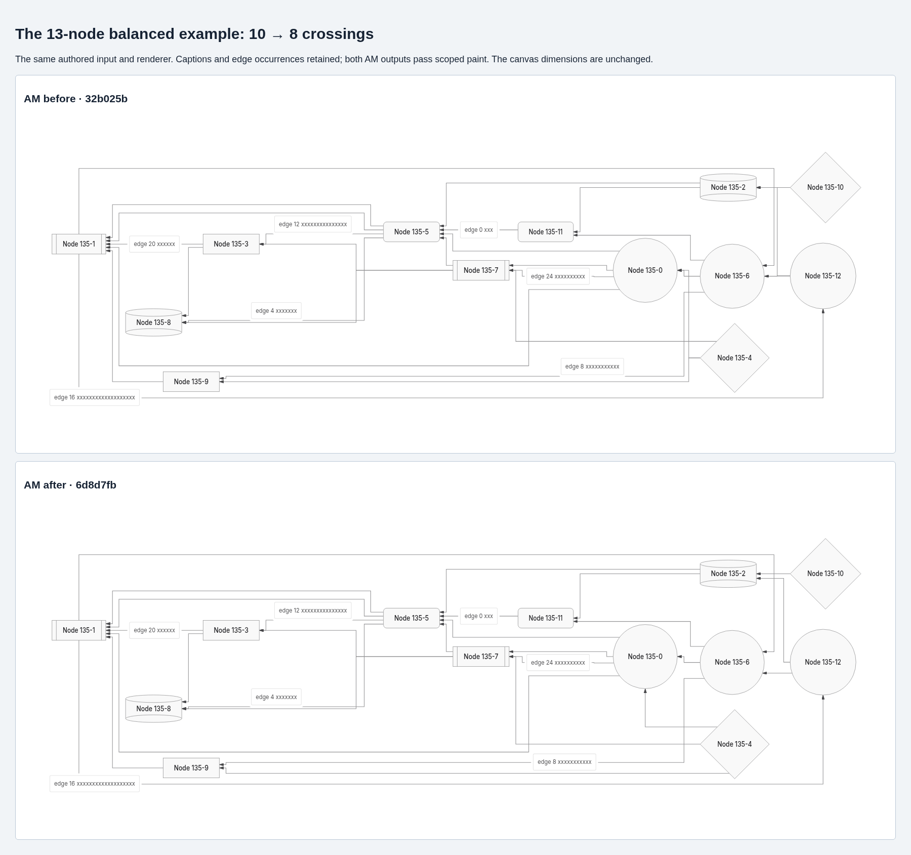
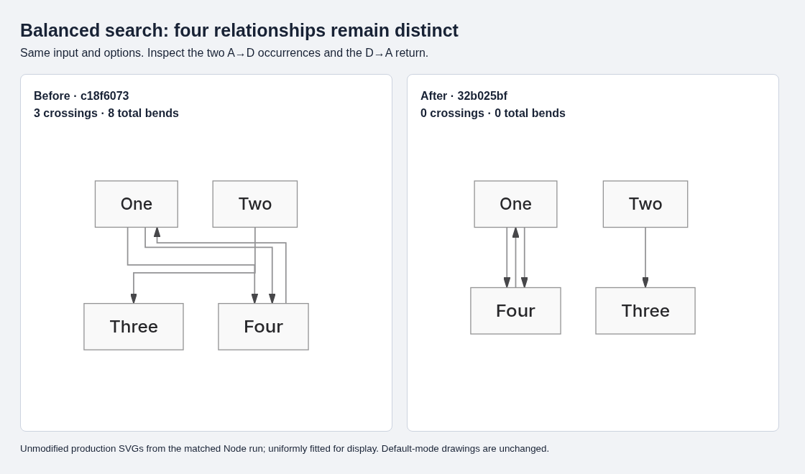
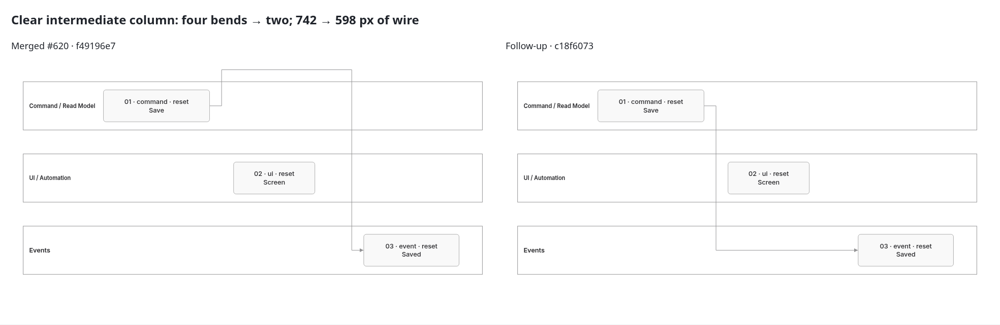
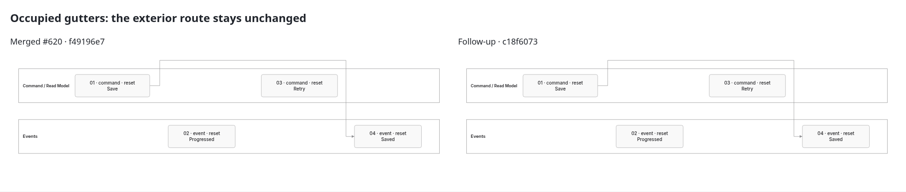

Nearby senders with different destinations can merge their arrivals so aggressively that individual transfers become hard to follow. This change preserves three separate upper-wallet arrivals in the public Beautiful Mermaid #52 example, including the lower wallet's exclusive payer. The old output already had correct connectivity; the repair improves traceability. It also keeps a mixed labelled/unlabelled diamond fan-in from collapsing its distinct arrivals into one vertex.

Ordinary candidate selection now minimizes **4 × proper crossings + 5 × padded label-conflict pairs**, after unchanged hard feasibility and title readability. One cleared label conflict can pay one crossing, not two. Equal weighted costs keep the former crossing-first tie rule, and receipts retain the raw axes. These coefficients are a documented product policy, not weights calibrated by a user study. Balanced mode keeps its separate all-axis Pareto rule.

The existing balanced unforced-order candidate can now qualify on duplicate relationships after per-occurrence shaft, arrow and caption checks. Earlier work in this PR also shortens a clear Event Modeling gutter and reuses bounded inert paint supports between settlement and final admission; details and prior captioned evidence remain below.

Refs #619; follows merged #620. **#619 stays open.** Ordinary routing/selection policy changes in this revision. ELK kernel, backend, options, recovery ladder, versions, proof caps, payload budgets and goldens are unchanged.

## Contract and implementation

A forward fan-in from nearby peer senders with different visible destination sets must remain individually traceable. The bounded rule reuses the existing 28 px peer-layer predicate, applies at both bundle construction and terminal-sharing/straightening, and excludes invisible constraints, self-loops, uniform joins and state terminators. Mixed-label nonrectangular convergence declines an optional bundle reconstruction when it would collapse the protected contacts. Different-rank arrivals remain outside this local rule.

The public graph and occurrence identities, caption associations and final shaft/marker paint remain the correctness boundary. Four exact reporter sources are checked in beside linked issue provenance: [BM #52](https://github.com/lukilabs/beautiful-mermaid/issues/52), [BM #83](https://github.com/lukilabs/beautiful-mermaid/issues/83), [BM #111](https://github.com/lukilabs/beautiful-mermaid/issues/111) and [ZM #629](https://github.com/dfadler/zombie-mermaid/issues/629). The latter two were terminal-output complaints; their new SVG guards do not claim AM previously had those failures.

## Visual evidence

PR base: `f49196e7f5d6d2f0970a4a76fe62644ee5e9d004`.
Before this repair: `32b025bff14e3020fd709a08d84f8543f57cb0cd`.
Current SHA: `6d8d7fbc835b2767b83a3bbdfca5e7b7d9f8e19b`.

### Transfer intent and current balanced layout

All five panels receive the same public wallet input. Blue and green pay only the upper destination; orange pays both. Inspect the three upper arrival tips. Colors/fading aid inspection; original coordinates, marker scaling and theme variables remain intact. Fonts/defaults differ across products.

AM's three tips are at least 13.45 px apart, with zero crossings, identical canvas and passing scoped paint. Wire grows **857.90→999.61 px (+16.52%)**. ZM5.18, Mermaid12.3 default Dagre and local Pele1.13 also retain three arrivals. The owner subsequently requested the hosted tests: **all nine exact public/generated inputs returned SVG in the actual Pele playground, version 1.13.0**. Hosted Pele also has three distinct wallet arrivals and zero crossings. Hosted Pele has 10 crossings on seed135, 21 on seed139 and 40 on cyclic19; npm Pele has 38 on cyclic19, so the two products are not interchangeable. [Exact inputs, deployed asset hashes, saved SVGs, screenshots and complete hosted comparison](https://github.com/adewale/agentic-mermaid/blob/ef8e9a16be384365a7ba254bfb3638de63a14d8d/issue619-pele-hosted-20261121/README.md). Directed occurrences, associated captions and forward-facing markers match the authored controls; wrapping/bold interpretation and common peer paint limits remain explicit.

The same generated seed135 balanced input improves **10→8 crossings** and **63→60 total geometric bends**, with an unchanged canvas and passing paint. Wire grows **0.13%**. Inspect the routes beside Node135-4 and the upper return lanes:

[Original SVGs, complete receipts, source/output bindings and all five-product examples](https://github.com/adewale/agentic-mermaid/blob/9ad611463de7460a7d3d9036b1ad652c982b4df6/issue619-intent-repair-20261121/README.md). Reproduce the owning behavior with `bun test src/__tests__/aesthetic-issue-regressions.test.ts src/__tests__/layout-certification.test.ts src/__tests__/layout-pass.test.ts`. The wallet has four-direction public guards; short controls cover competing source fan-outs and mixed-label diamond arrivals.

Eleven of the fourteen original default/balanced visual comparisons remain byte-identical. The changed drawings are wallet default/balanced and seed135 balanced. The separate fully consumed dense24 control also changes in both modes: **124 crossings, 175 bends, 75 occurrences, 18 captions and canvas remain unchanged; wire decreases 20.68 px**, with passing paint. The raw comparator retains its inherited 72 default-exact flags for this intentional ordinary-policy change; default byte identity is no longer claimed.

### Earlier balanced ordering milestone

The four-node duplicate/return example below records c18→32b; its selected drawing is unchanged at current head. Inspect both One→Four shafts and the Four→One return. All four relationships remain distinguishable.

That change used the existing optional candidate slot and two-extra-producer allowance. A per-occurrence check rejects newly ambiguous shafts, marker conflicts and caption conflicts; the core pipeline owns admission. Across the combined milestones the small drawing is 3→0 crossings, seed135 is 13→8, and seed139 is 43→24. Seed139 still has two n16 marker/node `POTENTIAL_OCCLUSION` findings and remains paint-unverified. [Original inputs, controls and rejected proposals](https://github.com/adewale/agentic-mermaid/blob/c0fe51e94eae38ee34a362ed4ce7c0b34b9c6a05/issue619-sol-experiments-20261121/README.md).

### Event Modeling routes

Base: `f49196e7f5d6d2f0970a4a76fe62644ee5e9d004` (merged #620).
Recorded Event milestone: `c18f607364ca1d85dd91a669c8ac33a2c7173a23`.

Both panels render the same [clear input](https://github.com/adewale/agentic-mermaid/blob/ca69aee4a4725979b68943be0c3d9376b78092f0/issue619-followup-20261121/event/clear.mmd) with default canonical sharp paint. Follow the vertical shaft through the empty intermediate column; the two original card contacts stay fixed.

The occupied-gutter control keeps the exterior route:

Copy the linked input to `/tmp/event-skip.mmd`, then run `bun run bin/am.ts render /tmp/event-skip.mmd --format svg --output /tmp/event-skip.svg` at either revision. [Production SVGs, layouts and complete receipts](https://github.com/adewale/agentic-mermaid/tree/ca69aee4a4725979b68943be0c3d9376b78092f0/issue619-followup-20261121/event) and [capture recipe](https://github.com/adewale/agentic-mermaid/blob/ca69aee4a4725979b68943be0c3d9376b78092f0/issue619-followup-20261121/event/event-images.mjs) are separate from this source diff. Independent owning tests check endpoints, authored relations, blocked peers/cards and actual paint certification. Prepared text bounds do not establish exact glyph ink or external-CSS clearance.

The Event code and its demonstrated routes are unchanged since that recorded milestone. The earlier captioned evidence remains attached.

## Execution, memory and download costs

The new isolated comparison is **32b→6d8**, using 108 fresh serial Node24.19.0 processes across 9 cases, cache 0/1 and 3 replicas. Each clock consumes SVG and the entire receipt as JSON/UTF8. Import, first call, warm repeats, first source edit and edited repeats are separate. All **1,296 products returned: 1,152 paint passed and 144 unverified**, with the same 72 unverified per arm on seed139. All 1,080 within-arm repeated SVG comparisons are exact; 420 receipt differences are solely documented cached execution counters/selections.

This is exploratory sampling, not a full Trident score run or an all-metrics improvement. Median paired uncached warm changes include seed135−7.8%, wallet−13.6%, cyclic19 balanced+4.8% and approval workflow+3.9%. Important adverse costs remain:

- Seed135 first uncached edit: **121.42→265.02 ms**, paired+118.3%/+143.61ms.
- Dense balanced cold: **1,038.83→1,291.28 ms**, paired+21.1%.
- Seed135 peak RSS: **170.18→189.36 MiB**; dense default peak RSS: **256.90→281.79 MiB**. Paired memory deltas and independent medians vary; warm heap is also mixed.

[Every case's cold/import/cache/edit time, RSS, heap, raw product and receipt differences](https://github.com/adewale/agentic-mermaid/blob/9ad611463de7460a7d3d9036b1ad652c982b4df6/issue619-intent-repair-20261121/PERFORMANCE-RESULT.md). The prior main→c18 and c18→32b costs remain [separately recorded](https://github.com/adewale/agentic-mermaid/blob/c0fe51e94eae38ee34a362ed4ce7c0b34b9c6a05/issue619-sol-experiments-20261121/benchmark/PERFORMANCE-RESULT.md); they are not attributed to this delta. Earlier c18 paint-support reuse avoided 271 of 284 requested initial route preparations, with 359 total prepared rows including 75 unused in one dense projection. Original cold debits/fresh ledgers and full hitch scans remain.

Flowchart selected closure grows **352,667→353,084 gzip bytes (+417)**, staying 26 requests; solver transfer is unchanged. Initial gzip falls 2 bytes but Brotli grows 5. The npm archive grows **7,104,337→7,107,924 bytes (+3,587)**; unpacked size adds 5,126 bytes, remaining 270 files. Unchanged lazy and actual Chromium budgets pass. [Complete compressed closures and package counts](https://github.com/adewale/agentic-mermaid/blob/9ad611463de7460a7d3d9036b1ad652c982b4df6/issue619-intent-repair-20261121/payload-delta.json).

## Remaining limits and long-edge diagnosis

Cyclic19 remains **AM37, ZM31, hosted Pele40, local Pele38** proper emitted-shaft crossings. Seed139 remains AM24/ZM17/hosted and local Pele21; AM remains paint-unverified. Mermaid's elliptical segments leave its crossing totals unknown on these generated cases; metadata/caption multisets do not establish common peer paint or glyph ink. These are independent emitted-SVG observations, not full Trident rankings.

A separate read-only long-edge profile confirms 94/616/1,656 generated dummies for 96-node span2/8/24 inputs. Span24 sampling attributes 50.5% of CPU and 655 MiB of sampled allocations across 9 layouts to crossing minimization, versus2.4%/52MiB to splitting. The next exact-output experiments should remove temporary port-rank/position arrays and independently test immutable normalized option sharing. Sparse Eiglsperger normalization needs a separate coordinate-compatibility experiment. **No kernel optimization is included or claimed.** [Counters, oracle qualifications, unchanged timing, CPU and allocation profiles](https://github.com/adewale/agentic-mermaid/blob/9ad611463de7460a7d3d9036b1ad652c982b4df6/issue619-intent-repair-20261121/long-edge-profile/REPORT.md).

## Verification and status

- Nine expanded owning regressions fail with baseline production code; the subsequent mixed-label diamond also fails at its old owner. 900 focused tests pass. An invisible-edge point-count assertion now checks visible hard findings/crossings/conflicts instead.
- Full local coverage: **17,073 passed, 78 skipped, 0 failed**, 608 files in 3 canonical sequential shards. Shard2 ran on identical runtime/consumed inputs before the final shard1-only assertion strengthening.
- Build, core/repository types, lint, eight pre-push checks, canonical font regeneration and actual Chromium payload checks pass. The pre-push browser lookup skips; the explicit Chromium check covers its budget obligation.
- 529 diagrams / 2,116 format audits report zero hard/soft/render defects. Advisory gate reports zero high/critical, 14 lower-severity findings. Goldens/caps/versions are unchanged.
- Initial sandbox, storage, font-TLS and Chromium socket-path failures are retained with actual recovered exits. No failed check was relabelled passed. Astra reviewed the combined routing owners and actual saved output.
- **Local CI only, as requested.** No remote workflow was requested; commits contain `[skip ci]`. The PR remains draft, no merge is requested, and #619 remains open.

[Verification logs and source/artifact bindings](https://github.com/adewale/agentic-mermaid/blob/9ad611463de7460a7d3d9036b1ad652c982b4df6/issue619-intent-repair-20261121/verification.json).

