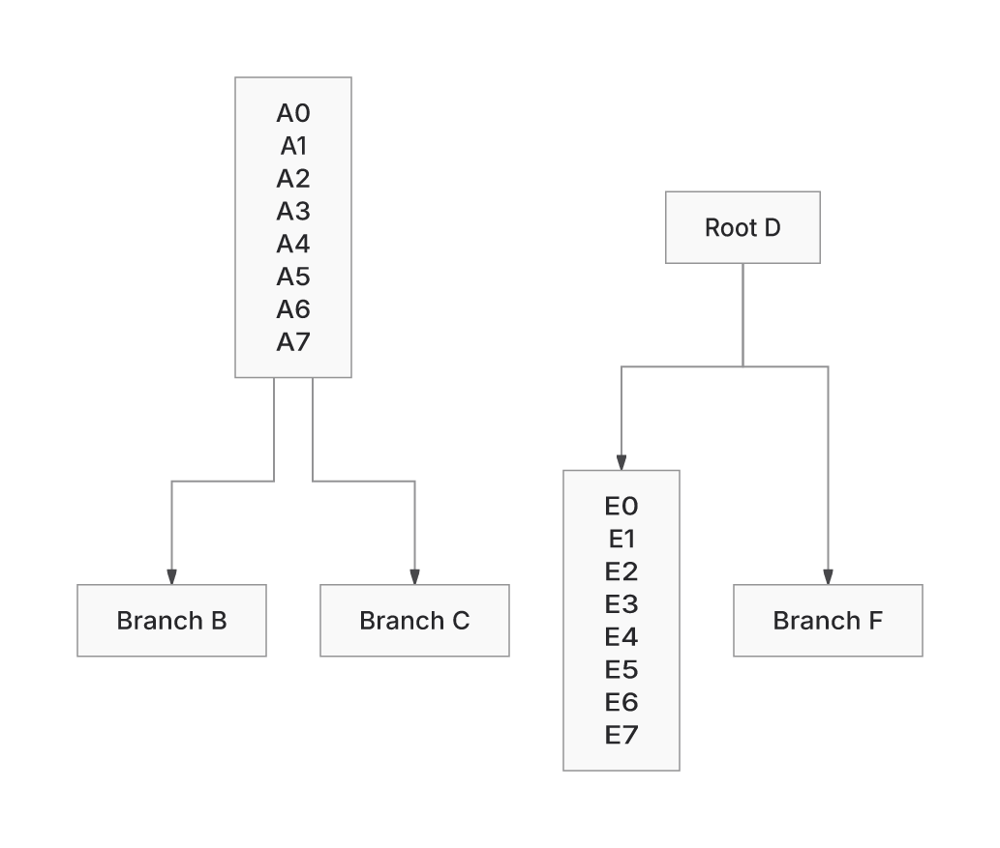

Compared with current main `39a500425`, this PR delivers the enrolled ER208 input that main refuses, reduces the default forest's area and wire, and restores a selected hollow-circle marker. It also increases some proof work, Brotli delivery size and build memory. **This remains a draft.**

## Improvements over current main

The same six inputs and options were frozen before outcomes. Fresh main39→PR1693 qualification makes 36 public SVG-with-receipt calls in separate Node24 processes, consuming the whole SVG and entire receipt. All 27 returned products bind byte-exactly to the earlier mainf9/PR741 products; nine calls still refuse. This preserves the demonstrated gains through integration, without claiming a new layout improvement.

| Input | Omitted backend: main→PR | Explicit Native: main→PR |
| --- | --- | --- |
| ER208 relationship chain | **400k geometry-work refusal→SVG delivered**, proof passed | Same gain; 208 identities, 207 ordered relationships and 414 normal contacts retained |
| Nonlinear forest | **Area−26.98%, wire−37.60%**, eight bends unchanged | Same gain; explicit ELK painted geometry unchanged |
| Raw hollow circle | **0→225 confined marker pixels** | Same paint gain; proof remains unverified in all modes |
| Sparse256 | Painted geometry unchanged | **Area−77.05%**, connected wire unchanged |
| Requirement TB cycle | Painted geometry unchanged | **Area−22.95%, wire−8.56%**, eight bends unchanged |
| ER256 relationship chain | Both revisions still refuse at the unchanged 400k geometry cap | Both still refuse |

Of 27 returns, 21 have passed proof and six remain unverified. Omitted Flowchart layout uses the existing forest fast path in both revisions; “default” does not always mean ELK. Selected circle/forest ink controls remain bound by exact SVG bytes. Whole-diagram glyph attribution, readability and arbitrary fonts remain unqualified. These cases establish selected benefits rather than a complete workload ranking.

## Delivery and execution costs

Complete production standalone HTML is consumed and compressed with gzip9/Brotli11. Main39 and the prior PR build used identical Bun 1.4.4, dependencies, environment and builder; the latest private dictionary specialization uses that same setup:

| Complete HTML / build cost | Main39 | Current PR bbda | Change vs main |
| --- | ---: | ---: | ---: |
| Raw bytes |4,742,588|2,186,915|−2,555,673|
| Gzip9 bytes |1,423,188|1,310,748|**−112,440 (−7.90%)**|
| Brotli11 bytes |1,098,404|1,245,137|**+146,733 (+13.36%)**|
| Peak build RSS, KiB |430,832|674,760|**+243,928**|

The latest change specializes the private decoder dictionary for the exact build-owned packed worker. A profile found 26,625 indexed reads touching only 16,460 of 122,784 dictionary bytes. The producer zeros unread bytes while preserving offsets and length, then independently compares both full decoded workers to the source. The packed worker and all decoded bytes remain identical. The shared build-time dictionary is restored in `finally`; no cache or runtime cap is added.

Against the previous PR build, gzip falls **37,701 bytes** and Brotli **37,131 bytes**, while raw HTML grows **95,553 bytes**. The existing strict gzip ceiling of 1,334,500 is unchanged: the local build moves from 13,949 bytes over to 23,752 below. Final build observation: 19.2s / 674,760 KiB peak RSS, within the existing 55-second deadline. These observations establish no runtime or memory speedup. Extra notices from symlinked dependencies remain included; local and CI absolute sizes stay separate.

The existing actual-worker/budget owners now both pass: 504 assertions cover complete Blob bytes, enrolled family/style SVGs, full receipts/verification, backend/fallback, crash recovery and ASCII/Unicode/PNG. Preview/minifier owners pass 46 tests / 314 assertions; core typing and changed-file lint pass. Corrupt input and cancellation still reject. This is a delivery-data change with no new layout claim or generic Brotli guarantee.

The earlier one-pass worker compression saved 80,895 gzip / 79,153 Brotli bytes in its own matched comparison, with 137,072 KiB extra peak RSS. Other compressor callers retain six passes. A full six-pass worker candidate exceeded the deadline and was stopped. Literal raw insertion saved only 5,910 Brotli bytes while worsening gzip by 283,230, so that hypothesis also stopped. The existing D3 curve imports were already explicit; no namespace rewrite was justified.

Proof work remains adverse on some unchanged drawings: forest default 22,851→98,311; raw circle 41,687→156,940; Requirement default 25,613→102,468. Sparse256 default falls 102,610→90,857. These are work counts, not CPU measurements. Caps remain unchanged. Single-sample timing/RSS observations establish no runtime ratio.

The [report-first performance review](https://github.com/adewale/agentic-mermaid/blob/bbda2112af8d791d8628a3769c86084e4cb962b3/docs/design/system/layout-0.6-performance-review.md) retains five measured hotspots with self/inclusive distinction, cache inventory and adverse samples at source 99ed. Its inventory and profiles are historical; newly integrated main code has not received a new performance profile. No causal rendering speedup or expected-speedup forecast is established.

## Lazy delivery diagnosis

Matched main39/bbda builds and the existing reporter measure Packet's complete family plus YAML transfer at **196,160→230,648 gzip bytes (+34,488)** while requests fall 22→13. Flowchart selected ELK grows 734,953→774,077; ER 693,457→734,901; Requirement 631,964→666,689. Initial transfer falls 5,919→5,854. Local recovered dependency topology stays separate from CI absolute sizes. The PR's Packet ceiling is 192,500; main's own ceiling is 210,250. No ceiling changed in this cycle.

The largest added source contributions are shared paint certification and emission/custody code. Those counts describe pre-compaction module bytes, not CPU hotspots or compressed attribution. Independent review found no safe substantive subtraction: receipts, refusal decisions, viewport repair and actual-write ownership consume this machinery. Terminal projection adds only 58 raw bytes in its owning module and is a poor explanation for the common growth.

A compression-only probe concatenates the exact Packet static closure using the reporter's Bun gzip implementation: **199,406→196,990 bytes**, saving 2,416 and leaving 32,073 above main's current static transfer. This stops that packing shortcut as sufficient for this case. The concatenated bytes are not executable ESM, and this result is not a bound on all future bundling rewrites. The earlier Python-compressor probe is retained separately after independent review caught its different absolute sizes.

[Paired emitted modules, original/normalized metafiles, transfer reports, failed owning gate, probe and independent review](https://github.com/adewale/agentic-mermaid/tree/8e0adbe90360b6d0bcd4cef07d8381ada6076fff/lazy-payload-20261107) are backed up outside the source diff. The latest two commits only record this diagnosis and its compressor correction; no runtime optimization or layout gain is claimed. [Current-head CI42327156190](https://github.com/adewale/agentic-mermaid/actions/runs/42327156190) is in progress, not passed. The prior completed failed run and all unresolved losses remain relevant.

## Remaining differences from ELK

- Forest: Native **wire+10.19%, area−6.43%**, eight bends in both. The earlier source-exit fix reduced branch wire 5.74%; residual placement/terminal cost remains.
- Sparse256: Native **area+5.04%**. The +0.97% backfill candidate is unshipped; +115.35% is historical.
- Requirement TB: Native is **10.43% smaller**, with 30.34% less wire and eight versus ten bends. The old TB+9.53% loss is falsified on this input. BT/LR/RL remain unqualified at this checkpoint.
- Shared ER256 refusal remains separate from Sparse32's 400k proof-cap failure. Delivered text/markers, proof availability and readability remain separate findings.

Original baseline2dadf0dbc2685c8435df541de99f3edce841450d/Trident/pinned Mermaid12.2/Pele1.9 products remain unavailable after recovery. Pele1.8 was not substituted. Replacement24 stays sealed.

## Visual evidence

PR baseline SHA: `39a500425f6b74eb486b9add9e90d538fab6a914`.
Current PR head SHA: `c9dabb20c67aa18587063ea0268fa4e5ebdf7c40`.
Rendering code is unchanged from integrated revision `1693c2a2b7fd93cb5da11f1a358d162180fa19cc`. The latest build preserves every packed and decoded worker byte; actual emitted-worker owners pass.

The pictured SVGs were captured at mainf9/PR741. Fresh main39/PR1693 SVGs and entire receipts are byte-exact to those products, so the existing images and selected ink controls are reused with their original limits. Equal scale and four manifest-verified Inter weights show the same six cards/four arrows; no image was edited.

| Main before | PR after | What to inspect |
| --- | --- | --- |
|  |  | Compare the empty vertical spans and retained card text/target arrows. Width and raster scale are fixed; card dimensions are retained. |

[Fresh inputs/options, complete SVGs/receipts, refusals, binding results, builds and independent review](https://github.com/adewale/agentic-mermaid/tree/19fbe17aaeee45d5c01a5e953705ca1da13fc704/main-integration-20261107) are outside the source diff. The [original pictures and capture records](https://github.com/adewale/agentic-mermaid/tree/a073858f2d9a51b6ddcfb55fb2effae394b18793/main-comparison-20261105) retain generation provenance. Byte binding adds no new glyph-attribution or general-readability claim.

## Scope and qualification

Normal merge 1693 combines main39 with PR970, preserving typed parser inspection, authored UTF16 diagnostics and source-MCP isolation beside the inherited PR449 capture/ownership foundation. The sole conflict retains the original standalone ceilings. Main's 0.5.7 identity, backend-default setting, ownership/getter/CSS/definition isolation and all caps remain in place. SDK regeneration reproduces the merged declarations exactly.

Local qualification: 273 parser/MCP tests; 146 foundation tests plus 103 after restoring missing xmlchars; core typing without diagnostics; 52-file lint. Independent source-position/admission probes reproduce no defect. These are bounded contract checks, not full-suite readiness. The PR remains broad because it includes the inherited foundation. Reviewed Class/Requirement/browser goldens qualify earlier behavior and add no rendering feature.

[Last completed runtime CI42324034140](https://github.com/adewale/agentic-mermaid/actions/runs/42324034140) completed **failed**. It tested merge `b64842fa9d79a8d01cbef182fec6ada6363ef875`, with parents current main39 and source bbda. Its complete source tree equals bbda's tree. Browser-site, including the original standalone budget, now passes. Browser contracts, unit shards 1/3, semantic conformance, CLI/MCP, package consumers and macOS/Windows isolation pass. Shard 2 fails only Sparse32 decorative markers with definitions=true. Lazy bundle budgets, lazy/demo/editor-empty payload growth and the advisory diagnostic still fail. No readiness claim or waiver.

The [dictionary profile, actual products, local checks, stopped probes, independent review and exact-head CI logs](https://github.com/adewale/agentic-mermaid/tree/9c0e14b18394925a0160812f4bc85e3df07bedcc/decoder-dictionary-20261107) are preserved separately from the source diff. The source is pushed; the evidence archive has 39 byte-verified members. The prior standalone budget failure remains in the earlier checkpoint and is bound to the actual before HTML.

Reproduce the integration owners with Bun 1.4.4:

```sh
bun test src/__tests__/diagram-parsers.test.ts src/__tests__/diagram-work-limits.test.ts src/__tests__/mcp-source-tools.test.ts --timeout 60000
bun test src/__tests__/scene-svg-writer.test.ts src/__tests__/scene-native-validation.test.ts --timeout 60000
NODE_ENV=production AGENTIC_MERMAID_SCENE_ASSERTIONS=0 bun run scripts/site/editor.ts
```

Earlier four directional forest owners failed before the source-exit repair; the merge adds no new bug-fix RED claim. The existing emitted-worker owner is the regression guard for the changed build.

The [work log](https://github.com/adewale/agentic-mermaid/blob/c9dabb20c67aa18587063ea0268fa4e5ebdf7c40/docs/design/system/layout-0.6-work-log.md) and [restore checkpoint](https://github.com/adewale/agentic-mermaid/blob/9c0e14b18394925a0160812f4bc85e3df07bedcc/decoder-dictionary-20261107/README.md) retain exact revisions, adverse costs, stopped hypotheses and byte-verified archives. Source and evidence are pushed separately. Archived leases cannot authorize writers. Bounded continuation and regular pushes remain authorized through **2026-11-08T23:59:59Z**; continuous execution is not claimed.


