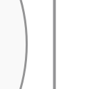

Compared with main `39a500425`, this PR delivers the enrolled ER208 chain that main refuses, reduces the default forest's area and wire, and restores a selected hollow-circle marker. Standalone gzip is 7.91% smaller. Brotli size, build memory and some proof work are higher. **This remains a draft; CI is not green.** An earlier frame expansion was reverted after it reintroduced circle contacts. The current checkpoint fixes one existing circle contact with the already-supported local terminal detour. The complete 1,748-record comparison changes only that SVG; the other 1,747 SVGs are byte-exact.

## Demonstrated improvements

The same six sources and options were frozen before outcomes. At current head3234, all 18 PR calls were requalified: 15 returned and three refused. Every returned SVG and entire receipt is byte-exact to the integrated PR1693 product; all three refusal names/codes/messages match. Main39 is unchanged, so its retained products are reused. This validates preservation, not a new layout gain.

| Input | Omitted backend: main→PR | Explicit Native: main→PR |
| --- | --- | --- |
| ER208 relationship chain | **400k geometry-work refusal→SVG delivered**, proof passed | Same gain; 208 identities, 207 ordered relationships and 414 normal contacts retained |
| Nonlinear forest | **Area−26.98%, wire−37.60%**, eight bends unchanged | Same gain; explicit ELK painted geometry unchanged |
| Raw hollow circle | **0→225 confined marker pixels** | Same paint gain; proof remains unverified in every mode |
| Sparse256 | Painted geometry unchanged | **Area−77.05%**, connected wire unchanged |
| Requirement TB cycle | Painted geometry unchanged | **Area−22.95%, wire−8.56%**, eight bends unchanged |
| ER256 relationship chain | Both revisions still refuse at the unchanged 400k geometry cap | Both still refuse |

Across the combined comparison, 27 products return: 21 proof-passed and six unverified; nine calls refuse. Omitted Flowchart layout can use the existing forest fast path in both revisions. These selected results do not establish a general workload ranking, whole-diagram glyph attribution or readability across arbitrary fonts.

## Existing circle contact: local terminal detour

At `3234fb3183e78840321ab41fe6881b31a0f5d4b2`, Native case230 retains all 17 identities, 40 relationships, 27 text programs and ten caption owners while separating a shaft from an unrelated circle. Before, their written strokes overlap by 0.453px; 41 selected shaft pixels are fully hidden. After, all 364 exposed pixels contribute, with none hidden or attenuated. Only that shaft and the generated scope name change; all other attributes and normalized text/CSS bind exactly.

The shared post-freeze producer previously spent its allowance on whole-band detours that cross already seated captions. It now retains the first band route when it clears nodes and headers and passes existing ink admission. After that first band fails ink admission, it tries the existing local terminal repair once before further band lanes. Four directional owning fixtures demonstrate that an already-admitted 280-unit band keeps priority over a 300.844-unit terminal alternative. The unpainted order, caps, terminal rays, endpoint exemptions, header/marker/caption admission and recertification remain. This adds no cache or supported body domain. A prior staged-input probe reduced support construction111→68 but did not fix the output and was stopped.

Proof changes U362,041→P362,293. Area and 17 crossings stay fixed; bends104→106 and wire grows 19.156 (+0.102%). SVG adds 32 raw/7 gzip bytes, Brotli unchanged. These selected pixels do not establish whole-diagram readability. [Full SVGs/receipts, pinned-font masks, profile, controls and stopped draft](https://github.com/adewale/agentic-mermaid/tree/34683912f30d6104de71f8dfe8138ffe2e1f063d/local-circle-detour-20261107) are backed up.

| Before: shaft merges into circle border | After: the same shaft clears the border |
| --- | --- |
|  |  |

Same saved actual SVGs/configuration, Chromium scale and offline manifest-verified Inter. The separate Resvg masks provide pixel attribution. Repair control revision: `6aa0ee45d9b6052addcb77036c1f7ba4c13b2cb4`. Pictures and masks were captured at47aed; current3234's complete case230 SVG and entire receipt bind exactly to that repaired product.

The complete existing CI comparison consumes **1,748 matched backend/case records with identical ordered IDs, literal sources and options**. Only Native230 changes. The other **1,747 SVGs, including all874 ELK outputs, are byte-exact** to the prior runtime; there are no delivery transitions or passed→unverified transitions, and one unverified→passed transition. This qualifies this retained corpus, not a general workload ranking. All18 frozen selected PR calls retain15 exact SVGs/entire receipts and three identical ER256 refusals.

The first47aed version changed nine Native SVGs, including case201's crossing count8→9 despite shorter wire. The final refinement restores201 and all seven other collateral routes exactly, relinquishing that wire saving. The earlier band remains preferred where admitted. This does not prove that every later band route across arbitrary inputs is preserved.

Owning tests: the repair-control public test is3P/1F at physical circle clearance; the candidate passes. Four directional admitted-band fixtures fail against47aed and pass against3234. Combined focused owners:8P/94 assertions. Full local route/layout/style checks:576P/18 missing-JSDOM loader failures; core types, changed-file lint and the actual standalone browser2P/504 assertions pass. Installed-dependency CI has one unit failure, the retained Sparse32 proof cap. Cases152/372 remain exactU. Proof availability, actual visible output and layout costs remain separate.

The targeted profile precedes changes and reports five sampled self/inclusive hotspots plus the existing cache inventory. Contact repair is only about2.1ms inclusive per case372 call; no material runtime speedup is established. Before/after230 proof work differs, so timing cannot supply an equivalent-work performance ratio.

## Delivery and execution costs

Complete production HTML uses the same Bun 1.4.4/dependency topology and production builder. Compression is Bun node:zlib gzip9/Brotli11; local and CI absolute sizes remain separate.

| Complete HTML / observed build cost | Main39 | PR3234 | Change |
| --- | ---: | ---: | ---: |
| Raw bytes |4,742,588|2,187,091|−2,555,497|
| Gzip9 bytes |1,423,188|1,310,630|**−112,558 (−7.91%)**|
| Brotli11 bytes |1,098,404|1,245,111|**+146,707 (+13.36%)**|
| Peak build RSS, KiB |430,832|722,140|Different single builds; no memory ratio|

The new complete production build takes 16.08 seconds within the existing 55-second deadline. Its byte-bound retained14bec control uses the same Bun/dependencies/recipe; this repair adds332 raw and183 Brotli11 bytes and removes57 gzip9 bytes. These single build observations establish no speed or memory ratio. The original standalone gzip ceiling of 1,334,500 bytes is unchanged and now passes locally. The actual emitted-worker owner also passes: 504 assertions across the two tests cover complete Blob bytes, enrolled family/style SVGs, entire receipts/verification, backend/fallback, crash recovery and ASCII/Unicode/PNG.

Private worker delivery reuses one existing compressor pass before packing, then specializes the bounded decoder dictionary for the exact build-owned stream. Each build traces dictionary reads, preserves offsets/length and verifies every decoded worker byte; notices and byte/CRC/loop/window/time/cancellation checks remain. The earlier dictionary step saved 37,701 gzip and 37,131 Brotli bytes while adding 95,553 raw bytes. The latest hull change modifies worker code and was requalified through the actual browser owner; its complete HTML saves a further 61 gzip and 209 Brotli bytes. No cache is added.

Lazy family transfer remains adverse. The matched pre-hull Packet plus complete YAML closure grows **196,160→230,648 gzip bytes**, despite22→13 requests; this remains a dated adverse measurement. Current CI Flowchart selected ELK is **774,124 gzip bytes against the unchanged761,500 ceiling**, up47 bytes from retained14bec. Current initial lazy transfer uses3 requests,15,408 raw/5,856 gzip/5,223 Brotli bytes. Lazy/demo/editor-empty budget failures remain; no ceiling or approval label is changed.

A matched-compressor packing probe saved only 2,416 gzip bytes and left 32,073 above main's static Packet transfer. It was compression-only, not executable ESM or a bound on all possible rewrites. Six-pass worker compression exceeded the build deadline; raw worker insertion worsened gzip. These stopped hypotheses and the earlier Python/Bun compressor mismatch remain in evidence.

Proof work also remains higher on some drawings: forest default 22,851→98,311; raw circle 41,687→156,940; Requirement default 25,613→102,468. Sparse256 default falls 102,610→90,857. These counts are not CPU measurements; caps stay unchanged.

## Runtime cleanup and profile

The earlier retained performance change requests bounds without constructing an unused original marker hull in paint certification. Every original-region consumer reads only bounds; served regions retain their full hull. Resource/pose encoding, proof charges and caps remain unchanged.

The [performance report](https://github.com/adewale/agentic-mermaid/blob/3234fb3183e78840321ab41fe6881b31a0f5d4b2/docs/design/system/layout-0.6-performance-review.md) retains the historical five-spot/cache review, the earlier Class128 before/candidate profile and the new case230/372 before-intervention profiles with five measured self/inclusive frames. The existing cache inventory remains; no cache or unmeasured speedup forecast is added. The largest sampled Class frame is first Scene admission, not redundant recapture. Class's Native-labelled placement still uses its Scene adapter; skipping mutable-input admission was not justified.

A sequential before/candidate pair preserves all warmup/repeat/edit SVGs and complete receipts. Repeats retain 388,607/400,000 proof operations; edit 389,269; all 127 markers and passed proof remain. Marker-region sampled self/inclusive weights move 7.697/12.499→6.964/11.241ms per call. Unchanged code also moves; this is **not an established end-to-end speedup**. Confounded earlier profiles, raw RSS/heap, errors and adverse observations are retained. Cold/import latency and cache1 were not measured in this bounded probe.

## Rebase and Sparse32 diagnosis

The requested merge-preserving rebase onto current main39 completed at the same 14bec head and tree. Missing historical Git objects were repaired, and intermediate files were preserved. No force push was needed. Heads 62af, deafff39d and dd365 add work-log qualification. The attempted frame expansion5ac52 was reverted in6aa0ee45d; runtime and tests were then byte-exact to dd365/14bec. Current3234 changes only existing painted-circle-contact proposal order; its new delivery costs are above, and the historical Class profile stays pinned to14bec.

The existing Sparse32 owner still fails. A stage trace is clean at **337,890 operations before XML closure**; the first refused charge requests 7 at 399,994 during typed-text literal validation. The actual 1,500-row/32-marker ink checks and direct Scene proof pass, while emitted Native proof remains unverified at the unchanged 400,000 allowance. This differs from ER256's geometry refusal.

A seven-bit prepared-attribute probe retained literal checks but still exhausted the allowance. It is saved and reverted, with all three control SVGs exact. Smaller 1,000/1,250-label probes pass at 328,063/395,813 operations; these are descriptive points, not maximums or acceptance gates. The original failure stays enrolled. [Rebase records, first-charge trace, failed candidate and independent review](https://github.com/adewale/agentic-mermaid/tree/a5c343e6600185b53679411a2f85575447454d50/rebase-sparse32-20261107) are backed up. No new runtime gain or capacity repair is claimed.

## Remaining differences from ELK

- Forest Native: **wire+10.19%, area−6.43%**, eight bends in both. Residual placement/terminal cost remains.
- Sparse256 Native: **area+5.04%**. The +0.97% backfill candidate is unshipped; +115.35% is historical.
- Requirement cycle Native: **TB/BT area−10.43%, wire−30.34%**, eight versus ten bends; **LR/RL area−1.44%, wire−20.25%**, six versus eight bends. The old TB/BT+9.53% loss does not reproduce on this fixture.
- Shared ER256 geometry refusal remains separate from Sparse32's proof-cap failure.

Six newly enrolled BT/LR/RL calls at 62af consume the full public SVG and entire receipt; all return with proof passed. Independent final-SVG inspection retains three authored cards, five ordered relationships and caption owners, and ten normal contacts per output. In manifest-pinned Inter rasters with system fonts off, each of 15 text programs and five arrows contributes pixels. LR/RL are wider and shorter: 970.194×251.95 versus ELK753.144×329.3, so the lower area does not establish better readability. SVG gzip6 is17–41B smaller, Brotli11 is23–43B smaller; N=1 CPU/wall/RSS observations establish no speed ratio. This is new directional qualification, with no runtime change or new layout gain. [Six actual products, PNGs, per-occurrence masks, costs and independent review](https://github.com/adewale/agentic-mermaid/tree/2b02e8d5970d3e3f695677d0e2fc9620ce064544/requirement-directions-20261107) are recoverable.

Ordinary painted-contact loss remains: original CI `sha256-counter-v1:152` delivers 17 nodes and 39 relationships but leaves 122 selected shaft pixels fully hidden by an unrelated card. Its strokes overlap by 0.823px. Checkpoint `5ac52ad3f` fixed that selected output through a nearer lane, but the complete CI comparison exposed five passed→unverified records across four unique sources. SHA33 and ELK296/362 reintroduced actual circle/shaft overlaps of 0.875, 0.125 and 0.5px. Native17 also changed its selected placement and gained marker-envelope warnings; its full causal path and visible marker impact remain unknown.

The added rectangle checks spent the shared optional allowance before existing circle repairs. A same-ledger circle-first probe restored17/33 proof but left152 unfixed, so it was stopped too. **Both implementations are reverted; no net renderer improvement ships from this attempt.** Rollback head `6aa0ee45d9b6052addcb77036c1f7ba4c13b2cb4` restored prior runtime/tests exactly. Fresh17/33/ELK296 SVGs bind byte-exactly to old CI with their recorded index prefixes;152's full SVG and entire unverified receipt bind exactly to its prior product.

The [complete positive/adverse products and stop decision](https://github.com/adewale/agentic-mermaid/tree/62d61e5cc41211f4aa3d5f50c0d8d05c0748e284/sharp-frame-stop-20261107) preserve the verified23MB CI artifact, all1,748 matched backend/case records, ten changed SVGs, all costs and the stopped priority-order probe. These existing corpora do not establish a general workload ranking. Passing505 local route owners,92 nearby cases and the real standalone owner did not establish preservation of those later circle decisions. Cases372/102 remain unverified. Case276's crossing-only candidate also stays reverted because it introduced a real painted contact. The subsequent bounded profile found that fewer staged support constructions alone did not fix the output, so that probe was stopped. The current circle-only repair does not expand the rectangle/subroutine domain. Cases152/372 remain counterexamples for a caption-safe route intervention without a new cache or quota.

Original baseline `2dadf0dbc2685c8435df541de99f3edce841450d`, Trident and pinned Mermaid 12.2/Pele 1.9 products remain unavailable. Pele 1.8 was not substituted. Replacement24 stays sealed.

## Visual evidence

PR baseline SHA: `39a500425f6b74eb486b9add9e90d538fab6a914`.
Current PR head SHA: `3234fb3183e78840321ab41fe6881b31a0f5d4b2`.

The pictures were captured at mainf9/PR741. Main39/PR1693 SVGs and entire receipts bound exactly to those products; the latest 18 PR calls bind again to PR1693. The existing images therefore retain their original selected-ink limits. Equal scale and four manifest-verified Inter weights show the same six cards/four arrows; no image was edited.

| Main before | PR after | What to inspect |
| --- | --- | --- |
|  |  | Compare empty vertical spans, retained card text and target arrows. Width/raster scale and card dimensions are fixed. |

## Scope, checks and recovery

Normal merge 1693 integrates main39 while retaining the inherited PR449 capture/ownership foundation, UTF16 diagnostics, typed parser and source-MCP isolation. Main's 0.5.7 identity, backend-default setting, mutable/getter/CSS/definition isolation and all caps remain. Reviewed Class/Requirement/browser goldens qualify earlier intentional spacing behavior.

Historical qualification at unchanged runtime14bec: 740 passed, known Sparse32 failed, and one child stdin permission error returned no render product. That public cyclic owner passes its permitted retry (392 assertions). Core types, changed-file lint, ESM/declarations and the actual standalone browser owners pass. These are behavior-preserving regression guards, not a new bug-fix RED claim.

[Current-head CI42352233778](https://github.com/adewale/agentic-mermaid/actions/runs/42352233778) completed **failed**. It tested main39 plus PR3234 at checkout`e848a44ac8f0c99e2fb299513b877fd3798cfb9e`; tree`1896f0868fce5f58edb28dc523c50f27b52ee1dd` equals the source head. Unit2 has6,413 passes and the one existing Sparse32 failure; unit1/3, browser, browser-site including the original standalone budget, package consumers/quickstarts, Node22 tarball, dist, CLI, MCP, semantic conformance, macOS/Windows isolation and build pass. Quality/payload failures and the generated-layout advisory (case276 six crossings versus ELK four) remain. This draft is **not ready**; no waiver or manual CI dispatch.

The independent review and full comparison exposed the intermediate crossing cost and led to the refinement, rather than accepting local helper passes. The [final recovery checkpoint](https://github.com/adewale/agentic-mermaid/tree/ca23753c6326112a1564a05b95c5e300277ae78a/local-circle-detour-20261107/final-3234) contains the complete verified generated-layout artifact, all1,748 outcomes, actual build/browser/check logs, failed directional owner and final green owner, source patch and exact CI checkout/tree binding. Earlier positive and adverse artifacts remain in evidence history.

Reproduce the affected owners with Bun 1.4.4:

```sh
bun test src/__tests__/route-contracts.test.ts --timeout 60000
bun run typecheck:core
NODE_ENV=production AGENTIC_MERMAID_SCENE_ASSERTIONS=0 bun run scripts/site/editor.ts
bun test e2e/browser.test.ts --test-name-pattern 'standalone editor' --timeout 120000
```

[Current profile, full products, checks, builds, independent review and stopped probes](https://github.com/adewale/agentic-mermaid/tree/57c180d47b2d01a618ec2a1c4e1ca87d1606c538/original-marker-bounds-20261107) are backed up outside the source diff. [Main integration evidence](https://github.com/adewale/agentic-mermaid/tree/19fbe17aaeee45d5c01a5e953705ca1da13fc704/main-integration-20261107) and [original pictures](https://github.com/adewale/agentic-mermaid/tree/a073858f2d9a51b6ddcfb55fb2effae394b18793/main-comparison-20261105) remain in history. The [work log](https://github.com/adewale/agentic-mermaid/blob/3234fb3183e78840321ab41fe6881b31a0f5d4b2/docs/design/system/layout-0.6-work-log.md) records exact revisions and remaining losses. Archived leases cannot authorize writers. Bounded continuation remains authorized through **2026-11-08T23:59:59Z**.

