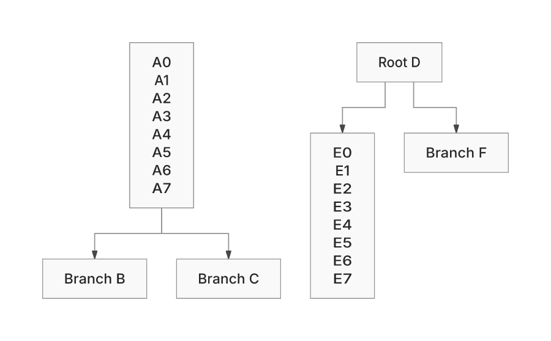
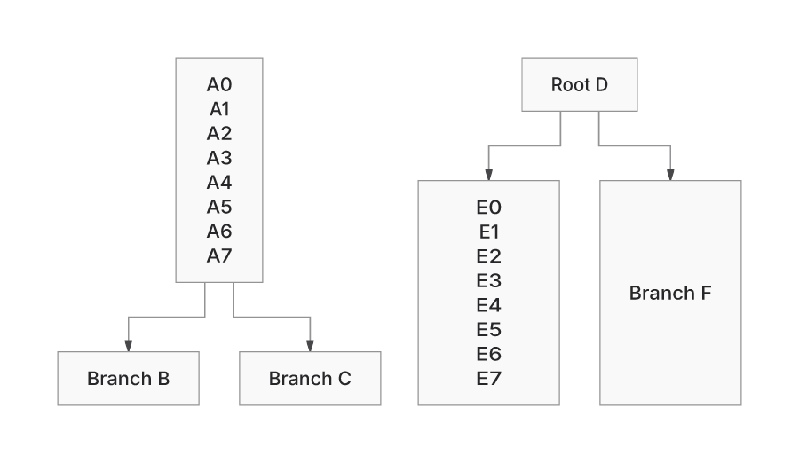
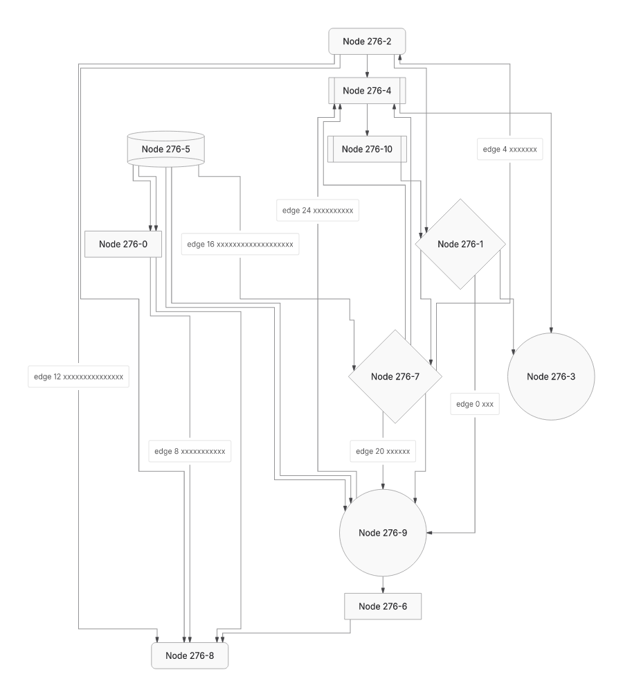
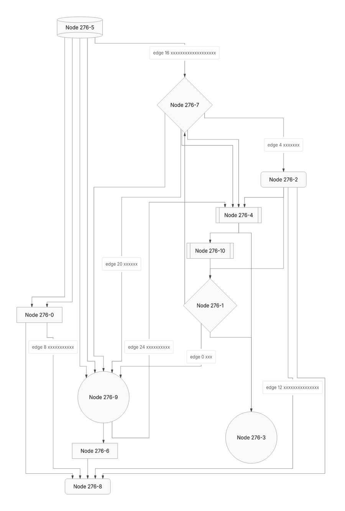

# Native and ELK: correctness comparison

Source: `d8c8ac879793a586b4b741c178b89d7900bd27ed`. Both lanes run through this PR’s shared measurement, SVG emission and certification pipeline. ELK is the pinned ELK 0.11.1 layout backend here; this is not a comparison with upstream Mermaid or an unmodified ELK consumer.

Both preserve the independently audited generated meaning. Native produces better layout vectors on most of this fixed roster and has more available final proofs. Neither backend has an exhaustive visible-correctness result.

## Delivery, meaning and proof availability

| Observation | Native | ELK |
| --- | ---: | ---: |
| Delivered SVG in fixed 874-pair roster | 874 | 874 |
| Final proof passed | 740 | 696 |
| Final proof unverified | 134 | 178 |
| Independently audited generated inputs | 640/640 | 640/640 |
| ER256 LR and TB probes | Both deliver | Both deliver |
| ER256 BT and RL probes | Both refuse | Both refuse |

The 640-input audit derives literal node declarations and directed/parallel relation occurrences without the production parser. It checks actual SVG-owned node/caption text, shape primitive kinds, resolved arrow resources, ordered endpoints and unique resource/relation identities. All 1,280 products pass those checks. Node paint order is recorded as a diagnostic, not an authored-meaning requirement. The first order-sensitive probe is retained as a rejected criterion.

The 234 mixed corpus cases are not assigned independent meaning success by that audit. Earlier literal forest/Class/ER/Requirement owners and selected pixel evidence remain revision-bound evidence. The current performance edits additionally deliver the expected changed text in all 96 processes. None of these checks proves every glyph remains visible under every later paint operation.

Of 874 pairs, 663 have passed proofs in both backends, 77 only in Native, 33 only in ELK, and 101 in neither. An unverified proof is separate from refusal and from an independently demonstrated collision. Sparse32’s emitted-proof work cap remains a separate enrolled limitation outside the 874 delivery roster.

## Layout quality vectors

Lower is counted per case. These are layout measurements, not counts of correct drawings. The roster has640 generated flowcharts and234 mixed corpus cases; it does not weight the owner’s workload frequency. All 874 pairs record the intended selected backends.

| Measure | Native lower | Equal | ELK lower |
| --- | ---: | ---: | ---: |
| Canvas area | 670 | 140 | 64 |
| Wire length | 644 | 149 | 81 |
| Bends | 500 | 221 | 153 |
| Crossings | 645 | 228 | 1 |
| Modelled label conflicts | 41 | 833 | 0 |
| Parallel route overlaps | 247 | 627 | 0 |
| Opposing route overlaps | 28 | 846 | 0 |

Mixed 234 cases alone: area 72 Native / 140 equal / 22 ELK; wire 68 / 149 / 17; bends 22 / 192 / 20; crossings 12 / 222 / 0. The remaining sole crossing loss is generated276: Native 6, ELK 4. Class area still favors ELK in 11 of 40 cases. Sparse256’s shipped area gap remains +5.04%; its narrower prototype and the global crossing trial stay unshipped because their adverse height/payload/contact effects were retained.

## Actual output examples

The same input at the same source revision is rasterized with manifest-verified Inter, system fonts disabled. Whole-view images preserve each backend’s canvas aspect ratio. These examples were visually inspected; they do not replace a whole-workload ink audit.

Forest: both preserve all six labels and four directed relationships. Native retains the short leaf’s measured box; ELK’s shared symmetry consumer enlarges it. Native’s actual area is 6.43% smaller, with 0.31% more wire.

Crossing276: Native is shorter and wider, with more crossings. Both retain all 11 node labels, 25 relation occurrences and 7 caption programs.

## Remaining uncertainty and reproducibility

Actual SVG carrier presence and shape primitives do not establish complete pixel visibility, contacts, readability, UTF16/getter/CSS/definitions behavior or ownership isolation across all mixed inputs. Those require their owning contracts and actual-output checks; unchanged recent source owners are not rerun as new progress here. No correctness percentage is assigned to the complete workload.

Use `correctness.py` on the retained fixed snapshots. `CORRECTNESS.json`, `MEANING.json`, `BACKEND-SELECTION.json` and `ELK-ADVANTAGES.json` retain every result, failed/unsupported slot and scope limit. The source snapshots are preserved in the precedingER256 recovery archive027ce160ee147e9a7aea032219298b5b215fe3f7.

Original baseline2dad, Trident and pinned Mermaid12.2/Pele1.9 remain unavailable; Replacement24 remains sealed. No source changes or new acceptance thresholds were introduced. Exact-head CI 42398164647 completed with failure; PR602 remains draft.
