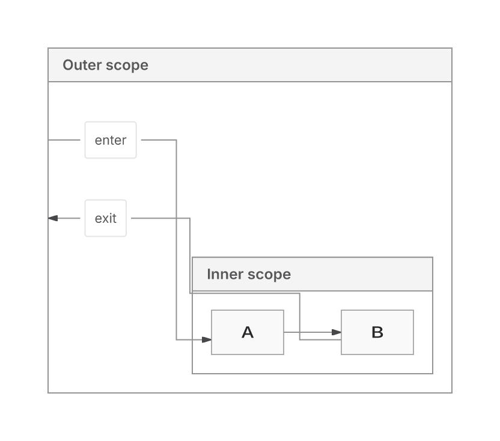
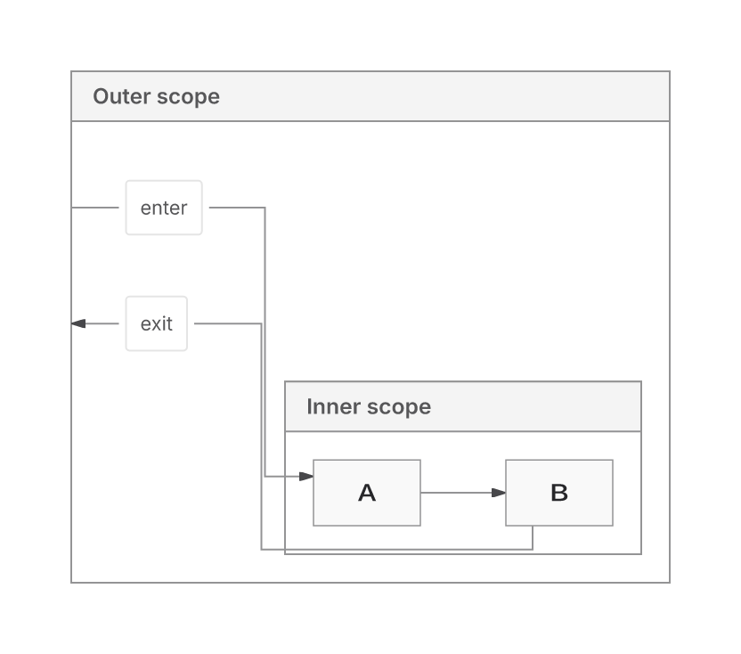

This PR repairs Native grouped routing, reduces repeated geometry/text work in the shared SVG pipeline and removes the unmerged Trinity backend. Native is the replacement candidate; ELK remains the default.

**Draft: replacement work remains incomplete.** Native100 latency, Chain300 proof availability and browser payload budgets remain open.

Head: `68986ba8e3b76ad99dad44c6ec8d43475cc5e12f`, parent `2525b91c477b9ad1fff162574d12f55c8c4be54e`. Frozen integrated Main: `9136b07efb8944a1058de9834b18fe5916884174`. Defaults, versions and resource caps are unchanged relative to that Main.

## Changes

- Native uses the shared measured request and early endpoint-capacity planning. Source-ordered group cycle handling, bounded global ranks and ancestor routing preserve authored relationships and flow.
- Capture, SVG writing and paint inspection reuse geometry/text/group/marker facts bound to the submitted source and actual written occurrence. Mutable inputs, inherited getters, replacement producers, callbacks, errors, CSS, definitions and ownership boundaries retain defensive handling. Duplication is reduced; it is not eliminated.
- Dispatch admits backend and fallback once before invoking a producer. Getters and producer callbacks cannot change the admitted policy or reported backend; retention callbacks and observers receive the same immutable decision.
- Trinity’s unmerged runtime, API choice, lazy mappings and dedicated tests are removed. Only `elk` and `agentic` remain accepted. Shared measured-request and endpoint-capacity code, neutral tests, the historical Trinity spec and retained evidence remain. Removed selections reject even with ELK fallback.
- Browser dispatch loads the selected Flow or State grammar; generic parsing retains both. Heavy style schemas use the existing provider. Role schemas construct 114 applicable property objects instead of 240.
- Canonical role descriptors freeze nested bounds and enum arrays, closing two reproduced exported-reference corruption paths. Public schema copies and caller StyleSpecs remain mutable and isolated.
- Prepared-text reuse requires supported prototypes to remain stable across sealing. Accessor/custom-prototype spans receive no immutable-data authority. Private paint-ledger reservations batch accounting while preserving totals, partial-cap behavior and proof status.

The broader Scene refactor, scalar-capture experiment and later writer/XML variants were withdrawn after inadequate savings or adverse measured costs. Their patches and results remain in recovery evidence.

## Correctness and limits

| Retained comparison | Result | Limitation or adverse cost |
| --- | --- | --- |
| Current689 full suite |99/99 inputs returned per engine;89/91 deep-authored checks complete and passed, two unavailable; eight labels-only supplements separate | Paint complete on 75 Native/74 ELK inputs, zero known failed checks; remaining paint scopes partial. Proof 93P/6U per engine; exact contacts unavailable |
| Grouped delivery |10→12/12 replacement inputs; zero crossings; ELK also 12/12 | Original twelve inputs/image are lost. Illustrated ancestor repair adds 5.56% wire |
| Frozen Main913 comparison | Both return 116/124 portable and 194/198 authored inputs; actual ink failures 2→0 by restoring Main’s omitted image | Raster proof remains unavailable; image needs area. ELK Requirement height +6 and nested Unicode Flow width +5 |
| Larger proof suite |8→10/12 passed; Fan100 passes both | Chain300 remains unknown at 400,000 operations on both; caps unchanged |
| Native100 proof work |270,326→238,786 operations | Counters are not CPU speedups |

Cleanup requalification runs the existing Trident collector on six graph families, with source-Bun and canonical Node SDKs separately. Each returns 36 supported Native/ELK products; all 18 whole-SVG and 18 entire-receipt pairs match 2525 exactly. All 18 current canonical Node proofs pass, and receipts confirm the actual requested producer. Portable authored-model and complete painted-correspondence scopes remain explicitly unmeasured; unchanged output/proof passes are not new all-family visible coverage.

All 12 removed Trinity policies reject, including ELK fallback. Their historical outcomes remain archived; removal is intentional, not a layout improvement.

Historical losses remain enrolled: forest wire +16.89% with area −6.43%, Requirement area +9.53%, and implemented Sparse256 area +5.04%. The Sparse256 +0.97% candidate is unshipped. ER256 already passes eight backend/direction lanes; no new ER repair is claimed. Original baseline2dad and equivalent pinned Mermaid12.2/Pele1.9 comparisons remain unavailable. Replacement24 stays sealed.

## Current Native/ELK benchmark

The full Trident run uses head `68986ba`, the canonical CI SDK and Node 24.19.0. Fetched Main `9136b07` is already integrated; no new merge or production change was needed. [Full comparison](https://github.com/adewale/agentic-mermaid/blob/0ec8560ffe5e2e56b128972410d4039bf796142a/latest-main-full-trident-20261112/REPORT-FINAL.md) includes all 33 families, actual selected producers, cold/import/cache/edit costs, memory, compression and retained failures.

All 2,976 stock workers and 432 full-response workers completed, with zero lifecycle failures or OOMs. Sampling remains exploratory: three fresh processes, seven adaptive stock batch means. The following cache-disabled times are medians of process medians, in milliseconds.

| Workload | Stock SVG Native | Stock SVG ELK | Full response Native | Full response ELK |
| --- | ---: | ---: | ---: | ---: |
| 100-node chain |78.03 |144.71 |109.55 |202.44 |
| 100-node fan-in |109.28 |258.42 |167.09 |399.98 |
| 300-node chain |224.96 |315.96 |307.32 |492.39 |

Full response consumes the entire SVG and receipt as JSON/UTF8 once inside the API clock. Chain100 first use, excluding import, is 274.09 ms Native / 650.22 ms ELK; first edited source 122.86 / 228.51 ms. Cache hits and repeated edited-source calls are separate report columns. Chain300 remains unverified at the existing proof cap, so its timings do not establish proved delivery.

**The general 100 ms target remains unmet.** Native's stock chain median is below 100 ms on this host, but its batch-mean p95 is 108.93 ms, fan-in is 109.28 ms, and both fully consumed 100-node responses exceed 100 ms.

Native has lower observed full-response median, process RSS and compressed browser payload in all eight backend-selecting family representatives. The other 25 families share rendering paths. Chain100 repeat-response after-call RSS is 129.78 MiB Native / 187.20 MiB ELK; after-call process heapUsed 30.01 / 55.85 MiB. These include harness/retained warmup products; RSS is not an isolated API allocation peak.

All 1,728 repeated base SVGs and entire receipts match warmup products. For each (case, backend), all 118 valid portable SVGs match across caches and between stock/receipt APIs; six expected invalid rows have no SVG. The 3,888 full responses contain 3,564 passed proofs and 324 unverified, retained separately from delivery.

The environment was replaced before verified timing collection. Node timings come from the replacement host; retained functional/browser results come from the earlier host. No code speedup is inferred against historical timings. Browser gzip 9/Brotli 11 recompress actual fetched bytes, not observed HTTP transfer. Sampling and the annotated 5.065 ms coordinator pause remain documented in the report.

Actual cleanup payload measurements compare canonical 2525 and 689 CI reports using the same per-file gzip level 9/Brotli quality 11 protocol:

| Payload | Parent2525 | Cleanup689 | Change |
| --- | ---: | ---: | ---: |
| Mixed browser raw |2,514,987 |2,513,282 |−1,705 |
| Mixed browser gzip |782,452 |781,054 |−1,398 |
| Mixed browser Brotli |622,671 |621,650 |−1,021 |
| Standalone editor gzip |1,380,423 |1,373,260 |−7,163 |
| Native Flowchart closure requests |37 |30 |−7 |
| Native Flowchart closure gzip |382,993 |379,237 |−3,756 |
| ELK Flowchart closure requests |27 |25 |−2 |
| ELK Flowchart closure gzip |741,465 |740,366 |−1,099 |

Family asset closures exclude YAML; the mixed row is the separately budgeted omitted-layout forest→ELK plus YAML union. Closure counts are not observed startup timings. Native still has five more Flowchart assets than ELK. Full 33-family costs remain retained. Small adverse costs remain: initial lazy Brotli +2 bytes and the separate editor-empty route Brotli +86 bytes.

**Payload budgets still fail.** Mixed raw/gzip/Brotli caps are 2,430,000 /761,500 /618,000. Demo payload is 826,219 /315,353 /276,111 against 788,000 /302,500 /276,000. Standalone editor gzip remains 38,760 bytes over 1,334,500. Per-PR growth versus Main also fails. No caps or approval labels changed.

## Verification

Cleanup checks pass 65 owning tests / 1,603 assertions and lint across 21 changed TypeScript files; independent scope review is clear. Neutral assertions formerly mixed into Trinity tests were migrated, including five Native/ELK diamond-refusal checks. The local full Class suite was killed under the memory limit; it was not called a pass or retried. The canonical CI package supplies the Node comparison above, and all 160 shipped JS/CJS/declaration files contain no Trinity reference.

Exact-head [CI 43311727806](https://github.com/adewale/agentic-mermaid/actions/runs/43311727806) finished with **failure; the PR is not ready**. All three unit shards, types, lint, canonical portable/Node/browser builds, Chromium resolved-scene E2E, semantic conformance, MCP, CLI/platform and installed/tarball consumers pass. Remaining failures are lazy/browser/site/editor payload budgets and per-PR growth, plus the generated-layout advisory. Browser-site records 21 passing tests and one editor-size failure. Ruff and Action pinning pass. No manual CI was dispatched.

## Recovery evidence

- [Cumulative Native audit and withdrawn exact-axis probe](https://github.com/adewale/agentic-mermaid/blob/e72484908b56dc68fdc4dabf466f53f4648060e1/native-loop-20261113/audit/cumulative-audit.md); [complete matched costs and rejection](https://github.com/adewale/agentic-mermaid/blob/e72484908b56dc68fdc4dabf466f53f4648060e1/native-loop-20261113/implementation/AXIS-PROBE-REPORT.md). Source remains689; this experiment supplied no retained improvement.

- [Current full Native/ELK Trident comparison](https://github.com/adewale/agentic-mermaid/blob/0ec8560ffe5e2e56b128972410d4039bf796142a/latest-main-full-trident-20261112/REPORT-FINAL.md), including raw results, per-family costs, output stability and host recovery.

- [Final cleanup qualification, canonical package and complete cost audit](https://github.com/adewale/agentic-mermaid/blob/ec0c3f1eb8c9261de9994e77eb941346b2cbe32b/native-only-689-final-20261112/REPORT.md): 291 files in two verified archives, including exact package bytes, Node outputs, terminal CI logs and adverse costs.
- [Approved cleanup, retained tests and source comparison](https://github.com/adewale/agentic-mermaid/blob/8458efcffd8ce66b89ec67ea82ae4daa02456d4a/native-only-689-20261112/REPORT.md)
- [Shipping2525 Native/ELK distributions and failed stock workers](https://github.com/adewale/agentic-mermaid/blob/0ac7d7df2ccdf7e73cdacaaa92691586473f889d/shipping-2525-native-elk-20261112/REPORT.md)
- [Dispatch fix and rejected XML/group trials](https://github.com/adewale/agentic-mermaid/blob/2b255b39cec8760c1b823560e6a37c5c2e01b639/guard-group-recovery-20261112/REPORT.md)
- [Prepared-part fix and rejected actual-writer variants](https://github.com/adewale/agentic-mermaid/blob/517981c6aa6cf650e3c00e62abb848feab062f12/actual-write-rejections-20261112/REPORT.md): original v1 emitted bundle/maps were overwritten; source, outputs and profiles remain.
- [Private-ledger comparison and matched costs](https://github.com/adewale/agentic-mermaid/blob/b85e5bc881fe5d59de90df71d5c7f4eb28779cc6/private-ledger-943-20261112/REPORT.md); [later rejected trials](https://github.com/adewale/agentic-mermaid/blob/79bcbce9bc58c1e7a8868a00d679a4524bdc6a4a/rejected-trials-and-ci-20261112/REPORT.md)
- [Role authority and withdrawn trials](https://github.com/adewale/agentic-mermaid/blob/4b24e930bc68420b6694b04072ef5b696e7205b1/role-authority-and-withdrawn-perf-20261112/REPORT.md)
- [Frozen Main comparison, five self/inclusive hotspots and cache inventory](https://github.com/adewale/agentic-mermaid/blob/f490974f6110ce235634da43ac82a02820315998/current-main-qualified-20261112/REPORT.md)
- [Parser/schema comparison](https://github.com/adewale/agentic-mermaid/blob/ccc8b783e0851728b560b47d6f1e967980d196fe/minimal-parser-qualified-20261112/REPORT.md); [State extraction and per-family costs](https://github.com/adewale/agentic-mermaid/blob/2a300fa133a1ce0e79dea8f615592b8b40d756c7/state-parser-qualified-20261112/REPORT.md)

## Visual evidence

Claim: the labelled ancestor entry/exit retain their authored relationships and A→B flow while removing two route crossings.

Input/fixture: `container-descendant-labelled` in [the fixed source set](https://github.com/adewale/agentic-mermaid/blob/8ec6299d2d1270c189e78c6d1ef79e1d66f3b9a9/native-blockers-checkpoint-20261110/REPLACEMENT-12.json), directionLR, nested Outer/Inner, Outer→A labelled enter, A→B, B→Outer labelled exit. Options/source are identical between arms; production SVG with Inter.

Baseline SHA: `7257faa9299a69948645a7574e185300b7841f75`.
Historical visual head SHA: `17f157fae6a6f97295ebb10f215d2c2326710b6b`.

Regenerate: extract `evidence.tar.gz`, replay the retained correctness collector, then `bun correctness-final/raster-ancestor.ts`. Resvg uses manifest-verified Inter, system fonts off,2× zoom. [Font manifest](https://github.com/adewale/agentic-mermaid/blob/8ec6299d2d1270c189e78c6d1ef79e1d66f3b9a9/native-blockers-checkpoint-20261110/RASTER-FONTS.json), [SVG/PNG/archive hashes](https://github.com/adewale/agentic-mermaid/blob/8ec6299d2d1270c189e78c6d1ef79e1d66f3b9a9/native-blockers-checkpoint-20261110/MANIFEST.json). Owning test: `ancestor-boundary-routes.test.ts`, “ancestor entry and exit preserve the inner chain without crossing”, allfour directions.

| Before | After |
| --- | --- |
|  |  |

Limitation: these renders establish the enrolled fixture's crossing repair, with a wire cost. They do not recover the lost original image, prove every grouped graph correct or establish ELK replacement readiness.

