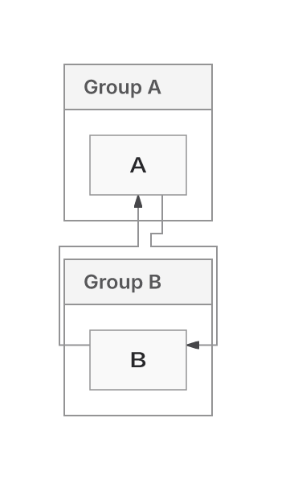
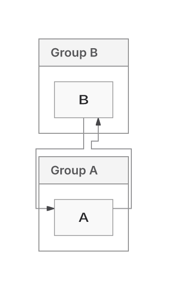

## What changes

**Draft; retain ELK.** Native (`agentic`) is the sole replacement candidate. Trinity feature development is frozen; its existing opt-in API remains compatible. Source `10253d29dba24554008fc61c178abcf7cc0a47cf`, main `e7cb05baa7f68154942a9ce9c6e9aaaee163dc94`. Defaults, versions and work limits are unchanged.

This PR preserves SVG write/occurrence ownership and mutable/getter, UTF16, CSS, definitions and cache isolation. It also repairs Native capacity, invisible constraints, shortening and nonlinear forests; shares canonical Requirement demand, frame rollback and sized inline-PNG emission. Historical ER256 delivery in four directions stays distinct from unresolved Sparse32 emitted-proof exhaustion. Raster image paint remains unverified; remote media stays inert.

The earlier Trinity experiment introduced the neutral measured placement/routed contract and bounded family adapters. Further replacement work now goes into Native.

## Latest Native changes

| Demonstrated loss | Change and result | Cost / remaining limit |
| --- | --- | --- |
| Reciprocal group links can reverse the first authored constraint | Prefer fewer cuts among bounded candidates, then earlier lifted group links. Ranked siblings preserve partition precedence. Four directional baseline failures become passes. Public horizontal wire133.55→121.55px, bends8→4; area unchanged. Vertical area/wire/bends unchanged. | The unavailable image was not reproduced. This does not resolve the five compound declines. Global nesting/border-node layout remains unimplemented. |
| Eight physical ports are compressed into a growable body | Plan explicit rectangular/rounded face capacity after cycle orientation and before coordinates. Return permitted body growth; decline insufficient fixed bodies. Preserve physical loop separation and requested40px terminal lead. Four Native conformance failures become passes. | This covers flat neutral requests. Compound metadata and production seam adoption remain unfinished. Preserving Requirement loop lead increases wire670→676px; area230538/bends8 unchanged. |
| Changed-marker proposals repeatedly construct peer marker views | One owned Native pass lazily prepares views and spatially queries a packed BVH. Writes/rollback invalidate changed edges; unknown peers, authored blocker order and exact checks remain authoritative. Borrowed/custom/unknown data uses live checks. | Real cyclic353 executes90 peer queries across five renders. No full-response speedup is established; adverse time/heap retained. Index storage is temporary O(E); construction O(Elog²E), refits O(logE). |

[Verified results and stopped probes](https://github.com/adewale/agentic-mermaid/blob/bbe1d52f88fb612156189c43deddcf6b766f70d4/native-only-checkpoint-20261109/README.md). The Native-only module-split experiment added a request to every product and worsened Native payload, so it is not shipped. Trial ELK context enablement also remains unshipped.

## Correctness

805 owning checks, core/repository typecheck and lint pass. The frozen 30×3 comparison retains84 identical whole SVG/receipts and six original shared errors. Actual 13-input lazy browser products pass all three adapters. Current source reproduces the four group evidence SVG/receipt bytes exactly. These checks do not prove whole-workload visible correctness.

Historical 874-input delivery at the preceding revisions: ELK874 returned (696 proof-passed/178 unverified); Native874 (741/133); Trinity123 returned/passed and751 unsupported. This population was not rerun after the new group-order change. Keep the dated counts as a reference, not a current aggregate score.

Remaining losses include the five compound declines, shared hollow-circle ink obscured by receiving bodies, Sparse32 proof exhaustion and payload gates. Authored meaning and actual SVG/ink remain the correctness boundary. The painted-contact counterfactual is not a public fix. Original2dad and equivalent pinned Mermaid/Pele runtime comparisons remain unavailable; Replacement24 stays sealed.

## Performance and download cost

[Profile: five measured self/inclusive hotspots and cache inventory](https://github.com/adewale/agentic-mermaid/blob/bbe1d52f88fb612156189c43deddcf6b766f70d4/native-only-checkpoint-20261109/REPORT.md). Shared emission capture dominates simple chains; crossing analysis adds fan cost. Inclusive samples overlap. No invented expected speedups.

- Fully consumed Native 100-node uncached warm responses: chain146–215ms; forest171–186ms; fan226–357ms. All return, with unverified receipts at the original400k capture limit. The 100ms target is unmet.
- The 96-edge isolated marker kernel improves first admission152–158→13–14ms and warm79–102→4–8ms. This is not a full-product result. Both100-node fan diagnostics made zero indexed queries.
- Real 10-node cyclic353:16 complete calls passed;32 whole SVG/receipt comparisons match. Warm125–176ms before versus136–431ms after includes an adverse outlier; edit and memory costs are mixed. [All observations](https://github.com/adewale/agentic-mermaid/blob/bbe1d52f88fb612156189c43deddcf6b766f70d4/native-only-checkpoint-20261109/CYCLIC353-MARKER-ABBA-RESULT.md). No reliable full-response win or retained-memory reduction is claimed.

Actual 13-input browser request union, binding bytes separate:

| Product metric | ELK | Native | Trinity |
| --- | ---: | ---: | ---: |
| gzip9 bytes |862852|492104|484631|
| Delta versus `dee908197` |+1365|+2213|+1491|
| Brotli11 bytes |692428|421732|415045|
| Requests including binding |43|49|50|

Requests are unchanged. These are actual fetched bytes compressed offline, not network-startup measurements. The smaller selected solver closure is not a whole-package reduction. [Payload vectors](https://github.com/adewale/agentic-mermaid/blob/bbe1d52f88fb612156189c43deddcf6b766f70d4/native-only-checkpoint-20261109/PRODUCT-DELTA.json).

## Verification and readiness

Reproduce owners: `bun test src/__tests__/agentic-layered.test.ts src/__tests__/measured-backend.test.ts src/__tests__/feedback-reroute.test.ts src/__tests__/route-contracts.test.ts src/__tests__/native-layout-cache.test.ts --timeout 30000`.

Exact-head [CI42721236241](https://github.com/adewale/agentic-mermaid/actions/runs/42721236241) is still running, with quality/payload/editor checks already failed: lazy Flowchart784589>761500gzip bytes, demo315347>302500, standalone editor1340895>1334500. Unit3, semantic conformance, package/CLI and renderer-isolation checks passed; unit1/2 and browser were pending at the latest check. Sparse32 remains a known preceding-head failure, separate from these budgets. No failure is waived and no cap is raised. **The PR is not ready.**

Source and recovery evidence are pushed to the existing branches; no new PR/issues, forced history rewrite, manual CI dispatch or publication.

## Visual evidence

Claim: the first authored group link `b→a` follows the declaredTB flow after group-cycle selection; both authored directions remain present.

Input/fixture: `group-cycle-TB`, two groups A/B, authored edges `b --> a` then `a --> b`; identical options, production SVG renderer, manifest-verified Inter with system fonts off.

Baseline SHA: `dee908197a8fe678d05cb6e1c6827d05ae9d4fb7`.
Current SHA: `10253d29dba24554008fc61c178abcf7cc0a47cf`.

Regenerate: extract the evidence archive and run `bun raster-groups.ts` on the retained production SVGs. [Manifest and hashes](https://github.com/adewale/agentic-mermaid/blob/bbe1d52f88fb612156189c43deddcf6b766f70d4/native-only-checkpoint-20261109/MANIFEST.json); [current-source SVG/receipt equivalence](https://github.com/adewale/agentic-mermaid/blob/bbe1d52f88fb612156189c43deddcf6b766f70d4/native-only-checkpoint-20261109/CURRENT-GROUP-EQUALITY.json). Owning test: `agentic-layered.test.ts`, “lifted group cycle cuts respect count then source order”.

| Before | After |
| --- | --- |
|  |  |

Limitation: these two-group renders establish ordering for this fixture, not general compound quality, the missing image, glyph fidelity or ELK replacement readiness.
