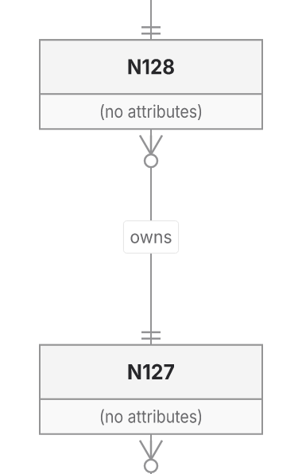
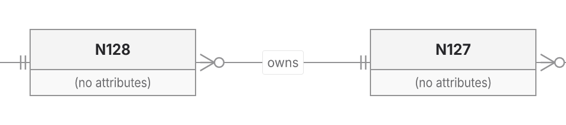

This PR preserves owned SVG capture and final-paint checks while improving selected Native layouts. It also fixes a shared ER finalizer refusal: the 256-entity chain now delivers in all four directions through Native and ELK, within the original 400,000-operation geometry allowance.

**The PR remains draft. It is not a general ELK replacement, and no new runtime or memory speedup is established.**

Head: `00938cc04693fe5da7a02a5d226406c3c2848251`.
Base: `c366de0d137e33e123acd84fc99164417c0f3917`.

The merge-preserving rebase integrates #601 and #607, retains the previous published head as ancestry, and was pushed normally. Main's existing ER index and caption-prefix repairs are not claimed as new PR work. Defaults, versions and caps are unchanged.

## Behavior and tradeoffs

The shared ER finalizer was rebuilding glyph/shaft geometry and indexes after an unchanged route stage, then querying spatial trees separately for each cardinality piece. It now reuses that call-local snapshot only when later face, frame and caption repairs have not moved routes. One conservative glyph-union query supplies candidates; the same exact piece intersections and incident-terminal exclusions still run.

| ER256 chain | Before | Current geometry work / original cap |
|---|---|---:|
| Native TB/LR | Returned at 397,206 | 343,421 / 400,000 |
| Native BT/RL | Refused | 385,344 / 400,000 |
| ELK TB/LR | Returned at 384,466 | 330,681 / 400,000 |
| ELK BT/RL | Refused | 371,874 / 400,000 |

Snapshot reuse alone and union queries alone still refuse BT; the combination delivers. All four previously returned control SVGs remain byte-exact. This is reduced geometry work and recovered delivery, not a CPU ratio between refusal and completion.

The PR also retains Native packing/leaf seating and the ownership/contact recovery foundation. Two named same-input comparisons against current main remain:

| Metric | Main Native | PR Native | ELK |
|---|---:|---:|---:|
| Forest wire | 700.04 | 397.71 | 396.47 |
| Forest area | 226,466 | 165,356 | 176,727 |
| Class2 area | 85,680 | 65,400 | 61,400 |

Class2 changes from 360×238 to 200×327: narrower, but taller. These examples establish selected benefits, not whole-workload readability. [Literal inputs, earlier SVGs and limitations](https://github.com/adewale/agentic-mermaid/blob/fb8258f17fadf2996e15aa4c82a0973b1cefae4f/rebase-c366-reconsider-20261107/README.md).

## Visual evidence

Baseline SHA: `a195262036dbb07c7ce4919505d4ff47dea09e63`.
Current SHA: `00938cc04693fe5da7a02a5d226406c3c2848251`.

The baseline returns ER_ROUTE_WORK_LIMIT for these BT/RL inputs, so there is no baseline drawing. The after images are crops of the actual final SVGs. Inspect the N127→N128 `owns` label and the one/zero-many cardinalities at each card. Rendering uses manifest-verified Inter, disabled system fonts and integer output-pixel crop boundaries at 2×.

[Inputs, receipts, ELK images, output hashes and reproduction](https://github.com/adewale/agentic-mermaid/blob/bd731d1d8d72448d9e008cf97bacaa993b42cd22/outcome-plan-a195-20261107/README.md). These crops were inspected; they do not qualify whole-diagram glyph attribution or readability.

## Verification

- Owning public ER chain matrix: 4 pass / 4 fail before, 8 pass after. It checks 256 authored identities, 255 ordered labelled relationships, 510 cardinality carriers and passed paint status.
- Entire backend owner: 67 initial passes and one five-second isolate timeout; that same case passes separately with the repository's 30-second timeout. Adjacent owners: 132 passes plus six sandbox child-stdin EPERM failures; all six exact child cases pass on retry.
- Canonical core/repository typecheck and lint pass. The rebuilt standalone worker passes 650 assertions with installed Chromium 154; its original gzip budget still fails.
- All 1,748 fixed-roster SVGs, route vectors, delivery outcomes and proof statuses remain exact. Native retains 740 passed / 134 unverified proofs; ELK 696 / 178. Supplemental ER256 cases are reported separately. Returned SVG is not independent visible correctness.
- [Independent review](https://github.com/adewale/agentic-mermaid/blob/bd731d1d8d72448d9e008cf97bacaa993b42cd22/outcome-plan-a195-20261107/independent-review.md) found no blocker. Reused index heuristics and gap-only union candidates can cost more on other geometries; all visits remain metered.

Reproduce: `bun test --timeout 30000 src/__tests__/er-layout-backends.test.ts --test-name-pattern 'finishes a 256-entity chain'`. The existing collector and layout comparison tools are retained in the evidence; no new qualification framework was added.

## Costs and remaining work

Actual standalone HTML before→after: gzip9 1,386,834→1,386,827 bytes; Brotli11 1,318,238→1,318,081. Against current main, gzip remains smaller and Brotli larger. The original 1,334,500 gzip ceiling still fails by 52,327 bytes and was not raised.

Admitted ER208 repeat/edit products and entire receipts remain exact, but timings are mixed and the final profile overlapped supplemental raster work. No causal runtime/RSS improvement, cold/cache1 result or p95 estimate is claimed.

Sparse32 proof exhaustion, visible contacts152/372/201/241, crossing276 and Sparse256's historical +5.04% area gap remain. Replacement24 stays sealed. The [shorter plan and metrics](https://github.com/adewale/agentic-mermaid/blob/00938cc04693fe5da7a02a5d226406c3c2848251/docs/design/system/layout-0.6-qualification.md) rank those losses and defer a general solver framework. Automation remains disabled. Final-head CI is queued; the PR is not ready.

