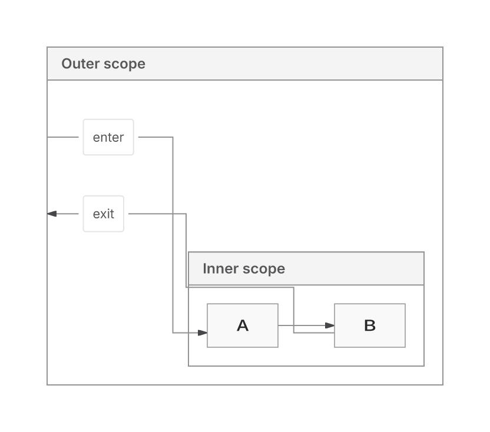
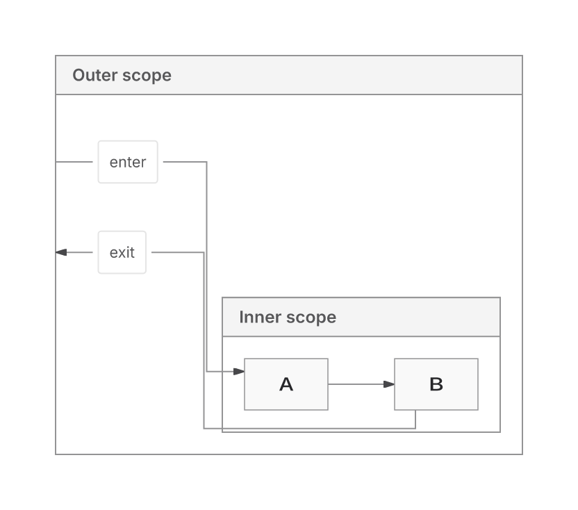

Native delivers all 12 enrolled grouped graphs and removes their ancestor-route crossings. The latest change removes repeated emission bookkeeping and fixes a false paint-proof result. **The 100-node/100 ms target is unmet. This PR remains draft, has merge conflicts, and has no full CI result for its current head.**

Source: `ff18d23eb2b25ffb84aa492170d4ef0005411b7e`. Recorded main base: `e7cb05baa7f68154942a9ce9c6e9aaaee163dc94`; live main was `4260292397d4bca7624a30c34649eb943a5f8e0c` at this update. The combined candidate with that newer main has not been qualified.

## What changes

The PR preserves SVG occurrence/write ownership, fresh receivers, mutable/getter behavior, UTF16, CSS, definitions and cache isolation. It carries the neutral measured backend contract into Native, adds early endpoint capacity, and repairs capacity, forest and compound cases. Global nesting handles leaf DAGs whose grouping invents a scope cycle; other compounds retain recursive handling for authored cycles, local directions and frame endpoints. The ER delivery/recovery foundation remains. Native is the sole replacement candidate; Trinity feature growth is frozen. ELK remains available.

The grouped routing fix admits legal host padding after the original content-domain miss under the same ledger and paint eligibility rules. Ancestor routing retains a feasible original route, checks bounded elbows and prefers fewer crossings. Endpoint, header, body, label and contact checks remain.

The latest shared-pipeline change:

- Uses one immutable XML record for the write handle and read view, with projection state in the existing private registry.
- Removes the duplicate raw-fragment boundary scan/cache and repeated sealing of unexposed projection data. The final assembled-document parser still checks substitution positions.
- Reuses existing text-plan descriptor operands for the captured native path. Foreign helpers, inherited descriptor hooks and coercible keys retain their original path and fresh receivers.
- Avoids a general definitions inventory for captured primitive definitions without directive/style prefixes; other inputs retain full inspection.
- Shares resource work estimation while retaining each consumer's traversal and bounds. Resource correspondence and pre-serialization work bounding still serve distinct contracts.

The earlier private group-literal sealing shortcut was unsafe under a pre-import `Object.freeze` hook. It could change retained class metadata and falsely pass an Inter proof over actual monospace SVG. Restoring pinned producer records changes that case from false-pass to `unverified / OUTPUT_SCOPE`, with all nine SVGs unchanged.

Private XML construction/registry callbacks are internal implementation details and no longer expose mutable evidence. Actual caller-input getters, proxies, coercions and generic non-string indentation retain their paths. No new cache, cap, backend default or version change ships.

## Correctness and verification

The owner's original 12 sources/image were lost. The grouped results cover a replacement set frozen before the routing edits, with authored expectations and actual SVG receipts.

| Metric | Native before 7257 | Native after grouped fix | Same-input ELK |
| --- | ---: | ---: | ---: |
| Delivered | 10/12 | 12/12 | 12/12 |
| Actual SVG receipt passed | 10/10 returned | 12/12 | 12/12 |
| Declared leaf-flow checks | 19/19 returned | 25/25 | 17/25 |
| Crossings | Ancestor 2; others 0 | 0 in all 12 | Mixed-local 1; others 0 |

ELK's flow differences are quality differences, not missing relationships. Ancestor LR crossings 2→0 cost wire 695.496→734.171 px (+5.56%); area is unchanged and bends 6→5. The reciprocal case's costs and original 20k refusal remain explicit. [Grouped inputs and evidence](https://github.com/adewale/agentic-mermaid/blob/8ec6299d2d1270c189e78c6d1ef79e1d66f3b9a9/native-blockers-checkpoint-20261110/README.md).

For the final shared-pipeline change:

- Affected suite: **1089 passed, one retained Sparse32 proof-budget failure**. Core/repository typechecks and lint pass. Eight sandbox stdin failures passed on the exact unsandboxed retry.
- Frozen comparison: 90 enrolled; 84 returned with byte-identical whole SVGs, six retained errors, no delivery or proof-status transitions. Of the receipts, 27 are exact and 57 differ only in paid operation count.
- All 13 public-product browser inputs pass for Native, ELK and frozen Trinity. These unchanged products validate the refactor; they are not new visible correctness gains.
- The font-scope regression reproduces the false proof on the parent revision and returns unverified after repair.

Reproduce affected owners with Bun 1.4.4:
`bun test src/__tests__/scene-*.test.ts src/__tests__/prepared-text.test.ts src/__tests__/crisp-drawing.test.ts src/__tests__/endpoint-marker-contact.test.ts src/__tests__/paint-certification.test.ts --timeout 30000`.

[Final result, recovery archive, raw failures and commit binding](https://github.com/adewale/agentic-mermaid/blob/ac8c8066fe2b5e719c3f87cb85d943050c0ef0ce/pipeline-dedup-checkpoint-20261110/RESULT.md). Earlier [five self/inclusive profile hotspots and rejected trials](https://github.com/adewale/agentic-mermaid/blob/51c1df9b201379e7e4d9f6b0789af11a65611519/native-emission-reuse-checkpoint-20261110/README.md) remain recovery evidence.

## Execution and download costs

Final Node 24 observations fully consume SVG, receipt and response serialization, with cache disabled and cold/repeat/edit separate. Four warm and four edit samples per case:

| Input | Cold ms | Warm median (range) ms | Edit median ms | Warm heap growth MB | Peak RSS MiB |
| --- | ---: | --- | ---: | ---: | ---: |
| Chain100 | 379.5 | 157.9 (147.7–161.9) | 141.1 | 23.13 | 193.76 |
| Fan-in100 | 573.7 | 222.7 (181.0–274.9) | 202.2 | 18.50 | 257.27 |
| Chain300 | 560.6 | 368.4 (301.7–377.0) | 318.8 | 41.04 | 263.95 |

All returned products retain budget-unverified proof. Host variation and adverse costs prevent a consistent speedup claim; these are absolute observations, not a new ELK speed comparison. The 100 ms target remains unmet. Constructor recipes, private-method binding and generic descriptor recycling were rejected; their costs and patches are retained outside the source diff.

Actual fetched 13-input product closure, binding separate; real bytes compressed outside timing:

| Backend | gzip9 bytes | Brotli11 bytes | Requests incl binding |
| --- | ---: | ---: | ---: |
| Native | 496644 | 425893 | 49 |
| ELK | 863104 | 692729 | 43 |
| Frozen Trinity compatibility | 485807 | 416238 | 50 |

Native versus parent c3dc: gzip **+61 B**, Brotli **−74 B**; request counts unchanged. This is a fetched-product measurement, not a whole-package or startup claim.

## Remaining losses and readiness

Sparse32 proof exhaustion remains distinct from the shared ER256 relationship-chain refusal. Historical quality losses remain: forest wire +16.89% with area −6.43% versus ELK; Requirement TB/BT area +9.53%; implemented Sparse256 area +5.04%. The +0.97% Sparse256 backfill candidate is unshipped. Mixed-circle paint, distribution limits and workload-wide replacement qualification remain unresolved.

Only the push-triggered [action-pinning job](https://github.com/adewale/agentic-mermaid/actions/runs/42898061847) passed for ff18. Full PR CI has not run for this head. Prior full CI [42770980947](https://github.com/adewale/agentic-mermaid/actions/runs/42770980947) failed Sparse32 unit shard 1/3, quality, browser-site and payload checks. No failure is waived or cap raised.

Original 2dad baseline and equivalent pinned Mermaid 12.2/Pele 1.9 runtime comparisons remain unavailable. Replacement24 stays sealed. Campaign/report automations remain disabled; the latest work was an explicit bounded request.

## Visual evidence

Claim: the labelled ancestor entry/exit retain their authored relationships and A→B flow while removing two route crossings.

Input/fixture: `container-descendant-labelled` in [the fixed source set](https://github.com/adewale/agentic-mermaid/blob/8ec6299d2d1270c189e78c6d1ef79e1d66f3b9a9/native-blockers-checkpoint-20261110/REPLACEMENT-12.json), directionLR, nested Outer/Inner, Outer→A labelled enter, A→B, B→Outer labelled exit. Options/source are identical between arms; production SVG with Inter.

Baseline SHA: `7257faa9299a69948645a7574e185300b7841f75`.
Grouped-routing fix SHA (its SVGs are unchanged by c3dc): `17f157fae6a6f97295ebb10f215d2c2326710b6b`.

Regenerate: extract `evidence.tar.gz`, replay the retained correctness collector, then `bun correctness-final/raster-ancestor.ts`. Resvg uses manifest-verified Inter, system fonts off,2× zoom. [Font manifest](https://github.com/adewale/agentic-mermaid/blob/8ec6299d2d1270c189e78c6d1ef79e1d66f3b9a9/native-blockers-checkpoint-20261110/RASTER-FONTS.json), [SVG/PNG/archive hashes](https://github.com/adewale/agentic-mermaid/blob/8ec6299d2d1270c189e78c6d1ef79e1d66f3b9a9/native-blockers-checkpoint-20261110/MANIFEST.json). Owning test: `ancestor-boundary-routes.test.ts`, “ancestor entry and exit preserve the inner chain without crossing”, allfour directions.

| Before | After |
| --- | --- |
|  |  |

Limitation: these renders establish the enrolled fixture's crossing repair, with a wire cost. They do not recover the lost original image, prove every grouped graph correct or establish ELK replacement readiness.
