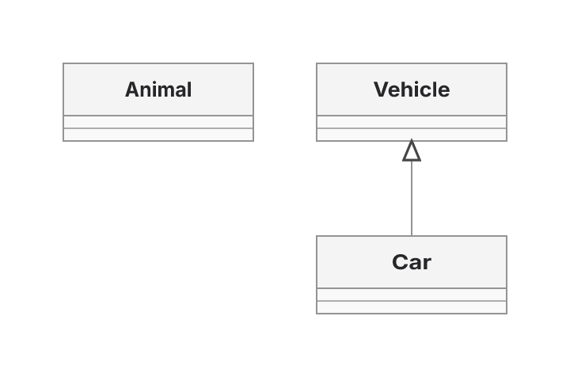
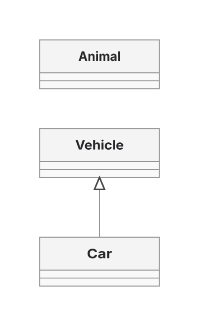
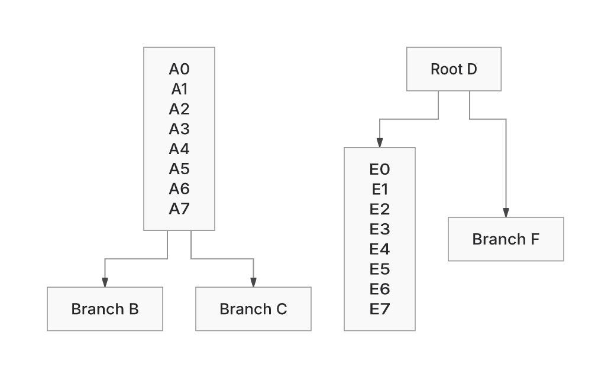
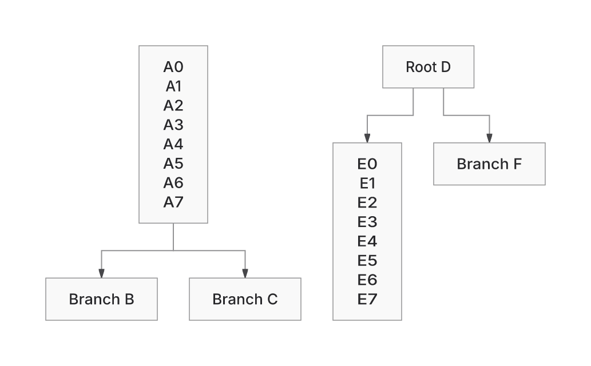

# Ranked PR602 work

Two retained changes make concrete improvements: nine Class drawings use less
area, and the variable-height forest keeps its smaller canvas with shorter wire.
Source commits `aa61c7c736750b85bac8ac813b902707b66a8363` and
`13143a343e30331b97a1104ea657ed2cba7f0903` are pushed to PR602.

## Stack rank and outcome

| Rank | Task | Outcome |
| --- | --- | --- |
| 1 | Native Class area losses,13/40 cases | Ship complete-component packing. Nine areas shrink; losses versus ELK13→11, wins8→10. |
| 2 | Shared ER256 refusal | Stop the suspected pair-scan optimization: even deleting both scans in an external diagnostic still hits400k later. No cap increase or omitted validation ships. |
| 3 | Crossing276,6versusELK4 | Reject the global distinct-cut change. It fixes276 to3crossings/52bends with clear served n10 geometry, but introduces39attenuated shaft pixels on42. |
| 4 | Sparse256 area+5.04% | External8-column row-major prototype reaches+1.34%, but height grows31.04% and gzip SVG grows. Keep it unshipped; earlier+.97% backfill remains unshipped. |
| 5 | Forest wire+10.19%, area−6.43% | Ship complete-leaf seating plus reuse of measured native boxes in the shared consumer. TB wire gap becomes+0.31%; area advantage is retained. |
| 6 | Profile-driven pipeline work | Remove redundant native peer resizing; reuse the existing fan route-only path. No broad cache/SoA/hash-table rewrite is justified. Other lower-priority pipeline proposals remain open. |

## Retained results

Class2, same measured cards and60px relationship: projected area85,680→65,400;
ELK61,400. Class29:87,720→78,480; ELK67,200. Other Class costs stay visible.
All874Native cases were freshly qualified for the packing milestone:
9areas shrink,865SVGs exact; wire, bends, crossings, label conflicts, overlaps,
delivery and proof status unchanged. A first unrestricted packing trial broke
two compound owners and was withdrawn. Scope projections retain their corridor
arrangement because local nodes can have external contacts.

The forest rule aligns a complete leaf toward its parent inside the existing
depth band. It has no outgoing route to lengthen. The leaf-only trial exposed
downstream blank-card growth. Native retains its producer-measured boxes:
ELK peer-size preparation is skipped and the fan emitter uses its existing
route-only mode. Complete, local-scope and ELK-shaped projections are explicit
contexts; the legacy default retains its earlier geometry.

Final source13143a343, complete public SVG and receipt consumed:

| Direction | Actual wire before → after | Final canvas area before → after |
| --- | ---: | ---: |
| TB | 436.8572 → 397.7072 | 165,355.6575 → same |
| BT | 424.8125 → 424.2875 | 165,355.6575 → same |
| LR | 413.5917 → 368.65 | 183,037.4936 → 147,535.0578 |
| RL | 376.0667 → 370.607 | 188,955.8454 → 152,305.4705 |

All four retain8bends,0crossings and passed final proof. Literal six nodes,
four directed relationships and displayed text are checked in the actual SVGs.
The TB ELK wire is396.4697; Native's remaining difference is+0.31%.
Explicit ELK and omitted-default TB SVGs remain exact against retained controls.
The earlier404.2875/+1.97% figure belongs to an intermediate consumer probe.

Fresh234corpus calls for the final forest change preserve all outcome statuses,
bends, crossings, label conflicts and overlaps. Class0 wire502→482; tree300 wire
93,477.0672→93,426.5548 and area13,285,417.8484→13,283,010.7840.
The640generated labelled inputs reuse retained outputs: their nonempty measured
edge labels exclude the existing forest fast path. They are not fresh calls.

## Visible evidence

Before Class source433b is rendering-equivalent toce15; final Class and forest
after products were freshly captured at13143a343. Forest before uses exactaa61
module overrides through the existing public collector. PNGs use manifest-verified
Inter, system fonts disabled, at2×. Compare the isolated Class card placement and
the short leaf's vertical lead; these pictures do not prove every output pixel.

## Costs and verification

The complete standalone HTML grows2,204,131→2,205,439raw bytes,
1,323,981→1,324,974gzip9 (+993), and1,257,443→1,258,458Brotli11 (+1,015).
Both arms use Bun1.4.4 node:zlib; Node's different gzip output is separate.
The original1,334,500gzip ceiling is unchanged.

Profiles precede both interventions. Sampling-disabled fully consumed Class
ABBA repeat/edit observations overlap; no CPU, RSS or heap saving is established.
Products, profiles, stage observations and adverse samples remain available.

Class/forest owners176P. Final forest/layered/symmetry/graph-selection owners442P
with one missing-jsdom failure; producer-context owner43P. Core types and canonical
lint pass. The four leaf owners fail before implementation; introduced box growth
has3failing directional owners before the consumer repair and all pass afterward.
Browser qualification is recorded in browser-final.log; the initial sandbox port
failure is retained separately.

Global distinct-cut trial:123crossing improvements/14adverse,105area grows/
100shrinks,99wire grows/109shrinks,91bend grows/101shrinks,15P→U/9U→P.
Case33's inspected head pairs lose no pixels despite envelope warnings;
case42 has39new attenuated pixels. Proof availability and actual ink stay separate.
The trial is withdrawn; crossing276 remains6versusELK4 in shipped code.

PR stays draft. Exact source CI42392278276 was in progress at inspection.
Sparse32 proof cap, sharedER256 refusal, other unverified outputs and lazy/advisory
cost failures remain. Original baseline/Trident/pinned references remain unavailable.
Replacement24 stays sealed. Automations remain disabled; this is one manual run.
