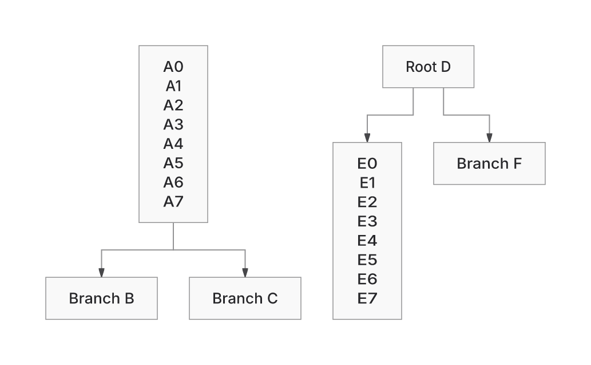

This PR preserves owned SVG capture and final-paint checks while improving selected Native layouts. Against current main, the named forest uses less wire and area, and Class case 2 uses less area with a taller result. **The PR remains draft: it is not a general ELK replacement, and no new runtime or memory speedup is established.**

Head: `a195262036dbb07c7ce4919505d4ff47dea09e63`.
Base: `c366de0d137e33e123acd84fc99164417c0f3917`.

The merge-preserving rebase integrates #601's eight families and #607's shared ER, caption and marker repairs. The previous published head remains an ancestor, so the update was pushed normally. Backend defaults, versions and original campaign caps were preserved. Main already contains the shared ER index and caption-prefix improvements; those are not claimed as new PR work.

## Changes and remaining tradeoffs

The PR retains capture/ownership isolation, final written-paint obligations, Native component packing and leaf seating, and family-specific contact/identity recovery. Geometry facts do not authorize skipping checks on the actual emitted SVG.

Two fixed inputs were run through the existing collector at both revisions, with explicit backend selection and no fallback:

| Metric | Main Native | PR Native | ELK at both revisions |
|---|---:|---:|---:|
| Forest wire | 700.04 | 397.71 | 396.47 |
| Forest area | 226,466 | 165,356 | 176,727 |
| Forest bends | 8 | 8 | 8 |
| Class case 2 area | 85,680 | 65,400 | 61,400 |

Class case 2 changes from 360×238 to 200×327: narrower, but taller. Its wire and bends stay 60/0. All eight named public products return with passed paint status; both ELK SVG controls remain exact. These examples do not establish whole-workload readability or correctness.

Integration exposed a separate regression: generated case 255 retained identical SVG bytes but its Native proof exhausted 400,000 operations. Restoring the admitted metered XML hash-lookup plan returns it to 399,809 operations. The public unmetered path keeps main's bounded scratch scan. The real Native child regression is RED before and GREEN after; no cap or collision check was removed.

## Visual evidence

Base SHA: `c366de0d137e33e123acd84fc99164417c0f3917`.
Head SHA: `a195262036dbb07c7ce4919505d4ff47dea09e63`.

The same forest source and options are retained in [the literal jobs](https://github.com/adewale/agentic-mermaid/blob/fb8258f17fadf2996e15aa4c82a0973b1cefae4f/rebase-c366-reconsider-20261107/CURRENT-MAIN-PAIR-JOBS.json). Both pictures come from actual final SVGs at 2× scale, using manifest-verified Inter with system fonts disabled. Compare the gap below the tall left parent and the position of the independent right-hand tree. The bend count is unchanged.

[Reproduction, Class pictures, SVG hashes and limitations](https://github.com/adewale/agentic-mermaid/blob/fb8258f17fadf2996e15aa4c82a0973b1cefae4f/rebase-c366-reconsider-20261107/README.md).

## Verification

- Canonical typecheck and lint pass.
- Affected owners: 1,340 initial passes; seven sandbox child failures pass on retries; known Sparse32 remains failed. New-family/SDK suites: 233 passes. Final XML/security selection: 34 passes; generated case 255 has a discriminating Native regression test.
- The 330-case geometry gate and Requirement raster pass after reconciling previously reviewed expectations.
- Fresh 874-input snapshots per backend preserve all 1,748 delivery outcomes, proof statuses and route-geometry vectors from the pre-rebase PR. Six SVGs inherit main's State text-color/scope changes. Native still has 134 unverified proofs and ELK 178 in this fixed roster; returned SVG is not independent visible correctness.
- Rebuilt standalone worker behavior passes 650 assertions using installed Chromium 154. Initial sandbox, missing-browser and timeout failures remain in the evidence.

Relevant commands include `bun run typecheck`, `bun run lint:biome`, and `bun test src/__tests__/paint-certification.test.ts --test-name-pattern 'metered final SVG validation'`. The saved jobs and scripts reuse `eval/layout-compare/run.ts`; no new qualification framework was added.

## Costs and limits

Actual standalone HTML, same Bun 1.4.4 compression: main→PR gzip9 is 1,517,563→1,386,834 bytes; Brotli11 is 1,170,181→1,318,238. The PR is smaller under gzip and larger under Brotli. The retained 1,334,500 gzip ceiling still fails by 52,334 bytes and was not raised.

ER256 BT/RL, Sparse32, crossing276 and Sparse256 tradeoffs remain. Historical peer-artifact gaps and sealed Replacement24 are unchanged. [Reconsidered proposals](https://github.com/adewale/agentic-mermaid/blob/fb8258f17fadf2996e15aa4c82a0973b1cefae4f/rebase-c366-reconsider-20261107/RECONSIDERED-PROPOSALS.md) narrow interface work to existing owning contracts rather than a new solver framework. CI at `93c6d75dc` completed failed: Sparse32, lazy/payload budgets, the generated advisory, and a stale forest center-alignment assertion. The assertion is now corrected to the existing producer's incoming-face seating; both forest owners pass 49 tests / 867 assertions, with no runtime change. CI for the final test/documentation-only follow-up is pending; the PR is not ready.

