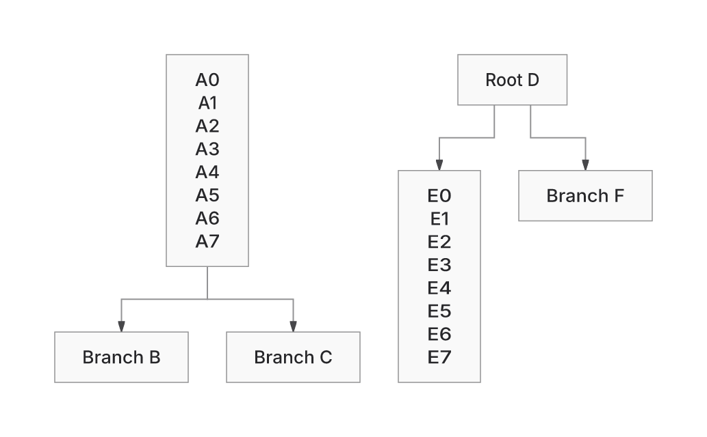
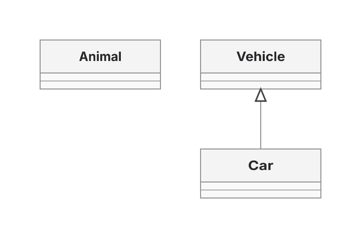
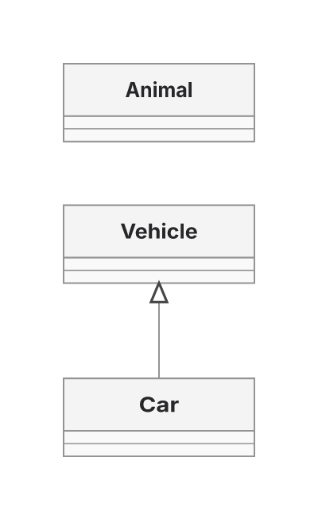

# PR602 rebase and reconsideration

7 November 2026. Combined source: `93c6d75dc1373d5c238cc764d938ca6af91bebfe`. Main: `c366de0d137e33e123acd84fc99164417c0f3917`. Previous published PR: `d8c8ac879793a586b4b741c178b89d7900bd27ed`.

The owner requested rebase and reconsideration, not execution of seven new projects. The merge-preserving rebase completed. The final integration commit retains the previous published head as its second parent, allowing a normal push without force or lost history. The local backup is `backup/pr602-pre-rebase-20261107-d8c8`. Both current main and the old PR head are ancestors of the published source. Automations remain disabled.

## What changed the recommendation

Main now includes #601, eight native diagram families, and #607, shared ER work reduction plus Class caption and Requirement marker corrections. The shared ink-tree and ER label-prefix files already match the pre-rebase PR byte for byte. Another implementation would duplicate existing work.

Main also provides concrete examples of deliberate geometry ownership: Swimlane requests placement and owns its lane routes; Usecase converts contacts to actor/ellipse outlines and invalidates certificates when that changes geometry. These argue against forcing every family through one complete-layout result.

**Withdraw a general solver plug-in framework as the first task.** A neutral measured request/result interface is absent, but shared selection, typed fallback, provenance and family conformance tests already exist. Narrow any interface work to an actual adapter migration or failed obligation. Extend existing suites rather than add another qualification system. [RECONSIDERED-PROPOSALS.md](RECONSIDERED-PROPOSALS.md) records the revised seven proposals; [Astra's main review](astra-main-review.md) and [integration review](astra-integration-review.md) provide the independent assessment.

## The PR still has measured value against new main

These are two fixed inputs, explicitly selecting a backend with fallback disabled through the existing `snapshotSample` collector. All eight public products return with passed paint status. Actual SVGs and public layouts/receipts are retained in `main-named.json.gz` and `pr-named.json.gz`; literal source is in `CURRENT-MAIN-PAIR-JOBS.json`.

| Case and metric | Main Native | PR Native | ELK, same value in both revisions |
|---|---:|---:|---:|
| Forest wire | 700.0375 | 397.7072 | 396.4697 |
| Forest area | 226,466.48 | 165,355.66 | 176,727.21 |
| Forest bends | 8 | 8 | 8 |
| Class2 area | 85,680 | 65,400 | 61,400 |
| Class2 wire / bends | 60 / 0 | 60 / 0 | 60 / 0 |

Class2 becomes narrower and taller: 360×238 to 200×327. That aspect-ratio cost remains; lower area is not a general readability verdict. Forest routes retain their authored relationships and measured contacts in the inspected output. Raster inspection of these named products does not qualify every corpus glyph.

The images use actual final SVGs at the same 2× scale, with manifest-verified Inter files and system fonts disabled. Main and PR images were inspected. Source revisions and SVG hashes are in `VISUALS.json`.

## Integration failure found and removed

The initial merge combined main's bounded small-attribute XML scan with the PR's metered final-paint checks. Generated SHA256-counter case 255 kept exactly the same SVG but changed from passed proof to unverified at 400,000 operations; it previously completed at 399,809.

The first parent-process tests did not discriminate the failure because the test runner enables Scene assertions. They are retained as failed probes, not claimed as regression proof. The final owning test runs the real Native child path with Scene assertions disabled before importing the renderer, reproduces the layout/render sequence and recorded prefix, and asserts 16 authored node IDs, 35 edge occurrences, selected Native, passed proof and the original400,000 cap. It is RED with the merged metered list plan and GREEN after the correction.

The repair restores the previous hash-lookup algorithm for metered XML calls, including the existing work charges. Public unmetered scanning retains main's bounded scratch plan. Duplicate-attribute rejection and complete namespace/value validation stay in both paths. This is not an allowance increase or omitted charge for executed work. The repaired named proof again finishes at 399,809. See `sha255-native-red.log`, `sha255-native-green.log`, `sha255-single-green.log` and the source diff between `a62af0daf` and the published source.

Two expectation conflicts were resolved using previously reviewed data: main's State concurrency parent IDs were combined with PR route coordinates, and the PR's existing Requirement raster was retained because its renderer and marker geometry are unchanged. No golden was generated from the current implementation. The 330-case geometry gate and Requirement raster check pass after reconciliation.

## Final qualification

`final/` contains fresh 874-input snapshots for each backend after the repair. These rerenders validate changed shared emission code; unchanged results are not counted as new layout improvements.

| Result on fixed corpus | Native | ELK |
|---|---:|---:|
| Returned SVG/layout products | 874 | 874 |
| Passed paint status | 740 | 696 |
| Unverified paint status | 134 | 178 |
| Delivery/proof-status changes versus pre-rebase PR | 0 | 0 |
| Route-geometry vector changes versus pre-rebase PR | 0 | 0 |
| Exact SVGs versus pre-rebase PR | 871 | 871 |

The remaining six SVG changes are State examples17–19 in each backend: one text fill changes from#27272A to#000000, alongside generated CSS scope names, through main's color resolution. They are preserved in `STATE-SEMANTIC-DIFFERENCES.json`. Geometry and proof outcomes are unchanged; these are not advertised as new Native quality gains.

This is not a correctness percentage or a representative workload weighting. The 640 generated SVGs per backend remain byte-identical, so the earlier independent authored-meaning audit continues to bind those bytes. The mixed corpus is not assigned independent meaning or pixel-wide success by this run. ER256 BT/RL refusals, Sparse32 proof-cap loss, crossing276 and Sparse256 tradeoffs remain outside or alongside this fixed delivery roster. Replacement24 stays sealed, and source recovery does not qualify unavailable historical peer-artifact benchmark lanes.

Checks:

* Affected owning suites: 1,340 passes with eight initial failures. Seven child-process failures were caused by sandbox stdin restrictions and pass on bounded retries outside that sandbox. Sparse32 remains the known real failure.
* New-family and SDK suites: 233 passes. Initial 48 sandbox child failures are retained separately from the passing retry.
* Final XML/security selection: 34 passes. The new real-Native regression is RED→GREEN.
* Geometry gate:330 corpus cases checked; all match the reconciled reviewed baseline. Requirement citizenship raster passes.
* Canonical typecheck (core and repository) and lint pass; results are recorded in their final logs. Trident uses its recovered exact pin; missing declared Vitest4.1.11 was installed under/tmp and linked without package/lock changes. Initial PATH and missing-dependency failures remain evidence.
* Rebuilt standalone worker behavior: 1 pass/650 assertions, installed Chromium 154.0.8037.57 via an external test preload. Playwright's bundled browser was unavailable; the first system-browser run hit60s while corpus jobs competed. Final retry after those jobs, with a 180s harness timeout, completes in 71.13s. No production work cap or payload ceiling changed.
* The original standalone gzip ceiling still fails. CI for this exact source was in progress when this report was assembled; PR remains draft and is not called ready.

## Payload costs, including the adverse result

One standalone HTML build per source uses the same Bun1.4.4 compressor/toolchain. All common declared dependency versions match. The PR additionally declares d3-shape, its types and the Brotli decoder dependency; these existing PR differences are recorded rather than described as identical dependency graphs. Artifacts and hashes are retained. These are actual distribution bytes, not equal-work CPU/RSS measurements.

| Standalone HTML | Main c366 | Previous PR d8c8 | Rebased PR93c6 |
|---|---:|---:|---:|
| Raw | 5,022,428 | 2,204,863 | 2,287,688 |
| gzip9 | 1,517,563 | 1,324,640 | 1,386,834 |
| Brotli11 | 1,170,181 | 1,258,659 | 1,318,238 |

Against new main, PR gzip is 130,729 bytes smaller and Brotli is 148,057 bytes larger. Against the previous PR, integration costs 62,194 gzip bytes. The retained 1,334,500 gzip ceiling is exceeded by 52,334 bytes. The ceiling was not raised. No new runtime, heap or RSS improvement is established.

## Reproduction and recovery

Use the checked-in owning tests, existing layout collector and the saved exact source/options. `requalify.ts` adapts the prior collector only to select the saved d8 inputs and write a new destination. `current-main-pairs.ts` runs the two literal jobs through the same collector at either source root. These are recovery orchestration, not a new qualification framework.

Source push is normal and ancestry-preserving. The evidence checkpoint contains reports, complete snapshots, failed probes, source-resolution records, actual images, built HTML and logs. No retained local work was deleted. Independent review found no blocking issue in the inspected merge/capture scope; that is not a substitute for the retained failing resource checks or pending CI.
