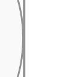
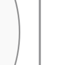

Compared with main `39a500425`, this PR delivers the selected ER208 chain that main refuses, reduces the default forest's area and wire, and restores a hollow-circle marker. The retained standalone build is smaller under gzip and larger under Brotli. **This is a draft: remaining proof, layout and payload failures prevent a readiness claim.**

Current head `6edd3fd3bb70bfa4232d61aba6cd0822b5adc82d` restores the entire source/test tree to the qualified runtime at3234. A subsequent shortcut-clearance trial was withdrawn after it changed marker contacts in another drawing. Its positive results and costs remain in evidence.

## Demonstrated behavior against main

The same six sources and options were frozen before outcomes. Each comparison consumes the complete public SVG and entire receipt in omitted-backend, Native and ELK lanes.

| Input | Omitted backend: main → PR | Explicit Native: main → PR |
| --- | --- | --- |
| ER208 relationship chain | **400k geometry-work refusal → SVG delivered**, proof passed | Same gain:208 identities,207 ordered relationships and414 normal contacts |
| Nonlinear forest | **Area−26.98%, wire−37.60%**, eight bends unchanged | Same gain; explicit ELK painted geometry unchanged |
| Raw hollow circle | **0 →225 confined marker pixels** | Same paint gain; proof remains unverified in every mode |
| Sparse256 | Painted geometry unchanged | **Area−77.05%**, connected wire unchanged |
| Requirement TB cycle | Painted geometry unchanged | **Area−22.95%, wire−8.56%**, eight bends unchanged |
| ER256 relationship chain | Both revisions still refuse at the unchanged400k geometry cap | Both still refuse |

Across the36 main/PR calls,27 products return:21 proof-passed and six unverified; nine calls refuse. At runtime3234, all18 PR calls were requalified:15 SVGs and entire receipts are byte-exact to integrated PR1693, and three ER256 refusals retain their names/codes/messages. This validates preservation, not another layout gain.

ELK remains the default backend setting. Omitted Flowchart layout can use the existing forest fast path in both revisions. These selected cases do not establish a general workload ranking or whole-diagram readability across arbitrary fonts. [Matched main comparison and original pictures](https://github.com/adewale/agentic-mermaid/tree/a073858f2d9a51b6ddcfb55fb2effae394b18793/main-comparison-20261105) and [current-main integration evidence](https://github.com/adewale/agentic-mermaid/tree/19fbe17aaeee45d5c01a5e953705ca1da13fc704/main-integration-20261107) are recoverable.

## Retained circle-contact repair

Native case230 previously delivered17 nodes and40 relationships with a0.453px shaft/circle overlap. The retained repair tries the existing local terminal detour after the first band route fails ink admission, while keeping an admitted first band ahead of that fallback. It adds no cache, body domain or quota. Endpoint rays, header reservations, marker/caption admission and recertification remain.

In saved actual SVGs with manifest-verified Inter, **41 hidden shaft pixels become0**; all364 exposed selected pixels contribute after repair, with none attenuated. Proof changes U362,041→P362,293. Area and17 crossings stay fixed; bends104→106 and wire grows19.156 (+0.102%). SVG adds32 raw/7 gzip bytes; Brotli is unchanged. All17 identities,40 relations,27 text programs, ten caption owners, node geometry, marker definitions, ports and normalized CSS remain.

| Before: shaft merges into circle border | After: the shaft clears the border |
| --- | --- |
|  |  |

Same actual SVG configuration, Chromium scale and offline pinned fonts; independent Resvg masks supply pixel attribution. Repair control revision: `6aa0ee45d9b6052addcb77036c1f7ba4c13b2cb4`. Pictures were captured at47aed; the complete repaired SVG and entire receipt bind exactly to3234 and the current rollback product. These selected pixels do not qualify every glyph.

The complete existing CI comparison at3234 matches **1,748 backend/case records with identical ordered IDs, literal sources and options**. Only Native230's SVG changes. The other1,747 SVGs, including all874 ELK outputs, are byte-exact to the prior runtime; no delivery transition or proof downgrade occurs, and one proof upgrades. The intermediate terminal-first version also increased case201's crossings8→9 despite shorter wire; the final refinement restores201 and every other collateral SVG exactly. Four directional owning fixtures protect the admitted-band preference without claiming universal shortest paths. [Complete qualification, adverse intermediate outcomes and checks](https://github.com/adewale/agentic-mermaid/tree/ca23753c6326112a1564a05b95c5e300277ae78a/local-circle-detour-20261107/final-3234) are backed up.

## Execution and delivery costs

These are complete production HTML builds using the same Bun1.4.4/dependency topology and builder, with Bun node:zlib gzip9/Brotli11. The PR column is the retained3234 build, not a newly measured rollback build.

| Complete HTML / observed build cost | Main39 | PR3234 |
| --- | ---: | ---: |
| Raw bytes |4,742,588|2,187,091|
| Gzip9 bytes |1,423,188|1,310,630 (**−7.91%**)|
| Brotli11 bytes |1,098,404|1,245,111 (**+13.36%**)|
| Peak build RSS, KiB |430,832|722,140|

The PR build takes16.08s within the existing55s child deadline. These single-build observations establish no speed or memory ratio. The original1,334,500-byte standalone gzip ceiling passes locally and in retained3234 CI. Its actual emitted-worker browser owner passes2 tests/504 assertions, covering full Blob bytes, enrolled SVGs/entire receipts, backend/fallback, crash recovery, ASCII/Unicode and PNG.

Private delivery uses one existing compressor pass before packing and specializes the bounded decoder dictionary for the exact build-owned stream. Every decoded worker byte is checked; notices and byte/CRC/loop/window/time/cancellation limits remain. This saved37,701 gzip/37,131 Brotli bytes while adding95,553 raw bytes at its recorded step. No cache is added.

Lazy transfer remains adverse. The matched pre-hull Packet plus complete YAML closure grows **196,160→230,648 gzip bytes**, despite22→13 requests. Retained3234 CI Flowchart selected ELK is **774,124 gzip bytes against the unchanged761,500 ceiling**. Initial lazy transfer uses3 requests,15,408 raw/5,856 gzip/5,223 Brotli bytes. Lazy/demo/editor-empty failures remain; no ceiling is raised. Compression-only concatenation saved2,416 gzip bytes and left32,073 above main's static Packet transfer; six-pass compression timed out. Both insufficient probes remain stopped.

Proof work is also higher on selected outputs: forest default22,851→98,311, raw circle41,687→156,940 and Requirement default25,613→102,468. Sparse256 default falls102,610→90,857. These counts are not CPU measurements.

The [report-first performance review](https://github.com/adewale/agentic-mermaid/blob/6edd3fd3bb70bfa4232d61aba6cd0822b5adc82d/docs/design/system/layout-0.6-performance-review.md) records five measured hotspots with self/inclusive distinction, the cache inventory and limits on expected speedups. The retained runtime cleanup omits construction of an unused original marker hull while preserving served hulls, bounds consumers, encoding and charges. Its complete Class SVGs/receipts remain exact; no end-to-end speedup is established. Cold/import latency and cache1 were not measured by the later bounded source-runtime profiles.

## Remaining differences and stopped shortcut trial

- Forest Native versus ELK: **wire+10.19%, area−6.43%**, eight bends in both. The fixed-dock routes are already shortest; residual placement/terminal cost remains.
- Sparse256 Native: **area+5.04%**. The+0.97% backfill candidate is unshipped; +115.35% is historical.
- Requirement cycle Native: **TB/BT area−10.43%, wire−30.34%**; LR/RL area−1.44%, wire−20.25%. LR/RL are wider and shorter,970.194×251.95 versus753.144×329.3; less area does not establish readability superiority. The oldTB/BT+9.53% loss does not reproduce on this fixture. [Actual directional products and per-occurrence ink](https://github.com/adewale/agentic-mermaid/tree/2b02e8d5970d3e3f695677d0e2fc9620ce064544/requirement-directions-20261107) remain.
- Shared ER256 geometry refusal is separate from Sparse32. Sparse32 delivers1,500 text records and32 contributing markers; direct Scene proof passes, emitted Native proof exhausts400k during XML literal validation. A clean337,890-operation stage precedes the first refused7-unit charge at399,994. The bitset/name-mask shortcuts were insufficient and remain unshipped. [Boundary trace and failed probe](https://github.com/adewale/agentic-mermaid/tree/a5c343e6600185b53679411a2f85575447454d50/rebase-sparse32-20261107) are preserved.

Case152 remains a visible contact:122 selected shaft pixels are hidden by an unrelated card. New stage tracing locates its first cause in compact measured shortening: a5.125px clear route becomes a0.823px stroke overlap before shared cleanup.

Trial `2f6417c9b37ff61a1f9618124b87b5b349ed5176` passed the producer's existing clearance margin to that shortener. It removed those122 hidden pixels, with area/bends/crossings fixed and wire+11.896. Its partial CI artifact retains1,428 matched records:23 SVG changes, ten proof upgrades, one downgrade and no delivery changes. **The other320 records are explicitly unknown**, because the diagnostic was cancelled by the normal rollback push. Proof upgrades do not establish visible improvements.

The downgrade is Native17. Its wire falls29.87% and area7.37%, but three arrowhead pairs acquire actual triangle-fill contact,0.120125px² per pair; their tips remain distinct. This establishes geometric contact, not a demonstrated raster visibility or reading loss. Restricting the new check to introduced segments retained the same outcome. The trial also adds560 raw/357 gzip/477 Brotli bytes to the complete standalone HTML. These are tradeoffs, not an automatic metric gate; the candidate remains unshipped while its broader effects and interaction with marker seating are unresolved.

Rollback `6edd3fd3bb70bfa4232d61aba6cd0822b5adc82d` restores the entire source/test tree to3234. Fresh17/152/230/372 SVGs and entire receipts bind exactly to their prior products:17/230 proof-passed,152/372 unverified. The complete rollback CI artifact also matches all1,748 SVGs and all recorded layout/proof/delivery outcomes exactly to3234. This is restoration validation, not a new gain. The earlier rectangle-expansion and trailing-budget attempts remain stopped too. [Positive/adverse products, actual screenshots, eight masks, first-stage trace, before-profile, partial CI, costs and rollback](https://github.com/adewale/agentic-mermaid/tree/a44f4123b35ac1f5c03f9458de3821aa55c4fb0b/shortcut-origin-stop-20261107) are preserved outside the source diff. The next intervention must account for shortcut-induced candidate and marker changes at their producer.

Original baseline `2dadf0dbc2685c8435df541de99f3edce841450d`, Trident and pinned Mermaid12.2/Pele1.9 products remain unavailable after recovery. Pele1.8 was not substituted. Replacement24 stays sealed.

## Visual evidence

PR baseline SHA: `39a500425f6b74eb486b9add9e90d538fab6a914`.
Current PR head SHA: `6edd3fd3bb70bfa4232d61aba6cd0822b5adc82d`.

The forest pictures were captured at mainf9/PR741. Main39/PR1693 complete SVGs and entire receipts bind to those products, and all15 returned frozen PR products bind again at3234. Current source is byte-exact to3234. The pictures retain their selected-ink limits; no image was edited.

| Main before | PR after | What to inspect |
| --- | --- | --- |
|  |  | Equal scale, retained card text and four arrows; compare empty vertical spans and source exits. |

## Scope and verification

Normal merge1693 integrates main39 and retains the inherited PR449 ownership/capture foundation, UTF16 diagnostics, typed parser and source-MCP isolation. Mutable/getter/CSS/definition isolation, current-main0.5.7 identity, backend-default setting and all caps remain. Reviewed Class/Requirement/browser goldens qualify earlier intentional spacing changes.

The retained circle repair has8 focused passes/94 assertions,576 broader local passes and18 missing-JSDOM loader failures, passing core types/lint and the actual standalone2P/504 owner. The later withdrawn trial had7 owning failures on3234 and20 passes/328 assertions on the candidate,706 broader passes with the same18 loader failures, passing types/six-file lint and independent review. Those local passes did not establish preservation of its Native17 output.

[Retained runtime CI42352233778](https://github.com/adewale/agentic-mermaid/actions/runs/42352233778) completed **failed** at an exact source tree: Sparse32, lazy/payload budgets and the generated-layout advisory failed; other runtime lanes passed. [Withdrawn trial CI42359393457](https://github.com/adewale/agentic-mermaid/actions/runs/42359393457) includes cancelled lanes and is not a full qualification. [Current rollback CI42359691358](https://github.com/adewale/agentic-mermaid/actions/runs/42359691358) completed **failed**. Unit2 has6,413 passes and the one retained Sparse32 failure; lazy/payload ceilings and the generated-layout advisory also fail. All other runtime lanes, including browser/browser-site, package consumers, CLI, semantic conformance and platform isolation, pass. The tested merge is`1eda7a829a6f8dc7c837247c22b77b41e9f799ab`; its tree`004f30cf2624424ad414da1c168ac126c3852ce2` equals the source head. [Full rollback artifact, exact1,748-record comparison and terminal checks](https://github.com/adewale/agentic-mermaid/tree/b1964173b298061aea98bb80a4581432d0d7fe5d/shortcut-origin-stop-20261107/final-ci) are recoverable. Its lazy transfer JSON is exact to retained3234. No readiness waiver or manual CI dispatch is used.

Reproduce retained owners with Bun1.4.4:

```sh
bun test src/__tests__/route-contracts.test.ts --test-name-pattern 'final painted circle contact|retains an admitted shortest circle-clear band' --timeout 60000
bun run typecheck:core
NODE_ENV=production AGENTIC_MERMAID_SCENE_ASSERTIONS=0 bun run scripts/site/editor.ts
bun test e2e/browser.test.ts --test-name-pattern 'standalone editor' --timeout 120000
```

The [work log](https://github.com/adewale/agentic-mermaid/blob/6edd3fd3bb70bfa4232d61aba6cd0822b5adc82d/docs/design/system/layout-0.6-work-log.md) records revisions and remaining losses. Source and evidence branches are pushed without force or history rewriting. Bounded continuation remains authorized through **2026-11-08T23:59:59Z**; archived leases never authorize another writer.

