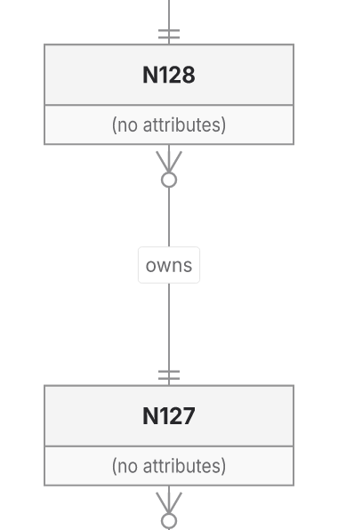
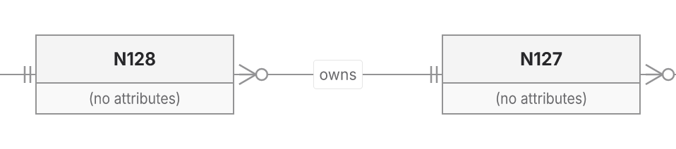

This PR preserves owned SVG capture and final-paint checks, improves selected Native layouts, and removes a shared ER256 refusal. It also stops the editor from loading graphical backend code merely to validate options. The original standalone gzip limit now passes.

**The PR remains draft. It is not a general ELK replacement.**

Head: `0c162c446b58ad98d0a5550719592a0d868619f8`. Integrated main: `e7cb05baa7f68154942a9ce9c6e9aaaee163dc94` (#608). Earlier main comparisons below are pinned to `c366de0d137e33e123acd84fc99164417c0f3917`. Defaults, versions and limits are unchanged by the PR. Main608's queue, clone-admission and hosted-worker changes are retained and are not claimed as new PR work. History is preserved; pushes are normal.

## Changes and tradeoffs

The shared ER finalizer reuses its call-local glyph/shaft snapshot when later face, frame and caption repairs have not moved routes. One conservative union query supplies candidates for the same exact cardinality-piece intersections and incident-terminal exclusions. Snapshot reuse alone and union queries alone still refuse; the combination delivers.

| ER256 chain | Before | After geometry operations / original cap |
|---|---|---:|
| Native TB/LR |Returned at 397,206|343,421 /400,000 |
| Native BT/RL |Refused|385,344 /400,000 |
| ELK TB/LR |Returned at 384,466|330,681 /400,000 |
| ELK BT/RL |Refused|371,874 /400,000 |

All four previously returned control SVGs remain exact. This recovers delivery without treating refusal and completion as equivalent timing work.

The option contract now has one leaf-module owner shared by public render-contract and the editor. Public metadata exports, object identities, validation messages and worker backend admission remain. The extraction removes Scene validation/writing/backend contributions from the editor's main-thread graph, 228→63 inputs. It changes no diagram pixels: all 1,748 fixed-roster SVGs remain exact.

| Actual standalone HTML | Gzip9 bytes | Brotli11 bytes |
|---|---:|---:|
| Before option extraction00938cc04 |1,386,827|1,318,081|
| Extractiond4e044949 |1,332,711|1,272,057|
| Combined with main608 |1,333,923|1,273,449|

Extraction saves 54,116 gzip / 46,024 Brotli bytes. Main608 adds 1,212 gzip / 1,392 Brotli bytes. The original 1,334,500 gzip ceiling passes with 577 bytes spare. Worker raw code grows 58 bytes at `d4e044949` while its packed payload shrinks 157. Pinned main `c366de0d1` measured 1,517,563 gzip / 1,170,181 Brotli: the PR retains a Brotli loss. Current main `e7cb05baa` was not rebuilt for a size comparison; hosted build success does not establish startup transfer cost.

Earlier selected same-input layout benefits against main `c366de0d1` remain:

| Metric | Main Native | PR Native | ELK |
|---|---:|---:|---:|
| Forest wire |700.04|397.71|396.47|
| Forest area |226,466|165,356|176,727|
| Class2 area |85,680|65,400|61,400|

Class2 becomes 200×327 from 360×238: narrower but taller. These examples do not establish whole-workload readability. [Inputs and comparison scope](https://github.com/adewale/agentic-mermaid/blob/fb8258f17fadf2996e15aa4c82a0973b1cefae4f/rebase-c366-reconsider-20261107/README.md).

## Visual evidence

Baseline SHA: `a195262036dbb07c7ce4919505d4ff47dea09e63`.
Current SHA: `00938cc04693fe5da7a02a5d226406c3c2848251` (ER repair).

The baseline returns ER_ROUTE_WORK_LIMIT for these BT/RL inputs, so no before drawing exists. These are inspected crops of actual final SVGs. Inspect N127→N128, the `owns` label and one/zero-many cardinalities. Rendering uses manifest-verified Inter, disabled system fonts and integer crop boundaries at 2×. Later option extraction changes no fixed-roster SVGs; the combined chain owner requalifies all four directions through both backends.

[Inputs, receipts, ELK images, hashes and reproduction](https://github.com/adewale/agentic-mermaid/blob/bd731d1d8d72448d9e008cf97bacaa993b42cd22/outcome-plan-a195-20261107/README.md). These crops do not qualify whole-diagram glyph attribution or readability.

## Verification and performance

Combined main608 qualification: canonical core/repository types and lint pass; owning cache/preview/editor/minifier checks 131passes plus 6 sandbox esbuild failures; exact projection retry and adjacent MCP/Zen owners 76passes. ER256 matrix 8passes / 96 assertions. Rebuilt standalone budget and persistent Blob worker 2 passes / 657 assertions using Chromium 154. Hosted editor build passes. Independent option-split and main-integration reviews found no actionable regression in their recorded boundaries.

All1,748 fixed-roster SVGs, route vectors, delivery outcomes and proof statuses remain exact. Native 740 passed / 134 unverified; ELK 696 / 178. This is preservation validation, not a visible-correctness gain. Supplemental ER256 cases remain outside that denominator.

At `d4e044949`, 24 fresh sequential Node24 processes consume 168 complete SVG+receipt products for ER256 BT/RL, layout cache 0/1, cold/repeat/edit separately. All 168 return/proof-pass. Independent XML checks of 48 cold/edit products preserve expected identities, relation order, labels, cardinality carriers and selected backend. Native still loses uncached BT edits (p50 1,742 vs 1,074 ms) and cached RL repeats (641 vs 593 ms). Three processes per cell and wide ranges support no blanket speed ratio, p95 or leak claim. This timing baseline predates main608; no combined-head speedup is established. RSS/heap, CPU, all phases and adverse observations are retained.

The Sparse32 XML-streaming trial is stopped: it still exhausts 400k and review identifies changed ambient lookup timing as an authority concern. No XML production changes ship. The [five measured hotspots](https://github.com/adewale/agentic-mermaid/blob/06b1960425f9b993017799e7ec8174da7c52c14e/sparse-plan-00938-20261107/SPARSE-PROFILE-FIRST.md) and existing cache inventory distinguish sampled self/inclusive weights from proof-budget work; expected speedups remain unmeasured.

Reproduce the delivery owner with `bun test --timeout 30000 src/__tests__/er-layout-backends.test.ts --test-name-pattern 'finishes a 256-entity chain'`. [Current evidence, retained failures and recovery](https://github.com/adewale/agentic-mermaid/blob/06b1960425f9b993017799e7ec8174da7c52c14e/sparse-plan-00938-20261107/README.md).

Sparse32 proof exhaustion, contacts 152/372/201/241, crossing276, Sparse256's implemented historical +5.04% area gap and other distribution budgets remain. Replacement24 stays sealed; original baseline/pinned Mermaid/Pele comparisons remain unavailable. [Short plan and separate optimization metrics](https://github.com/adewale/agentic-mermaid/blob/0c162c446b58ad98d0a5550719592a0d868619f8/docs/design/system/layout-0.6-qualification.md). Automation stays off. Exact-head CI run 42431021452 is in progress; no completed full-suite result is available. The PR is not ready.

