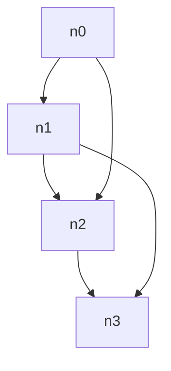

# Native versus Pele: source review and bounded causal probes

Follow-up evidence: [ASTRA-PELE-ADDENDUM.md](ASTRA-PELE-ADDENDUM.md) traces the exact spacing cause and adds one clearance-preserving public-SVG experiment. It shows a smaller admitted diamond but a bend regression; it does not establish a generally better compact policy.

Research date: 2026-11-07. Read-only review of Agentic Mermaid `d8c8ac879793a586b4b741c178b89d7900bd27ed`. No production edits, cap/default/version/cache changes, installation, upstream builds, commits or campaign runs. The only new executable artifact is `probe.ts`, a three-case source-level diagnostic; its raw results are in `probe-results.json`.

## Assessment

The useful lesson from Pele is **make the layout producer account for the drawing it will emit, and spend quality work inside the phase that owns the relevant constraints**. It is not “replace Native with another engine,” “remove verification,” or “increase every search cap.” Native already has meaningful advantages: explicit authored correspondence, exact shape/marker demands, finite resource accounting, checked final geometry, and written-paint certification. Pele does much less of that work and makes different routing and failure tradeoffs.

The strongest demonstrated issue is loss of Native candidate provenance: a tiny graph runs three producer candidates and exposes a one-attempt, one-comparison certification afterward. The clearest quality opportunity is that compact/alternate placement is primarily triggered by crossings, although zero-crossing output can still be unnecessarily tall, bent or badly aligned. The strongest architecture hypothesis is avoidable repeated completion/checking between the owned Native solver and shared graph pipeline; its time contribution still needs measurement.

## Acquired evidence and provenance

* Current official repository HEAD recovered through GitHub API: **`3a2f075ee0c3d914f0fad3545fc0f193693975ac`**, release **1.13.0**, commit timestamp 2026-10-31T00:07:28Z. [README](https://github.com/obsidianmd/pele/blob/3a2f075ee0c3d914f0fad3545fc0f193693975ac/README.md#L1-L9) targets Mermaid 12.1.0, synchronous SVG and no runtime dependencies. `pele-head.json` retains API evidence.
* Audited 1.9 source: **`e7f092a4de147cc32210913c20e36eaa5fcd0ef1`**. [package.json](https://github.com/obsidianmd/pele/blob/e7f092a4de147cc32210913c20e36eaa5fcd0ef1/package.json#L1-L8) says 1.9.0. This is source-tag evidence, **not provenance for the npm archive**. npm has no gitHead; this session did not acquire or requalify the integrity-pinned npm package.
* Official https://pele.run recovered as `pele.run.html` and text extraction `pele.run-text.txt`. The website is current evidence, not a frozen 1.9 implementation promise.
* Source archives: `pele-current.tar.gz` SHA-256 `a3b5641d9dc9658011a887f3d3b04490ee95320e888fa5b54a1ce07b7f3b6f90`; `pele-1.9-source.tar.gz` SHA-256 `c4ede14e4a9ebec8c930ef2f0d8faf9e0c436e34417df622956665a0cbed10a8`. HTML SHA-256 `32f847d19e7dae7c0538a349495d54dfc2a98d8cc81a3c38903e0fa31b3b5540`.
* Trident catalog was recovered by the coordinator at `f080278e31e4202ca89d524e4ee9e4cf3cbff038`; catalog availability establishes inventory, not any previously unavailable peer benchmark results.

All Pele source links below use current 1.13 HEAD unless explicitly marked 1.9. These versions differ materially: current adds border-port alignment, avoids start ports unnecessarily pushing children down a rank, and allows dummy-only alignment blocks to move farther than real-node blocks. See [current layered.ts:1016](https://github.com/obsidianmd/pele/blob/3a2f075ee0c3d914f0fad3545fc0f193693975ac/src/layout/layered.ts#L1016) versus [1.9 layered.ts](https://github.com/obsidianmd/pele/blob/e7f092a4de147cc32210913c20e36eaa5fcd0ef1/src/layout/layered.ts). Do not attribute those additions to the audited 1.9 package.

## Ranked findings

### 1. Preserve internal candidate decisions instead of replacing them with a fresh one-candidate receipt

**Observed, reproducible internal evidence loss; no incorrect geometry demonstrated.**

Named input `ladder`:



A fresh-process source call to `layoutGraphSync(parseMermaid(source), {graphLayout:{backend:'agentic'}})` at the reviewed revision emits **three `graph-preparation` and three `agentic` observer samples**, but returns:

```json
{"status":"passed","strategy":"agentic-layered","attempts":1,
 "hardViolations":0,"preference":{"reason":"first-certified",
 "compared":[{"strategy":"agentic-layered"}]}}
```

`probe-results.json` contains the full selected score, dimensions, stages and input. These stage counts are invocation evidence, not durations or cache-miss claims.

Cause: [selectNativeGraphCandidate:433–443](https://github.com/adewale/agentic-mermaid/blob/d8c8ac879793a586b4b741c178b89d7900bd27ed/src/layout/agentic-producer-core.ts#L433) produces/refines multiple candidates; [certifyOwnedLayoutCandidate:487–493](https://github.com/adewale/agentic-mermaid/blob/d8c8ac879793a586b4b741c178b89d7900bd27ed/src/layout/agentic-producer-core.ts#L487) always records attempts=1 and one compared candidate; [layoutNativeGraphCandidate:500–501](https://github.com/adewale/agentic-mermaid/blob/d8c8ac879793a586b4b741c178b89d7900bd27ed/src/layout/agentic-producer-core.ts#L500) re-certifies the selected object under `agentic-layered`, replacing its prior strategy evidence. The receipt interface describes attempts as **placement-production attempts**, separately from routing comparison: [certification.ts:53](https://github.com/adewale/agentic-mermaid/blob/d8c8ac879793a586b4b741c178b89d7900bd27ed/src/layout/certification.ts#L53).

This does not prove that backend-selection `layoutDecisions.attempts` is wrong: that is a separate contract and may correctly say one backend attempt. It does show that the final candidate receipt cannot explain actual internal search or identify the winning refinement. A final independent certificate can retain a selection trace without treating a previous certificate as proof of later mutations. Test this through the public layout result and observer, not source greps or private call-count snapshots.

### 2. Trigger quality improvement by the defect being improved; crossings alone are an incomplete gate

**Observed policy limitation; compactness/safety improvement remains a proposal.**

Native reserves two private ranks per span by default: [minimum-span-ranks.ts:7–13](https://github.com/adewale/agentic-mermaid/blob/d8c8ac879793a586b4b741c178b89d7900bd27ed/src/layout/minimum-span-ranks.ts#L7). Its compact candidate is only available to small, flat graphs, and [refineOwnedLayoutCandidate:453–456](https://github.com/adewale/agentic-mermaid/blob/d8c8ac879793a586b4b741c178b89d7900bd27ed/src/layout/agentic-producer-core.ts#L453) exits if the initial routes have zero crossings. Even though its score then puts label conflicts and route overlaps before crossings, neither can trigger that search alone. This is different from the generic certifier's explicitly tested zero-crossing label-conflict comparison: [layout-certification.test.ts:347](https://github.com/adewale/agentic-mermaid/blob/d8c8ac879793a586b4b741c178b89d7900bd27ed/src/__tests__/layout-certification.test.ts#L347).

Pele avoids some of this work structurally: [layered.ts:254–270](https://github.com/obsidianmd/pele/blob/3a2f075ee0c3d914f0fad3545fc0f193693975ac/src/layout/layered.ts#L254) starts with one rank step and introduces an intermediate step when labels or parallel/reciprocal pairs require it. This is a graph-wide step, not an optimal per-edge packing scheme. It subsequently aligns labels and removes unused dummy-only bends within the same solver.

Named diagnostic `diamond` (`n0→n1,n0→n2,n1→n3,n2→n3`): all four boxes are exactly 60×40, padding=0, nodeSpacing=40, layerSpacing=48, edgeSpacing=16. Native's raw default is **160×248**; its internal compact policy is **160×184**; current Pele's stepped layout is **160×216**. Public Native rendering preparation produces one candidate and reports zero crossings, confirming the gate.

**Critical caveat:** these are not interchangeable admissible layouts. Native uses `halfGap=max(4,layerSpacing/2)` per private rank even under the compact flag ([core:783–795](https://github.com/adewale/agentic-mermaid/blob/d8c8ac879793a586b4b741c178b89d7900bd27ed/src/layout/agentic-layered-core.ts#L783)); reducing rank count changes the physical interpretation of the spacing input. The probe's raw compact result does not establish equal inter-node clearance, marker safety, final SVG correctness or free savings. The sensible follow-up is a **clearance-preserving compact producer policy**, tested on final emitted geometry, not toggling this internal flag or silently changing defaults. Native forest fast paths also bypass this rank policy; do not generalize the diamond result to trees.

### 3. Clarify ownership of completion and eliminate only proven redundant work

**Observed repeated work boundaries; performance impact unmeasured.**

Native already owns marker finalization, shortening and fitting ([producer-core:81–112](https://github.com/adewale/agentic-mermaid/blob/d8c8ac879793a586b4b741c178b89d7900bd27ed/src/layout/agentic-producer-core.ts#L81)); its projection then fits again at [373](https://github.com/adewale/agentic-mermaid/blob/d8c8ac879793a586b4b741c178b89d7900bd27ed/src/layout/agentic-producer-core.ts#L373) and calls shared `finishGraphGeometry` at [405](https://github.com/adewale/agentic-mermaid/blob/d8c8ac879793a586b4b741c178b89d7900bd27ed/src/layout/agentic-producer-core.ts#L405). `fitMeasuredLayout` scans boxes/routes and allocates replacement node and edge arrays even if its translation is zero: [fit-measured-layout.ts:5–34](https://github.com/adewale/agentic-mermaid/blob/d8c8ac879793a586b4b741c178b89d7900bd27ed/src/layout/fit-measured-layout.ts#L5).

The shared pipeline still clips endpoints, applies route contracts, reanchors, reroutes, repairs marker terminals, repairs labels and closes route contracts ([layout-engine.ts:1529–1623](https://github.com/adewale/agentic-mermaid/blob/d8c8ac879793a586b4b741c178b89d7900bd27ed/src/layout-engine.ts#L1529)). After freeze, each executed pass snapshots boxes **and every edge's point array** and checks mutation/certificate discipline ([pass.ts:138–149](https://github.com/adewale/agentic-mermaid/blob/d8c8ac879793a586b4b741c178b89d7900bd27ed/src/layout/pass.ts#L138)). Declared metric budgets measure before and after; candidate certification checks correspondence, geometric invariants and the rubric again ([certification.ts:302–314](https://github.com/adewale/agentic-mermaid/blob/d8c8ac879793a586b4b741c178b89d7900bd27ed/src/layout/certification.ts#L302)). Selected refined candidates can receive another full certification, as finding 1 shows.

**Do not describe this as all ELK repair work rerunning.** Native explicitly skips peer-size equalization and port-lane movement; most node-moving symmetry passes only run for ELK or Native forest bundling ([pipeline:1450–1508](https://github.com/adewale/agentic-mermaid/blob/d8c8ac879793a586b4b741c178b89d7900bd27ed/src/layout-engine.ts#L1450)). The preservation options in `applyRouteContracts` also differ for Native.

Pele has a tighter shape: measure → compound/layered layout → renderer clips/curves/trims actual routes → SVG ([flowchart/render.ts:65](https://github.com/obsidianmd/pele/blob/3a2f075ee0c3d914f0fad3545fc0f193693975ac/src/diagrams/flowchart/render.ts#L65), [179](https://github.com/obsidianmd/pele/blob/3a2f075ee0c3d914f0fad3545fc0f193693975ac/src/diagrams/flowchart/render.ts#L179), [321](https://github.com/obsidianmd/pele/blob/3a2f075ee0c3d914f0fad3545fc0f193693975ac/src/diagrams/flowchart/render.ts#L321)). It still has bounded repeat layouts and final renderer-owned geometry; it is not literally one pass.

Recommended investigation: attribute preparation, solver, shared completion, certification, serialization and fully consumed paint proof separately; look first at the duplicate bounded `fitMeasuredLayout`, unchanged selected-candidate recertification, and unconditional no-op label passes on graphs with no labels. Reuse only owned immutable facts; no earlier layout result may stand in for final emitted paint. There is no measured claim here that these dominate runtime or that removing them preserves contracts.

### 4. Put endpoint offsets and long-edge alignment into coordinate assignment

**Concrete algorithmic difference; expected quality benefit is a hypothesis.**

Native places equalized bands, then performs four pairs of median coordinate descent before assigning ports ([core:424–447](https://github.com/adewale/agentic-mermaid/blob/d8c8ac879793a586b4b741c178b89d7900bd27ed/src/layout/agentic-layered-core.ts#L424), [616–668](https://github.com/adewale/agentic-mermaid/blob/d8c8ac879793a586b4b741c178b89d7900bd27ed/src/layout/agentic-layered-core.ts#L616), [711](https://github.com/adewale/agentic-mermaid/blob/d8c8ac879793a586b4b741c178b89d7900bd27ed/src/layout/agentic-layered-core.ts#L711)). Additional port-aware coordinate improvement is optional, requested via `quality:'balanced'`, bounded by graph size and existing bends ([producer-core:503–515](https://github.com/adewale/agentic-mermaid/blob/d8c8ac879793a586b4b741c178b89d7900bd27ed/src/layout/agentic-producer-core.ts#L503)). Native already reserves marker footprint and widens eligible boxes for port capacity ([337–355](https://github.com/adewale/agentic-mermaid/blob/d8c8ac879793a586b4b741c178b89d7900bd27ed/src/layout/agentic-producer-core.ts#L337)); that should be preserved.

Pele spreads endpoint offsets **before** its default coordinate assignment ([layered.ts:528–541](https://github.com/obsidianmd/pele/blob/3a2f075ee0c3d914f0fad3545fc0f193693975ac/src/layout/layered.ts#L528)). Its Brandes–Köpf implementation balances four aligned layouts and carries endpoint offsets into block alignment ([2032](https://github.com/obsidianmd/pele/blob/3a2f075ee0c3d914f0fad3545fc0f193693975ac/src/layout/layered.ts#L2032)). `alignLabels`, `settle`, `snap`, and current `alignPorts` then preserve noncrossing separation while aligning long runs and border contacts. Its compound solver can derive shared order from a flat projection and propagate far-side port hints across groups ([compound.ts:613–675](https://github.com/obsidianmd/pele/blob/3a2f075ee0c3d914f0fad3545fc0f193693975ac/src/layout/compound.ts#L613)), with bounded repeated layout retained only when actual routed crossings improve ([876–924](https://github.com/obsidianmd/pele/blob/3a2f075ee0c3d914f0fad3545fc0f193693975ac/src/layout/compound.ts#L876)).

This is more actionable than importing a generic “Pele is faster” claim: examine offset-aware alignment and compound boundary-port order as producer constraints, under Native's exact marker/contact requirements. Do not replace Native's already-existing long-edge simplification, rank optimization or group routing just because Pele names similar phases.

### 5. Make the quality objective explicit across producers and stages

**Observed policy inconsistency; intended tradeoff must be decided.**

Pele's [layered.ts:4–27](https://github.com/obsidianmd/pele/blob/3a2f075ee0c3d914f0fad3545fc0f193693975ac/src/layout/layered.ts#L4) states priorities in one place: distinguishable lines/no node or label intrusion, crossings, simple routes, midpoint ports, symmetry, square entry, authored order, compactness. Native's generic preference puts crossings before label conflicts ([certification.ts:31–35](https://github.com/adewale/agentic-mermaid/blob/d8c8ac879793a586b4b741c178b89d7900bd27ed/src/layout/certification.ts#L31)); its owned refinement puts label conflicts and opposing/parallel overlaps first ([producer-core:458–463](https://github.com/adewale/agentic-mermaid/blob/d8c8ac879793a586b4b741c178b89d7900bd27ed/src/layout/agentic-producer-core.ts#L458)), and counts raw points minus two rather than the rubric's justified-bend interpretation. Native tests explicitly retain an occluded label to avoid one crossing ([layout-certification.test.ts:335–344](https://github.com/adewale/agentic-mermaid/blob/d8c8ac879793a586b4b741c178b89d7900bd27ed/src/__tests__/layout-certification.test.ts#L335)).

Those may be deliberate distinct contracts, but then the selection receipt must explain them. A screenshot being attractive does not resolve which loss is acceptable. Reconcile the user-facing quality priority and use the same named metric interpretation where the artifacts have the same semantics; leave family-specific exceptions explicit.

## Tests worth borrowing, without copying the whole suite

| Pele evidence | Useful invariant | Native overlap / incremental value |
|---|---|---|
| [compound.test.ts:588–619](https://github.com/obsidianmd/pele/blob/3a2f075ee0c3d914f0fad3545fc0f193693975ac/tests/layout/compound.test.ts#L588) | Relative order of fan routes leaving one group agrees with order entering another; assert actual border intersections, not just node ordering. | Native already tests cross-scope leaf contacts, headers and exterior order. Add this only if an asymmetric, nested reciprocal/parallel witness reveals a gap; carry it through final owned SVG contact. |
| [compound.test.ts:621–647](https://github.com/obsidianmd/pele/blob/3a2f075ee0c3d914f0fad3545fc0f193693975ac/tests/layout/compound.test.ts#L621) | Route crosses a group boundary in line with its interior endpoint, where all lanes have enough room; label-rich bipartite witness. | Native [agentic-layered.test.ts:766](https://github.com/adewale/agentic-mermaid/blob/d8c8ac879793a586b4b741c178b89d7900bd27ed/src/__tests__/agentic-layered.test.ts#L766) covers single private lanes; compound version challenges the interaction. |
| [compound.test.ts:140–160](https://github.com/obsidianmd/pele/blob/3a2f075ee0c3d914f0fad3545fc0f193693975ac/tests/layout/compound.test.ts#L140) | A rank-skipping edge changes cross-flow lane only once when the corridor permits, including backward edges. | Native already has [long-channel compaction in all directions:947](https://github.com/adewale/agentic-mermaid/blob/d8c8ac879793a586b4b741c178b89d7900bd27ed/src/__tests__/agentic-layered.test.ts#L947). Extend that table with unequal boxes plus labels/reciprocal ends if it discriminates offset-aware alignment; do not add duplicate straight-chain tests. |
| [layered.test.ts:5–35](https://github.com/obsidianmd/pele/blob/3a2f075ee0c3d914f0fad3545fc0f193693975ac/tests/layout/layered.test.ts#L5) | Independently recount crossings of returned segments while checking group contiguity. | Useful at the measured solver boundary, but production paint crossing semantics remain separate. Native already has independent geometry/rubric tests; no second copied inventory. |
| [render/flowchart.test.ts:340–403](https://github.com/obsidianmd/pele/blob/3a2f075ee0c3d914f0fad3545fc0f193693975ac/tests/render/flowchart.test.ts#L340) | Actual emitted arrowhead separation, diamond/circle outline contact, and stepped routes clear of nodes. | Native's written-paint/contact coverage is stronger, including [fractional direction cases:63](https://github.com/adewale/agentic-mermaid/blob/d8c8ac879793a586b4b741c178b89d7900bd27ed/src/__tests__/agentic-layered.test.ts#L63) and `compound-final-contacts.test.ts`; retain that evidence rather than replacing it with generic snapshots. |
| [util/measurer.test.ts:37–67](https://github.com/obsidianmd/pele/blob/3a2f075ee0c3d914f0fad3545fc0f193693975ac/tests/util/measurer.test.ts#L37), [mount.test.ts:262](https://github.com/obsidianmd/pele/blob/3a2f075ee0c3d914f0fad3545fc0f193693975ac/tests/mount.test.ts#L262) | Do not retain fallback-font widths while a font is loading; remeasure when fonts become available and avoid unnecessary redraw. | Browser host lesson only. Native's deterministic fitting/profile contract differs and is already tested in `custom-font-geometry.test.ts`; no recommendation to add ambient font mutation to its synchronous core. |
| [stress.test.ts:12–110](https://github.com/obsidianmd/pele/blob/3a2f075ee0c3d914f0fad3545fc0f193693975ac/tests/stress.test.ts#L12) | Hostile compact input, many nested border crossings and edge Cartesian products fail/succeed within a loose time bound with a structured error. | Native has detailed work-cap tests already. Adopt adversarial input shapes at the public boundary when uncovered, not Pele's 3-second threshold or “any PeleError passes” as quality proof. |

The highest-value **new Native-specific** regression is the small ladder's truthful candidate provenance. The highest-value quality regression needs a **new demonstrated final-output witness**: zero-crossing but needlessly bent/large output whose alternative preserves minimum clearance, meaning and all final contacts. The raw diamond probe alone is not that regression yet.

## Runtime, bundle and comparison limits

* Pele has no library runtime dependencies, but that does not mean its all-family entry is tiny. It ships all-in-one, explicit per-family registration and lazy entries ([package.json:25–54](https://github.com/obsidianmd/pele/blob/3a2f075ee0c3d914f0fad3545fc0f193693975ac/package.json#L25)). Its build walks **static dependency closure** and reports compressed core/added-family costs ([build.mjs:23–85](https://github.com/obsidianmd/pele/blob/3a2f075ee0c3d914f0fad3545fc0f193693975ac/scripts/build.mjs#L23)). That accounting is worth adopting or retaining, not an invented byte comparison.
* Native already has a solver-specific lazy import boundary ([agentic-layered.lazy.ts:14–31](https://github.com/adewale/agentic-mermaid/blob/d8c8ac879793a586b4b741c178b89d7900bd27ed/src/layout/agentic-layered.lazy.ts#L14)); selecting ELK need not fetch Native. The conclusion is measure actual closure/request graphs, not that Native lacks lazy loading. No package size or browser startup timing was measured here.
* Pele default routes are smooth curves; Native's certified graph pipeline uses stricter orthogonal route/contact contracts. Even stepped Pele renderer rounds corners and trims shafts while emitting marker artwork ([svg/edges.ts:55](https://github.com/obsidianmd/pele/blob/3a2f075ee0c3d914f0fad3545fc0f193693975ac/src/svg/edges.ts#L55)). Counts of raw route bends/crossings cannot be compared without projecting actual emitted paths consistently.
* Pele limits dummy expansion by converting selected longest edges to direct curves when it would exceed 20,000 dummies ([layered.ts:273–291](https://github.com/obsidianmd/pele/blob/3a2f075ee0c3d914f0fad3545fc0f193693975ac/src/layout/layered.ts#L273)). Native instead may refuse or use explicitly requested ELK fallback. Pele returning an SVG is not evidence it meets Native's visibility/attachment/paint proof contract. Do not raise Sparse32 or ER direction proof caps by analogy.
* Pele's renderer can accommodate crossed group titles using title placement/treatment ([flowchart/render.ts:223–237](https://github.com/obsidianmd/pele/blob/3a2f075ee0c3d914f0fad3545fc0f193693975ac/src/diagrams/flowchart/render.ts#L223)); Native reserves and certifies header bands. This is a genuine difference in acceptable drawings.
* Native's final output pipeline binds retained geometry to writing/paint evidence and may reject failed proof ([graphical-render.ts:188–205](https://github.com/adewale/agentic-mermaid/blob/d8c8ac879793a586b4b741c178b89d7900bd27ed/src/graphical-render.ts#L188)). No analogous full certificate is issued in the inspected Pele public render path. Pele still has escaping, style/link filtering and size/work safeguards; lack of Native's certificate does not imply insecure output.
* Pele's own `bench.mjs` catches per-input failures, reports success count, times ordinary rendering and measures its built bundle ([bench.mjs:35–63](https://github.com/obsidianmd/pele/blob/3a2f075ee0c3d914f0fad3545fc0f193693975ac/scripts/bench.mjs#L35)). It does not establish peer meaning, endpoint completeness or final-paint equivalence. Its numbers must not be mixed with fully consumed Native receipt timing.
* The existing Native-versus-same-pipeline-ELK campaign (Native lower uncached median in 5/6; crossing276 320 vs 265 ms and 6 vs 4 crossings; original 874 pairs; ER256 direction and Sparse32 limits) remains evidence for that recorded comparison only. It contains no Pele performance result. Source recovery and six tiny public Pele source renders in this probe do not retroactively qualify unavailable historical Pele/Trident cells.

## Reproduction and completion

Run from the reviewed checkout with the existing runtime:

```sh
/tmp/pr449-tools-20261106/package/bin/bun /tmp/pr449-week-comparison-20261101/trident-elk-research-20261107/astra/probe.ts
```

The probe imports the exact local source revisions, produces raw Native default/compact and current Pele stepped geometry, observes public Native layout preparation/solver invocations, and renders each tiny source through both recovered Pele 1.9 and 1.13 **source trees**. It writes a single JSON artifact under this report directory. It changes no cache policy; fresh-process invocation avoids preexisting in-process entries. No performance ratio is reported. No upstream test suite was run; tests above were inspected, and three bounded input cases were executed. No production fix is proposed as already safe or completed.
