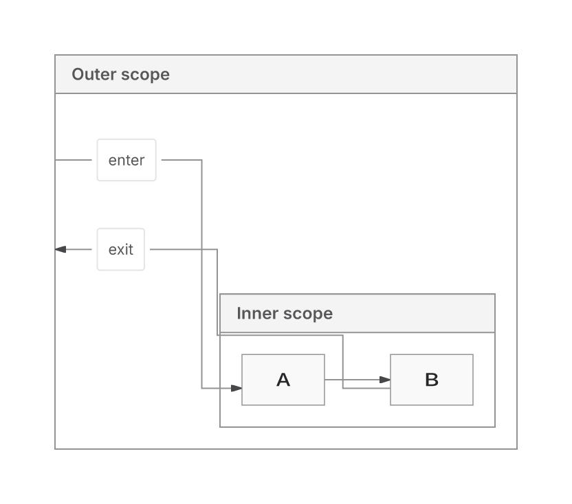
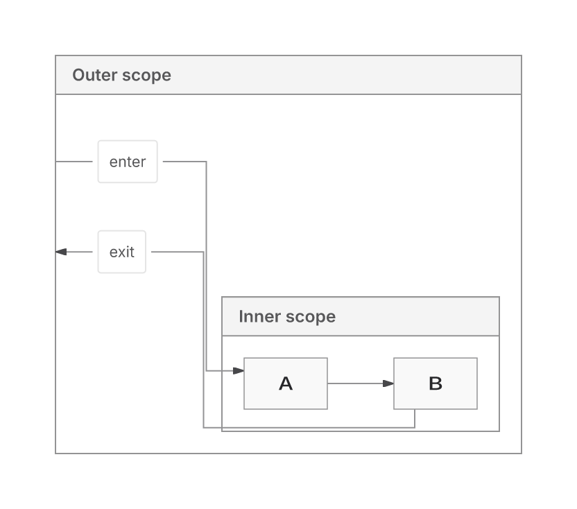

This PR changes Native routing and shared SVG ownership/capture. Main already provides Native. The owner-requested rebase integrates current main while retaining fresh, metered paint-proof checks. **The PR remains draft: the local Sparse32 budget failure remains and full CI has failed. The 100 ms target for fresh layout work remains unmet.**

Source: `599bee58db7cb54293866cc8aa86c887ef93e9a4`. Main base: `4260292397d4bca7624a30c34649eb943a5f8e0c`. GitHub reports mergeable=true. The original `ff18d23eb2b25ffb84aa492170d4ef0005411b7e` history and the rebased history are both preserved on the evidence branch.

## Main integration — 10 November

Main's writer findings are retained for unmetered final output security. Paid XML validation and text-position checks remain fresh. Native emission keeps defensive snapshots; main's in-place owned-data freezing cannot grant paint-proof authority. Scene writes retain own-data capture, and ER/Class retain fresh actual-write certification. Both marker-peer paths keep their live fallback and invalidation contracts.

A regression probe found that inherited `styleStart=0` let the parser accept elements inside style text. Own frame metadata now rejects that input. The owner test fails before the repair and passes after it. SDK declarations are regenerated and editor imports are reconciled.

Final affected suite: **1345 passed, one existing Sparse32 budget failure** across 25 files. Native routing owners: **32 passed**. Core/repository typechecks and lint pass. The frozen comparison against ff18 retains 84 byte-identical returned SVGs, six errors, and no delivery or proof-status transitions; 57 receipts differ only in paid operation count.

[Integration result, raw checks, failed probes and recovery archive](https://github.com/adewale/agentic-mermaid/blob/0d77487314ac526b944428499960024dfa0e3b23/rebase-main-20261110/RESULT.md). The [frozen Main/PR comparison](https://github.com/adewale/agentic-mermaid/blob/4fea9394f097ca8112bcabfc3a594a5cc248d729/trident-main-20261110/REPORT.md) below measures both backends on this rebased head.

## What changes

The PR preserves SVG occurrence/write ownership, fresh receivers, mutable/getter behavior, UTF16, CSS, definitions and cache isolation. It carries the neutral measured backend contract into Native, adds early endpoint capacity, and repairs capacity, forest and compound cases. Global nesting handles leaf DAGs whose grouping invents a scope cycle; other compounds retain recursive handling for authored cycles, local directions and frame endpoints. The ER delivery/recovery foundation remains. Native is the sole replacement candidate; Trinity feature growth is frozen. ELK remains available.

The grouped routing fix admits legal host padding after the original content-domain miss under the same ledger and paint eligibility rules. Ancestor routing retains a feasible original route, checks bounded elbows and prefers fewer crossings. Endpoint, header, body, label and contact checks remain.

The latest shared-pipeline change:

- Uses one immutable XML record for the write handle and read view, with projection state in the existing private registry.
- Removes the duplicate raw-fragment boundary scan/cache and repeated sealing of unexposed projection data. The final assembled-document parser still checks substitution positions.
- Reuses existing text-plan descriptor operands for the captured native path. Foreign helpers, inherited descriptor hooks and coercible keys retain their original path and fresh receivers.
- Avoids a general definitions inventory for captured primitive definitions without directive/style prefixes; other inputs retain full inspection.
- Shares resource work estimation while retaining each consumer's traversal and bounds. Resource correspondence and pre-serialization work bounding still serve distinct contracts.

The earlier private group-literal sealing shortcut was unsafe under a pre-import `Object.freeze` hook. It could change retained class metadata and falsely pass an Inter proof over actual monospace SVG. Restoring pinned producer records changes that case from false-pass to `unverified / OUTPUT_SCOPE`, with all nine SVGs unchanged.

Private XML construction/registry callbacks are internal implementation details and no longer expose mutable evidence. Actual caller-input getters, proxies, coercions and generic non-string indentation retain their paths. No new cache, cap, backend default or version change ships.

## Correctness and verification

The owner's original 12 sources/image were lost. The table below records the pre-rebase grouped-routing milestone on a replacement set frozen before the routing edits, with authored expectations and actual SVG receipts.

| Metric | Native before 7257 | Native after grouped fix | Same-input ELK |
| --- | ---: | ---: | ---: |
| Delivered | 10/12 | 12/12 | 12/12 |
| Actual SVG receipt passed | 10/10 returned | 12/12 | 12/12 |
| Declared leaf-flow checks | 19/19 returned | 25/25 | 17/25 |
| Crossings | Ancestor 2; others 0 | 0 in all 12 | Mixed-local 1; others 0 |

ELK's flow differences are quality differences, not missing relationships. Ancestor LR crossings 2→0 cost wire 695.496→734.171 px (+5.56%); area is unchanged and bends 6→5. The reciprocal case's costs and original 20k refusal remain explicit. [Grouped inputs and evidence](https://github.com/adewale/agentic-mermaid/blob/8ec6299d2d1270c189e78c6d1ef79e1d66f3b9a9/native-blockers-checkpoint-20261110/README.md).

For the shared-pipeline change and subsequent main integration:

- Final rebased affected suite: **1345 passed, one retained Sparse32 proof-budget failure**. Core/repository typechecks and lint pass.
- Frozen comparison: 90 enrolled; 84 returned with byte-identical whole SVGs, six retained errors, no delivery or proof-status transitions. Of the receipts, 27 are exact and 57 differ only in paid operation count.
- Current frozen Main/PR browser qualification: 132/132 family/arm observations passed XML, positive canvas and declared visible-label checks; 264 actual full public products retained. Deeper meaning, paint and unknowns are reported separately in the [99-case fidelity cohort](https://github.com/adewale/agentic-mermaid/blob/4fea9394f097ca8112bcabfc3a594a5cc248d729/trident-main-20261110/fidelity/SUMMARY.md). Trinity was not included in this comparison.
- The font-scope regression reproduces the false proof on the parent revision and returns unverified after repair.

Reproduce affected owners with Bun 1.4.4:
`bun test src/__tests__/scene-*.test.ts src/__tests__/prepared-text.test.ts src/__tests__/crisp-drawing.test.ts src/__tests__/endpoint-marker-contact.test.ts src/__tests__/paint-certification.test.ts src/__tests__/written-svg-security.test.ts src/__tests__/svg-inspection.test.ts src/__tests__/renderer-security.test.ts src/__tests__/render-options-authority.test.ts src/__tests__/shape-outline-authority.test.ts src/__tests__/fanout-symmetry.test.ts src/__tests__/feedback-reroute.test.ts src/__tests__/position-cache-ownership.test.ts src/__tests__/verified-preview.test.ts --timeout 30000`.

[Final result, recovery archive, raw failures and commit binding](https://github.com/adewale/agentic-mermaid/blob/ac8c8066fe2b5e719c3f87cb85d943050c0ef0ce/pipeline-dedup-checkpoint-20261110/RESULT.md). Earlier [five self/inclusive profile hotspots and rejected trials](https://github.com/adewale/agentic-mermaid/blob/51c1df9b201379e7e4d9f6b0789af11a65611519/native-emission-reuse-checkpoint-20261110/README.md) remain recovery evidence.

## Native and ELK compared with current Main

[All 33 families and standard metrics](https://github.com/adewale/agentic-mermaid/blob/4fea9394f097ca8112bcabfc3a594a5cc248d729/trident-main-20261110/REPORT.md) · [family CSV](https://github.com/adewale/agentic-mermaid/blob/4fea9394f097ca8112bcabfc3a594a5cc248d729/trident-main-20261110/FAMILY-METRICS.csv) · [raw evidence archive](https://github.com/adewale/agentic-mermaid/blob/4fea9394f097ca8112bcabfc3a594a5cc248d729/trident-main-20261110/evidence.tar.gz).

Frozen sources: Main `4260292397d4bca7624a30c34649eb943a5f8e0c`, PR `599bee58db7cb54293866cc8aa86c887ef93e9a4`; Trident `f080278e31e4202ca89d524e4ee9e4cf3cbff038`. Both backends use fallback:none. All 33 family representatives return in all four arms. Eight record an actual graph-backend selection; the other 25 produce byte-identical Native/ELK SVGs without a recorded choice.

On the eight graph representatives, Native has lower observed layout-cache-disabled SVG and full-product runtime medians and smaller fetched browser closures than ELK. Main already has that advantage. Cached results often converge; the PR is not a general performance improvement over Main.

The table consumes the actual built public SVG+receipt response, serializes it once and counts UTF8 bytes. Layout cache disabled; medians of three fresh processes, each with four repeat calls:

| Input | Main Native ms | Main ELK ms | PR Native ms | PR ELK ms |
| --- | ---: | ---: | ---: | ---: |
| Chain100 | 107.5 | 221.8 | 173.2 | 387.8 |
| Fan-in100 | 165.0 | 438.0 | 239.1 | 509.6 |
| Chain300 | 285.6 | 649.4 | 385.9 | 714.5 |

With the existing layout cache enabled, PR Native Chain100 repeats take 15.6 ms, but the first authored edit takes 184.6 ms; Main measures 14.9 and 120.3 ms. First render/import, repeats and first/repeated edits are separate in the report. The 100 ms fresh-work goal remains unmet. PR diagnostic products are proof-unverified while Main's pass, so these costs are not rates of equivalently proved diagrams.

Actual fresh-family flowchart browser closure, including the support probe and enrolled source:

| Source | Native gzip KiB | ELK gzip KiB | Native requests | ELK requests |
| --- | ---: | ---: | ---: | ---: |
| Main | 326.5 | 688.0 | 32 | 28 |
| PR | 389.6 | 739.7 | 41 | 31 |

Product bytes exclude binding bytes; request counts include the binding. Compression is offline gzip9 on actual fetched modules, not compressed HTTP delivery or a complete npm package. Brotli11, raw bytes, heap, RSS, CPU and all family-specific costs are retained. Native's lower byte count comes with more requests. Chain100 whole-process peak RSS is 95.7 MiB on Main Native, 117.6 on PR Native and 172.6 on PR ELK; this includes import, driver and qualification.

The demonstrated visible improvement versus Main is controlled embedded-image delivery in both backends. The independent 99-case cohort retains its errors and unknowns, including eight labels-only supplements and a Trident Event Modeling schema mismatch; no overall correctness percentage is claimed. In the separate 62-case seed cohort, six larger outputs move from passed proof on Main to unverified on the PR in both backends. Actual SVG paint, authored meaning, proof availability and layout-quality vectors remain separate.

All 5952 SVG/resource workers and 864 full-product workers completed. All 7776 measured full-product calls returned. Repeated SVG and receipt bytes are exact in all 3456 repeat observations; cross-cache SVG comparisons are exact in 232 returned cells, with 16 actual-error cells unavailable. These are observations, not a workload-wide correctness claim. Artifact/dependency hashes match for all 1434 checked files and all source/tool worktrees remain clean.

Timing is exploratory and below Trident's full calibration. Raw samples and process spread remain available; pooled p95 is a percentile of adaptive batch means, not a single-call tail. No source optimization, new cache, cap change or acceptance gate was introduced by the benchmark.

## Remaining losses and readiness

Sparse32 proof exhaustion remains distinct from the shared ER256 relationship-chain refusal. Historical larger cases, not requalified by the minimal family representatives: forest wire +16.89% with area −6.43% versus ELK; Requirement TB/BT area +9.53%; implemented Sparse256 area +5.04%. The +0.97% Sparse256 backfill candidate is unshipped. Mixed-circle paint, distribution limits and workload-wide replacement qualification remain unresolved.

Full [CI for 599bee58d](https://github.com/adewale/agentic-mermaid/actions/runs/42916751713) completed with failure: quality, unit shards 1/3 and 3/3, browser-site, payload and the advisory generated-layout diagnostic failed. Action pinning and Ruff passed. The benchmark does not waive these failures or establish readiness.

Original 2dad baseline and equivalent pinned Mermaid 12.2/Pele 1.9 runtime comparisons remain unavailable. Replacement24 stays sealed. Campaign/report automations remain disabled; the latest work was an explicit bounded request.

## Visual evidence

Claim: the labelled ancestor entry/exit retain their authored relationships and A→B flow while removing two route crossings.

Input/fixture: `container-descendant-labelled` in [the fixed source set](https://github.com/adewale/agentic-mermaid/blob/8ec6299d2d1270c189e78c6d1ef79e1d66f3b9a9/native-blockers-checkpoint-20261110/REPLACEMENT-12.json), directionLR, nested Outer/Inner, Outer→A labelled enter, A→B, B→Outer labelled exit. Options/source are identical between arms; production SVG with Inter.

Baseline SHA: `7257faa9299a69948645a7574e185300b7841f75`.
Grouped-routing fix SHA (its SVGs are unchanged by c3dc): `17f157fae6a6f97295ebb10f215d2c2326710b6b`.

Regenerate: extract `evidence.tar.gz`, replay the retained correctness collector, then `bun correctness-final/raster-ancestor.ts`. Resvg uses manifest-verified Inter, system fonts off,2× zoom. [Font manifest](https://github.com/adewale/agentic-mermaid/blob/8ec6299d2d1270c189e78c6d1ef79e1d66f3b9a9/native-blockers-checkpoint-20261110/RASTER-FONTS.json), [SVG/PNG/archive hashes](https://github.com/adewale/agentic-mermaid/blob/8ec6299d2d1270c189e78c6d1ef79e1d66f3b9a9/native-blockers-checkpoint-20261110/MANIFEST.json). Owning test: `ancestor-boundary-routes.test.ts`, “ancestor entry and exit preserve the inner chain without crossing”, allfour directions.

| Before | After |
| --- | --- |
|  |  |

Limitation: these renders establish the enrolled fixture's crossing repair, with a wire cost. They do not recover the lost original image, prove every grouped graph correct or establish ELK replacement readiness.

