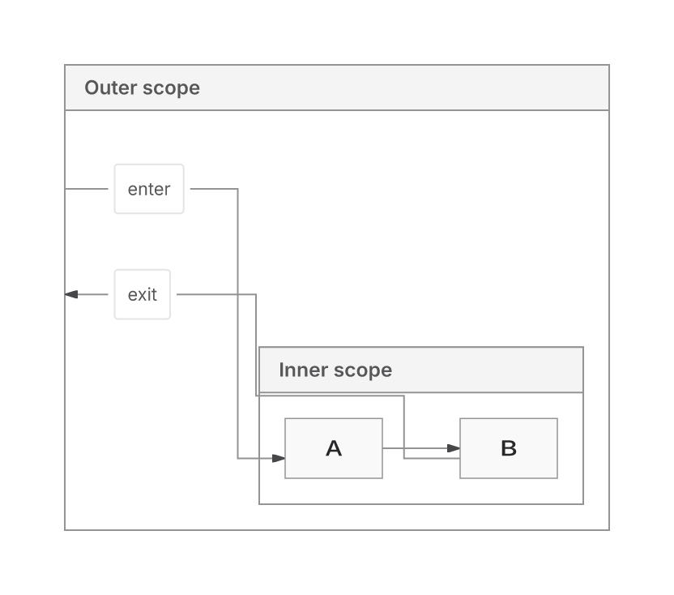
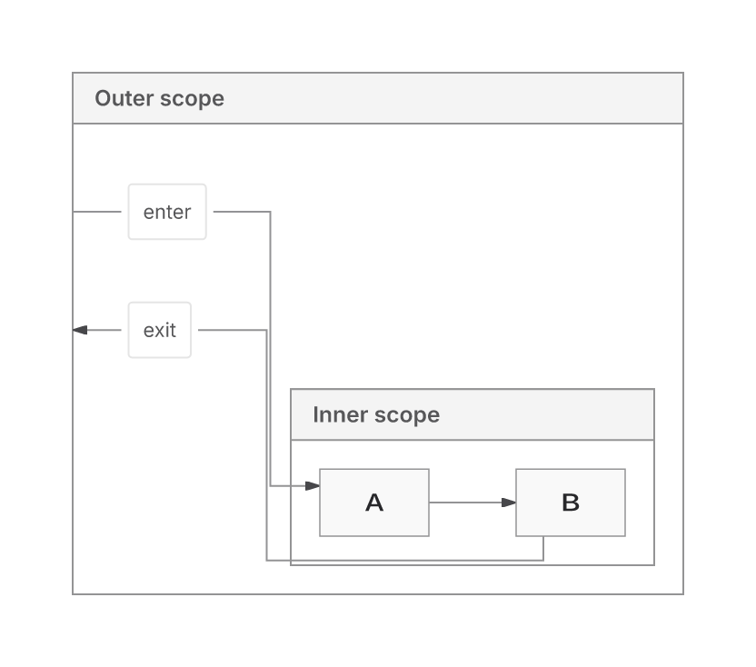

This PR repairs Native compound routing and strengthens SVG write ownership and capture. It also renders authored embedded images that Main replaces with a placeholder. Native is already available in Main.

**The PR remains draft. Full CI has failed, Sparse32 still exhausts its proof budget, and the 100 ms target for fresh layout work remains unmet.**

PR head SHA: `599bee58db7cb54293866cc8aa86c887ef93e9a4`. Main base: `4260292397d4bca7624a30c34649eb943a5f8e0c`.

## What changes

Native uses the neutral measured request contract and early endpoint-capacity planning. Global nesting handles leaf DAGs whose grouping invents a scope cycle; authored cycles, local directions and frame endpoints retain recursive handling. Grouped routing admits legal host padding under the existing ledger. Ancestor routing retains a feasible original route and checks bounded elbows to reduce crossings, while preserving endpoint, header, body, label and contact checks. Native is the sole replacement candidate; Trinity feature growth is frozen and ELK remains available.

Shared emission uses one immutable XML record for the write handle/read view, private registry projection state, existing text-plan descriptor operands and a narrower definitions path for captured primitives. Resource work estimation is shared while consumer traversal, correspondence and pre-serialization bounds remain distinct. The final assembled XML parser and paid text-position validation stay fresh. Own frame metadata rejects an inherited `styleStart=0` parser bypass found during main integration.

Pinned producer records remain necessary: a pre-import `Object.freeze` hook could otherwise change class metadata and falsely pass an Inter proof over actual monospace SVG. That probe now returns `unverified / OUTPUT_SCOPE`, with all nine SVGs unchanged. Mutable/getter/CSS/definitions/ownership isolation, UTF16 and all caps remain covered by owning tests. No new cache, backend default or version change ships.

## Verification

On the rebased source, the affected suite records **1345 passes and one retained Sparse32 budget failure** across 25 files; Native routing owners record **32 passes**. Core/repository typechecks and lint pass. The rebase preservation cohort retains 84 byte-identical returned SVGs and six errors; 27 receipts are exact and 57 differ only in paid operation count. These are preservation checks.

[Rebase commands, exact revision and raw verification](https://github.com/adewale/agentic-mermaid/blob/0d77487314ac526b944428499960024dfa0e3b23/rebase-main-20261110/RESULT.md). [Shared-pipeline probes and recovery](https://github.com/adewale/agentic-mermaid/blob/ac8c8066fe2b5e719c3f87cb85d943050c0ef0ce/pipeline-dedup-checkpoint-20261110/RESULT.md).

The owner's original 12 grouped sources/image were lost. On the replacement set frozen before routing edits, the historical milestone improves Native delivery from 10/12 to 12/12, with zero crossings in all 12; ELK also delivers 12/12. Ancestor crossings fall 2→0 while wire rises 5.56%. The before/after visual below records that milestone, not a new comparison against current Main.

## Native and ELK compared with current Main

[All 33 families and standard metrics](https://github.com/adewale/agentic-mermaid/blob/4fea9394f097ca8112bcabfc3a594a5cc248d729/trident-main-20261110/REPORT.md) · [family CSV](https://github.com/adewale/agentic-mermaid/blob/4fea9394f097ca8112bcabfc3a594a5cc248d729/trident-main-20261110/FAMILY-METRICS.csv) · [raw evidence archive](https://github.com/adewale/agentic-mermaid/blob/4fea9394f097ca8112bcabfc3a594a5cc248d729/trident-main-20261110/evidence.tar.gz).

Frozen sources: Main `4260292397d4bca7624a30c34649eb943a5f8e0c`, PR `599bee58db7cb54293866cc8aa86c887ef93e9a4`; Trident `f080278e31e4202ca89d524e4ee9e4cf3cbff038`. Both backends use fallback:none. All 33 family representatives return in all four arms. Eight record an actual graph-backend selection; the other 25 produce byte-identical Native/ELK SVGs without a recorded choice.

On the eight graph representatives, Native has lower observed layout-cache-disabled SVG and full-product runtime medians and smaller fetched browser closures than ELK. Main already has that advantage. Cached results often converge; the PR is not a general performance improvement over Main.

The table consumes the actual built public SVG+receipt response, serializes it once and counts UTF8 bytes. Layout cache disabled; medians of three fresh processes, each with four repeat calls:

| Input | Main Native ms | Main ELK ms | PR Native ms | PR ELK ms |
| --- | ---: | ---: | ---: | ---: |
| Chain100 | 107.5 | 221.8 | 173.2 | 387.8 |
| Fan-in100 | 165.0 | 438.0 | 239.1 | 509.6 |
| Chain300 | 285.6 | 649.4 | 385.9 | 714.5 |

With the existing layout cache enabled, PR Native Chain100 repeats take 15.6 ms, but the first authored edit takes 184.6 ms; Main measures 14.9 and 120.3 ms. First render/import, repeats and first/repeated edits are separate in the report. The 100 ms fresh-work goal remains unmet. PR diagnostic products are proof-unverified while Main's pass, so these costs are not rates of equivalently proved diagrams.

Actual fresh-family flowchart browser closure, including the support probe and enrolled source:

| Source | Native gzip KiB | ELK gzip KiB | Native requests | ELK requests |
| --- | ---: | ---: | ---: | ---: |
| Main | 326.5 | 688.0 | 32 | 28 |
| PR | 389.6 | 739.7 | 41 | 31 |

Product bytes exclude binding bytes; request counts include the binding. Compression is offline gzip9 on actual fetched modules, not compressed HTTP delivery or a complete npm package. Brotli11, raw bytes, heap, RSS, CPU and all family-specific costs are retained. Native's lower byte count comes with more requests. Chain100 whole-process peak RSS is 95.7 MiB on Main Native, 117.6 on PR Native and 172.6 on PR ELK; this includes import, driver and qualification.

The demonstrated visible improvement versus Main is controlled embedded-image delivery in both backends. The independent 99-case cohort retains its errors and unknowns, including eight labels-only supplements and a Trident Event Modeling schema mismatch; no overall correctness percentage is claimed. In the separate 62-case seed cohort, six larger outputs move from passed proof on Main to unverified on the PR in both backends. Actual SVG paint, authored meaning, proof availability and layout-quality vectors remain separate.

Artifact/dependency hashes match for all 1434 checked files and all source/tool worktrees remain clean.

Timing is exploratory and below Trident's full calibration. Raw samples and process spread remain available; pooled p95 is a percentile of adaptive batch means, not a single-call tail. No source optimization, new cache, cap change or acceptance gate was introduced by the benchmark.

## Remaining losses and readiness

The [full CI run](https://github.com/adewale/agentic-mermaid/actions/runs/42916751713) failed quality, unit shards 1/3 and 3/3, browser-site, payload and the advisory generated-layout diagnostic. Action pinning and Ruff passed. The benchmark does not waive these failures.

Historical larger counterexamples were not requalified by the minimal family representatives: forest wire +16.89% with area −6.43%, Requirement TB/BT area +9.53%, implemented Sparse256 area +5.04%. The +0.97% Sparse256 backfill candidate is unshipped. Sparse32 proof exhaustion remains distinct from the shared ER256 relationship-chain refusal. Mixed-circle paint and workload-wide replacement qualification remain unresolved.

Original 2dad baseline and equivalent pinned Mermaid12.2/Pele1.9 renderer comparisons remain unavailable. Replacement24 stays sealed. Campaign/report automations remain disabled; this benchmark was an explicit bounded request.

## Visual evidence

Claim: the labelled ancestor entry/exit retain their authored relationships and A→B flow while removing two route crossings.

Input/fixture: `container-descendant-labelled` in [the fixed source set](https://github.com/adewale/agentic-mermaid/blob/8ec6299d2d1270c189e78c6d1ef79e1d66f3b9a9/native-blockers-checkpoint-20261110/REPLACEMENT-12.json), directionLR, nested Outer/Inner, Outer→A labelled enter, A→B, B→Outer labelled exit. Options/source are identical between arms; production SVG with Inter.

Baseline SHA: `7257faa9299a69948645a7574e185300b7841f75`.
Historical visual head SHA: `17f157fae6a6f97295ebb10f215d2c2326710b6b`.

Regenerate: extract `evidence.tar.gz`, replay the retained correctness collector, then `bun correctness-final/raster-ancestor.ts`. Resvg uses manifest-verified Inter, system fonts off,2× zoom. [Font manifest](https://github.com/adewale/agentic-mermaid/blob/8ec6299d2d1270c189e78c6d1ef79e1d66f3b9a9/native-blockers-checkpoint-20261110/RASTER-FONTS.json), [SVG/PNG/archive hashes](https://github.com/adewale/agentic-mermaid/blob/8ec6299d2d1270c189e78c6d1ef79e1d66f3b9a9/native-blockers-checkpoint-20261110/MANIFEST.json). Owning test: `ancestor-boundary-routes.test.ts`, “ancestor entry and exit preserve the inner chain without crossing”, allfour directions.

| Before | After |
| --- | --- |
|  |  |

Limitation: these renders establish the enrolled fixture's crossing repair, with a wire cost. They do not recover the lost original image, prove every grouped graph correct or establish ELK replacement readiness.

