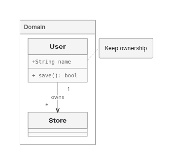

This PR preserves PR449’s SVG ownership/capture foundation, removes the shared ER256 refusal, improves selected Native layouts, and adds a common measured-layout interface with opt-in Trinity.

**Draft: retain ELK.** Trinity now returns27 of30 frozen inputs, versus28 for Native/ELK. These are delivery/proof counts, not complete-correctness scores: the remaining controlled-image input also exposes missing actual-image emission in the other backends.

Runtime: `4db8570d389246bb5f1eede8c5b1899fe6cd687e`; report: `a62cba6766f959dc6aad4709b138a5888906c9a1`. Integrated main: `e7cb05baa7f68154942a9ce9c6e9aaaee163dc94`. Owner deadline: **9 November2026 at20:00UTC /8pm London**. History is preserved through normal commits/pushes; old automations remain off. No new PR/issues, default/version/cap changes or ELK retirement.

## Verified changes

Shared ER finalization reuses its call-local glyph/shaft snapshot and cardinality lookup without changing retained routes. ER256 now delivers in all four directions through Native and ELK at the original 400k geometry limit. Previously refused BT/RL require 385,344 Native / 371,874 ELK operations. Returned TB/LR controls fall from 397,206→343,421 Native and 384,466→330,681 ELK. Refused work is excluded from completed timing ratios.

Earlier pinned-main comparisons retain selected Native improvements: forest wire 700.04→397.71 versus ELK396.47, forest area226,466→165,356 versus ELK176,727, and Class2 area85,680→65,400 versus ELK61,400. These are dated, same-input comparisons against main `c366de0d137e33e123acd84fc99164417c0f3917`, not a fresh all-workload ranking. [Retained comparison scope](https://github.com/adewale/agentic-mermaid/blob/fb8258f17fadf2996e15aa4c82a0973b1cefae4f/rebase-c366-reconsider-20261107/README.md).

The common interface distinguishes measured placement from routed results and enforces finite geometry, authored correspondence and fixed/minimum body policy. Family producers retain shape/text/marker measurement and final emission. Native retains its private search, cache and work ownership.

Trinity is a real, uncached local solver selected by `graphLayout: { backend: 'trinity' }`. It now supports bounded rectangular/rounded Flowchart and State with nested scopes, fixed State start/end circles, canonical Class scopes with notes/cardinalities and flat ER cards and Requirement. Routed admission is64subjects/128edges. Single-container Architecture uses body placement under the separate4096node/16384edge forest admission. Admission limits do not guarantee delivery for every graph inside them. Unsupported constraints decline; fallback requires an explicit request, and exhausted work/engine defects remain hard errors.

The earlier nested migration reproduces two frozen nested refusals, then reuses scope sizing/lifting/boundary routing with **Trinity local solves**, without invoking Native’s solver or search flags. Actual frame paint, header minima and endpoint supports reach placement. Child frames stay fixed after bottom-up sizing. The first fixed-leaf trial failed LR/RL capacity; permitted growth exposed shared consumers discarding returned dimensions. Scope projection and flat/cross-hierarchy routing boxes now consume the actual grown body. Cumulative work and expansion limits remain unchanged; no cache was added.

The current Class change removes a blanket rejection of namespaces, notes and cardinalities that already have measured/shared owners. Namespace frames, ancestry, actual card sizes and canonical endpoint spans feed real Trinity solves; Class completion retains note seating, annotation/cardinality placement, final contacts and marker meaning. Interfaces and custom paint remain unsupported. The existing64-subject limit now counts cards plus flattened namespace frames before solver construction;128 relationships and all work/proof budgets remain unchanged.

## Delivery and actual output

| Frozen30 outcome | ELK | Native | Trinity |
| --- | ---: | ---: | ---: |
| Returned / proof-passed |28|28|27|
| Unsupported |0|0|1|
| Shared input errors |2|2|2|

The new delivery is `features:class:namespace-members-cardinality`: Domain, User members/method, Store, labelled ownership, endpoint cardinalities and attached note. Of15 reacquired Class products,14 previous SVGs are byte-exact and one Trinity SVG is newly returned. Existing Trident authored-meaning and actual finalSVG observers find no failed checks on those Class outputs. The harder nested owner also retains notes, multiple marker kinds, cardinalities and a self-loop in four directions.

The existing613-criterion ledger is ELK575passed/6unsupported/29blocked/3failed, Native576/6/28/3 and Trinity564/19/28/2. Common parser/prelude credit is not solver delivery; all unknowns and failures remain.

Controlled image is the sole frozen Trinity unsupported case. Native/ELK return a warned vector placeholder: their independently declared `embedded-images` check **fails** because no decoded image is emitted. Opening Trinity’s gate alone would not close that shared deficit. Authored meaning, proof availability and actual ink remain separate.

| Actual Class SVG | ELK | Native | Trinity |
| --- | ---: | ---: | ---: |
| Area |142,237|121,274|117,311|
| Relationship wire |137.3|77.3|61|
| Bends / crossings / parallel overlaps |0 /0 /0|0 /0 /0|0 /0 /0|
| SVG gzip9 /Brotli11 bytes |1,928 /1,630|1,924 /1,642|1,929 /1,645|

Notes contribute to the viewport; note tethers are not counted as graph relationships. Trinity’s compressed SVG is slightly larger despite smaller area/wire. Earlier fan-in delivery at `e928a1847` remains mixed: LR crossings ELK6/Trinity9, TB13/29. [Its retained cost/refusal/ink report](https://github.com/adewale/agentic-mermaid/blob/c06e199f462b5e2b2241d395cfc2cc25469c1db5/trinity-shaft-checkpoint-20261109/README.md) binds that runtime.

## Complete-product performance and distribution

Current Class input, twelve serial fresh Node24 processes, two replicas/backend/cache: **60 complete SVG+entire receipt calls, all returned/proof-passed**. Originals and repeated edits are byte-exact; the authored note edit changes output. Import, explicit GC, artifact writes and compression are outside render windows; sampling/observers off. Cache0 still permits existing derived caches. No general ratio, percentile, memory superiority or application-startup result follows from this sample.

| Backend | Cache0 cold /repeat2 /edit2 median ms | Cache1 repeat2 /edit2 median ms |
| --- | --- | --- |
| ELK |730.52 /43.59 /74.09|20.61 /19.25|
| Native |201.94 /43.30 /26.14|19.75 /18.12|
| Trinity |180.32 /24.59 /20.88|23.33 /16.92|

Cached repeats are adverse for Trinity. CPU, RSS/heap ranges, complete output JSON and every phase remain in the linked report; snapshots are not heap peaks or leak evidence. Before-Trinity refusal is not comparable completed work.

Equal13-input family/feature browser workloads include the new Class case, with full receipts consumed; all lanes pass:

| Fetched product | ELK | Native | Trinity |
| --- | ---: | ---: | ---: |
| gzip9 bytes |856,327|484,054|476,329|
| Brotli11 bytes |687,180|415,162|408,167|
| Requests including binding |41|47|48|

Files were served raw and compressed after observation: no compressed-wire/startup claim. Binding bytes are separate. The workload adds one input to the earlier12-input union; the cross-run delta is not a code-only saving. Matched Bun1.4.4 editor gzip1,342,154→1,342,694 (+540), Brotli1,281,810→1,282,743 (+933). **The original1,334,500 gzip ceiling still fails by8,194.**

The report-first profile, self/inclusive distinction, cache inventory and stopped performance hypotheses are retained in [the source review](https://github.com/adewale/agentic-mermaid/blob/a62cba6766f959dc6aad4709b138a5888906c9a1/docs/design/system/layout-0.6-performance-review.md), bound to its recorded revisions. This Class change is delivery admission, not a performance rewrite, new cache or invented speedup.

## Visual evidence

Baseline SHA: `96d10ff9551f88178c4262acda5219e11926ccdf`.
Current SHA: `4db8570d389246bb5f1eede8c5b1899fe6cd687e`.

Before: Trinity refuses this namespace/member/cardinality/note input, so no before SVG exists. After: actual SVG retains the frame, two cards, member/method text, ownership caption, cardinalities and attached note. The finite observed quality is not a broad replacement claim.

Same-input [ELK](https://raw.githubusercontent.com/adewale/agentic-mermaid/196763ac987d368398615669cdcdb265873ce974/trinity-class-scopes-checkpoint-20261109/elk-class-scopes.png) and [Native](https://raw.githubusercontent.com/adewale/agentic-mermaid/196763ac987d368398615669cdcdb265873ce974/trinity-class-scopes-checkpoint-20261109/agentic-class-scopes.png) actual outputs. Earlier [nested Flowchart](https://raw.githubusercontent.com/adewale/agentic-mermaid/b2d1377b215115bf2372d75f827e22df2dce69a1/trinity-compound-checkpoint-20261109/trinity-nested-flowchart.png), [nested State](https://raw.githubusercontent.com/adewale/agentic-mermaid/b2d1377b215115bf2372d75f827e22df2dce69a1/trinity-compound-checkpoint-20261109/trinity-nested-state.png) and [fan-in](https://raw.githubusercontent.com/adewale/agentic-mermaid/4a1f62b068e4fbdb5018e84425c599e8eb303674/trinity-shaft-checkpoint-20261109/trinity-LR.png) bind their own recorded runtimes.

## Verification, recovery and remaining work

Restoring only the old Class producer makes5 new owners fail. Current Class owners156pass; nearby79pass/5sandbox child-stdin failures, then targeted permitted retries10pass cover all five. Core/repo types, lint, actual editor/lazy builds and the real browser binding pass. Independent read-only causal and scope/value reviews report no blocker. Failures, retries, diagnostic overlays and raw products remain in recovery evidence.

Runtime [CI42547381339](https://github.com/adewale/agentic-mermaid/actions/runs/42547381339) was in progress at the last observation; the report push triggers a new exact-head run. No readiness claim. Earlier completed CI retained Sparse32, quality/lazy budgets, website payload and generated-advisory failures; original ceilings remain.

[Current Class report, full raw recovery archive and reproduction](https://github.com/adewale/agentic-mermaid/blob/b1b3a397155559016b1a15a912ab30648dd04a7b/trinity-class-scopes-checkpoint-20261109/README.md). Earlier [nested complete-product costs](https://github.com/adewale/agentic-mermaid/blob/adc3fb10c9aa01fc304c1d4825d9efb5d7944d1d/trinity-compound-checkpoint-20261109/README.md) and [five-input comparison](https://github.com/adewale/agentic-mermaid/blob/1f7dd5d5e6c92e975b0b0ac0eec59bf3f161ae96/final-comparison-20261108/COMPARISON.md) are not pooled into a current-head ratio.

Mermaid regressions, Pele’s boundary-port implementation and port-constraint/Sugiyama papers supply concrete counterexamples and hypotheses, not runtime benchmark credit. Controlled-image emission, broader Trinity capacity/domains, adverse crossings, Native contacts152/372/201/241, Sparse32 and resource losses remain. Sparse256’s implemented historical area gap is+5.04%; +0.97%backfill is unshipped. Original2dad baseline and equivalent pinned Pele runtime remain unavailable. Replacement24 stays sealed; adoption and retirement remain deferred.

