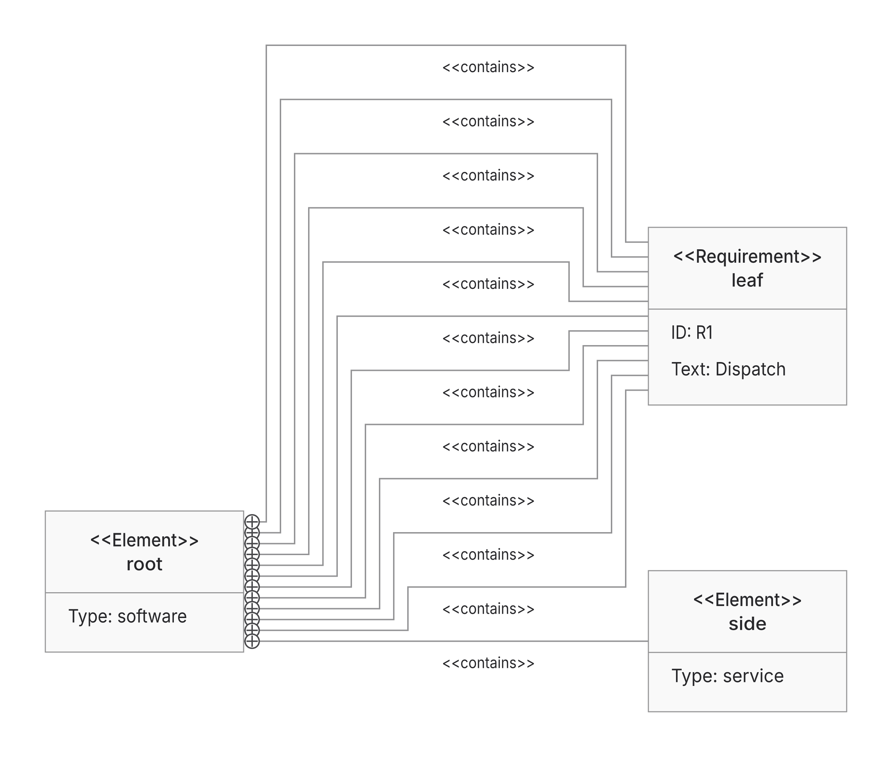
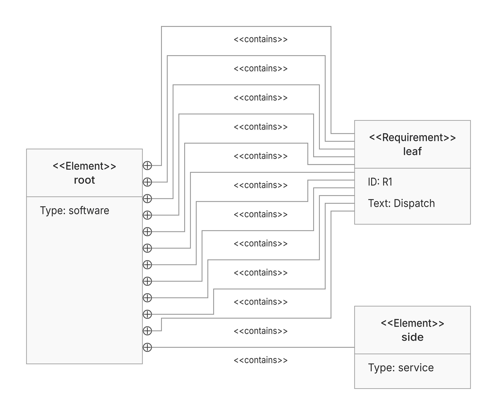
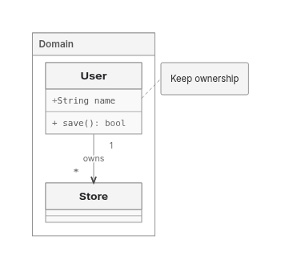
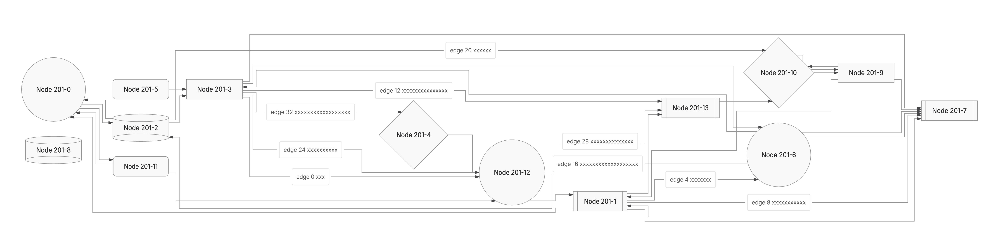

This PR preserves PR449’s SVG ownership/capture foundation, repairs shared ER delivery and selected Native layouts, and adds a common measured-layout interface with opt-in Trinity.

**Draft: retain ELK. Current-head CI is running; the previous completed CI failed.** Trinity is a bounded alternative; this PR does not qualify ELK retirement or change backend defaults, versions or existing limits.

Source head: `0597c632ffed2ae04909c13193635bf524d89d18`. Frozen-30 timing source: `3f2c26bd860eadcfb48746eabb45801ab8e07c7a`; integrated main: `e7cb05baa7f68154942a9ce9c6e9aaaee163dc94`. Campaign deadline: **9 November 2026 at 20:00 UTC / 8pm London**. Normal commits/pushes preserve history; old automations remain off.

## What changes

- Retain actual SVG-write ownership through capture, immutable snapshots and final paint proof. Mutable/getter/CSS/definitions and operation ownership remain distinct; helper passes do not establish visible correctness.
- Reuse the shared ER finalizer’s call-local glyph/shaft snapshot and cardinality lookup. ER256 now delivers through Native and ELK in all four directions at the original 400k geometry limit. Previously refused BT/RL use 385,344 Native / 371,874 ELK operations; returned TB/LR controls fall 397,206→343,421 Native and 384,466→330,681 ELK. Refused work receives no completed timing ratio.
- Seat crowded ordinary rectangle/subroutine endpoint heads with separate measured marker/shaft supports and retain numeric foreign-node clearance during shortening. Explicit invisible constraints now retain topology/order/ports while consuming zero endpoint paint demand; positive/unknown visible support and all caps remain. These Native repairs are distinct from the Trinity work.
- Improve Native component packing and forest seating; shared consumers reuse producer-measured bodies and consume permitted growth instead of resizing only a shell.
- Introduce a common measured request/result boundary for placement and routing, finite geometry, authored correspondence and fixed/minimum bodies. Families own measurement, paint supports and final emission. Native keeps its private search/cache ownership.
- Add real, uncached Trinity local solves via `graphLayout: { backend: 'trinity' }`. Nested Flowchart/State scopes and Class namespaces reuse shared sizing/lifting/boundary routing while Trinity solves locally. Class completion retains members, notes, labels, cardinalities and marker meaning.
- Share exact complete license texts across standalone codec/worker notices after unchanged collection/read budgets. This saves 4,243 gzip bytes; executable bytes and all HTML outside inert notices remain exact.

Trinity admits bounded rectangular/rounded Flowchart and State, fixed State start/end circles, canonical Class scopes, flat ER and Requirement. Routed admission remains 64 subjects / 128 edges; single-container Architecture uses body placement under the separate 4096-node / 16384-edge forest admission. Admission does not guarantee delivery. Interfaces, custom/unknown paint and controlled images remain unsupported. Fallback must be explicit; exhausted work and engine defects remain hard errors.

## Correctness and delivery

| Frozen 30 original inputs | ELK | Native | Trinity |
| --- | ---: | ---: | ---: |
| Returned / proof-passed | 28 | 28 | 27 |
| Unsupported image | 0 | 0 | 1 |
| Shared invalid API inputs | 2 | 2 | 2 |

The image row exposes a shared emission gap: Native/ELK return a vector placeholder whose independent embedded-image criterion fails; Trinity declines. Returned/proof-passed is not complete visible correctness. The unchanged 613-criterion authored-meaning/finalSVG ledger is ELK 575P/6U/29 blocked/3 failed, Native 576/6/28/3, Trinity 564/19/28/2. Common parser/prelude credit is not selected-solver delivery; unknowns remain.

Trinity frozen delivery rose 24→26 with nested Flowchart/State, then 26→27 with Class namespaces/members/cardinality/notes. The Class milestone reacquired 15 products: 14 prior SVGs exact and one new Trinity return; existing actual finalSVG observers find no failed checks. Shared body-growth consumers and labelled cross-group shaft reconnection also preserve descendant connectivity.

Selected Native improvements are dated comparisons, not fresh all-workload rankings: forest wire 700.04→397.71 versus ELK 396.47, area 226,466→165,356 versus ELK 176,727; Class2 area 85,680→65,400 versus ELK 61,400. [Retained comparison scope](https://github.com/adewale/agentic-mermaid/blob/fb8258f17fadf2996e15aa4c82a0973b1cefae4f/rebase-c366-reconsider-20261107/README.md).

Quality remains mixed. Current Class scope area/wire is ELK 142,237/137.3, Native 121,274/77.3, Trinity 117,311/61, all with zero relationship bends/crossings/overlaps; Trinity SVG gzip 1,929 exceeds ELK 1,928 and Native 1,924. Supplemental fan-in delivers in all four Trinity directions, but TB crossings remain 29 versus ELK 13, with smaller area 293,974 versus 509,479. [Fan-in output/cost scope](https://github.com/adewale/agentic-mermaid/blob/c06e199f462b5e2b2241d395cfc2cc25469c1db5/trinity-shaft-checkpoint-20261109/README.md).

Current qualification corrects the obsolete blanket contact list: base152/372/201/241 all return/proof-pass. Selected marginal ink is clear:152 has183/183 visible shaft pixels,372 has122/122,241 has257/257;201’s full SVG matches its retained repaired261/261 head observation. These finite checks requalify existing code, including committed3b737e930’s repairs; they are not new runtime fixes or whole-diagram parity. The separately retained201 variant with three `n0 ~~~ n7` constraints is now reproduced and repaired in Native LR, with RL regression coverage. Its private face has38.5px demand in36.9px; removing three phantom1px invisible shafts leaves35.5px. All30 directed pairs among six selected heads have zero hidden/attenuated pixels after the fix; baseline’s worst pair has36 hidden/49 attenuated. Node geometry, area,80 bends and10 crossings are exact; wire15760.07→15749.37. ELK still returns/U for this input; Trinity refuses its unsupported shapes. TB/BT retain a separate head/filled-label-halo warning. [Actual source, traces, masks, full products and costs](https://github.com/adewale/agentic-mermaid/blob/b3e43efe002485c0315ba695ff27c107c0ffa3dd/trinity-invisible-span-checkpoint-20261109/README.md). [Current source bindings, actual masks and scope](https://github.com/adewale/agentic-mermaid/blob/7a4ff6535d1de28e4fb5adf36664cd52691f1553/trinity-contact-claims-checkpoint-20261109/README.md).

## Complete-product performance

Historical full-cohort source3f2c26bd8 (before the separate0597 Requirement supplement below), first complete frozen-30 cost acquisition: **360 serial fresh Node24 processes, 1,248 timed attempts: 1,140 returned/proof-passed, 96 invalid-option errors and 12 Trinity image refusals.** Exact sources/options, literal preludes and original authored edits remain. Whole SVG and entire receipt serialization are inside the windows; import, explicit GC, writes/compression and cache audits are outside. Sampling and timed observers are off. Two replicas/cell are descriptive, not p95 or stable speed ratios.

Cache0 repeat2 median ms on the six portable inputs; other derived caches remain live:

| Family | ELK | Native | Trinity |
| --- | ---: | ---: | ---: |
| Flowchart | 66.67 | 24.34 | 31.91 |
| State | 45.76 | 48.15 | 32.01 |
| Class | 36.46 | 24.36 | 29.56 |
| ER | 44.10 | 29.99 | 18.56 |
| Architecture | 45.31 | 27.54 | 22.12 |
| Requirement | 43.88 | 26.95 | 24.78 |

Cached workflows retain adverse costs: Flowchart repeat2/edit2 ELK 5.24/15.26ms versus Trinity 7.43/31.09; Architecture 19.66/19.06 versus 63.65/47.68. Nested-State Trinity first-target cache0 ranges 261–2,967ms versus ELK 530–610; its repeat ranges overlap. A first target after a prelude is preconditioned, not cold startup. Shared measurement/capture/emission costs are included; these are not isolated kernels.

All 332 original SVGs match previously observed products, 664 returned repeats preserve full SVG/receipt, and 72 returned edit pairs are exact. This validates unchanged output, not new correctness coverage or an optimization. Process lifetime RSS includes import/harness/artifact work; heap snapshots are not peaks, settled retention or leak evidence. Six generic geometry rows remain explicitly unknown for note/generated-endpoint correspondence.

[Full per-input cold/first-target, cache, edit, CPU, RSS/heap, geometry and actual compressed-product report; raw archive and reproduction](https://github.com/adewale/agentic-mermaid/blob/86869bd66c21f73db5c33928c242ed7a9b50186b/trinity-frozen-cost-checkpoint-20261109/README.md).

The endpoint repair has a separate24-call before/after cost check at7b95:12 returned/U→12 returned/P. Cache0 first/repeat1/repeat2 median ms640.88/331.03/241.60→662.05/302.90/274.61; repeat2 ranges overlap. Cache1 lifetimeRSS is adverse196.85–207.77→211.92–262.11MiB. Two process replicas per cell establish no stable speed or memory gain. SVG Brotli grows2bytes; complete SVG+receipt Brotli falls103bytes as warnings disappear. Detailed CPU/ranges/heap and actual compressed streams remain in the endpoint evidence.

## Distribution costs

Equal 13-input observed lazy browser union at current runtime `0597c632ffed2ae04909c13193635bf524d89d18`:

| Fetched renderer product | ELK | Native | Trinity |
| --- | ---: | ---: | ---: |
| gzip9 bytes | 857,700 | 485,445 | 477,702 |
| Brotli11 bytes | 688,369 | 416,359 | 409,356 |
| Requests including binding | 41 | 47 | 48 |

The shared Requirement milestone adds1,374gzip/1,233Brotli bytes per union versus exact7b95; all3browser lanes pass and request counts stay unchanged. Files were served raw and compressed after observation; this is not compressed-wire/startup performance. Actual SVG+receipt JSON gzip/Brotli streams are separately retained in the frozen-cost report; several Trinity response sizes are slightly adverse.

Standalone editor gzip 1,342,694→1,338,451 (−4,243), Brotli 1,282,743→1,281,956 (−787). **The original 1,334,500 gzip ceiling still fails by 3,951.** All 637 distinct nonblank notice lines and complete maintained license bodies remain; worker/facade and outside-notice HTML bytes are exact. [Notice evidence](https://github.com/adewale/agentic-mermaid/blob/a4cd4ab60afcb4418ac623f90c0748da7eb1355a/trinity-editor-notice-checkpoint-20261109/README.md).

A later Native label-placement prototype clears two selected TB/BT head/halo contacts, but remains unshipped: it adds another repair phase and933 gzip /842 Brotli bytes to each browser union without improving Trinity delivery. A global reservation alternative introduced actual new head loss and was stopped. Source and prior local editor bytes are restored; [the prototype, stopped probes and costs are retained](https://github.com/adewale/agentic-mermaid/blob/892dee0a790db96aa60671ecff1c736e80c62cc7/trinity-label-halo-prototype-checkpoint-20261109/README.md).

Canonical sharp-shaft Requirement diagrams now produce the same physical request for all three backends. ELK consumes endpoint supports through centered ports, spacing and permitted body growth; occurrence IDs preserve correspondence. Only selected dimensions publish to emission. CSS-dependent strokes and rounded shafts retain existing Native/ELK family paths. The old internal adapters had disjoint input domains; public rendering already worked through separate requests, so convergence alone is not a delivery gain.

The shared demand also repairs a real ELK failure: twelve-containment fans in all four directions return/proof-unverified→passed. Actual circles need11px separation; nearest centers7.67px(LR/RL)/10.77px(TB/BT) become20px. Selected worst LR/RL marginal ink180hidden/198attenuated→0/0; all eight selected directed pair masks clear. ELK LR area337038.54→301441.65 and wire6286.25→4862.92, retaining42bends. Other inputs retain adverse area up to3.85% and wire20.25%. Trinity delivery scope is unchanged. [Same-input products, actual masks, all quality vectors and complete costs](https://github.com/adewale/agentic-mermaid/blob/91400dc282c7717ffa9bf658c83351969dc679de/trinity-common-requirement-checkpoint-20261109/README.md).

Current portable Requirement comparison, full public SVG+entire receipt, source0597c632f. Two process replicas/cell; times are descriptive medians, not stable ratios or p95:

| Same authored Requirement input | ELK | Native | Trinity |
| --- | ---: | ---: | ---: |
| Delivery / proof | returned / passed | returned / passed | returned / passed |
| Area | 136,232.59 | 115,615.32 | 110,268.65 |
| Wire / bends / crossings | 174.30 /0/0 | 96.30 /0/0 | 72.75 /0/0 |
| First target, cache0, ms; import separate | 329.61 | 129.78 | 152.11 |
| Repeat2 cache0, ms | 44.19 | 22.41 | 27.81 |
| Repeat2 cache1, ms | 19.27 | 19.63 | 19.66 |
| Lifetime RSS at cache0repeat2, MiB | 176.98–188.03 | 159.37–184.22 | 182.61–183.34 |
| Complete response gzip9 / Brotli11 bytes | 2,593 /2,224 | 2,593 /2,217 | 2,606 /2,230 |

RSS includes loader/import/inspector/artifacts; heap is not peak or settled retention. Original authored-edit workflow cache1edit2 medians are ELK15.04, Native15.35, Trinity18.43ms. This64-process/240-call before/after supplement retains216P/24before-fixU; all128returned repeat products are exact. Portable uncached repeat2 before→after medians ELK39.52→44.19, Native21.14→22.41, Trinity19.73→27.81; costs are mixed. Native preconditioned repeat2 has an adverse132.85ms outlier alongside19.08ms, versus before20.24–20.63. A bounded profile did not recapture it; its cause remains unattributed and the original sample remains. No speed/memory gain claimed. All240actual response streams match timed serialization and decode exactly.

## Visual evidence

Requirement containment repair, same twelve-occurrence LR source. Baseline7b95d18053f605ae1574406e377cb8dd29c919b0; current0597c632ffed2ae04909c13193635bf524d89d18. Full actualSVG rasters, owned Inter; the selected masks above qualify the named circles.

Baseline SHA: `96d10ff9551f88178c4262acda5219e11926ccdf`.
Current SHA: `0597c632ffed2ae04909c13193635bf524d89d18`. The Class render was introduced at4db8570d; its frozen SVG remains byte-exact at the current head.

Before: Trinity refuses this namespace/member/cardinality/note input, so no before SVG exists. After: the actual SVG retains the frame, cards, member/method text, labelled ownership, cardinalities and note.

Same-input [ELK](https://raw.githubusercontent.com/adewale/agentic-mermaid/196763ac987d368398615669cdcdb265873ce974/trinity-class-scopes-checkpoint-20261109/elk-class-scopes.png) and [Native](https://raw.githubusercontent.com/adewale/agentic-mermaid/196763ac987d368398615669cdcdb265873ce974/trinity-class-scopes-checkpoint-20261109/agentic-class-scopes.png). [Class implementation, verification and earlier complete-product scope](https://github.com/adewale/agentic-mermaid/blob/b1b3a397155559016b1a15a912ab30648dd04a7b/trinity-class-scopes-checkpoint-20261109/README.md).

Endpoint example, same exact SHA201 plus three invisible constraints, inspect the six arrowheads on the right at n7. Before source: `af92dd1473cb7e4e5b7e5cf75856d7506a34a807`; after source: `7b95d18053f605ae1574406e377cb8dd29c919b0`. These are complete actual SVG rasters with manifest-verified Inter, system fonts off; pair masks qualify the selected region, not the entire drawing.

## Verification and limits

Common Requirement owners:515nearbyP,55RequirementP, final measured18P; exact7b95overrides fail ten strengthened owners while three controls pass. Core/repo types and lint pass. Final guards retain all60candidate products exact. Frozen90 retains83returns/six original bad-option errors/one Trinity image refusal, with five Requirement SVG changes and unchanged delivery/proof. Existing Trident observes12affectedSVGs: no failed checks; ELK47P/1existing ownership-unavailable, Native48P, Trinity48P. Five sandbox child-stdin failures and initial esbuildEPERM are retained; permitted retries pass. Independent scope/value review finds no blocker. These are affected checks, not new whole-diagram parity.

The original endpoint core fails the strengthened LR/RL hidden cases; current native-cache/layered/Trinity owners263P, core/repo types and lint pass. All874 enrolled Native SVG/delivery/proof statuses stay exact (740P/134U); all83 returned frozen-cohort SVGs also stay exact, with six invalid API calls and one image refusal retained. Extra visibility reads are charged without raising limits. Independent scope review finds no blocker. These unchanged cases validate the repair, not874 new gains.

Old Class producer fails five new owners; Class owners156P. Old notice producer fails its owner; current codec/notice owners13P. Core/repo types, lint, editor/lazy builds and browser binding pass at their recorded milestones. Nearby Class qualification retained five sandbox child-stdin failures, then ten permitted retries covered all five. Full suite runs in CI.

Measured-runtime-source [CI42552670015](https://github.com/adewale/agentic-mermaid/actions/runs/42552670015) completed with failure: Sparse32 emitted-proof owner, lazy-family size ceilings, demo payload and generated advisory. Unit shards2/3, browser-site, package/CLI, renderer isolation and semantic/MCP lanes pass. Demo gzip313,753 exceeds302,500. Previous-head [CI42565636119](https://github.com/adewale/agentic-mermaid/actions/runs/42565636119) completed with failure: unit shard1/3, quality gates, payload checks and generated advisory. Unit shards2/3, browser/site, package/CLI, renderer isolation and semantic/MCP lanes passed. New-head [CI42582780904](https://github.com/adewale/agentic-mermaid/actions/runs/42582780904) is running; Ruff/action-pinning pass. No readiness claim.

Five measured hotspots, self/inclusive distinction, existing caches and stopped candidates are in [the performance review](https://github.com/adewale/agentic-mermaid/blob/7834513e894fadf61da913c699b3a94ed6f104d4/docs/design/system/layout-0.6-performance-review.md). Heap, XML streaming/bitset, header-height and source-group ordering trials did not establish a safe general gain; they remain unshipped. [Retained quality trials](https://github.com/adewale/agentic-mermaid/blob/43ac28c44cd785f6d79f56a5684cb955f2120533/trinity-quality-trials-final-checkpoint-20261109/README.md).

Actual image emission, broader Trinity capacity/domains, the separate TB/BT marker-versus-filled-label-halo warning, other unverified outputs, historical crossing276, Sparse32 and resource losses remain. Sparse256’s implemented historical area gap is +5.04%; +0.97% backfill is unshipped. Original2dad baseline and equivalent pinned Pele runtime remain unavailable. Replacement24 stays sealed; adoption/retirement remain deferred.
