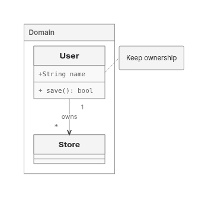

This PR preserves PR449’s SVG ownership/capture foundation, repairs shared ER delivery and selected Native layouts, and adds a common measured-layout interface with opt-in Trinity.

**Draft: retain ELK. Exact-head CI fails.** Trinity is a bounded alternative; this PR does not qualify ELK retirement or change backend defaults, versions or existing limits.

Measured source: `3f2c26bd860eadcfb48746eabb45801ab8e07c7a`; integrated main: `e7cb05baa7f68154942a9ce9c6e9aaaee163dc94`. Campaign deadline: **9 November 2026 at 20:00 UTC / 8pm London**. Normal commits/pushes preserve history; old automations remain off.

## What changes

- Retain actual SVG-write ownership through capture, immutable snapshots and final paint proof. Mutable/getter/CSS/definitions and operation ownership remain distinct; helper passes do not establish visible correctness.
- Reuse the shared ER finalizer’s call-local glyph/shaft snapshot and cardinality lookup. ER256 now delivers through Native and ELK in all four directions at the original 400k geometry limit. Previously refused BT/RL use 385,344 Native / 371,874 ELK operations; returned TB/LR controls fall 397,206→343,421 Native and 384,466→330,681 ELK. Refused work receives no completed timing ratio.
- Improve Native component packing and forest seating; shared consumers reuse producer-measured bodies and consume permitted growth instead of resizing only a shell.
- Introduce a common measured request/result boundary for placement and routing, finite geometry, authored correspondence and fixed/minimum bodies. Families own measurement, paint supports and final emission. Native keeps its private search/cache ownership.
- Add real, uncached Trinity local solves via `graphLayout: { backend: 'trinity' }`. Nested Flowchart/State scopes and Class namespaces reuse shared sizing/lifting/boundary routing while Trinity solves locally. Class completion retains members, notes, labels, cardinalities and marker meaning.
- Share exact complete license texts across standalone codec/worker notices after unchanged collection/read budgets. This saves 4,243 gzip bytes; executable bytes and all HTML outside inert notices remain exact.

Trinity admits bounded rectangular/rounded Flowchart and State, fixed State start/end circles, canonical Class scopes, flat ER and Requirement. Routed admission remains 64 subjects / 128 edges; single-container Architecture uses body placement under the separate 4096-node / 16384-edge forest admission. Admission does not guarantee delivery. Interfaces, custom/unknown paint and controlled images remain unsupported. Fallback must be explicit; exhausted work and engine defects remain hard errors.

## Correctness and delivery

| Frozen 30 original inputs | ELK | Native | Trinity |
| --- | ---: | ---: | ---: |
| Returned / proof-passed | 28 | 28 | 27 |
| Unsupported image | 0 | 0 | 1 |
| Shared invalid API inputs | 2 | 2 | 2 |

The image row exposes a shared emission gap: Native/ELK return a vector placeholder whose independent embedded-image criterion fails; Trinity declines. Returned/proof-passed is not complete visible correctness. The unchanged 613-criterion authored-meaning/finalSVG ledger is ELK 575P/6U/29 blocked/3 failed, Native 576/6/28/3, Trinity 564/19/28/2. Common parser/prelude credit is not selected-solver delivery; unknowns remain.

Trinity frozen delivery rose 24→26 with nested Flowchart/State, then 26→27 with Class namespaces/members/cardinality/notes. The Class milestone reacquired 15 products: 14 prior SVGs exact and one new Trinity return; existing actual finalSVG observers find no failed checks. Shared body-growth consumers and labelled cross-group shaft reconnection also preserve descendant connectivity.

Selected Native improvements are dated comparisons, not fresh all-workload rankings: forest wire 700.04→397.71 versus ELK 396.47, area 226,466→165,356 versus ELK 176,727; Class2 area 85,680→65,400 versus ELK 61,400. [Retained comparison scope](https://github.com/adewale/agentic-mermaid/blob/fb8258f17fadf2996e15aa4c82a0973b1cefae4f/rebase-c366-reconsider-20261107/README.md).

Quality remains mixed. Current Class scope area/wire is ELK 142,237/137.3, Native 121,274/77.3, Trinity 117,311/61, all with zero relationship bends/crossings/overlaps; Trinity SVG gzip 1,929 exceeds ELK 1,928 and Native 1,924. Supplemental fan-in delivers in all four Trinity directions, but TB crossings remain 29 versus ELK 13, with smaller area 293,974 versus 509,479. [Fan-in output/cost scope](https://github.com/adewale/agentic-mermaid/blob/c06e199f462b5e2b2241d395cfc2cc25469c1db5/trinity-shaft-checkpoint-20261109/README.md).

## Complete-product performance

First complete frozen-30 cost acquisition: **360 serial fresh Node24 processes, 1,248 timed attempts: 1,140 returned/proof-passed, 96 invalid-option errors and 12 Trinity image refusals.** Exact sources/options, literal preludes and original authored edits remain. Whole SVG and entire receipt serialization are inside the windows; import, explicit GC, writes/compression and cache audits are outside. Sampling and timed observers are off. Two replicas/cell are descriptive, not p95 or stable speed ratios.

Cache0 repeat2 median ms on the six portable inputs; other derived caches remain live:

| Family | ELK | Native | Trinity |
| --- | ---: | ---: | ---: |
| Flowchart | 66.67 | 24.34 | 31.91 |
| State | 45.76 | 48.15 | 32.01 |
| Class | 36.46 | 24.36 | 29.56 |
| ER | 44.10 | 29.99 | 18.56 |
| Architecture | 45.31 | 27.54 | 22.12 |
| Requirement | 43.88 | 26.95 | 24.78 |

Cached workflows retain adverse costs: Flowchart repeat2/edit2 ELK 5.24/15.26ms versus Trinity 7.43/31.09; Architecture 19.66/19.06 versus 63.65/47.68. Nested-State Trinity first-target cache0 ranges 261–2,967ms versus ELK 530–610; its repeat ranges overlap. A first target after a prelude is preconditioned, not cold startup. Shared measurement/capture/emission costs are included; these are not isolated kernels.

All 332 original SVGs match previously observed products, 664 returned repeats preserve full SVG/receipt, and 72 returned edit pairs are exact. This validates unchanged output, not new correctness coverage or an optimization. Process lifetime RSS includes import/harness/artifact work; heap snapshots are not peaks, settled retention or leak evidence. Six generic geometry rows remain explicitly unknown for note/generated-endpoint correspondence.

[Full per-input cold/first-target, cache, edit, CPU, RSS/heap, geometry and actual compressed-product report; raw archive and reproduction](https://github.com/adewale/agentic-mermaid/blob/86869bd66c21f73db5c33928c242ed7a9b50186b/trinity-frozen-cost-checkpoint-20261109/README.md).

## Distribution costs

Equal 13-input observed lazy browser union at runtime `4db8570d389246bb5f1eede8c5b1899fe6cd687e`:

| Fetched renderer product | ELK | Native | Trinity |
| --- | ---: | ---: | ---: |
| gzip9 bytes | 856,327 | 484,054 | 476,329 |
| Brotli11 bytes | 687,180 | 415,162 | 408,167 |
| Requests including binding | 41 | 47 | 48 |

Files were served raw and compressed after observation; this is not compressed-wire/startup performance. Actual SVG+receipt JSON gzip/Brotli streams are separately retained in the frozen-cost report; several Trinity response sizes are slightly adverse.

Standalone editor gzip 1,342,694→1,338,451 (−4,243), Brotli 1,282,743→1,281,956 (−787). **The original 1,334,500 gzip ceiling still fails by 3,951.** All 637 distinct nonblank notice lines and complete maintained license bodies remain; worker/facade and outside-notice HTML bytes are exact. [Notice evidence](https://github.com/adewale/agentic-mermaid/blob/a4cd4ab60afcb4418ac623f90c0748da7eb1355a/trinity-editor-notice-checkpoint-20261109/README.md).

## Visual evidence

Baseline SHA: `96d10ff9551f88178c4262acda5219e11926ccdf`.
Current SHA: `4db8570d389246bb5f1eede8c5b1899fe6cd687e`; current measured 3f2 SVGs are byte-exact.

Before: Trinity refuses this namespace/member/cardinality/note input, so no before SVG exists. After: the actual SVG retains the frame, cards, member/method text, labelled ownership, cardinalities and note.

Same-input [ELK](https://raw.githubusercontent.com/adewale/agentic-mermaid/196763ac987d368398615669cdcdb265873ce974/trinity-class-scopes-checkpoint-20261109/elk-class-scopes.png) and [Native](https://raw.githubusercontent.com/adewale/agentic-mermaid/196763ac987d368398615669cdcdb265873ce974/trinity-class-scopes-checkpoint-20261109/agentic-class-scopes.png). [Class implementation, verification and earlier complete-product scope](https://github.com/adewale/agentic-mermaid/blob/b1b3a397155559016b1a15a912ab30648dd04a7b/trinity-class-scopes-checkpoint-20261109/README.md).

## Verification and limits

Old Class producer fails five new owners; Class owners156P. Old notice producer fails its owner; current codec/notice owners13P. Core/repo types, lint, editor/lazy builds and browser binding pass at their recorded milestones. Nearby Class qualification retained five sandbox child-stdin failures, then ten permitted retries covered all five. Full suite runs in CI.

Exact-source [CI42552670015](https://github.com/adewale/agentic-mermaid/actions/runs/42552670015) completed with failure: Sparse32 emitted-proof owner, lazy-family size ceilings, demo payload and generated advisory. Unit shards2/3, browser-site, package/CLI, renderer isolation and semantic/MCP lanes pass. Demo gzip313,753 exceeds302,500. No readiness claim.

Five measured hotspots, self/inclusive distinction, existing caches and stopped candidates are in [the performance review](https://github.com/adewale/agentic-mermaid/blob/7834513e894fadf61da913c699b3a94ed6f104d4/docs/design/system/layout-0.6-performance-review.md). Heap, XML streaming/bitset, header-height and source-group ordering trials did not establish a safe general gain; they remain unshipped. [Retained quality trials](https://github.com/adewale/agentic-mermaid/blob/43ac28c44cd785f6d79f56a5684cb955f2120533/trinity-quality-trials-final-checkpoint-20261109/README.md).

Actual image emission, broader Trinity capacity/domains, adverse contacts152/372/201/241, crossing276, Sparse32 and resource losses remain. Sparse256’s implemented historical area gap is +5.04%; +0.97% backfill is unshipped. Original2dad baseline and equivalent pinned Pele runtime remain unavailable. Replacement24 stays sealed; adoption/retirement remain deferred.
