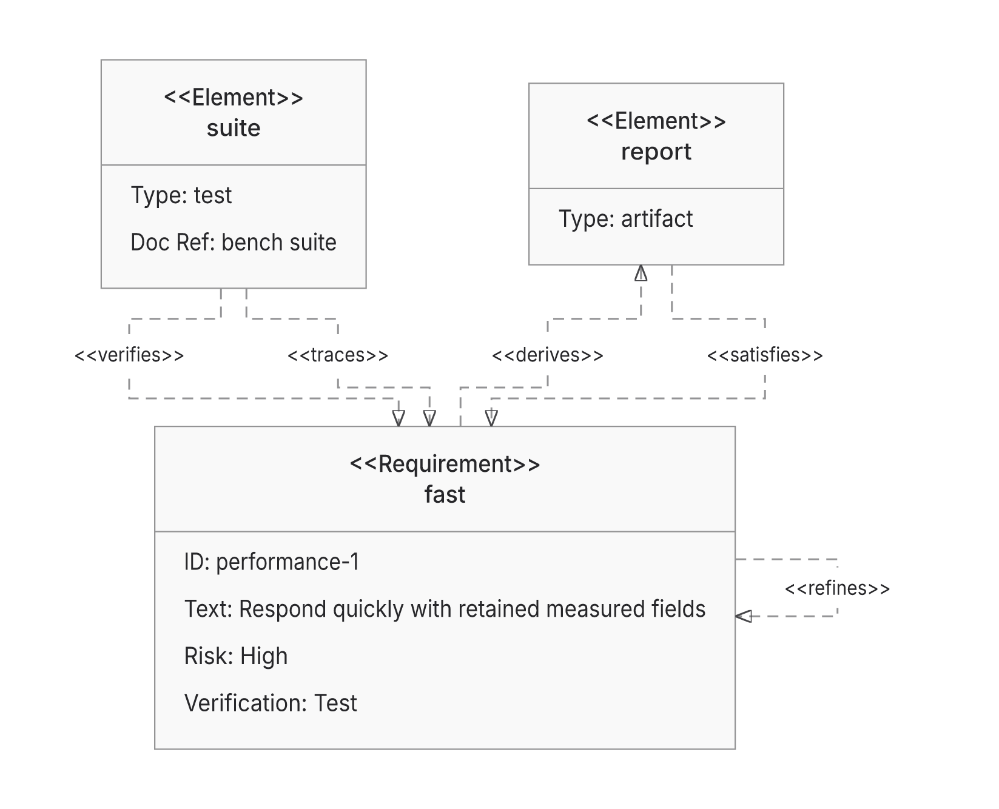
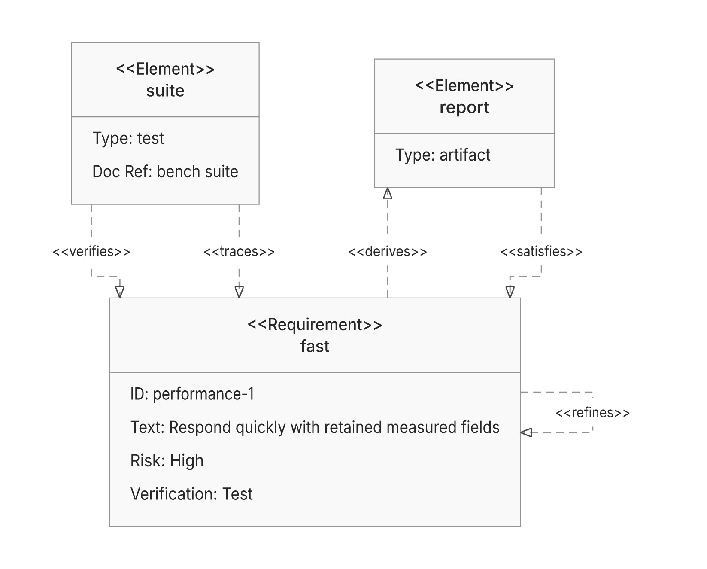

## What changes

**Draft; retain ELK.** Head `705db8562b7b9729e71e78ebf0da94e6991342f0`, base `e7cb05baa7f68154942a9ce9c6e9aaaee163dc94`. This PR adds opt-in Trinity and repairs shared measurement/paint ownership. It does not qualify ELK retirement or change backend defaults, versions or existing limits. Omitted Flowchart layout retains the forest fast path already present in main.

- Bind SVG proof to actual writes and occurrence ownership, preserving mutable/getter/CSS/definitions and resource boundaries.
- Reuse call-local ER measurements/finalization so ER256 delivers through Native and ELK in all four directions at the original400k geometry limit. Previously refused BT/RL complete at385,344 Native/371,874 ELK operations; refused work gets no runtime ratio.
- Repair Native endpoint capacity, invisible constraints' phantom paint demand, shortening clearance, component packing and forests. These are separate from Trinity delivery.
- Add a neutral measured request/result boundary, actual selected-backend evidence and uncached Trinity. Supported family scope is bounded Flowchart/State rectangles/rounded bodies and fixed State circles, canonical Class scopes with members/notes/cardinalities, flat ER/Requirement and single-container Architecture forests. Routed admission remains64subjects/128edges; Architecture's existing placement slice is separate. Unsupported styles/domains decline unless fallback is explicit; work exhaustion stays hard.
- Make canonical sharp-shaft Requirement produce the same physical request for all three solvers. ELK translates endpoint supports to centered ports, spacing and permitted growth; emitted cards consume only selected dimensions. Unknown CSS/rounded shafts retain existing family paths. This also separates twelve crowded ELK containment circles in all four directions: nearest centers7.67/10.77→20px versus11px needed; selected worst pair180hidden→0. [Shared-demand repair and costs](https://github.com/adewale/agentic-mermaid/blob/91400dc282c7717ffa9bf658c83351969dc679de/trinity-common-requirement-checkpoint-20261109/README.md).
- Project flat-root Trinity contacts toward reserved neighbor lanes before channel allocation, reusing Native's scalar clamp. The demonstrated Requirement TB case changes18→6bends, wire1072.96→507.03, area244079.95→242350.83, with zero crossings. Both roles share body positions; compound locals retain centered contacts because their external corridors are absent from local IR.

The wider port-projection trial introduced three compound fan-in refusals and was stopped. All ten previously returned compound products are exact under the final policy; two prior Native refusals remain. The separate Native label-gap prototype also stays unshipped: it added933gzip bytes per browser union without improving Trinity delivery. No late repair phase or new cache ships.

## Correctness and delivery

| Frozen30 original inputs | ELK | Native | Trinity |
| --- | ---: | ---: | ---: |
| Returned / proof-passed | 28 | 28 | 27 |
| Unsupported image | 0 | 0 | 1 |
| Shared invalid-option errors | 2 | 2 | 2 |

These delivery/proof vectors are requalified and unchanged by the latest milestone. Native/ELK's image return is a vector placeholder whose actual-image criterion fails; proof-passed is not complete visible correctness. The retained613-criterion authored-meaning/finalSVG ledger is ELK575passed/6unsupported/29blocked/3failed, Native576/6/28/3, Trinity564/19/28/2. All19Trinity unsupported criteria refer to one controlled-image input. Common parser/prelude credit is separate from selected-solver delivery.

Trinity delivery rose24→26 through nested Flowchart/State, then26→27 through Class scopes. The latest flat-contact change adds no delivery domain: all60Requirement products stay proof-passed,40Native/ELK SVGs exact,15Trinity SVGs change. On these20inputs area falls0–2.14%/wire0–53.10%, with no increases in those two vectors. Frozen90cells retain83returns/six original errors/one image refusal; only two Trinity SVGs change. Existing Trident observes25passed paint checks on those two. Finite checks and unchanged validation do not establish whole-diagram parity.

Earlier scoped gains remain dated: Native forest wire700.04→397.71 versus ELK396.47, area226466→165356 versus176727; Sparse256's implemented historical area gap is+5.04%, not+115.35%. The+0.97% backfill remains unshipped. [Prior comparison scope](https://github.com/adewale/agentic-mermaid/blob/fb8258f17fadf2996e15aa4c82a0973b1cefae4f/rebase-c366-reconsider-20261107/README.md). [Native invisible-demand actual heads/costs](https://github.com/adewale/agentic-mermaid/blob/b3e43efe002485c0315ba695ff27c107c0ffa3dd/trinity-invisible-span-checkpoint-20261109/README.md).

## Current three-way measured comparison

Same cyclic Requirement TB input and measured demand; complete public SVG+entire receipt consumed. Two fresh processes/cell; medians are descriptive, with no stable ratio/p95 claim. Other directions, CPU/time ranges and all raw samples are in [the current comparison](https://github.com/adewale/agentic-mermaid/blob/004cc22d0c46d053a708a95d5a6cf92f5ada74d5/trinity-root-ports-checkpoint-20261109/CURRENT-THREE-WAY.md) and [raw evidence](https://github.com/adewale/agentic-mermaid/blob/004cc22d0c46d053a708a95d5a6cf92f5ada74d5/trinity-root-ports-checkpoint-20261109/README.md).

| Metric | ELK | Native | Trinity |
| --- | ---: | ---: | ---: |
| Returned / proof | returned / passed | returned / passed | returned / passed |
| Area | 264,555.83 | 230,692.46 | 242,350.83 |
| Wire / bends / crossings | 1021.17 /10/0 | 671.20 /8/0 | 507.03 /6/0 |
| First target cache0 ms; import separate | 358.63 | 181.49 | 163.02 |
| Repeat2 cache0 ms | 48.37 | 31.00 | 32.24 |
| Repeat2 cache1 ms | 39.49 | 62.65 | 34.35 |
| Lifetime RSS at cache0repeat2 MiB | 176.75–189.43 | 167.62–184.39 | 168.84–183.53 |
| API-return heap at cache0repeat2 MiB | 50.62–50.63 | 39.71–39.91 | 38.55–38.61 |
| Complete response gzip9 / Brotli11 bytes | 3,209 /2,726 | 3,177 /2,693 | 3,167 /2,671 |
| Original frozen authored edit2 cache0 ms | 29.70 | 21.10 | 34.31 |
| Original frozen authored edit2 cache1 ms | 16.82 | 15.67 | 15.54 |

The edit rows use the original frozen prelude/authored-edit Requirement workflow, not an invented edit of the cyclic case.60current-code processes/204calls all return/P;120repeat products are entirely exact. Trinity cells precede the newly acquired interleaved ELK/Native cells, so cohorts are not balanced statistical effects. LifetimeRSS includes loader/import/inspector/artifacts; heap is not peak or settled retention. Cache1 is the existing layout-cache switch; Trinity has no own layout cache and other derived caches remain live. First target after a prelude is preconditioned; import is separate.

Paired Trinity before/after remains mixed: TB cache0repeat2 median36.22→32.24ms, BT32.67→63.10 with a91.51ms sample, LR41.41→29.21, RL30.45→35.50. Original edit2 cache0 is adverse16.51→34.31ms; cache1 is23.24→15.54. No runtime/memory win claimed. All136paired and204current actual response streams match timed serialization and decode exactly. A separate earlier Native132.85ms outlier stays unattributed and retained.

[Historical full frozen30 cost report](https://github.com/adewale/agentic-mermaid/blob/86869bd66c21f73db5c33928c242ed7a9b50186b/trinity-frozen-cost-checkpoint-20261109/README.md), source3f2:360serial processes/1248attempts,1140returned/P,96original invalid-option errors,12image refusals. It retains cold/cache/edit/RSS/heap/actual streams across all families. Cached Flowchart and Architecture costs are adverse for Trinity; current narrow results do not replace that workload scope.

## Distribution cost

Actual13-input lazy browser union; all3lanes pass. Product bytes exclude the separately retained Trident binding:

| Metric | ELK | Native | Trinity |
| --- | ---: | ---: | ---: |
| gzip9 bytes | 857,714 | 485,497 | 477,921 |
| Brotli11 bytes | 688,366 | 416,373 | 409,526 |
| Requests including binding | 41 | 47 | 48 |

Latest milestone gzip grows14/52/219bytes versus0597; the preceding shared-Requirement change added1374gzip/1233Br each. Fetched assets and complete response streams decode exactly. Raw serving/offline compression is not compressed-wire/startup or total-package size. Last measured standalone source3f2 gzip1338451 exceeds the original1334500 cap by3951 despite saving4243gzip bytes through complete-license deduplication. No fresh standalone-editor or full-package size claim in this cycle.

## Visual evidence

Baseline SHA: `0597c632ffed2ae04909c13193635bf524d89d18`.
Current SHA: `705db8562b7b9729e71e78ebf0da94e6991342f0`. Same Requirement source, actual completeSVG rasters, manifest-verified Inter/system fonts off. Node sizes/cross coordinates remain; channel demand changes main-axis positions. Existing output already proof-passed; this is route simplification.

Earlier [Class scope render](https://raw.githubusercontent.com/adewale/agentic-mermaid/196763ac987d368398615669cdcdb265873ce974/trinity-class-scopes-checkpoint-20261109/trinity-class-scopes.png) retains its exact current SVG. [ELK containment before/after and selected masks](https://github.com/adewale/agentic-mermaid/blob/91400dc282c7717ffa9bf658c83351969dc679de/trinity-common-requirement-checkpoint-20261109/README.md).

## Reproduction, verification and remaining losses

Run `bun test src/__tests__/requirement-layout-backends.test.ts src/__tests__/trinity-layout.test.ts src/__tests__/graph-layout-selection.test.ts --timeout 30000` using the repository's pinned Bun. Render `eval/layout-compare/fixtures/requirement-backends.mmd` through `renderMermaidSVGWithReceipt(source, { graphLayout: { backend: 'trinity', fallback: 'none' }, embedFontImport: false })`. Exact before modules, all calls, source traces, stopped probes and stream files are retained in the evidence archive.

Local final owners:178selection/measured/kernelP,110family/measured/kernelP,37kernelP and19other-familyP; counts overlap and are not summed. Core/repo types and lint pass. Old kernel fails four new straight-route owners; stopped global variant fails three existing compound owners. An overbroad sideways assertion and a routed-only probe were corrected/stopped with their failures retained. Unequal reversed endpoint supports fit an exactly full74px rounded face in all directions. Independent review finds no blocker in the final scope/role contract. Full suite runs in CI.

[Current-head CI42588764390](https://github.com/adewale/agentic-mermaid/actions/runs/42588764390) is in progress; Ruff/action-pinning pass. [Previous-head CI42582780904](https://github.com/adewale/agentic-mermaid/actions/runs/42582780904) failed. No readiness claim. Known Sparse32 proof, distribution and advisory losses are unaddressed.

Remaining counterexamples: Native compound fan TB arc refusal/BT no-corridor refusal; Trinity compound fan TB29crossings versus ELK13; controlled images/shared media, broader capacity/domains, separate Native TB/BT marker/halo loss, historical crossing276 and resource costs. Original2dad baseline/equivalent pinned Pele runtime remain unavailable. Replacement24 stays sealed; adoption and retirement are deferred. Next bounded diagnosis is the Native TB compound refusal's provisional-route obstacle ownership, without resuming global port projection.

[Five profiled hotspots, self/inclusive distinction, existing cache inventory and stopped optimization hypotheses](https://github.com/adewale/agentic-mermaid/blob/7834513e894fadf61da913c699b3a94ed6f104d4/docs/design/system/layout-0.6-performance-review.md).
