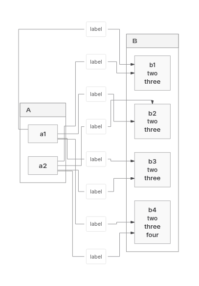

This PR preserves PR449’s SVG ownership/capture foundation, removes the shared ER256 refusal, improves selected Native layouts, and adds a common measured-layout interface with opt-in Trinity.

**Draft: retain ELK.** Frozen delivery is ELK28/Native28/Trinity26 of30. A separately enrolled labelled fan-in that Trinity refused now returns in all four directions. Quality and costs remain mixed; original distribution budgets still fail.

Runtime: `e928a1847ef773058f62e36122780a81fcd928f7`; report commit: `96d10ff9551f88178c4262acda5219e11926ccdf`. Integrated main: `e7cb05baa7f68154942a9ce9c6e9aaaee163dc94`. Normal commits/pushes preserve history. Owner deadline: **9 November2026 at20:00UTC /8pm London**. Old automations remain disabled. No new PR/issues, default/version/work-cap changes or ELK retirement.

## Verified changes

Shared ER finalization reuses its call-local glyph/shaft snapshot and cardinality lookup without changing retained routes. ER256 now delivers in all four directions through Native and ELK at the original 400k geometry limit. Previously refused BT/RL require 385,344 Native / 371,874 ELK operations. Returned TB/LR controls fall from 397,206→343,421 Native and 384,466→330,681 ELK. Refused work is excluded from completed timing ratios.

Earlier pinned-main comparisons retain selected Native improvements: forest wire 700.04→397.71 versus ELK396.47, forest area226,466→165,356 versus ELK176,727, and Class2 area85,680→65,400 versus ELK61,400. These are dated, same-input comparisons against main `c366de0d137e33e123acd84fc99164417c0f3917`, not a fresh all-workload ranking. [Retained comparison scope](https://github.com/adewale/agentic-mermaid/blob/fb8258f17fadf2996e15aa4c82a0973b1cefae4f/rebase-c366-reconsider-20261107/README.md).

The common interface distinguishes measured placement from routed results and enforces finite geometry, authored correspondence and fixed/minimum body policy. Family producers retain shape/text/marker measurement and final emission. Native retains its private search, cache and work ownership.

Trinity is a real, uncached local solver selected by `graphLayout: { backend: 'trinity' }`. It now supports bounded rectangular/rounded Flowchart and State with nested scopes, fixed State start/end circles, flat Class/ER cards and Requirement. Routed admission is64subjects/128edges. Single-container Architecture uses body placement under the separate4096node/16384edge forest admission. Admission limits do not guarantee delivery for every graph inside them. Unsupported constraints decline; fallback requires an explicit request, and exhausted work/engine defects remain hard errors.

The earlier nested migration reproduces two frozen nested refusals, then reuses scope sizing/lifting/boundary routing with **Trinity local solves**, without invoking Native’s solver or search flags. Actual frame paint, header minima and endpoint supports reach placement. Child frames stay fixed after bottom-up sizing. The first fixed-leaf trial failed LR/RL capacity; permitted growth exposed shared consumers discarding returned dimensions. Scope projection and flat/cross-hierarchy routing boxes now consume the actual grown body. Cumulative work and expansion limits remain unchanged; no cache was added.

## Delivery, meaning and actual ink

| Frozen30 outcome | ELK | Native | Trinity |
| --- | ---: | ---: | ---: |
| Returned / proof-passed |28|28|26|
| Unsupported |0|0|2|
| Shared input errors |2|2|2|

Trinity’s two remaining frozen unsupported inputs are Class namespace/cardinality/note and controlled image. The retained613-criterion Trident ledger is ELK575passed/6unsupported/29blocked/3failed, Native576/6/28/3 and Trinity549/34/28/2. Common parser/prelude credit is not solver delivery; fewer failures can reflect refusal. Authored meaning, proof availability and actual final ink remain separate.

The new supplemental source comes from [Pele PR97](https://github.com/obsidianmd/pele/pull/97): six leaves, two groups, eight labelled edges. It is outside the frozen30. All four Trinity directions return with authored leaf/group identities and eight endpoint/label occurrences preserved. ELK returns all four; Native returns LR/RL and refuses TB/BT, also reproduced with the baseline router. All ten returned SVGs have no failed checks in the existing Trident paint/quantitative observers. This finite observation is not universal replacement qualification.

The shared boundary router had treated temporary bends to ancestor ports as mandatory alongside the actual label shaft. The fix retains that shaft and reconnects actual descendants through existing bounded routing, including border escape offsets and measured terminal/header/peer-contact checks. The new scan spends the existing work ledger. Direct-first search and a diagnostic subtracting18,371 expansion units both still failed; those shortcuts do not ship.

| Actual LR SVG | ELK | Native | Trinity |
| --- | ---: | ---: | ---: |
| Area |269,990|245,660|236,886|
| Wire |3,289.85|2,334.19|2,693.10|
| Bends |64|48|35|
| Crossings |6|13|9|

Adverse TB crossings are ELK13 versus Trinity29; Native refuses. Proper crossings remain visible and counted. Thirty-three of34 retained Native compound SVGs remain exact. The changed flattened Class namespace case retains area220,248, wire640→618 and bends12→6, with passed proof and no failed before/after actual-ink checks. All39 affected frozen-cohort products/outcomes remain exact: validation, not new delivery progress.

## Complete-product performance and distribution

Current runtime, one LR supplemental input, twelve serial fresh Node24 processes, two replicas/backend/cache,60 attempts: **52 returned/proof-passed and eight Native edit refusals**. Full SVG plus entire receipt consumed. Imports, GC, artifact writes and compression sit outside render windows; profiling/observers are off. Cache0 retains existing derived caches. These observations establish no general speed, percentile or memory claim.

| Backend | Cache0 cold / repeat2 / edit2 median ms | Cache1 repeat2 / edit2 median ms |
| --- | --- | --- |
| ELK |625.94 /199.99 /145.75|9.90 /41.99|
| Native |389.01 /192.69 /refused|7.62 /refused|
| Trinity |323.40 /163.59 /127.91|9.69 /49.91|

Native’s refused edits are excluded from completed-work comparisons. Cached edit latency favors ELK. Returned originals repeat exactly; ELK/Trinity edits change and repeat exactly. RSS/heap ranges and CPU/adverse costs are retained in the linked report; snapshots are not heap peaks or leak evidence.

Same12 family/feature browser inputs, actual lazy API, full receipt consumed; all lanes pass:

| Fetched product | ELK | Native | Trinity |
| --- | ---: | ---: | ---: |
| gzip9 bytes |856,357|484,084|476,359|
| Brotli11 bytes |687,192|415,174|408,179|
| Requests including binding |41|47|48|

Files were served raw and compressed after observation: no compressed-network/startup claim. Binding bytes are reported separately. Matched Bun1.4.4 editor gzip1,342,789→1,342,154 (−635), Brotli1,282,069→1,281,810 (−259). **The original1,334,500 gzip ceiling still fails by7,654.**

A pristine nine-attempt profile preceded this repair; five measured frames, self/inclusive distinction and existing cache inventory are recorded in [the performance review](https://github.com/adewale/agentic-mermaid/blob/96d10ff9551f88178c4262acda5219e11926ccdf/docs/design/system/layout-0.6-performance-review.md). Heap/state page Maps are a possible later indexed-directory question, not a shipped optimization or promised speedup. The older45-call completed-product profile remains bound to its own revision.

## Visual evidence

Baseline SHA: `680d01bc579fd4d1ef2b92bceb29fe4f54eb03b9`.
Current SHA: `e928a1847ef773058f62e36122780a81fcd928f7`.

Before: Trinity refuses the LR fan-in, so no before SVG exists. After: actual SVG retains six leaves, two groups and eight labelled connections. Area/wire improve versus ELK on this input, while crossings worsen6→9.

Same-input [ELK](https://raw.githubusercontent.com/adewale/agentic-mermaid/4a1f62b068e4fbdb5018e84425c599e8eb303674/trinity-shaft-checkpoint-20261109/elk-LR.png) and [Native](https://raw.githubusercontent.com/adewale/agentic-mermaid/4a1f62b068e4fbdb5018e84425c599e8eb303674/trinity-shaft-checkpoint-20261109/agentic-LR.png) alternatives; changed Class [before](https://raw.githubusercontent.com/adewale/agentic-mermaid/4a1f62b068e4fbdb5018e84425c599e8eb303674/trinity-shaft-checkpoint-20261109/class-before.png)/[after](https://raw.githubusercontent.com/adewale/agentic-mermaid/4a1f62b068e4fbdb5018e84425c599e8eb303674/trinity-shaft-checkpoint-20261109/class-after.png) actual ink.

Earlier newly delivered [nested Flowchart](https://raw.githubusercontent.com/adewale/agentic-mermaid/b2d1377b215115bf2372d75f827e22df2dce69a1/trinity-compound-checkpoint-20261109/trinity-nested-flowchart.png) and [nested State](https://raw.githubusercontent.com/adewale/agentic-mermaid/b2d1377b215115bf2372d75f827e22df2dce69a1/trinity-compound-checkpoint-20261109/trinity-nested-state.png) images bind `680d01bc5`; their frozen products remain byte-exact.

## Verification and remaining work

Current four-direction owner tests fail4 without the router fix and pass4 with it. Primary/kernel/cache owners213pass; nearby owners211pass plus the corrected Class regression guard1pass. Core/repository typing, lint, actual editor/lazy builds and browser binding pass. Independent read-only review found the missing scan charge and then no remaining blocker after accounting and anchor fixes. Failed trials, initial regressions, sandbox failures and scoped retries remain in recovery evidence.

[Runtime CI42545538646](https://github.com/adewale/agentic-mermaid/actions/runs/42545538646) was in progress at the last observation; the report push triggers a new exact-head run. No readiness claim. Earlier completed CI42540793178 failed Sparse32, quality/lazy budgets, website payload and generated advisory. The original ceilings remain.

[Current full report, raw recovery archive and reproduction](https://github.com/adewale/agentic-mermaid/blob/c06e199f462b5e2b2241d395cfc2cc25469c1db5/trinity-shaft-checkpoint-20261109/README.md). Earlier [nested costs/research](https://github.com/adewale/agentic-mermaid/blob/adc3fb10c9aa01fc304c1d4825d9efb5d7944d1d/trinity-compound-checkpoint-20261109/README.md) and [five-input comparison](https://github.com/adewale/agentic-mermaid/blob/1f7dd5d5e6c92e975b0b0ac0eec59bf3f161ae96/final-comparison-20261108/COMPARISON.md) bind their recorded revisions and are not pooled into a current-head ratio.

Mermaid label/title regressions, Pele’s boundary-port implementation, and port-constraint/Sugiyama papers supply counterexamples and hypotheses; source recovery is not a Pele runtime benchmark. Broader Trinity domains, the two frozen unsupported inputs, adverse crossings, Native contacts152/372/201/241, Sparse32 and resource losses remain. Sparse256’s implemented historical area gap is+5.04%; +0.97%backfill is unshipped. Original2dad baseline and equivalent pinned Pele runtime remain unavailable. Replacement24 stays sealed; retain ELK.

